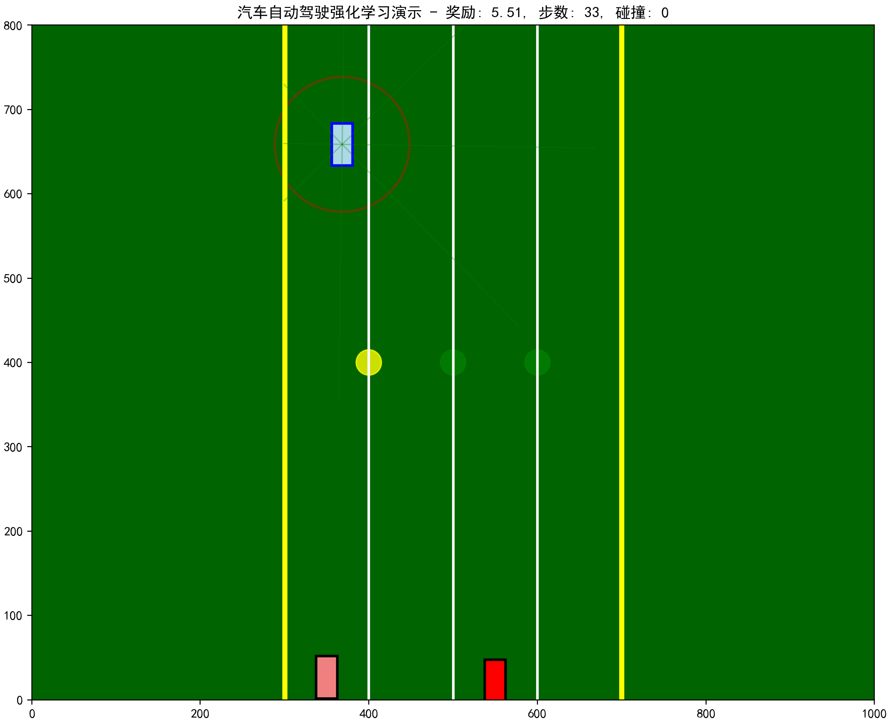
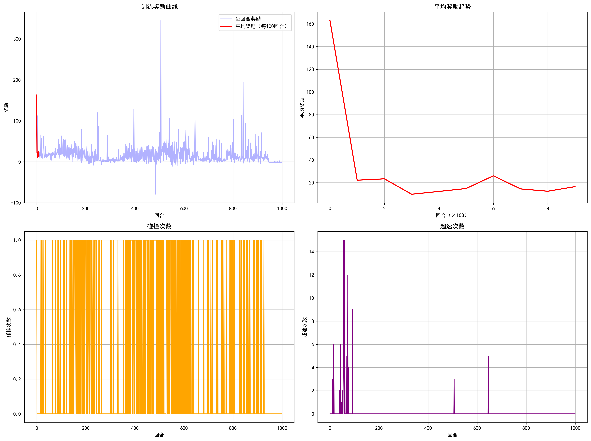

# 23 | 机器人控制：从机械臂到自动驾驶（下）

你好！欢迎来到强化学习的第二十三讲。这节课我们将探索强化学习在自动驾驶中的应用与发展。

通过本节课的学习，你将能够：

- 理清两大场景的技术关联：识别机械臂的运动学控制、传感器融合经验如何为自动驾驶的路径跟踪、动力学控制提供借鉴，理解强化学习从“结构化环境精确控制”到“动态环境自适应决策”的技术演进。

## 一、强化学习在自动驾驶中的应用与发展

在自动驾驶技术向 L4 及以上级别突破的过程中，传统方法在复杂交通场景、未知风险应对及智能决策进化等方面逐渐显露出瓶颈。如何让自动驾驶汽车真正具备接近甚至超越人类驾驶员的环境感知、行为决策与动态控制能力，成为行业亟待解决的核心问题。

## 1.1 自动驾驶智能水平的评判与现状

如何判断自动驾驶汽车的智能水平？从生物大脑视角切入是重要思路。普遍观点认为，生物智能高低与其大脑神经元数量密切相关。若以深度神经网络作为智能承载，智能体（Agent）的智能性也与人工神经网络规模直接相关。

当前，用于自动驾驶汽车的神经网络规模约为百万或千万级别，这与典型哺乳动物的神经元数量相差甚远，且单个机器神经元能力远不及人类神经元。因此，现有自动驾驶技术远未达到人类驾驶智能，仅适用于简单稀疏交通工况，无法应对城市复杂道路交通场景，对未知场景的适应能力也存在不足。

传统自动驾驶技术同样面临瓶颈。基于规则库或模型预测控制（MPC）的方法，在处理城市复杂交通流、非结构化道路及“长尾”场景时，局限性日益凸显。而强化学习凭借“自我学习、试错进化”的独特范式，为攻克这些难题提供了新可能，且主要应用于自动驾驶的决策与控制环节。

- 决策层面：可模拟人类驾驶员在复杂交通流中的行为博弈，解决路口通行、匝道汇入、超车和跟车等复杂场景的决策问题。

- 控制层面：强化学习智能体通过学习，能实现对车辆的精准运动控制，如路径跟踪和车道保持，在各种路况和车速下输出最佳前轮转角和加减速指令。

强化学习的潜力在其他领域已有亮眼体现。在围棋智能突破中，谷歌 DeepMind 的第一代围棋智能（AlphaGo）结合监督学习与强化学习训练落子决策智能，具备战胜人类职业棋手的能力；其升级版本 AlphaZero 采用自我更新、自我进化机制，仅用 21 天自我学习就战胜此前的AlphaGo 版本，充分展示出强化学习类似人类学习机制的巨大潜力。

## 1.2 强化学习应用于自动驾驶的现实挑战与技术框架

针对这一问题，行业形成了“车路云闭环训练”的核心技术路线，其基本原理为：通过车端传感器获取车辆状态及周围环境信息，借助车云或车路云通信技术将数据上传至云端平台；云端利用大规模算力实现自动驾驶策略的快速迭代训练，训练成熟的策略再下载到车端进行测试与应用。通过这一“感知 - 训练 - 部署”的闭环循环，自动驾驶系统的感知、决策、控制性能可逐步提升，最终从协同式驾驶辅助，过渡到协同式环境感知与决策控制，实现城市道路场景的高级别自动驾驶。

从决策控制功能的演进来看，自动驾驶决控系统已历经三代技术变革，每一代都对应着智能水平的显著提升，而强化学习正是第三代技术的核心驱动力。

第一代：专家规则型决控（代表企业 / 机构：谷歌、特斯拉早期）。该系统完全依靠专家经验制定驾驶规则，实现行为选择与轨迹规划。但其最大制约在于“人类经验的有限性”——面对城市交通中的突发场景（如行人横穿、车辆违规变道），规则库无法覆盖所有情况，导致智能性不足。数据显示，其在复杂交通工况下的事故率约为人类驾驶员的百倍以上，难以满足安全需求。

第二代：数据驱动型决控（代表企业 / 机构：英伟达、CMU）。该系统通过自然驾驶数据直接拟合神经网络策略，试图通过“数据量堆砌”提升泛化能力。但它面临两大核心问题：一是“长尾数据困境”，罕见场景（如暴雨天的障碍物识别、特殊交通标志）的数据样本极少，需海量数据（权威机构估计至少需百亿公里自然驾驶数据）才能覆盖，导致成本高、耗时久；二是“上限瓶颈”，监督学习机制只能复刻人类驾驶员的平均水平，无法实现超越，难以突破人类驾驶的安全与效率天花板。

第三代：类脑学习型决控（代表企业 / 机构：MIT、清华大学）。该系统以强化学习理论为核心，结合自动驾驶仿真平台与实车运行数据，通过“自主学习进化”方式优化策略，目标是实现“超越人类驾驶员”的自动驾驶能力。其优势在于：无需依赖海量标注数据，可通过仿真试错快速积累经验；能主动学习最优策略，而非被动复刻人类行为，为提升智能性提供了关键路径，成为当前自动驾驶技术发展的重要方向。

## 1.3 自动驾驶决控系统的技术变革

目前，全球自动驾驶行业在强化学习的应用上，已形成两条截然不同但又相互融合的技术路径，分别以特斯拉和 Waymo 为代表；国内玩家则结合自身场景特点，探索出务实的混合路线。

### 特斯拉：数据驱动的“影子模式”与端到端之路

特斯拉的核心优势在于其庞大的“数据飞轮”与独特的“影子模式”。全球数百万辆已部署车辆会在后台持续运行自动驾驶系统，将系统决策与人类驾驶员的实际行为进行对比，若两者差异较大（即“边缘案例”或“长尾场景”），数据会实时回传至云端。这些真实世界数据构成了天然的强化学习训练样本，“决策差异”则成为奖励信号，驱动模型持续优化。

同时，特斯拉正从传统“感知 - 规控”模块化架构，向“端到端（End-to-End）”架构演进：其 FSDBeta V12 引入基于 Transformer 的端到端模型，直接学习从原始传感器输入（摄像头、雷达数据）到车辆控制指令（转向、加减速）的映射关系。这一架构高度依赖其庞大的数据量与强大的训练算力（如 Dojo 超级计算机），通过海量数据驱动智驾模型快速迭代，以提升策略的鲁棒性与泛化能力。

### Waymo：仿真优先的模拟驱动学习

与特斯拉依赖真实数据不同，Waymo 更强调“仿真环境中的大规模训练”。Waymo Driver 的开发经验，既包括公共道路行驶的数百万英里，更涵盖模拟环境中行驶的数十亿英里——其自研的 Waymax 模拟器专为大规模强化学习设计，可利用 Waymo Open Motion Dataset（WOMD）实例化现实交通场景，并提供多种 RL 接口进行训练。

这种模式的核心优势在于“安全与高效”：在仿真环境中，系统可无风险地进行大量试错探索，解决真实世界中 RL 训练的安全性问题；同时，Waymo 通过数据增强提升模拟器真实性，利用强化学习微调模拟交通流，使其更接近真实物理规律，从源头缓解“虚实迁移”的核心难题。

### 国内玩家：混合实践与务实路线

国内学术与产业界结合场景需求，探索出更具落地性的混合路线。例如，清华大学李升波教授团队提出“混合型强化学习及其集成式决控（IDC）架构”，模拟人类驾驶员“先模仿、再优化”的学习过程，让自动驾驶汽车具备自我学习与进化能力，并通过实车测试验证了方法的有效性。

地平线等企业则采用“三阶段训练范式”的务实路线：第一阶段进行感知与规划预训练，夯实基础能力；第二阶段通过模仿学习实现“冷启动”，快速适配常见场景；第三阶段利用强化学习进行“后训练”，重点优化长尾场景与分布外情况，最终提升模型的鲁棒性。

## 1.4 强化学习在自动驾驶中的具体应用进展

经过多年发展，强化学习在自动驾驶的运动控制、行为决策及特定任务中，已从理论研究走向实践应用，取得显著进展。

### 运动控制：精准实现路径跟踪与车道保持。

在运动控制领域，强化学习的核心价值是让车辆在复杂工况下（如不同车速、路面附着系数变化），仍能保持精准的动态响应。例如，有研究提出基于深度 Q-Learning（DQN）神经网络的转向控制策略，通过训练让智能体自适应不同路况与车速，输出最优前轮转角，显著提升路径跟踪的精度与稳定性；另有研究提出“双估计强化学习 + 前向预测控制（DEQL-FPC）”的运动控制框架，解决了传统 RL 因“单步决策”导致的次优控制序列问题，在路径跟踪与局部避障任务中表现出明显优越性。

### 行为决策：应对复杂交通博弈与场景决策

城市交通中，自动驾驶汽车需与各类动态交通参与者（车辆、行人、骑行者）交互，传统决策方法难以应对这种“博弈场景”。强化学习（尤其是多智能体强化学习）能通过学习交互规律，做出更优、更“拟人化”的决策。例如，在路口通行、匝道汇入等场景中，RL 可自主学习通行优先级判断；在协作自适应巡航控制（CACC）研究中，“通信感知强化学习（CA-RL）框架”通过前向与后向信息传递，让车辆高效融合周边车辆信息，大幅提升交通流效率与安全性。

### 特定任务：高效完成自动泊车与赛道竞速

在目标明确、边界清晰的特定任务中，强化学习表现尤为突出。例如，在自动驾驶赛车（Autonomous Racing, AR）领域，车辆需逼近性能极限，传统方法难以应对非线性与高速动态特性；而基于深度强化学习（如 PPO 算法）的赛车智能体，可在卡耐基梅隆大学 ROAR 项目中自主学习最优赛车线，最终实现超越人类驾驶员的圈速，证明了 RL 在“极限控制问题”上的独特优势。在自动泊车任务中，RL 也能通过学习不同车位（垂直、平行、斜列）的空间约束，输出精准的转向与速度控制指令，提升泊车效率与成功率。

## 1.5 强化学习在自动驾驶应用中的核心挑战与解决方案

尽管强化学习在自动驾驶中应用前景广阔，但仍面临三大核心挑战，这些挑战直接决定了技术落地的安全性与可行性。

挑战 1：安全性矛盾——试错学习与绝对安全的冲突

强化学习的“试错学习”机制是其核心优势，但也与自动驾驶“零事故”的安全要求存在根本矛盾：训练过程中，智能体需通过探索未知行为优化策略，而探索可能导致危险动作（如急刹、违规变道），在真实道路中可能引发事故。传统解决方案是将“碰撞”设为巨大负奖励，但这种“软惩罚”无法提供绝对安全保障。

针对这一挑战，行业探索出三类解决方案：

- 安全约束强化学习（Safe RL）：将安全问题建模为“约束型马尔可夫决策过程（CMDP）”，把安全性作为“硬约束”而非“软惩罚”。例如，通过拉格朗日乘子法将安全约束整合到 DQN、MADDPG 等算法中，确保策略优化过程中不突破安全边界；或结合人类风险偏好，在CMDP 中计算成本限制，搭配模型预测控制（MPC）设计“动作屏蔽机制”，过滤不安全动作。

- 安全过滤器（Safety Filter）：采用“RL + 安全验证”的混合架构，在 RL 输出决策后，增加一个实时安全验证模块。例如，某专利提出将 RL 与 MPC 结合，RL 生成动作后，安全过滤器在预测时域内验证动作安全性，仅执行通过验证的指令，兼顾 RL 的高性能与 MPC 的安全性。

- 可解释知识模型：利用责任敏感安全模型（RSS）等可解释框架设计“安全掩码”，在训练与测试中强制约束智能体行为，确保任何情况下不发生碰撞。

挑战 2：样本效率与泛化能力——数据饥渴与长尾困境

自动驾驶场景的复杂性，导致强化学习面临“样本效率低”与“泛化能力不足”的双重问题：

- 样本效率低：RL 训练需大量环境交互，尤其在“稀疏奖励任务”中（多数状态下无有效奖励），智能体难以获得反馈，学习进程缓慢；且真实道路交互成本极高，难以支撑大规模训练。

- 泛化能力不足：现实交通存在海量“长尾场景”（如特殊交通标志、行人异常动作），RL 模型在训练场景中表现优异，但面对未见过的场景时，性能会大幅下降。

解决这些问题的核心方案包括：

- 提高样本利用率：离线强化学习（Offline RL）通过静态离线数据集训练，摆脱对在线交互的依赖，可利用已收集的大规模低成本数据，大幅降低样本获取成本。

- 增强探索机制：设计更高效的探索策略（如基于好奇心的探索、优先级经验回放），让智能体在更少交互中获取“高价值样本”，加速学习进程。

- 多范式集成学习：将模仿学习（IL）与强化学习结合，先用 IL 基于专家数据完成“冷启动”，快速适配常见场景；再用 RL 微调策略，优化长尾场景性能。研究表明，这种混合方法可将关键风险事件的碰撞率降低超 38%。

挑战 3：虚实迁移鸿沟（Sim-to-Real Gap）——仿真与现实的“最后一公里”

由于真实道路试错风险高、成本大，绝大多数 RL 训练在仿真环境中进行，但仿真与现实存在“域差距”（如物理模型不精确、传感器噪声差异、光照材质非线性），导致仿真中表现优异的策略，在真实道路中可能失效，这就是“虚实迁移鸿沟”。

缩小这一鸿沟的主要方法有：

- 数据驱动的仿真：利用真实场景数据优化仿真环境，例如蔚来“世界模型（NWM）”架构，通过日行千万公里的真实数据筛选重点场景，结合三维重建生成新场景，提升仿真真实性。

- 域随机化与域适应：域随机化通过随机调整仿真中的光照、传感器噪声、物体外观等参数，迫使模型学习“泛化性特征”；域适应则通过最优传输理论（如“检索增强学习框架RALAD”），在仿真与真实数据间建立特征映射，通过微调缩小差距。

- 离线强化学习：直接在真实世界数据集上训练，从根本上绕开虚实迁移问题，为策略获取提供安全高效的路径。

解决这些挑战的方案包括：

- 提高样本利用率：离线强化学习通过在静态、离线数据集上学习，从根本上解决了对在线交互的依赖，使得利用大规模、低成本的已收集数据成为可能。

- 增强探索机制：学习过程中的数据分布受到动作策略的影响，因此，设计更有效的探索机制，可以在更少的交互次数下获得更有价值的样本数据，从而加速学习进程。

- 多范式集成学习：混合学习范式，如将模仿学习与强化学习相结合，可以有效解决样本效率问题。例如，先用 IL 基于专家数据进行“冷启动”预训练，再通过 RL 进行微调，可以显著降低数据需求。这种方法利用 IL 的计算高效性初始化模型，再通过 RL 的奖励机制提升其在未见过场景的鲁棒性 。一项研究表明，这种混合方法能在应对关键风险事件时，将碰撞率降低超过 38%。

## 1.6 强化学习在自动驾驶应用中与大语言模型的结合

随着人工智能技术的发展，强化学习正与其他前沿技术融合，为自动驾驶注入更高阶的智能，主要体现在两大方向：大语言模型（LLM）与具身智能的结合、多智能体强化学习（MARL）的群体协作。

### 大语言模型与具身智能：赋予高阶认知与可解释性

自动驾驶汽车本质是“具身智能（Embodied AI）”的典型形态——通过物理实体（汽车）与环境交互，实现感知、学习与决策。而大语言模型（LLM）在复杂推理与自然语言理解上的突破，正为具身智能赋予更高阶的能力。

- 提升认知与规划能力：LLM 可将运动规划问题重构为语言建模问题，例如 GPT-Driver 能生成驾驶轨迹，并以自然语言解释决策逻辑（如“减速是因为前方行人横穿马路”），提升系统透明度与可信度；同时，LLM 能理解复杂场景意图（如预测行人未来动作），帮助系统做出更安全的决策，其知识驱动的决策成功率显著高于传统方法。

- 技术协同与生态拓展：自动驾驶与具身智能在核心技术（传感器融合、实时控制、数据闭环、仿真）上高度共通。当自动驾驶在 L3 + 级别面临瓶颈时，将核心能力扩展到服务机器人、智能物流等具身智能赛道，成为技术与资本的自然选择——近期多位自动驾驶技术专家投身具身智能创业，正是这一趋势的体现，预示着人工智能从“虚拟交互”向“物理世界交互”的宏大升级。

### 多智能体强化学习（MARL）：从单车智能到群体智能

传统自动驾驶研究聚焦“单车智能”，即单辆车独立决策，但现实交通是多参与者（自动驾驶车、人类驾驶车、行人）构成的复杂交互系统，单智能体 RL 难以应对这种“群体博弈”。而多智能体强化学习（MARL）通过训练智能体团队协同完成目标，在交通效率与安全性上展现出巨大潜力。

- 典型应用场景：在协作自适应巡航控制（CACC）中，车辆通过 V2V 通信共享状态信息，MARL 可让车队在动态场景下（如前车减速、车道合并）协同决策，减少跟车距离、降低急刹频率，提升交通流效率；在城市路口，MARL 能协调多方向车辆通行，优化通行顺序，减少拥堵。

- 性能提升与未来方向：研究表明，在交通震荡场景中，当 MARL 模型渗透率达 100% 时，安全隐患较纯人类驾驶环境降低超 73%。未来，MARL 的研究将集中于提升开放环境下的稳健性、优化多智能体协作效率，并结合博弈论应对其他参与者的不确定性行为，最终实现“群体智能驱动的高效交通系统”。

## 二、强化学习自动驾驶实例

强化学习自动驾驶实例，系统架构与核心组件和训练流程与奖励机制如下：

- 系统架构与核心组件：该代码实现了一个完整的汽车自动驾驶强化学习系统，采用模块化设计包含三个核心类：CarEnvironment（环境模拟器）、PPOAgent（智能体）和PolicyNetwork（神经网络）。环境模拟器构建了一个 1000×800 像素的多车道道路场景，包含 4 条车道、动态其他车辆、交通灯系统和多传感器融合系统（16 个距离传感器、视觉传感器和位置传感器）。智能体使用 PPO（Proximal Policy Optimization）算法，采用 Actor-Critic 架构，其中 Actor 网络输出连续动作（加速度和转向角），Critic 网络评估状态价值，通过经验回放和策略梯度更新来学习最优驾驶策略。

- 训练流程与奖励机制：训练过程采用回合制，每个回合最多 2000 步，智能体通过观察环境状态（包含传感器数据、车辆位置、速度等）选择动作，环境根据动作更新车辆状态并计算奖励。奖励函数设计精细，包含基础前进奖励（+0.1）、速度控制奖励（理想速度范围+0.5，超速惩罚 -0.3）、车道保持奖励、安全距离奖励、交通灯遵守奖励等，同时设置碰撞惩罚（-20）、越界惩罚（-10）和驾驶平滑性奖励。系统每 128 步更新一次策略网络，每100 回合输出训练进度，并定期保存模型检查点。

图 23-1 是实时交互式演示。该演示系统通过 matplotlib 实现了实时可视化，展示智能体在复杂交通环境中的学习过程。演示界面包含多车道道路（黄色边界线、白色车道分隔线）、主车（蓝色矩形，带红色传感器范围圆圈）、其他车辆（不同颜色的圆形障碍物）和交通灯系统。系统实时显示关键指标：当前奖励值、步数、碰撞次数等，让观众直观感受强化学习智能体如何通过试错学习逐步掌握安全驾驶技能，包括速度控制、车道保持、避障和交通规则遵守等核心驾驶能力。



- 图23-1 强化学习-自动驾驶演示

图 23-2 展示了训练性能深度分析。从训练曲线可以看出，智能体在 1000 回合训练中表现出典型的学习模式：初期奖励波动剧烈（-100 到 300+），平均奖励从 160 快速下降到 20-25 并保持相对稳定，说明智能体快速收敛到次优策略。碰撞率分析显示前 850 回合几乎每回合都发生碰撞（碰撞率接近 100%），后期有所改善但仍不稳定，反映了环境复杂性和奖励函数设计的挑战。超速行为在训练初期频繁（最高 14 次 / 回合），150 回合后显著减少，说明速度控制学习相对成功。整体而言，虽然智能体学会了基本的速度控制，但在复杂多车环境下的安全驾驶能力仍有待提升，这为后续算法优化和奖励函数调整提供了明确方向。



- 图23-2 强化学习-自动驾驶数据分析

```
"""
系统使用PPO算法训练智能体在模拟环境中进行自动驾驶。
```

- 主要特性：

```sql
1. 完整的汽车物理模拟
2. 多车道道路环境
3. 智能交通系统（其他车辆、交通灯）
4. 多传感器融合（距离、视觉、位置传感器）
5. 实时可视化展示
6. 性能评估和训练曲线
"""
import numpy as np
import matplotlib.pyplot as plt
import matplotlib.patches as patches
from matplotlib.animation import FuncAnimation
import torch
import torch.nn as nn
import torch.nn.functional as F
import torch.optim as optim
from torch.distributions import Normal
import random
import math
from collections import deque
import time
import json
from datetime import datetime
# 设置中文字体
plt.rcParams["font.family"] = ["SimHei", "WenQuanYi Micro Hei", "Heiti TC"]
plt.rcParams["axes.unicode_minus"] = False
class CarEnvironment:
   """
   汽车自动驾驶环境
   这个类模拟了一个真实的驾驶环境，包括：
   - 多车道道路
   - 其他车辆（不同驾驶风格）
   - 交通灯系统
   - 物理碰撞检测
   - 传感器模拟
   """
   def __init__(self, width=1000, height=800, lane_width=100):
       self.width = width
       self.height = height
       self.lane_width = lane_width
       self.num_lanes = 4
       # 汽车物理参数
       self.car_length = 50
       self.car_width = 25
       self.max_speed = 8.0
       self.max_steering = 0.4
       self.acceleration = 0.3
       self.deceleration = 0.5
       # 交通规则
       self.speed_limit = 5.0
       self.safe_distance = 80
       # 传感器参数
       self.sensor_range = 300
       self.num_sensors = 16
       # 重置环境
       self.reset()
   def reset(self):
       """重置环境到初始状态"""
       # 道路边界定义
       self.road_left = self.width // 2 - self.lane_width * self.num_lanes // 2
       self.road_right = self.width // 2 + self.lane_width * self.num_lanes // 2
       # 主车（我们的智能体）初始位置
       self.car_x = self.width // 2
       self.car_y = self.height - 150
       self.car_angle = 0
       self.car_speed = 0
       self.car_steering = 0
       self.car_acceleration = 0
       # 生成其他车辆
       self.other_cars = []
       self.spawn_other_cars()
       # 交通灯系统
       self.traffic_lights = []
       self.spawn_traffic_lights()
       # 统计信息
       self.total_reward = 0
       self.step_count = 0
       self.max_steps = 2000
       self.collision_count = 0
       self.speed_violations = 0
       return self.get_state()
   def spawn_other_cars(self):
       """生成其他车辆，模拟真实交通"""
       self.other_cars = []
       for _ in range(8):
           # 随机选择车道
           lane = random.randint(0, self.num_lanes - 1)
           x = self.road_left + lane * self.lane_width + self.lane_width // 2
           # 随机y位置（在屏幕上方）
           y = random.randint(-300, -50)
           # 随机速度（模拟不同驾驶风格）
           speed = random.uniform(1.5, 4.0)
           # 随机车辆类型
           car_type = random.choice(['normal', 'aggressive', 'slow'])
           if car_type == 'aggressive':
               speed *= 1.5
           elif car_type == 'slow':
               speed *= 0.7
           self.other_cars.append({
               'x': x,
               'y': y,
               'speed': speed,
               'lane': lane,
               'length': self.car_length,
               'width': self.car_width,
               'type': car_type,
               'color': 'red' if car_type == 'aggressive' else 'orange' if car_t
           })
   def spawn_traffic_lights(self):
       """生成交通灯系统"""
       self.traffic_lights = []
       for i in range(3):
           x = self.road_left + (i + 1) * self.lane_width
           y = self.height // 2
           self.traffic_lights.append({
               'x': x,
               'y': y,
               'state': random.choice(['red', 'yellow', 'green']),
               'timer': random.randint(50, 200)
           })
   def get_state(self):
       """
       获取当前状态向量
       状态包含：
       1. 主车状态（位置、速度、角度等）
       2. 传感器数据（16个方向的距离检测）
       3. 车道信息
       4. 交通灯状态
       5. 相对速度信息
       """
       state = []
       # 主车状态（6维）
       state.extend([
           self.car_x / self.width,  # 归一化x位置
           self.car_y / self.height,  # 归一化y位置
           self.car_angle / math.pi,  # 归一化角度
           self.car_speed / self.max_speed,  # 归一化速度
           self.car_steering / self.max_steering,  # 归一化转向
           self.car_acceleration / self.acceleration  # 归一化加速度
       ])
       # 传感器数据（16个方向 × 4个特征 = 64维）
       sensor_data = self.get_enhanced_sensor_data()
       state.extend(sensor_data)
       # 车道信息（6维）
       lane_info = self.get_lane_information()
       state.extend(lane_info)
       # 交通灯信息（12维）
       traffic_light_info = self.get_traffic_light_information()
       state.extend(traffic_light_info)
       # 相对速度信息（3维）
       relative_speeds = self.get_relative_speeds()
       state.extend(relative_speeds)
       return np.array(state, dtype=np.float32)
   def get_enhanced_sensor_data(self):
       """获取增强的传感器数据"""
       sensor_data = []
       # 16个方向的传感器
       for i in range(self.num_sensors):
           angle = i * 360 / self.num_sensors
           distance, object_type = self.enhanced_raycast(angle)
           sensor_data.extend([
               distance / self.sensor_range,  # 归一化距离
               1.0 if object_type == 'car' else 0.0,  # 是否检测到车辆
               1.0 if object_type == 'boundary' else 0.0,  # 是否检测到边界
               1.0 if object_type == 'traffic_light' else 0.0  # 是否检测到交通灯
           ])
       return sensor_data
   def enhanced_raycast(self, angle_deg):
       """
       增强的射线检测
       模拟激光雷达传感器，检测前方障碍物
       """
       angle_rad = math.radians(angle_deg + self.car_angle * 180 / math.pi)
       for distance in range(1, self.sensor_range):
           x = self.car_x + distance * math.cos(angle_rad)
           y = self.car_y + distance * math.sin(angle_rad)
           # 检查车辆碰撞
           for car in self.other_cars:
               if (abs(x - car['x']) < car['width'] and
                   abs(y - car['y']) < car['length']):
                   return distance, 'car'
           # 检查交通灯
           for light in self.traffic_lights:
               if (abs(x - light['x']) < 20 and
                   abs(y - light['y']) < 20):
                   return distance, 'traffic_light'
           # 检查道路边界
           if (x < self.road_left or x > self.road_right or
               y < 0 or y > self.height):
               return distance, 'boundary'
       return self.sensor_range, 'none'
   def get_lane_information(self):
       """获取车道信息"""
       lane_info = []
       # 当前车道
       current_lane = int((self.car_x - self.road_left) // self.lane_width)
       current_lane = max(0, min(current_lane, self.num_lanes - 1))
       # 车道中心距离
       lane_center = self.road_left + current_lane * self.lane_width + self.lane
       lane_distance = (self.car_x - lane_center) / (self.lane_width / 2)
       # 车道占用情况
       for lane in range(self.num_lanes):
           occupied = self.is_lane_occupied(lane)
           lane_info.append(1.0 if occupied else 0.0)
       lane_info.extend([
           current_lane / (self.num_lanes - 1),  # 归一化当前车道
           lane_distance,  # 车道中心距离
       ])
       return lane_info
   def is_lane_occupied(self, lane):
       """检查车道是否被占用"""
       lane_x = self.road_left + lane * self.lane_width + self.lane_width // 2
       for car in self.other_cars:
           if (abs(car['x'] - lane_x) < self.lane_width / 2 and
               abs(car['y'] - self.car_y) < self.safe_distance):
               return True
       return False
   def get_traffic_light_information(self):
       """获取交通灯信息"""
       light_info = []
       for light in self.traffic_lights:
           # 距离
           distance = math.sqrt((light['x'] - self.car_x)**2 + (light['y'] - sel
           distance_norm = min(distance / 200, 1.0)
           # 状态编码
           state_encoding = [0, 0, 0]
           if light['state'] == 'red':
               state_encoding[0] = 1.0
           elif light['state'] == 'yellow':
               state_encoding[1] = 1.0
           else:  # green
               state_encoding[2] = 1.0
           light_info.extend([distance_norm] + state_encoding)
       return light_info
   def get_relative_speeds(self):
       """获取相对速度信息"""
       relative_speeds = []
       # 前方车辆相对速度
       front_cars = [car for car in self.other_cars
                    if car['y'] > self.car_y and
                    abs(car['x'] - self.car_x) < self.lane_width]
       if front_cars:
           closest_car = min(front_cars, key=lambda c: c['y'] - self.car_y)
           relative_speed = (closest_car['speed'] - self.car_speed) / self.max_s
           relative_speeds.append(relative_speed)
       else:
           relative_speeds.append(0.0)
       # 左右车道车辆相对速度
       for direction in [-1, 1]:
           lane_cars = [car for car in self.other_cars
                       if abs(car['x'] - (self.car_x + direction * self.lane_wid
           if lane_cars:
               avg_speed = np.mean([car['speed'] for car in lane_cars])
               relative_speed = (avg_speed - self.car_speed) / self.max_speed
               relative_speeds.append(relative_speed)
           else:
               relative_speeds.append(0.0)
       return relative_speeds
   def step(self, action):
       """
       执行动作并返回新状态
       Args:
           action: [throttle, steering] 动作向量
       Returns:
           next_state: 新状态
           reward: 奖励
           done: 是否结束
           info: 额外信息
       """
       # 解析动作
       throttle = np.clip(action[0], -1, 1)  # 油门 [-1, 1]
       steering = np.clip(action[1], -1, 1)  # 转向 [-1, 1]
       # 更新汽车物理状态
       self.car_acceleration = throttle * self.acceleration
       self.car_speed += self.car_acceleration
       self.car_speed = np.clip(self.car_speed, -self.max_speed, self.max_speed)
       self.car_steering = steering * self.max_steering
       # 更新位置
       self.car_x += self.car_speed * math.cos(self.car_angle)
       self.car_y += self.car_speed * math.sin(self.car_angle)
       self.car_angle += self.car_steering * 0.1
       # 更新其他车辆
       self.update_other_cars()
       # 更新交通灯
       self.update_traffic_lights()
       # 计算奖励
       reward = self.calculate_advanced_reward()
       # 检查终止条件
       done = self.check_termination()
       self.total_reward += reward
       self.step_count += 1
       return self.get_state(), reward, done, {}
   def update_other_cars(self):
       """更新其他车辆（包含简单的AI行为）"""
       for car in self.other_cars:
           # 基础移动
           car['y'] += car['speed']
           # 简单的变道行为
           if random.random() < 0.01:  # 1%概率变道
               new_lane = car['lane'] + random.choice([-1, 1])
               if 0 <= new_lane < self.num_lanes:
                   car['lane'] = new_lane
                   car['x'] = self.road_left + new_lane * self.lane_width + self
           # 根据前方车辆调整速度
           front_cars = [c for c in self.other_cars
                        if c != car and c['y'] > car['y'] and
                        abs(c['x'] - car['x']) < self.lane_width]
           if front_cars:
               closest = min(front_cars, key=lambda c: c['y'] - car['y'])
               if closest['y'] - car['y'] < self.safe_distance:
                   car['speed'] *= 0.9  # 减速
           # 重新生成离开屏幕的车辆
           if car['y'] > self.height + 100:
               car['y'] = -100
               car['x'] = self.road_left + random.randint(0, self.num_lanes - 1)
               car['speed'] = random.uniform(1.5, 4.0)
               car['lane'] = int((car['x'] - self.road_left) // self.lane_width)
   def update_traffic_lights(self):
       """更新交通灯状态"""
       for light in self.traffic_lights:
           light['timer'] -= 1
           if light['timer'] <= 0:
               if light['state'] == 'red':
                   light['state'] = 'green'
                   light['timer'] = random.randint(100, 200)
               elif light['state'] == 'green':
                   light['state'] = 'yellow'
                   light['timer'] = 20
               else:  # yellow
                   light['state'] = 'red'
                   light['timer'] = random.randint(50, 150)
   def calculate_advanced_reward(self):
       """
       计算高级奖励函数
       奖励函数设计原则：
       1. 鼓励安全驾驶
       2. 鼓励遵守交通规则
       3. 鼓励高效通行
       4. 惩罚危险行为
       """
       reward = 0
       # 基础奖励（鼓励前进）
       reward += 0.1
       # 速度奖励（鼓励适当速度）
       speed_ratio = self.car_speed / self.speed_limit
       if 0.8 <= speed_ratio <= 1.2:
           reward += 0.5  # 理想速度范围
       elif speed_ratio > 1.2:
           reward -= 0.3  # 超速惩罚
           self.speed_violations += 1
       # 车道保持奖励
       current_lane = int((self.car_x - self.road_left) // self.lane_width)
       lane_center = self.road_left + current_lane * self.lane_width + self.lane
       lane_distance = abs(self.car_x - lane_center)
       reward += (1 - lane_distance / (self.lane_width / 2)) * 0.3
       # 安全距离奖励
       front_cars = [car for car in self.other_cars
                    if car['y'] > self.car_y and
                    abs(car['x'] - self.car_x) < self.lane_width]
       if front_cars:
           closest_car = min(front_cars, key=lambda c: c['y'] - self.car_y)
           distance = closest_car['y'] - self.car_y
           if distance > self.safe_distance:
               reward += 0.2
           elif distance < self.safe_distance / 2:
               reward -= 0.5  # 跟车太近惩罚
       # 交通灯遵守奖励
       for light in self.traffic_lights:
           if (abs(light['x'] - self.car_x) < self.lane_width and
               abs(light['y'] - self.car_y) < 50):
               if light['state'] == 'red' and self.car_speed > 0:
                   reward -= 1.0  # 闯红灯惩罚
               elif light['state'] == 'green' and self.car_speed > 0:
                   reward += 0.3  # 绿灯通行奖励
       # 碰撞惩罚
       if self.check_collision_with_cars(self.car_x, self.car_y):
           reward -= 20
           self.collision_count += 1
       # 越界惩罚
       if (self.car_x < self.road_left or self.car_x > self.road_right or
           self.car_y < 0 or self.car_y > self.height):
           reward -= 10
       # 平滑驾驶奖励
       reward -= abs(self.car_steering) * 0.1  # 急转弯惩罚
       reward -= abs(self.car_acceleration) * 0.05  # 急加速/急刹车惩罚
       return reward
   def check_collision_with_cars(self, x, y):
       """检查是否与其他车辆碰撞"""
       for car in self.other_cars:
           if (abs(x - car['x']) < car['width'] and
               abs(y - car['y']) < car['length']):
               return True
       return False
   def check_termination(self):
       """检查是否终止"""
       # 碰撞检测
       if self.check_collision_with_cars(self.car_x, self.car_y):
           return True
       # 越界检测
       if (self.car_x < self.road_left or self.car_x > self.road_right or
           self.car_y < 0 or self.car_y > self.height):
           return True
       # 步数限制
       if self.step_count >= self.max_steps:
           return True
       return False
   def render(self, ax):
       """渲染环境（用于可视化）"""
       ax.clear()
       # 绘制道路
       for i in range(self.num_lanes + 1):
           x = self.road_left + i * self.lane_width
           ax.axvline(x, color='white', linewidth=2)
       # 绘制道路边界
       ax.axvline(self.road_left, color='yellow', linewidth=4)
       ax.axvline(self.road_right, color='yellow', linewidth=4)
       # 绘制交通灯
       for light in self.traffic_lights:
           color = light['state']
           circle = patches.Circle((light['x'], light['y']), 15,
                                 color=color, alpha=0.8)
           ax.add_patch(circle)
       # 绘制其他车辆
       for car in self.other_cars:
           rect = patches.Rectangle(
               (car['x'] - car['width']/2, car['y'] - car['length']/2),
               car['width'], car['length'],
               linewidth=2, edgecolor='black', facecolor=car['color']
           )
           ax.add_patch(rect)
       # 绘制主车（我们的智能体）
       car_rect = patches.Rectangle(
           (self.car_x - self.car_width/2, self.car_y - self.car_length/2),
           self.car_width, self.car_length,
           linewidth=2, edgecolor='blue', facecolor='lightblue'
       )
       ax.add_patch(car_rect)
       # 绘制传感器射线
       for i in range(0, self.num_sensors, 2):  # 每2个传感器画一条线
           angle = i * 360 / self.num_sensors
           distance, _ = self.enhanced_raycast(angle)
           angle_rad = math.radians(angle + self.car_angle * 180 / math.pi)
           end_x = self.car_x + distance * math.cos(angle_rad)
           end_y = self.car_y + distance * math.sin(angle_rad)
           ax.plot([self.car_x, end_x], [self.car_y, end_y], 'g-', alpha=0.3, li
       # 绘制安全距离
       safety_circle = patches.Circle((self.car_x, self.car_y), self.safe_distan
                                    fill=False, color='red', alpha=0.3, linewidt
       ax.add_patch(safety_circle)
       ax.set_xlim(0, self.width)
       ax.set_ylim(0, self.height)
       ax.set_aspect('equal')
       ax.set_title(f'汽车自动驾驶强化学习演示 - 奖励: {self.total_reward:.2f}, 步数:
       ax.set_facecolor('darkgreen')
class PPOAgent:
   """
   PPO (Proximal Policy Optimization) 智能体
   PPO是一种先进的策略梯度算法，具有以下优点：
   1. 训练稳定
   2. 样本效率高
   3. 适合连续控制任务
   4. 有理论保证
   """
   def __init__(self, state_size, action_size, lr=3e-4, gamma=0.99,
                eps_clip=0.2, k_epochs=4, entropy_coef=0.01):
       self.state_size = state_size
       self.action_size = action_size
       self.lr = lr
       self.gamma = gamma
       self.eps_clip = eps_clip
       self.k_epochs = k_epochs
       self.entropy_coef = entropy_coef
       # 策略网络
       self.policy = PolicyNetwork(state_size, action_size).to(device)
       self.optimizer = optim.Adam(self.policy.parameters(), lr=lr)
       # 经验缓冲区
       self.memory = PPOMemory()
   def select_action(self, state):
       """选择动作"""
       state = torch.FloatTensor(state).unsqueeze(0).to(device)
       with torch.no_grad():
           action_mean, action_std, value = self.policy(state)
       dist = Normal(action_mean, action_std)
       action = dist.sample()
       log_prob = dist.log_prob(action).sum(dim=-1)
       return action.cpu().numpy()[0], log_prob.cpu().numpy()[0], value.cpu().nu
   def store_transition(self, state, action, reward, next_state, done, log_prob,
       """存储经验"""
       self.memory.store(state, action, reward, next_state, done, log_prob, valu
   def update(self):
       """更新策略网络"""
       if len(self.memory.states) == 0:
           return
       # 计算折扣回报
       rewards = []
       discounted_reward = 0
       for reward, done in zip(reversed(self.memory.rewards), reversed(self.memo
           if done:
               discounted_reward = 0
           discounted_reward = reward + self.gamma * discounted_reward
           rewards.insert(0, discounted_reward)
       # 转换为张量
       states = torch.FloatTensor(self.memory.states).to(device)
       actions = torch.FloatTensor(self.memory.actions).to(device)
       old_log_probs = torch.FloatTensor(self.memory.log_probs).to(device)
       values = torch.FloatTensor(self.memory.values).to(device)
       rewards = torch.FloatTensor(rewards).to(device)
       # 标准化奖励
       rewards = (rewards - rewards.mean()) / (rewards.std() + 1e-8)
       # PPO更新
       for _ in range(self.k_epochs):
           action_means, action_stds, new_values = self.policy(states)
           dist = Normal(action_means, action_stds)
           new_log_probs = dist.log_prob(actions).sum(dim=-1)
           # 计算比率
           ratio = torch.exp(new_log_probs - old_log_probs)
           # 计算优势
           advantages = rewards - values.detach()
           # 计算损失
           surr1 = ratio * advantages
           surr2 = torch.clamp(ratio, 1 - self.eps_clip, 1 + self.eps_clip) * ad
           actor_loss = -torch.min(surr1, surr2).mean()
           critic_loss = F.mse_loss(new_values.squeeze(), rewards)
           entropy = dist.entropy().sum(dim=-1).mean()
           total_loss = actor_loss + 0.5 * critic_loss - self.entropy_coef * ent
           self.optimizer.zero_grad()
           total_loss.backward()
           self.optimizer.step()
       # 清空经验缓冲区
       self.memory.clear()
class PolicyNetwork(nn.Module):
   """
   策略网络
   使用Actor-Critic架构：
   - Actor: 输出动作的均值和标准差
   - Critic: 输出状态价值
   """
   def __init__(self, state_size, action_size, hidden_size=512):
       super(PolicyNetwork, self).__init__()
       # 共享特征提取层
       self.fc1 = nn.Linear(state_size, hidden_size)
       self.fc2 = nn.Linear(hidden_size, hidden_size)
       self.fc3 = nn.Linear(hidden_size, hidden_size)
       self.fc4 = nn.Linear(hidden_size, hidden_size)
       # Actor分支：输出动作
       self.action_mean = nn.Linear(hidden_size, action_size)
       self.action_std = nn.Linear(hidden_size, action_size)
       # Critic分支：输出价值
       self.value = nn.Linear(hidden_size, 1)
   def forward(self, x):
       x = F.relu(self.fc1(x))
       x = F.relu(self.fc2(x))
       x = F.relu(self.fc3(x))
       x = F.relu(self.fc4(x))
       # Actor输出
       action_mean = torch.tanh(self.action_mean(x))  # 限制在[-1, 1]
       action_std = F.softplus(self.action_std(x)) + 1e-5  # 确保为正
       # Critic输出
       value = self.value(x)
       return action_mean, action_std, value
class PPOMemory:
   """PPO经验缓冲区"""
   def __init__(self):
       self.states = []
       self.actions = []
       self.rewards = []
       self.next_states = []
       self.dones = []
       self.log_probs = []
       self.values = []
   def store(self, state, action, reward, next_state, done, log_prob, value):
       self.states.append(state)
       self.actions.append(action)
       self.rewards.append(reward)
       self.next_states.append(next_state)
       self.dones.append(done)
       self.log_probs.append(log_prob)
       self.values.append(value)
   def clear(self):
       self.states.clear()
       self.actions.clear()
       self.rewards.clear()
       self.next_states.clear()
       self.dones.clear()
       self.log_probs.clear()
       self.values.clear()
# 设备配置
device = torch.device("cuda" if torch.cuda.is_available() else "cpu")
print(f"使用设备: {device}")
def train_agent(episodes=1000, update_frequency=128, save_interval=100):
   """
   训练智能体
   Args:
       episodes: 训练回合数
       update_frequency: 更新频率
       save_interval: 保存间隔
   """
   print("=" * 60)
   print("开始训练汽车自动驾驶智能体")
   print("=" * 60)
   env = CarEnvironment()
   state_size = len(env.get_state())
   action_size = 2
   agent = PPOAgent(state_size, action_size)
   episode_rewards = []
   avg_rewards = []
   collision_rates = []
   speed_violations = []
   start_time = time.time()
   for episode in range(episodes):
       state = env.reset()
       episode_reward = 0
       for step in range(2000):
           action, log_prob, value = agent.select_action(state)
           next_state, reward, done, _ = env.step(action)
           agent.store_transition(state, action, reward, next_state, done, log_p
           state = next_state
           episode_reward += reward
           if done:
               break
       episode_rewards.append(episode_reward)
       collision_rates.append(env.collision_count)
       speed_violations.append(env.speed_violations)
       # 更新智能体
       if len(agent.memory.states) >= update_frequency:
           agent.update()
       # 打印进度
       if episode % 100 == 0:
           avg_reward = np.mean(episode_rewards[-100:])
           avg_collision = np.mean(collision_rates[-100:])
           avg_speed_violation = np.mean(speed_violations[-100:])
           avg_rewards.append(avg_reward)
           elapsed_time = time.time() - start_time
           print(f"回合 {episode:4d} | 平均奖励: {avg_reward:6.2f} | "
                 f"平均碰撞: {avg_collision:4.1f} | 超速次数: {avg_speed_violation:
                 f"用时: {elapsed_time:.1f}s")
       # 保存模型
       if episode % save_interval == 0 and episode > 0:
           torch.save(agent.policy.state_dict(), f'autonomous_driving_model_epis
   # 保存最终模型
   torch.save(agent.policy.state_dict(), 'autonomous_driving_model_final.pth')
   print(f"\n训练完成！模型已保存为 'autonomous_driving_model_final.pth'")
   return agent, episode_rewards, avg_rewards, collision_rates, speed_violations
def test_agent(agent, episodes=3, render=True):
   """
   测试智能体
   Args:
       agent: 训练好的智能体
       episodes: 测试回合数
       render: 是否显示可视化
   """
   print("=" * 60)
   print("开始测试智能体")
   print("=" * 60)
   env = CarEnvironment()
   if render:
       fig, ax = plt.subplots(figsize=(15, 10))
   test_rewards = []
   for episode in range(episodes):
       state = env.reset()
       episode_reward = 0
       for step in range(2000):
           with torch.no_grad():
               action, _, _ = agent.select_action(state)
           next_state, reward, done, _ = env.step(action)
           state = next_state
           episode_reward += reward
           if render:
               env.render(ax)
               plt.pause(0.01)
           if done:
               break
       test_rewards.append(episode_reward)
       print(f"测试回合 {episode + 1}: 奖励 = {episode_reward:.2f}, "
             f"碰撞次数 = {env.collision_count}, 超速次数 = {env.speed_violations}"
       if render:
           time.sleep(1)
   if render:
       plt.close()
   avg_test_reward = np.mean(test_rewards)
   print(f"\n测试完成！平均奖励: {avg_test_reward:.2f}")
   return test_rewards
def plot_training_curves(episode_rewards, avg_rewards, collision_rates, speed_vio
   """绘制训练曲线"""
   plt.figure(figsize=(16, 12))
   # 子图1：每回合奖励
   plt.subplot(2, 2, 1)
   plt.plot(episode_rewards, alpha=0.3, color='blue')
   plt.plot(avg_rewards, color='red', linewidth=2)
   plt.title('训练奖励曲线')
   plt.xlabel('回合')
   plt.ylabel('奖励')
   plt.legend(['每回合奖励', '平均奖励（每100回合）'])
   plt.grid(True)
   # 子图2：平均奖励
   plt.subplot(2, 2, 2)
   plt.plot(avg_rewards, color='red', linewidth=2)
   plt.title('平均奖励趋势')
   plt.xlabel('回合（×100）')
   plt.ylabel('平均奖励')
   plt.grid(True)
   # 子图3：碰撞次数
   plt.subplot(2, 2, 3)
   plt.plot(collision_rates, color='orange')
   plt.title('碰撞次数')
   plt.xlabel('回合')
   plt.ylabel('碰撞次数')
   plt.grid(True)
   # 子图4：超速次数
   plt.subplot(2, 2, 4)
   plt.plot(speed_violations, color='purple')
   plt.title('超速次数')
   plt.xlabel('回合')
   plt.ylabel('超速次数')
   plt.grid(True)
   plt.tight_layout()
   plt.savefig('autonomous_driving_training_curves.png', dpi=300, bbox_inches='t
   plt.show()
def create_demo_animation(agent, duration=10):
   """创建演示动画"""
   print("创建演示动画...")
   env = CarEnvironment()
   fig, ax = plt.subplots(figsize=(15, 10))
   def animate(frame):
       if frame == 0:
           env.reset()
       state = env.get_state()
       with torch.no_grad():
           action, _, _ = agent.select_action(state)
       next_state, reward, done, _ = env.step(action)
       env.render(ax)
       if done:
           env.reset()
   # 创建动画
   anim = FuncAnimation(fig, animate, frames=duration*30, interval=33, repeat=Tr
   # 保存动画
   anim.save('autonomous_driving_demo.gif', writer='pillow', fps=30)
   print("动画已保存为 'autonomous_driving_demo.gif'")
   plt.show()
   return anim
def save_training_results(episode_rewards, avg_rewards, collision_rates, speed_vi
   """保存训练结果"""
   results = {
       'episode_rewards': episode_rewards,
       'avg_rewards': avg_rewards,
       'collision_rates': collision_rates,
       'speed_violations': speed_violations,
       'timestamp': datetime.now().isoformat()
   }
   with open('training_results.json', 'w', encoding='utf-8') as f:
       json.dump(results, f, indent=2, ensure_ascii=False)
   print("训练结果已保存为 'training_results.json'")
def main():
   """主函数 - 课程展示入口"""
   print("=" * 80)
   print("汽车自动驾驶强化学习课程展示")
   print("=" * 80)
   print()
   print("本演示包含以下内容：")
   print("1. 完整的汽车物理模拟环境")
   print("2. 多传感器融合系统")
   print("3. PPO强化学习算法")
   print("4. 实时可视化展示")
   print("5. 性能评估和分析")
   print()
   # 训练智能体
   print("开始训练...")
   agent, episode_rewards, avg_rewards, collision_rates, speed_violations = trai
       episodes=1000,
       update_frequency=128
   )
   # 绘制训练曲线
   print("\n绘制训练曲线...")
   plot_training_curves(episode_rewards, avg_rewards, collision_rates, speed_vio
   # 测试智能体
   print("\n开始测试...")
   test_rewards = test_agent(agent, episodes=3, render=True)
   # 保存结果
   save_training_results(episode_rewards, avg_rewards, collision_rates, speed_vi
   # 创建演示动画
   print("\n创建演示动画...")
   create_demo_animation(agent, duration=10)
   print("\n" + "=" * 80)
   print("课程展示完成！")
   print("=" * 80)
   print()
   print("生成的文件：")
   print("- autonomous_driving_model_final.pth: 训练好的模型")
   print("- autonomous_driving_training_curves.png: 训练曲线图")
   print("- autonomous_driving_demo.gif: 演示动画")
   print("- training_results.json: 训练结果数据")
```

对于 L4 + 级别的自动驾驶，强化学习是一种被认为能提升决策上限的技术探索路线，理想应用模式是“强化学习突破上限 + 规则保障下限 + 海量场景库支撑 + 全量特征输入”，但现实情况是，规则与传统控制已能覆盖 99% 的场景，且强化学习在这些常规场景中难以保证达到传统控制决策的水平。因此，强化学习的应用期待主要集中在 1% 的长尾场景，然而这类场景又需大量仿真与场景触发来实现学习对比，这恰好面临强化学习“样本类型不足而难以学好”的核心问题。

不过目前头部车企均有强化学习方案探索（需注意不同企业的强化学习应用层次与深度存在差异，且与学术界侧重端到端或直接决策的方向不同）：

- 一方面，强化学习多用于优化策略搜索以提升效率，例如特斯拉用 MCTS 搜索航点、百度Apollo 用其输出未来一段时间的位置、部分方案在规划阶段用其评估不同决策路径的价值（如面对车前自行车时选择跟随、远离还是变道等）；

- 另一方面，强化学习常在仿真环境中作为智能代理（Smart agent），模仿现实世界中人和物的决策行为，与自动驾驶车辆进行博弈，主动生成符合真实场景的人车运动状态，进而提升或验证传统算法性能。

值得注意的是，当前强化学习的主要应用领域仍集中在游戏行业，因其环境可控、稳定且任务目标明确，且自动驾驶类游戏 AI 已能实现出色表现，但这与实际自动驾驶并非同一类问题；不过目前强化学习在非游戏领域的研究热度显著提升，尤其是模仿学习与离线强化学习成果丰硕，且已在游戏工业界实现成功应用，这对降低研发成本、加速实验迭代具有重要意义。

同时需正视，不同公司的强化学习人才储备与技术水平差异较大，受业务需求、组织发展等因素影响，强化学习人才的技术能力差距明显，而强化学习技术要实现商业化落地并展现出优异实际性能，离不开大量工程实践经验与扎实的项目背景支撑。从做出 Demo 到实际落地并达成成熟商业化，不仅是单纯的技术问题，但鉴于强化学习技术路线的探索价值，整体仍看好其在自动驾驶领域的落地前景，未来有望实现突破性表现，值得期待。

## 总结

这三节课我们以“机器人控制：从机械臂到自动驾驶”为核心主题，系统串联起两大典型机器人控制场景的技术逻辑与实践方法。机械臂控制聚焦结构化环境下的精准操作，围绕运动学（正向 / 逆运动学、线性运动学）、动力学补偿及力反馈控制展开，从 DH 参数建模到雅可比矩阵应用，构建了“关节协同 - 末端精准”的控制体系；而强化学习的引入，进一步解决了传统控制在动态力反馈任务中的适配难题，通过“试错迭代”机制让机械臂在人机协作、灵巧抓取等场景中实现自适应调整，为复杂操作任务提供了智能化解决方案。

自动驾驶则是机械臂控制技术在动态开放环境中的进阶延伸，其核心在于构建“感知 - 决策 - 规划 - 控制”的完整闭环。从行业全景看，自动驾驶正通过感知架构升级（BEV+Transformer+Occupancy）、工程方案优化（轻地图、传感器降本、集中式域控）及商业化分层落地（封闭场景先行）逐步突破 L4 级技术瓶颈；在控制层面，纵向速度调节与横向路径跟踪的协同，结合车辆动力学模型，实现了安全与效率的平衡，而强化学习从“专家规则”到“类脑学习”的技术迭代，更推动自动驾驶决策从“复刻人类”向“超越人类”迈进，成为解决复杂交通博弈与长尾场景的关键路径。

机械臂与自动驾驶虽场景差异显著，却共享“感知环境 - 决策策略 - 执行控制”的核心逻辑，形成了技术上的传承与互补——机械臂的运动学控制经验为自动驾驶路径跟踪提供了理论基础，传感器融合技术则在两者间实现跨场景复用；强化学习作为贯穿其中的核心技术纽带，既解决了机械臂力反馈等精密控制问题，又突破了自动驾驶动态决策的瓶颈，推动机器人控制技术从“结构化环境精确执行”向“动态环境智能适应”持续演进，为更高阶的机器人智能化应用奠定了基础。

## 思考题

在自动驾驶决策控制场景中，强化学习常需应对“虚实迁移鸿沟”（Sim-to-Real Gap），即仿真环境中训练的最优策略，部署到真实道路后易因物理模型偏差、传感器噪声差异等问题失效。结合本节课中提到的自动驾驶技术框架（如感知 - 决策 - 规划 - 控制闭环）与强化学习应用逻辑（如仿真训练、真实环境微调），请分析：

从技术原理角度，“虚实迁移鸿沟”会对自动驾驶强化学习策略的哪两个核心环节产生最显著影响？请分别说明具体影响机制（例如对感知数据处理、控制指令执行的干扰）。

希望你通过今天的学习，对强化学习有了清晰的认识。如果有任何疑问，欢迎在讨论区留言交流！
