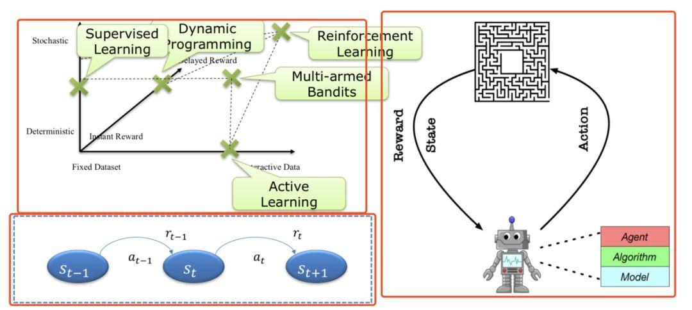
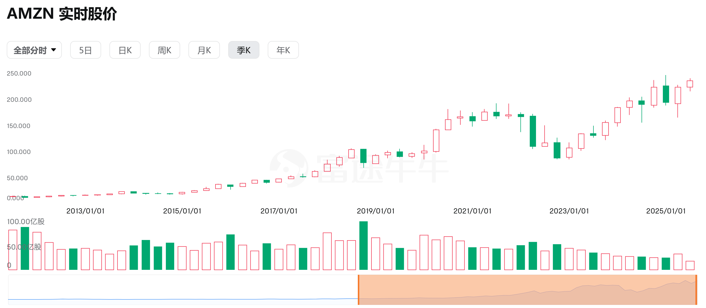
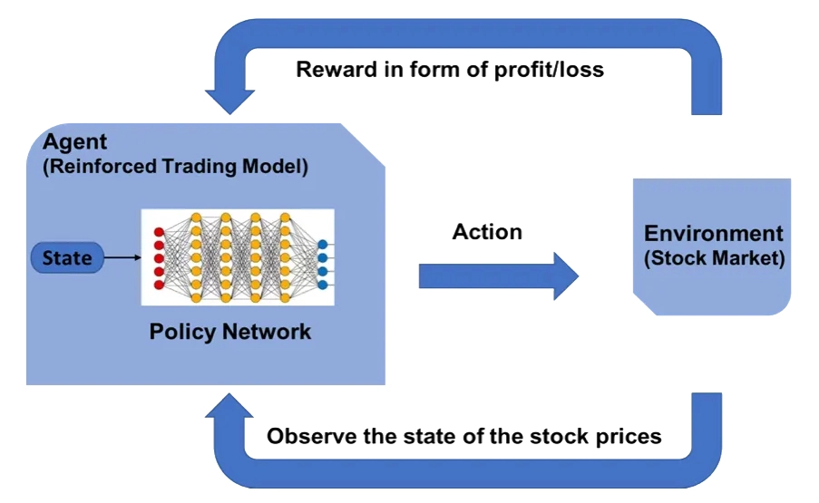
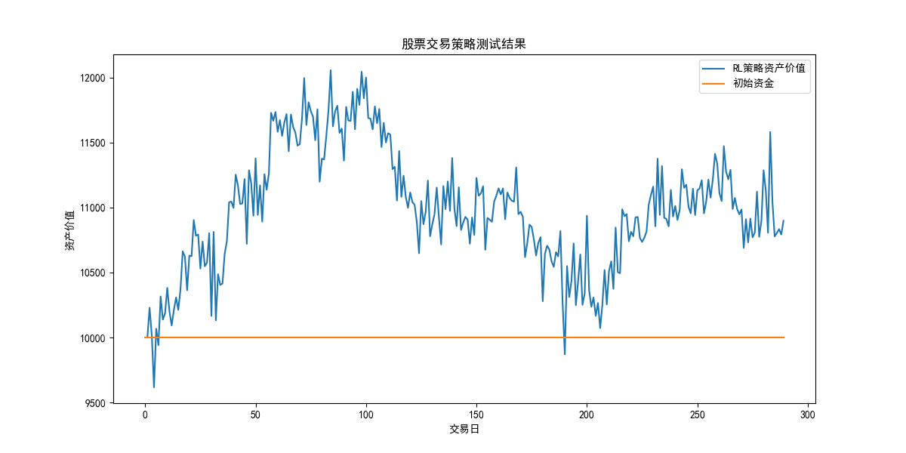
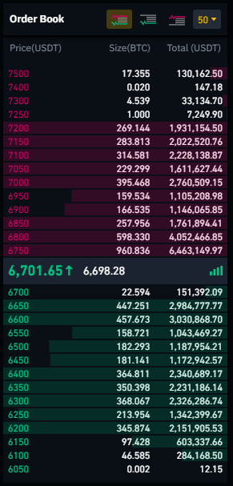

# 24 | 金融交易：从股票交易到投资组合优化（上）

欢迎来到强化学习的第二十四讲。金融交易，从来都是“不确定性”与“复杂性”交织的战场。无论是散户紧盯 K 线图的焦灼，还是机构团队应对市场波动的决策博弈，本质上都在与一个核心难题对抗：如何在瞬息万变的市场中，找到稳定且可持续的盈利逻辑？传统交易策略往往受限于人工经验的边界——依赖历史规律推导的模型，在政策突变、黑天鹅事件或市场风格切换面前，很容易陷入“失效陷阱”；而依赖主观判断的决策，又难以摆脱情绪干扰与认知偏差。

但如今，人工智能技术的浪潮正为这个领域带来全新解法，其中强化学习无疑是最具颠覆性的范式之一。它不像传统方法那样“被动拟合历史”，而是让智能体（Agent）以“主动交互”的方式探索市场：从识别价格波动规律、解读成交量信号，到动态调整资产配置比例，智能体始终在“试错 - 反馈 - 优化”的循环中学习，最终目标直指“长期收益最大化”与“风险可控化”的双重平衡。

在金融交易的两大核心场景中，强化学习的价值正被逐步验证：

- 股票交易作为最基础的金融参与形式，核心痛点在于“买卖时机的精准判断”——既要考虑单只股票的价格走势、成交量变化，又要叠加行业政策、公司财报、宏观经济数据等多维度信息。强化学习能将这些碎片化数据转化为统一的“状态信号”，通过深度模型捕捉隐藏的关联规律，让交易决策从“经验驱动”转向“数据驱动”。

- 投资组合优化则是更高维度的命题。“不要把所有鸡蛋放在一个篮子里”的分散投资逻辑，背后需要解决的是“多资产动态配置”的复杂问题：如何在股票、债券、黄金等不同品类间分配资金？如何在市场风格切换时调整权重以控制回撤？强化学习能突破传统均值 - 方差模型的静态局限，在动态市场中实时优化资产组合，实现“风险与收益的动态平衡”。

我们将用两节课，从“理论落地”的视角，层层拆解强化学习在这两大场景中的应用逻辑：从状态空间、动作空间、奖励函数的核心设计，到 DQN、DDPG 等算法的实战选型；从股票交易策略的代码实现，到投资组合优化的案例验证；更会直面市场非平稳性、数据噪声、过拟合等实际挑战，并提供可落地的解决方案。

让我们一起，揭开强化学习赋能金融交易的实战面纱。

## 一、强化学习基础回顾

在深入探讨金融交易应用之前，先简要回顾一下强化学习的基本概念和要素。如图 24-1 所示，图右边部分是最能说明强化学习的过程：一个智能体（Agent），它会跟环境（Environment）产生交互，其中 Agent 是通过 Action 来影响 Environment，Environment 会返回 Reward 和 State，这个交互过程会不断地交互迭代。



- 图24-1 强化学习的过程（出自百度大脑&DataFun AI Talk《强化学习：原理与应用》）

智能体是在环境中进行决策的主体，在金融交易场景中，它可以是一个交易算法或策略。环境则是智能体所处的外部世界，对于金融交易而言，就是整个金融市场，包括各种股票、债券、期货等金融产品的价格走势、成交量等市场数据。状态是对环境的一种描述，智能体根据当前状态来决定采取何种动作。在股票交易中，状态可以是当前股票的价格、成交量、技术指标等信息。动作是智能体在某个状态下采取的具体行动，例如在股票交易中，动作可以是买入、卖出或持有股票。奖励是环境对智能体采取某个动作后的反馈，它反映了该动作的好坏程度。在金融交易中，奖励通常与交易的盈利或亏损相关，例如盈利时给予正奖励，亏损时给予负奖励。

强化学习的目标就是让智能体通过不断地与环境交互，学习到一个最优策略，使得在长期的交互过程中获得的累积奖励最大化。常见的强化学习算法包括 Q-learning、深度 Q 网络（DQN）、策略梯度算法等。Q-learning 是一种基于值函数的强化学习算法，它通过构建一个Q 表来存储在每个状态下采取每个动作的预期奖励值，智能体根据 Q 表来选择最优动作。深度 Q 网络则是将深度学习与 Q-learning 相结合，利用深度神经网络来逼近 Q 函数，从而能够处理更加复杂的高维状态空间。策略梯度算法则是直接对策略进行优化，通过计算策略的梯度来调整策略参数，使得策略能够朝着获得更高奖励的方向发展。

## 二、强化学习在股票交易中的应用

对于投资公司与对冲基金而言，能稳定盈利的自动化股票交易策略堪称核心竞争力——它不仅能精准优化资本配置，更可助力实现投资绩效的最大化，例如显著提升预期回报。而预期回报的最大化，往往建立在对潜在收益与风险的精准预估之上。

然而，在瞬息万变、错综复杂的股票市场中，设计出持续盈利的交易策略绝非易事。尽管“制胜策略”是所有市场参与者的共同追求，但现实中，其研发过程充满了未知与挑战。

## 2.1 强化学习股票交易概述

股票交易是指股票投资者之间按照市场价格对已发行上市的股票所进行的买卖活动。股票交易的主要目标是通过低买高卖获取差价利润，或者通过长期持有股票获得股息红利收益。股票交易市场分为一级市场（发行市场）和二级市场（交易市场），我们通常所说的股票交易主要发生在二级市场。在二级市场中，股票价格受到众多因素的影响，包括公司自身的经营状况、行业发展趋势、宏观经济形势、政策法规、投资者情绪等，这些因素的复杂性和不确定性导致股票价格呈现出高度的波动性，也给股票交易带来了巨大的挑战。

强化学习的思想源头，可追溯至对人类“奖惩驱动”学习机制的模拟——通过正向反馈（奖赏）强化有效行为，借由负向信号（惩罚）修正错误决策。如今，这一源于认知科学的智能范式，正深度渗透金融市场核心，成为量化交易领域中极具颠覆性的 AI 技术方向之一。

传统机器学习在金融场景中多聚焦于短期预测（如次日股价、日内波动），决策逻辑常局限于“即时最优”；而强化学习的核心目标是长期回报最大化，其决策框架更贴合金融交易的本质诉求。正如 AlphaZero 在围棋对弈中，为了全局胜利敢于“舍子取势”、承受局部损失，基于 RL构建的交易策略也具备类似的“战略眼光”——在市场波动中，能理性容忍短期账面亏损，始终以长期收益目标为导向调整操作。这种 AI 策略天然蕴含的“延迟满足”特性，不仅突破了传统量化模型的短视性局限，更激发了业界对强化学习解决复杂交易问题的探索热情。

在股票交易中，强化学习可以用于：

- 最大化收益

- 优化资产配置

- 控制回撤

不同于传统机器学习模型，强化学习不依赖固定标签，而是通过不断“试错”，学习如何在市场中做出最优决策路径。

- 参考《一文搞懂金融交易中的强化学习：从理论到实践的全面指南》举例来说（图 24-2）：亚马逊股价在 2018-2020 年相对平稳，适合均值回归策略。但 2020 年初起大幅上扬，若继续使用均值回归策略将带来亏损。



- 图24-2 亚马逊股票

强化学习模型可以识别更长周期的趋势变化，在 2020 年初选择继续持仓，获得延迟满足带来的超额收益。强化学习的显著优势在于，其学习策略拥有最大化长期回报的能力，即使这意味着接受短期损失。

## 2.2 基于强化学习的股票交易策略构建

与监督学习预测未来的数值不同，强化学习根据输入的状态（如当日开盘价、收盘价等），输出系列动作（例如：买进、持有、卖出），使得最后的收益最大化，实现自动交易（图 24-3）。



- 图24-3 强化学习在股票交易中的应用（出自zhili《Building a trading bot with Deep Reinforcement Learning(DRL)》）

### 2.2.1 状态空间定义

构建基于强化学习的股票交易策略，首先需要定义状态空间。状态空间应尽可能全面地包含与股票交易决策相关的信息。常见的状态变量包括：

- 股票价格信息：如当前股票价格、过去一段时间内的最高价、最低价、收盘价等。这些价格信息可以反映股票价格的走势和波动情况。

- 成交量信息：成交量是衡量股票市场活跃度的重要指标，当前成交量以及过去一段时间内的平均成交量等信息，对于判断股票价格走势的可靠性具有重要意义。例如，在股价上涨过程中，如果成交量同步放大，通常意味着市场对该股票的看好程度较高，上涨趋势可能更具持续性；反之，如果股价上涨但成交量萎缩，则可能预示着上涨动力不足。

- 技术指标：技术分析是股票交易中常用的分析方法之一，通过计算各种技术指标可以帮助投资者更好地理解股票价格走势和市场趋势。常见的技术指标，如移动平均线（MA）、相对强弱指标（RSI）、布林带（Bollinger Bands）等，都可以作为状态变量纳入状态空间。移动平均线可以反映股票价格的平均成本和趋势方向，不同周期的移动平均线交叉情况常常被用

- 作买卖信号的判断依据。相对强弱指标则用于衡量股票价格的相对强弱程度，取值范围在 0- 100 之间，一般认为 RSI 值高于 70 表示股票处于超买状态，价格可能面临回调；RSI 值低于 30 表示股票处于超卖状态，价格可能反弹。布林带由三条线组成，分别是上轨线、中轨线和下轨线，它可以反映股票价格的波动区间和趋势变化，当股价触及上轨线时，可能意味着价格过高，有回调风险；当股价触及下轨线时，可能表示价格过低，有反弹机会。

- 宏观经济数据：宏观经济形势对股票市场有着重要的影响。一些关键的宏观经济数据，如国内生产总值（GDP）增长率、通货膨胀率、利率、失业率等，也可以作为状态变量考虑。例如，GDP 增长率反映了一个国家或地区经济的总体增长情况，较高的 GDP 增长率通常会带动企业盈利增长，从而对股票市场产生积极影响。利率的变化会影响企业的融资成本和投资者的资金流向，当利率上升时，企业融资成本增加，可能导致企业盈利下降，同时投资者可能会将资金从股票市场转移到债券市场或其他固定收益类投资领域，从而对股票价格产生负面影响。

### 2.2.2 动作空间定义

在股票交易中，动作空间相对较为简单，通常包括买入、卖出和持有三种基本动作。为了更精细地控制交易策略，还可以进一步细分动作，例如确定买入或卖出的股票数量、交易的时机选择等。

例如，可以将买入动作定义为按照当前市场价格买入一定比例（如 10%、20% 等）的投资组合资金对应的股票数量；卖出动作可以定义为按照当前市场价格卖出一定比例（如 10%、20% 等）的持有的股票数量；持有动作则表示不进行任何买卖操作，保持当前的股票持仓状态。

### 2.2.3 奖励函数设计

奖励函数是强化学习中引导智能体学习最优策略的关键因素。在股票交易场景中，奖励函数的设计需要紧密围绕交易的盈利目标。一个简单直观的奖励函数可以定义为交易的即时收益，即当前动作导致的资产价值变化。例如，如果智能体采取买入动作后，股票价格上涨，资产价值增加，则给予正奖励；反之，如果股票价格下跌，资产价值减少，则给予负奖励。然而，仅仅基于即时收益设计奖励函数可能会导致智能体过于短视，只关注眼前的利益而忽视了长期的投资目标。为了鼓励智能体追求长期稳定的收益，可以在奖励函数中引入更多的因素，如累计收益、风险调整后的收益等。

一种常见的改进方法是采用夏普比率（Sharpe Ratio）来衡量投资组合的风险调整后收益，并

- ​−RR

## SharpeRatio =

- pf

## R

- ，其中是投资组

将其纳入奖励函数。夏普比率的计算公式为：

- ​​pσ​​p

## R

## σ

- 是无风险利率，是投资组合收益率的标准差，代表投资组合的风

合的预期收益率，

- ​f​p

险。

夏普比率越高，说明投资组合在承担单位风险的情况下能够获得更高的超额收益。在奖励函数中，可以根据夏普比率的变化情况给予智能体相应的奖励，当夏普比率提高时，给予正奖励，鼓励智能体采取能够提升投资组合风险收益比的策略；当夏普比率下降时，给予负奖励，促使智能体调整策略以降低风险或提高收益。

另一种考虑因素是交易成本。在实际股票交易中，每一次买入或卖出操作都需要支付一定的交易费用，如佣金、印花税等。这些交易成本会直接影响投资收益，因此在奖励函数中需要将交易成本纳入考虑。可以在每次执行买入或卖出动作时，从奖励中扣除相应的交易成本。例如，假设交易成本为交易金额的，当智能体执行一笔 10000 元的买入操作时，需要扣除元的交易成本，相应地在奖励函数中减去这 10 元。这样可以促使智能体在进行交易决策时，更加谨慎地考虑交易次数和交易规模，避免频繁交易导致交易成本过高而侵蚀收益。

### 2.2.4 强化学习算法选择与训练

在定义好状态空间、动作空间和奖励函数后，就可以选择合适的强化学习算法来训练股票交易策略模型。如前文所述，常见的强化学习算法如 Q-learning、深度 Q 网络（DQN）、策略梯度算法等都可以应用于股票交易场景。

对于简单的股票交易场景，状态空间和动作空间维度较低时，Q-learning 算法可能是一个不错的选择。Q-learning 通过构建 Q 表来存储每个状态 - 动作对的预期奖励值，训练过程相对简单直观。然而，在实际的股票交易中，状态空间往往是高维且复杂的，Q 表的存储和更新会面临巨大的挑战，此时深度 Q 网络（DQN）则更具优势。DQN 利用深度神经网络来逼近 Q 函数，能够处理高维状态空间，并且通过经验回放（Experience Replay）和固定 Q 目标（FixedQ - Target）等技术改进，提高了算法的稳定性和收敛性。

策略梯度算法也是一种在股票交易中常用的强化学习算法。与基于值函数的 Q-learning 和DQN 不同，策略梯度算法直接对策略进行优化，通过计算策略的梯度来调整策略参数，使得策略能够朝着获得更高奖励的方向发展。策略梯度算法在处理连续动作空间或需要考虑长期累积奖励的场景中表现出色，例如在确定买入或卖出股票的具体数量时，动作空间是连续的，策略梯度算法可以更好地适应这种情况。

在训练过程中，需要使用大量的历史股票市场数据作为训练样本。这些数据包括股票价格、成交量、技术指标、宏观经济数据等信息，以及对应的交易动作和收益情况。通过让智能体在模拟的股票市场环境中不断进行交易操作，根据环境反馈的奖励来调整策略参数，逐渐学习到最优的股票交易策略。同时，为了提高模型的泛化能力，避免过拟合现象，还需要采用一些数据增强技术和正则化方法，如随机打乱数据顺序、增加噪声、使用 L1 或 L2 正则化等。

### 2.2.5 代码

代码主要分为 4 个部分：股票交易环境定义、DQN 网络模型、智能体（Agent）实现、主函数（训练与测试）。

### 1. 股票交易环境

模拟股票交易的真实场景，负责状态生成、动作执行、奖励计算等核心逻辑。

主要方法：

- 初始化环境参数，包括股票数据、状态窗口大小、初始资金等。

- 重置环境到初始状态（如重置资金、持仓、当前步骤等），用于每次训练回合的开始。

- 生成当前状态特征，包含：

- 基础数据：窗口内的收盘价、成交量。

- 技术指标：5 日 / 20 日移动平均线（MA）、相对强弱指标（RSI）、布林带（BollingerBands）。

- 持仓状态：当前持股数量、剩余资金（标准化处理）。所有特征会被标准化（如价格除以最大值），便于网络学习。

- 执行智能体的动作（买入 / 卖出 / 持有），并返回新状态、奖励和是否结束的标志：

- 动作定义：0 = 卖出（仅当持有股票时）、1 = 持有、2 = 买入（使用 50% 资金，扣除0.1% 交易成本）。

- 奖励计算：当前总资产与上一步总资产的差值（鼓励资产增长）。

- 状态更新：更新资金、持仓数量、总资产，并推进到下一交易日。

### 2. DQN 网络模型

基于 PyTorch 实现的深度神经网络，用于拟合 Q 值（动作价值函数），输入状态特征，输出每个动作的 Q 值（表示在该状态下执行动作的预期收益）。

### 3. DQN 智能体

实现强化学习的核心逻辑，包括经验回放、动作选择、模型训练等。

主要方法：

- 初始化智能体参数，包括状态 / 动作维度、经验回放缓冲区、超参数（折扣因子、探索率等），并创建 DQN 模型和优化器。

- 将每次交互的经验（状态、动作、奖励、下一状态、是否结束）存入回放缓冲区，用于后续批量训练。

- 根据当前状态选择动作，采用 ε- 贪婪策略（ε- greedy）：

- 以概率 ε 随机选择动作（探索未知策略）。

## 1 −ε

- 以概率选择 Q 值最大的动作（利用已知策略）。

- 从经验缓冲区中随机采样批量数据，更新网络参数。

图 24-4 是股票交易策略测试结果折线图，用于呈现基于强化学习的交易策略在模拟交易中的资产价值变化情况。



- 图24-4 强化学习模拟股票交易结果

```bash
import numpy as np
import pandas as pd
import matplotlib.pyplot as plt
from collections import deque
import random
import torch
import torch.nn as nn
import torch.optim as optim
import torch.nn.functional as F
from torch.autograd import Variable
# 确保使用GPU（如果可用）
device = torch.device("cuda" if torch.cuda.is_available() else "cpu")
# 定义股票交易环境（与之前相同）
class StockTradingEnv:
   def __init__(self, df, window_size=10):
       self.df = df  # 股票数据
       self.window_size = window_size  # 用于构建状态的窗口大小
       self.current_step = self.window_size  # 当前步骤
       self.total_steps = len(df) - 1  # 总步骤
       self.initial_balance = 10000  # 初始资金
       self.balance = self.initial_balance  # 当前资金
       self.shares_held = 0  # 持有股票数量
       self.total_assets = self.initial_balance  # 总资产
       self.portfolio_values = [self.initial_balance]  # 投资组合价值历史
   def reset(self):
       """重置环境到初始状态"""
       self.current_step = self.window_size
       self.balance = self.initial_balance
       self.shares_held = 0
       self.total_assets = self.initial_balance
       self.portfolio_values = [self.initial_balance]
       return self._get_state()
   def _get_state(self):
       """获取当前状态，包含技术指标"""
       start = self.current_step - self.window_size + 1
       end = self.current_step + 1
       # 价格和成交量数据
       prices = self.df['close'].values[start:end]
       volumes = self.df['volume'].values[start:end]
       # 计算技术指标
       ma5 = self._moving_average(5)[start:end]
       ma20 = self._moving_average(20)[start:end]
       rsi = self._rsi(14)[start:end]
       upper_band, middle_band, lower_band = self._bollinger_bands(20, 2)
       upper_band = upper_band.values[start:end]
       middle_band = middle_band.values[start:end]
       lower_band = lower_band.values[start:end]
       # 标准化状态
       state = np.concatenate([
           prices / np.max(prices) if np.max(prices) > 0 else prices,
           volumes / np.max(volumes) if np.max(volumes) > 0 else volumes,
           ma5 / np.max(ma5) if np.max(ma5) > 0 else ma5,
           ma20 / np.max(ma20) if np.max(ma20) > 0 else ma20,
           rsi / 100,  # RSI已经在0-100之间
           upper_band / np.max(upper_band) if np.max(upper_band) > 0 else upper_
           middle_band / np.max(middle_band) if np.max(middle_band) > 0 else mid
           lower_band / np.max(lower_band) if np.max(lower_band) > 0 else lower_
           [self.shares_held / 100, self.balance / self.initial_balance]  # 持仓和
       ])
       return state
   def _moving_average(self, window):
       """计算移动平均线"""
       return self.df['close'].rolling(window=window).mean().fillna(0)
   def _rsi(self, window):
       """计算相对强弱指标"""
       delta = self.df['close'].diff()
       gain = (delta.where(delta > 0, 0)).rolling(window=window).mean()
       loss = (-delta.where(delta < 0, 0)).rolling(window=window).mean()
       rs = gain / loss
       return 100 - (100 / (1 + rs)).fillna(50)  # 默认为50
   def _bollinger_bands(self, window, num_std):
       """计算布林带"""
       middle_band = self.df['close'].rolling(window=window).mean()
       std = self.df['close'].rolling(window=window).std()
       upper_band = middle_band + (std * num_std)
       lower_band = middle_band - (std * num_std)
       return upper_band.fillna(0), middle_band.fillna(0), lower_band.fillna(0)
   def step(self, action):
       """执行动作并返回新状态、奖励、是否结束"""
       # 当前价格
       current_price = self.df['close'].iloc[self.current_step]
       # 记录执行动作前的总资产
       prev_total_assets = self.total_assets
       # 执行动作
       # 动作空间: 0-卖出, 1-持有, 2-买入
       if action == 0 and self.shares_held > 0:
           # 卖出所有股票，扣除0.1%的交易成本
           self.balance += self.shares_held * current_price * (1 - 0.001)
           self.shares_held = 0
       elif action == 2 and self.balance > 0:
           # 用50%的资金买入股票，扣除0.1%的交易成本
           buy_amount = self.balance * 0.5 * (1 - 0.001)
           self.shares_held += buy_amount / current_price
           self.balance -= buy_amount
       # 更新总资产
       self.total_assets = self.balance + self.shares_held * current_price
       self.portfolio_values.append(self.total_assets)
       # 计算奖励 (考虑夏普比率的简化版本)
       reward = self.total_assets - prev_total_assets
       # 移动到下一步
       self.current_step += 1
       done = self.current_step >= self.total_steps
       # 获取新状态
       next_state = self._get_state() if not done else None
       return next_state, reward, done
# 定义DQN网络（PyTorch版本）
class DQN(nn.Module):
   def __init__(self, state_size, action_size):
       super(DQN, self).__init__()
       self.fc1 = nn.Linear(state_size, 64)
       self.dropout1 = nn.Dropout(0.2)
       self.fc2 = nn.Linear(64, 32)
       self.dropout2 = nn.Dropout(0.2)
       self.fc3 = nn.Linear(32, action_size)
   def forward(self, x):
       x = F.relu(self.fc1(x))
       x = self.dropout1(x)
       x = F.relu(self.fc2(x))
       x = self.dropout2(x)
       return self.fc3(x)
# 定义DQN智能体（PyTorch版本）
class DQNAgent:
   def __init__(self, state_size, action_size):
       self.state_size = state_size  # 状态大小
       self.action_size = action_size  # 动作大小
       self.memory = deque(maxlen=2000)  # 经验回放缓冲区
       # 超参数
       self.gamma = 0.95  # 折扣因子
       self.epsilon = 1.0  # 探索率
       self.epsilon_min = 0.01  # 最小探索率
       self.epsilon_decay = 0.995  # 探索率衰减
       self.learning_rate = 0.001  # 学习率
       # 创建Q网络和优化器
       self.model = DQN(state_size, action_size).to(device)
       self.optimizer = optim.Adam(self.model.parameters(), lr=self.learning_rat
       self.criterion = nn.MSELoss()
   def remember(self, state, action, reward, next_state, done):
       """存储经验到回放缓冲区"""
       self.memory.append((state, action, reward, next_state, done))
   def act(self, state):
       """根据当前状态选择动作"""
       # 探索: 随机选择动作
       if np.random.rand() <= self.epsilon:
           return random.randrange(self.action_size)
       # 利用: 根据Q网络选择最优动作
       self.model.eval()
       with torch.no_grad():
           state = torch.FloatTensor(state).unsqueeze(0).to(device)
           act_values = self.model(state)
       self.model.train()
       return torch.argmax(act_values[0]).item()
   def replay(self, batch_size):
       """从经验回放缓冲区中学习"""
       minibatch = random.sample(self.memory, batch_size)
       for state, action, reward, next_state, done in minibatch:
           # 转换为PyTorch张量
           state = torch.FloatTensor(state).unsqueeze(0).to(device)
           next_state = torch.FloatTensor(next_state).unsqueeze(0).to(device) if
           # 计算目标Q值
           target = torch.FloatTensor([reward]).to(device)
           if not done and next_state is not None:
               with torch.no_grad():
                   q_next = self.model(next_state).max(1)[0]
               target = reward + self.gamma * q_next
           # 获取当前Q值
           q_current = self.model(state)
           target_f = q_current.clone()
           target_f[0][action] = target
           # 计算损失并优化
           self.optimizer.zero_grad()
           loss = self.criterion(q_current, target_f)
           loss.backward()
           self.optimizer.step()
       # 衰减探索率
       if self.epsilon > self.epsilon_min:
           self.epsilon *= self.epsilon_decay
   def load(self, name):
       """加载模型权重"""
       self.model.load_state_dict(torch.load(name))
   def save(self, name):
       """保存模型权重"""
       torch.save(self.model.state_dict(), name)
# 主函数：训练和测试强化学习股票交易策略
def main():
   # 生成模拟股票数据或加载实际数据
   def generate_sample_data(n_days=1000):
       dates = pd.date_range(start='2020-01-01', periods=n_days, freq='D')
       prices = np.cumsum(np.random.randn(n_days)) + 100  # 随机游走价格
       # 添加一些趋势
       trend = np.linspace(0, 20, n_days)
       prices += trend
       # 生成成交量
       volumes = np.random.randint(100000, 1000000, size=n_days)
       return pd.DataFrame({
           'date': dates,
           'open': prices,
           'high': prices + np.random.rand(n_days) * 5,
           'low': prices - np.random.rand(n_days) * 5,
           'close': prices + np.random.randn(n_days) * 2,
           'volume': volumes
       }).set_index('date')
   # 生成样本数据
   df = generate_sample_data(1000)
   # 分割训练集和测试集
   train_size = int(0.7 * len(df))
   train_df = df[:train_size]
   test_df = df[train_size:]
   # 初始化环境和智能体
   window_size = 10
   env = StockTradingEnv(train_df, window_size)
   state_size = window_size * 8 + 2  # 状态大小：8个指标×窗口大小 + 2个持仓状态
   action_size = 3  # 动作空间：卖出、持有、买入
   agent = DQNAgent(state_size, action_size)
   # 训练参数
   episodes = 50
   batch_size = 32
   # 训练智能体
   print("开始训练...")
   for e in range(episodes):
       state = env.reset()
       total_reward = 0
       while True:
           action = agent.act(state)
           next_state, reward, done = env.step(action)
           total_reward += reward
           agent.remember(state, action, reward, next_state, done)
           state = next_state
           if done:
               final_assets = env.total_assets
               print(f"回合 {e+1}/{episodes}, 总奖励: {total_reward:.2f}, 最终资产:
               break
           # 经验回放学习
           if len(agent.memory) > batch_size:
               agent.replay(batch_size)
   # 测试训练好的策略
   print("\n开始测试...")
   test_env = StockTradingEnv(test_df, window_size)
   state = test_env.reset()
   total_reward = 0
   # 测试时关闭探索
   agent.epsilon = 0.0
   while True:
       action = agent.act(state)
       next_state, reward, done = test_env.step(action)
       total_reward += reward
       state = next_state
       if done:
           final_assets = test_env.total_assets
           print(f"测试结果 - 总奖励: {total_reward:.2f}, 最终资产: {final_assets:.2
           break
   # 绘制资产价值变化
   plt.figure(figsize=(12, 6))
   plt.plot(test_env.portfolio_values, label='RL策略资产价值')
   plt.plot([test_env.initial_balance] * len(test_env.portfolio_values), label='
   plt.title('股票交易策略测试结果')
   plt.xlabel('交易日')
   plt.ylabel('资产价值')
   plt.legend()
   plt.show()
if __name__ == "__main__":
   main()
```

## 2.3 强化学习在金融量化领域的落地应用

当前，强化学习技术已在金融量化行业的多个核心领域实现落地应用，并在实践中持续迭代优化，其应用场景与技术定位可具体拆解为投资组合管理、加密货币交易以及金融大模型。

### 2.3.1 投资组合管理

大多数金融市场的深度学习方法，将预测价格的波动曲线或运动趋势作为目标，将历史价格指标作为输入，模型可输出对应预测值，据此做出相应投资行为。但这种做法的性能很大程度上是依赖于预测的准确性，且预测价格本身并不是市场行为，将其转化为市场中的投资行动需要额外的逻辑转换。如果这种转换是通过人工手动编码实现，那么结果不具有稳定性和扩展性。

作为强化学习在金融量化领域的早期经典应用场景，投资组合管理聚焦多品种资产的动态配置与交易决策。随着市场复杂度提升与数据维度拓展，该场景对模型的要求已从传统强化学习的策略优化，转向“深度学习截面预测 + 强化学习”的协同模式——其中，深度学习负责精准捕捉多资产间的截面关联与价格预测信号，而强化学习则作为核心补充，在资产权重分配、风险控制、交易成本优化等决策环节发挥作用，助力提升组合整体收益稳定性。

投资组合构建，是指在特定市场条件下，将资金按预设比例分配至多种金融资产的系统性过程。其核心目标在于在约束组合整体风险的前提下，实现收益最大化，这一决策过程可通过马尔可夫决策过程进行形式化描述。

## M = ⟨S, A, P, R⟩

马尔可夫决策过程的数学模型可表示为

- ，其中：

## S

- 代表状态空间（如市场行情、资产价格波动、组合持仓等状态集合）；

## A

- 代表动作空间（如买入、卖出、持仓调整等可行交易操作集合）。

该模型的具体执行逻辑如下：

1. ​ ∈

## a

## A

## s

- 状态转移过程：当执行某一交易动作时，当前状态会依据特定概率分布转移至t​t​ ∼​ ∣

## P(s

- ​, a​)

## P(⋅)

## s

## s

## s

- 新状态为状态概率分布函数，用，其转移规律满足：，t+1t+1t+1tt​

## s

## a

## s

- 于量化“在状态下执行动作后，转移至状态”的概率。t+1​t​t​

## s

## r

2. 收益计算过程：当系统进入新状态后，可通过奖励函数计算当期收益，公式为：t+1​t​​ =

## R(s

- ​, s​, a​)

## R(⋅)

## r

- 为奖励函数，在投资组合场景中，通常以组合的实际收益（如，t+1ttt净值增长、超额收益等）进行定义。

投资组合的关键变量与数学表达如下：

1. 投资组合权重向量

- ​ =

## n

## t

## w

## w

若投资组合包含 种资产，在时刻 ，其资产配置比例可通过组合权重向量

- 描述：​ttn,t]Tn

## Rn×1

- ​, w​, … , w

## [

- ​ =

## 1

## ∈

## ∑i=1

## w

- ​ w

## w

## t

- 代表时刻，且满足权重归一化约束：，1,t2,ti,ti,t​​

## i

第 种资产在组合中的权重（若为负，则表示卖空该资产）。

2. 资产价格与价格变化量

## R1×m

- ​ ∈

## close

## m

定义

- 为资产收盘价序列，其中表示用于分析的价格序列窗口大小（如过t

## m

## t

## p

去

- 个交易日的收盘价）。相应地，时刻 的资产价格变化量（通常指价格增长率或价格​tclose​ =

## p

比率）可表示为

- 。​ttclose​t−1​

3. 投资组合的期末总价值

## T

## W

考虑交易成本的影响，经过

- 个投资周期后，投资组合的期末总价值可表示为：T​T​ =​ ⋅​ ⋅p​ ⋅(1 −c​)

## [

- t ]

## ∏t=1

## W

## W

- ​ w0Ttt

## W

- 为投资组合的初始总价值；​0

## c

## t

- 为时刻 执行交易时的交易费率（如券商佣金、印花税等，通常为交易额的固定比例）；​tT​ ⋅p​ ⋅(1 −c​)

## [

- t ]

## ∏t=1

- ​ w

## T

- 乘积项代表经过个周期的“资产增值 × 交易成本扣除”后的累tt计乘数。

### 2.3.2 加密货币交易

加密货币交易（以单品种交易为主）曾是推动金融开源社区活跃度的核心场景之一。在该领域，由开发者社区共同维护的开源工具成为技术落地的关键载体，这类工具基于闭源因子自动生成交易信号，其核心驱动技术正是强化学习。此外，加密货币市场相较于传统金融市场，具有交易限制少、多空机制灵活、7×24 小时连续交易等特性，能够为强化学习模型提供更丰富的训练样本与更高效的反馈周期，使其天然具备适配强化学习技术的场景优势。

做市商就是多空两边开单子，给交易所制造流动性，自己赚单子差价和平台返佣，最喜欢稳定的行情，单边趋势行情一来，就容易亏钱，因此做市商的仓位管理尤为重要。

图 24-5 为币安合约平台的 BTC/USDT 交易对订单簿截图。绿色订单显示为特定价位的买单，红色则为卖单。订单簿是当前交易信息的实时集合，上面记录着盘口不同订单的报价和数量。当交易所收到匹配订单簿价格的交易请求时，就会讲对应的报价信息从订单簿删除。



- 图24-5 币安合约平台的BTC/USDT交易对订单簿截图

订单簿上的订单更新的数量和频率都能从某种程度上提供资产未来价格的补充资料，我们可以将市场订单分为 3 类：市价单、现价单、撤销单。一般来说，限价单会给市场带来流动性，市价单和撤单请求会减少流动性。

在加密货币市场中，设计盈利且可靠的交易策略至关重要。现有的深度强化学习方法在加密货币投资组合配置和交易执行方面显示出潜力，但面临三大挑战：市场的高波动性、历史市场数据的低信噪比以及市场的大幅波动。现有研究可能受到回测过拟合问题的影响，这是一个误报问题。研究者在回测过程中可能“幸运地”获得了一个过于乐观的代理（过拟合的代理）。

现有研究可分为三类：使用向前看方法的回测、使用交叉验证方法的回测和带有超参数调整的回测。向前看方法在单一市场情况下进行验证，容易导致过拟合。K 折交叉验证方法假设训练和验证集来自独立同分布（IID）过程，这在金融市场中不成立。DRL 算法对超参数非常敏感，导致 DRL 算法的性能变化很大。FinRL-Podracer 等研究采用了云平台上的进化策略来训练交易代理，通过不同超参数的排名选择回报最高的代理。

### 2.3.3 金融大模型：探索阶段的核心结论

目前，强化学习与金融大模型的结合仍处于探索期，行业实践已形成以下关键结论：

1. 预训练 / 后训练阶段：私有金融文本价值有限，仅使用大量私有金融文本（如内部研报、交易日志）对 LLM 进行预训练或后训练，难以显著提升模型在量化交易、风险研判等核心任务中的性能。

2. 全量微调 + 强化学习：技术组合显效若对 LLM 进行全量微调后，再结合强化学习进行策略优化（尤其在 DeepSeek-R1 开源模型推出后，该路径的落地门槛进一步降低），则能明显提升模型的金融任务适配性与决策精度。

3. 关键技术要点：奖励信号与课程学习。

4. 奖励信号设计：需为强化学习训练构建有效的反馈来源，常见路径包括三类——逻辑推理类金融数据集（如财报分析、因子有效性验证数据集）、金融市场实时数据（如行情波动、订单流变化）、人类交易员的决策标注（如专家对交易信号的评分）。

5. 课程学习任务设计：需为 LLM 规划“从易到难”的训练任务梯度，其中基础任务的核心标准为：确保大模型在该任务上的 pass@N（即 N 次尝试内答对的概率）高于 0，先通过简单

- 任务让模型掌握金融领域基础逻辑（如资产类别区分、基础指标计算），再逐步提升任务复杂度（如多因子组合优化、极端行情应对）。

6. 概念界定：当前无需区分“强化学习金融大模型”与“强化学习 + 大模型”。截至 2025 年，行业内对“强化学习金融大模型”（以强化学习为核心驱动的金融专属 LLM）与“强化学习 + 大模型”（将 LLM 作为基础工具，叠加强化学习进行策略优化）的讨论尚无明确边界，二者在技术路径与应用效果上的差异尚未凸显。未来，只有当大模型基础设施（如高效训练框架）或硬件水平（如高显存 GPU/TPU）发展到以下阶段——能够支持占用大量显存的 LLM 直接作为奖励模型（Reward Model），且该模式能显著提升量化任务性能时，才具备对二者进行明确概念区分的必要。

## 三、案例分析

为了更直观地理解强化学习在股票交易中的应用效果，我们来看一个具体的案例。假设我们使用深度 Q 网络（DQN）算法构建一个股票交易策略模型，并在某只股票的历史数据上进行训练和测试。

## 3.1 数据准备

我们收集了该股票过去 5 年的日交易数据，包括每日的开盘价、最高价、最低价、收盘价、成交量等信息。同时，计算了一些常用的技术指标，如 10 日移动平均线（MA10）、30 日移动平均线（MA30）、相对强弱指标（RSI）等。将这些数据按照时间顺序划分为训练集（前 4 年的数据）和测试集（最后 1 年的数据）。

## 3.2 模型构建与训练

基于 DQN 算法构建股票交易策略模型。模型的输入为包含股票价格、成交量、技术指标等信息的状态向量，输出为每个动作（买入、卖出、持有）对应的 Q 值。在训练过程中，设置了合适的学习率、折扣因子、经验回放池大小等超参数。经过大量的训练迭代，模型逐渐学习到了在不同市场状态下的最优交易策略。

## 3.3 测试与评估

使用测试集数据对训练好的模型进行测试。在测试过程中，模型根据当前市场状态选择动作，并记录每次交易的收益情况。最终，通过计算测试期间的累计收益率、夏普比率等指标来评估模型的性能。经过测试，该模型在测试期间获得了 15% 的累计收益率，夏普比率为 1.2，相比传统的买入并持有策略（累计收益率为 10%，夏普比率为 0.8），表现出了更好的收益和风险调整后收益。

从这个案例可以看出，基于强化学习的股票交易策略能够通过学习历史数据，捕捉市场中的交易机会，实现比传统交易策略更好的投资绩效。然而，需要注意的是，金融市场具有高度的不确定性和复杂性，历史数据并不能完全代表未来市场走势，因此在实际应用中，还需要不断地对模型进行优化和调整，以适应市场的变化。

下节课我们将重点学习强化学习在投资组合优化中的应用，总结在完整学习后进行。敬请期待！

希望你通过今天的学习，对强化学习有了清晰的认识。如果有任何疑问，欢迎在讨论区留言交流！
