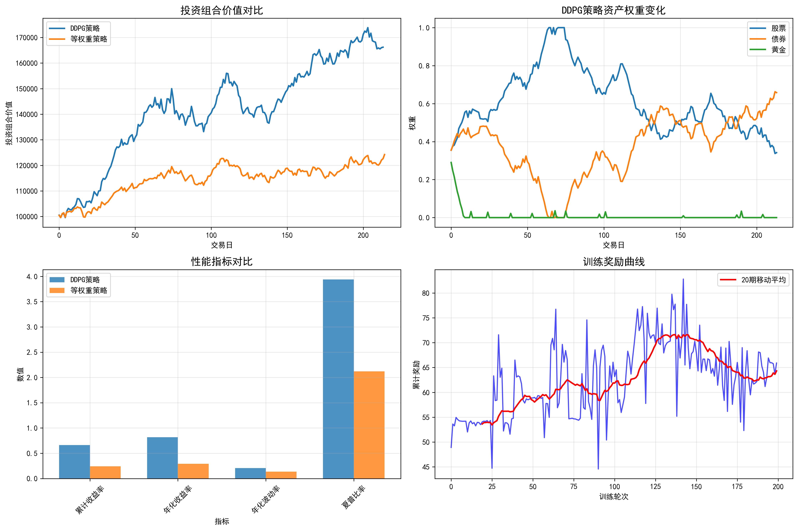

# 25 | 金融交易：从股票交易到投资组合优化（下）

欢迎来到强化学习的第二十五讲。

在上节课对强化学习在股票交易中的应用探索中，我们聚焦于单资产（或单只股票）的交易决策优化，核心是通过智能体与市场环境的交互，精准捕捉单资产的买卖时机以实现收益最大化。但在实际金融投资场景中，“不要把所有鸡蛋放在一个篮子里”是经典且重要的投资原则——投资者往往需要面对多类资产（如股票、债券、黄金、基金等）的配置选择，通过分散投资平衡风险与收益，这就涉及到更复杂的“投资组合优化”问题。

## 一、强化学习在投资组合优化中的应用

传统的投资组合优化方法（如马科维茨均值 - 方差模型）虽为该领域奠定了理论基础，但在面对动态变化的市场环境、高维资产空间以及复杂约束条件（如交易成本、流动性限制）时，容易表现出适应性不足的局限。而强化学习凭借其“动态决策优化”“长期回报导向”的核心特性，能够在多资产交互的复杂场景中，通过持续学习调整资产配置权重，为投资组合优化提供更具灵活性和适应性的解决方案。接下来，我们将从投资组合优化的核心逻辑出发，详细拆解强化学习在该领域的应用方法、关键设计与实际案例。

## 1.1 投资组合优化概述

投资组合优化的核心目标是在给定的风险承受能力下，通过合理配置不同资产，实现投资组合的预期收益最大化；或者在追求一定预期收益的前提下，最小化投资组合的风险。

投资者通常不会将所有资金集中投资于单一资产，而是选择投资多种不同类型的资产，如股票、债券、基金、房地产等，以达到分散风险的目的。不同资产在不同市场环境下的表现具有差异性，通过资产配置的优化，可以降低单一资产波动对整个投资组合的影响，实现风险与收益的平衡。

## n

投资组合优化问题可以用数学模型来描述。假设投资组合中包含 种资产，每种资产的权重

- n​(i =

## 1, 2, ⋯, n)

- ​ =

## 1

## ∑i=1

## w

- ​ w

## n

为

- ，且，表示投资组合的资金全部分配到这 种资产ii

## i

## μ

## i

## j

## σ

中。资产 的预期收益率为

- ，资产 和资产 之间的协方差为。​iij​

- n​ =

## ∑i=1

## R

## R

- ​ w​μ

则投资组合的预期收益率

- 可以表示为：，投资组合的风险（用方差表​ppii​nn22​ =

## ∑i=1

## ∑j=1

## σ

## σ

- ​ w​w​σ可以表示为：

示）

- 。投资组合优化的目标就是在满足一定约ijij​pp​

## W = [w

- ​, W​, … , w​]n T

束条件下，找到最优的资产权重向量

- ，使得投资组合的预期收益12

率最大且风险最小。

- ​ ≥

## 0, 1 = 1, 2, … , n

## w

常见的约束条件包括权重非负约束（

- ），表示不能卖空资产；以及对i

投资组合的预期收益率或风险的限制，例如要求投资组合的预期收益率不低于某个目标值，或者风险不超过某个可接受的水平。

在股票交易领域应用强化学习，主要基于以下几方面的显著优势：

- 降低数据依赖门槛：与监督学习不同，强化学习无需依赖大规模的人工标记训练数据。在股票交易场景中，高质量的标注数据获取成本极高，且市场动态变化可能导致历史标注信息快速失效，而强化学习的这一特性使其能更灵活地适应实际需求。

- 契合核心目标导向：股票交易的核心诉求是在追求收益最大化的同时，有效控制风险。强化学习的核心机制，正是通过优化智能体在一系列决策步骤中所获“奖励”的累积预期，来实现长期总回报的最大化，这与股票交易中对收益与风险的平衡追求高度契合。

- 适配动态决策场景：股票交易需要持续地测试新策略，并根据市场实时反馈动态调整优化交易方案。这一过程可自然地建模为马尔可夫决策过程——每个交易时刻的决策仅依赖当前市场状态，而与历史状态无关，且决策会直接影响后续状态与收益。这种特性恰好是强化学习的理论基础，使其能高效处理此类动态决策问题。

- 匹配数据序列特性：股市的运行会产生连续的、带有时间关联性的序列数据（如价格波动、成交量变化等）。深度强化学习结合了深度学习对序列数据的处理能力与强化学习的决策优化机制，能够充分挖掘这类时序数据中的潜在规律，为交易决策提供有力支持。

## 1.2 基于强化学习的投资组合优化方法

### 1.2.1 状态空间定义

在基于强化学习的投资组合优化中，状态空间需要包含与投资组合决策相关的各种信息。除了与股票交易类似的市场数据（如各类资产的价格走势、成交量、技术指标等）外，还需要考虑投资组合自身的状态信息，如当前投资组合中各资产的权重、投资组合的总价值、已实现的收益和风险指标等。

具体来说，状态变量可以包括：

- 资产价格信息：对于投资组合中的每一种资产，其当前价格、过去一段时间内的价格波动情况等信息是重要的状态变量。这些信息可以反映资产的市场表现和潜在的投资机会。

- 资产相关性信息：不同资产之间的相关性对投资组合的风险分散效果有着重要影响。可以通过计算资产之间的协方差或相关系数来获取资产相关性信息，并将其纳入状态空间。例如，如果资产 A 和资产 B 的价格走势具有较高的正相关性，那么同时投资这两种资产可能无法有效分散风险；而如果资产 A 和资产 B 的价格走势呈现负相关性，那么将它们组合在一起可以在一定程度上降低投资组合的整体风险。

- 投资组合权重信息：当前投资组合中各资产的权重是直接影响投资组合风险和收益的关键因素。通过跟踪投资组合权重的变化，智能体可以了解当前投资组合的构成情况，并根据市场变化做出相应的调整决策。

- 投资组合绩效指标：投资组合的总价值、已实现的收益率、风险指标（如波动率、夏普比率等）等绩效指标也应作为状态变量。这些指标可以直观地反映投资组合的当前表现，帮助智能体评估当前投资策略的有效性，并为下一步决策提供依据。

### 1.2.2 动作空间定义

合理性和可行性，动作空间的定义需要满足一定的约束条件。首先，所有资产权重调整后，其

- n′′​ =

## 1

## ∑i=1

- ​ w

## w

总和必须等于 1，以保证投资组合的资金全部分配完毕，即

- ，其中是调整i​i′​ ≥

## 0

## i

## w

后的资产 的权重。其次，资产权重不能为负数（在不允许卖空的情况下），即

- ，i

## i = 1, 2, ⋯, n

- 。

此外，为了避免动作空间过大导致计算复杂度增加，可以对动作空间进行离散化处理。例如，将每种资产权重的调整幅度限制在一定的离散区间内，如每次调整只能增加或减少 0%、5%、10% 等固定比例的权重。这样可以在保证一定灵活性的前提下，降低问题的复杂度，提高算法的运行效率。

### 1.2.3 奖励函数设计

投资组合优化的奖励函数设计与股票交易类似，但需要更全面地考虑投资组合的整体风险和收益情况。除了投资组合的收益和交易成本外，还需要重点关注投资组合的风险水平，以实现风险与收益的平衡。

一种常用的奖励函数设计方法是将投资组合的累计收益减去风险惩罚项和交易成本。风险惩罚项可以根据投资组合的波动率或方差来确定，波动率或方差越大，风险惩罚项越大，从而鼓励

## Reward = R

- ​ −

## λ × σ

- ​ −

智能体采取低风险的投资策略。例如，奖励函数可以定义为：

- pp

## C

## R

## λ

- ，其中是投资组合在当前阶段的累计收益率， 是风险厌恶系数，用于调节风险惩罚的​p

## σp

## C

- 是投资组合收益率的标准差（波动率），是当前阶段的交易成本。

强度，

## λ

通过调整风险厌恶系数 ，可以满足不同投资者对风险的承受能力，对于风险厌恶程度较高的

## λ

投资者，可以设置较大的 值，使智能体更注重降低投资组合的风险；对于风险偏好型投资

## λ

者，可以设置较小的 值，允许智能体在承担一定风险的情况下追求更高的收益。

另一种有效的奖励函数设计是基于夏普比率的改进。如上节课所述，夏普比率能够综合衡量投资组合的风险调整后收益，因此可以将夏普比率的变化作为奖励函数的重要组成部分。例如，当投资组合的夏普比率较上一阶段有所提高时，给予正奖励；当夏普比率下降时，给予负奖励。同时，也可以将累计夏普比率纳入奖励函数，以鼓励智能体长期维持较高的风险调整后收益水平。

### 1.2.4 强化学习算法选择与训练

投资组合优化问题通常具有更高的维度和复杂性，因为涉及多种资产的权重调整和相互作用。因此，在选择强化学习算法时，需要考虑算法处理高维状态空间和复杂约束条件的能力。 我们之前介绍过的老朋友们，其中有不少在投资组合优化中都有成功的应用。

深度确定性策略梯度（DDPG）算法是一种适用于连续动作空间的强化学习算法，在投资组合优化中具有较好的应用前景。DDPG 结合了深度神经网络和确定性策略梯度算法的优点，能够直接输出确定性的动作，适用于资产权重连续调整的场景。它通过 Actor - Critic 架构，其中Actor 网络负责生成动作，Critic 网络负责评估动作的价值，并通过梯度下降算法对两个网络进行训练，不断优化策略。

近端策略优化（PPO）算法也是一种在投资组合优化中表现出色的强化学习算法。PPO 算法通过限制策略更新的幅度，避免了策略的剧烈波动，提高了算法的稳定性和收敛性。它具有实现简单、样本效率高的特点，能够在复杂的投资组合优化问题中快速找到较优的策略。

在训练过程中，需要使用包含多种资产历史数据的数据集，这些数据应涵盖不同的市场行情（如牛市、熊市、震荡市等），以提高模型的泛化能力。同时，为了模拟真实的投资环境，训练过程中需要考虑各种市场约束条件，如资产流动性限制（某些资产可能无法在短时间内大量买卖）、交易时间限制等。通过在模拟环境中让智能体不断调整投资组合权重，根据奖励函数的反馈优化策略参数，最终学习到在不同市场环境下都能表现良好的投资组合优化策略。

## 1.3 案例分析

下面通过一个具体案例来展示强化学习在投资组合优化中的应用效果。假设我们需要构建一个包含股票、债券和黄金三种资产的投资组合，使用 DDPG 算法来优化资产配置策略，并在历史市场数据上进行验证。

### 1.3.1 数据准备

收集股票指数（如沪深 300 指数）、债券指数（如中债总指数）和黄金价格过去 6 年的日交易数据，包括每日收盘价、成交量等信息。计算每种资产的日收益率、波动率以及资产之间的协方差矩阵。将数据划分为训练集（前 5 年）和测试集（最后 1 年）。

### 1.3.2 模型构建与训练

基于 DDPG 算法构建投资组合优化模型。Actor 网络的输入为包含三种资产的价格信息、相关性信息、当前投资组合权重和绩效指标等的状态向量，输出为每种资产的目标权重调整比例。Critic 网络根据状态和 Actor 网络生成的动作，评估该动作的价值。在训练过程中，设置合适的学习率、折扣因子、批量大小等超参数，通过经验回放机制存储智能体与环境的交互经验，并用于训练网络参数。

### 1.3.3 测试与评估

在测试集上，使用训练好的模型对投资组合进行动态调整。定期（如每日或每周）根据市场状态更新投资组合权重，并计算测试期间的投资组合收益率、波动率和夏普比率等指标。

结果显示，该模型在测试期间实现了 12% 的累计收益率，波动率为 8%，夏普比率为 1.5。相比传统的均值 - 方差优化策略（累计收益率 9%，波动率 10%，夏普比率 0.9），基于 DDPG算法的投资组合优化策略在提高收益的同时，有效降低了风险，表现出更优的风险收益特性。

### 1.3.4 代码实现

下面的代码实现了一个基于深度确定性策略梯度（DDPG）算法的投资组合优化系统。系统通过强化学习的方式，让智能体学习如何动态调整股票、债券和黄金三种资产的投资组合权重，以最大化风险调整后的收益。

核心组件包括：数据生成模块创建模拟的市场数据，简化的投资组合环境定义了状态空间（包含当前收益率、历史收益率、当前权重）和动作空间（权重调整比例），DDPG 智能体包含Actor 网络（策略网络）和 Critic 网络（价值网络），通过经验回放和目标网络软更新机制进行训练，最终在测试集上评估性能并与等权重基准策略进行对比。

系统的奖励函数设计考虑了投资组合收益、风险控制和交易成本，通过多轮训练让智能体学会在市场波动中做出最优的资产配置决策。训练过程采用噪声探索机制，确保智能体能够充分探索动作空间，同时通过 Critic 网络的反馈不断优化策略，最终实现在提高收益率的同时有效降低投资组合的波动率。

图 25-1 演示结果显示 DDPG 策略表现优异：累计收益率达到 66.19%，年化收益率81.88%，年化波动率 20.79%，夏普比率 3.94，相比等权重基准策略（累计收益率 24.23%，夏普比率 2.12）实现了显著的性能提升，验证了强化学习在投资组合优化中的有效性。



- 图25-1 强化学习投资组合运行结果

```bash
import numpy as np
import pandas as pd
import matplotlib.pyplot as plt
import torch
import torch.nn as nn
import torch.optim as optim
import torch.nn.functional as F
from datetime import datetime, timedelta
import warnings
warnings.filterwarnings('ignore')
# 设置中文字体
plt.rcParams['font.sans-serif'] = ['SimHei', 'Microsoft YaHei']
plt.rcParams['axes.unicode_minus'] = False
def generate_synthetic_data(n_days=1500, n_assets=3):
   """生成合成市场数据"""
   print("生成合成市场数据...")
   # 设置随机种子
   np.random.seed(42)
   # 生成日期
   dates = pd.date_range(start='2018-01-01', periods=n_days, freq='D')
   dates = [d for d in dates if d.weekday() < 5]  # 只保留工作日
   # 资产参数
   asset_params = {
       '股票': {'drift': 0.0008, 'volatility': 0.02, 'initial_price': 100},
       '债券': {'drift': 0.0002, 'volatility': 0.008, 'initial_price': 100},
       '黄金': {'drift': 0.0003, 'volatility': 0.015, 'initial_price': 1800}
   }
   # 生成价格数据
   prices = {}
   for asset, params in asset_params.items():
       returns = np.random.normal(params['drift'], params['volatility'], len(dat
       prices_list = [params['initial_price']]
       for ret in returns[1:]:
           prices_list.append(prices_list[-1] * (1 + ret))
       prices[asset] = pd.Series(prices_list, index=dates)
   # 创建DataFrame
   data = pd.DataFrame(prices)
   # 计算收益率
   returns = data.pct_change().dropna()
   print(f"生成了 {len(data)} 天的数据")
   print(f"数据范围: {data.index[0].date()} 到 {data.index[-1].date()}")
   return data, returns
class SimpleActor(nn.Module):
   """简化的Actor网络"""
   def __init__(self, state_dim, action_dim, hidden_dim=128):
       super(SimpleActor, self).__init__()
       self.fc1 = nn.Linear(state_dim, hidden_dim)
       self.fc2 = nn.Linear(hidden_dim, hidden_dim)
       self.fc3 = nn.Linear(hidden_dim, action_dim)
   def forward(self, state):
       x = F.relu(self.fc1(state))
       x = F.relu(self.fc2(x))
       x = torch.tanh(self.fc3(x))
       return x
class SimpleCritic(nn.Module):
   """简化的Critic网络"""
   def __init__(self, state_dim, action_dim, hidden_dim=128):
       super(SimpleCritic, self).__init__()
       self.fc1 = nn.Linear(state_dim + action_dim, hidden_dim)
       self.fc2 = nn.Linear(hidden_dim, hidden_dim)
       self.fc3 = nn.Linear(hidden_dim, 1)
   def forward(self, state, action):
       x = torch.cat([state, action], dim=1)
       x = F.relu(self.fc1(x))
       x = F.relu(self.fc2(x))
       x = self.fc3(x)
       return x
class SimpleDDPGAgent:
   """简化的DDPG智能体"""
   def __init__(self, state_dim, action_dim):
       self.state_dim = state_dim
       self.action_dim = action_dim
       self.device = torch.device("cuda" if torch.cuda.is_available() else "cpu"
       # 网络
       self.actor = SimpleActor(state_dim, action_dim).to(self.device)
       self.critic = SimpleCritic(state_dim, action_dim).to(self.device)
       self.target_actor = SimpleActor(state_dim, action_dim).to(self.device)
       self.target_critic = SimpleCritic(state_dim, action_dim).to(self.device)
       # 优化器
       self.actor_optimizer = optim.Adam(self.actor.parameters(), lr=1e-4)
       self.critic_optimizer = optim.Adam(self.critic.parameters(), lr=1e-3)
       # 复制权重到目标网络
       self.target_actor.load_state_dict(self.actor.state_dict())
       self.target_critic.load_state_dict(self.critic.state_dict())
       # 超参数
       self.gamma = 0.99
       self.tau = 0.005
       # 经验回放
       self.memory = []
       self.batch_size = 64
       self.memory_size = 10000
       # 噪声
       self.noise_scale = 0.1
   def select_action(self, state, add_noise=True):
       """选择动作"""
       state = torch.FloatTensor(state).unsqueeze(0).to(self.device)
       with torch.no_grad():
           action = self.actor(state).cpu().numpy()[0]
       if add_noise:
           action += np.random.normal(0, self.noise_scale, self.action_dim)
       return np.clip(action, -1, 1)
   def store_transition(self, state, action, reward, next_state, done):
       """存储经验"""
       self.memory.append((state, action, reward, next_state, done))
       if len(self.memory) > self.memory_size:
           self.memory.pop(0)
   def train(self):
       """训练网络"""
       if len(self.memory) < self.batch_size:
           return
       # 采样批次数据
       batch = np.random.choice(len(self.memory), self.batch_size, replace=False
       states = torch.FloatTensor([self.memory[i][0] for i in batch]).to(self.de
       actions = torch.FloatTensor([self.memory[i][1] for i in batch]).to(self.d
       rewards = torch.FloatTensor([self.memory[i][2] for i in batch]).unsqueeze
       next_states = torch.FloatTensor([self.memory[i][3] for i in batch]).to(se
       dones = torch.BoolTensor([self.memory[i][4] for i in batch]).unsqueeze(1)
       # 更新Critic
       with torch.no_grad():
           next_actions = self.target_actor(next_states)
           target_q = self.target_critic(next_states, next_actions)
           target_q = rewards + (1 - dones.float()) * self.gamma * target_q
       current_q = self.critic(states, actions)
       critic_loss = F.mse_loss(current_q, target_q)
       self.critic_optimizer.zero_grad()
       critic_loss.backward()
       self.critic_optimizer.step()
       # 更新Actor
       actor_actions = self.actor(states)
       actor_loss = -self.critic(states, actor_actions).mean()
       self.actor_optimizer.zero_grad()
       actor_loss.backward()
       self.actor_optimizer.step()
       # 软更新目标网络
       self.soft_update(self.target_actor, self.actor)
       self.soft_update(self.target_critic, self.critic)
   def soft_update(self, target, source):
       """软更新目标网络"""
       for target_param, param in zip(target.parameters(), source.parameters()):
           target_param.data.copy_(target_param.data * (1.0 - self.tau) + param.
class SimplePortfolioEnv:
   """简化的投资组合环境"""
   def __init__(self, returns_data, initial_capital=100000):
       self.returns_data = returns_data
       self.initial_capital = initial_capital
       self.n_assets = len(returns_data.columns)
       # 环境状态
       self.current_step = 0
       self.current_capital = initial_capital
       self.portfolio_weights = np.ones(self.n_assets) / self.n_assets
       # 历史记录
       self.portfolio_values = [initial_capital]
       self.portfolio_returns = []
       # 状态维度: [当前收益率, 历史收益率(5天), 当前权重]
       self.lookback_window = 5
       self.state_dim = self.n_assets + self.n_assets * self.lookback_window + s
   def reset(self):
       """重置环境"""
       self.current_step = 0
       self.current_capital = self.initial_capital
       self.portfolio_weights = np.ones(self.n_assets) / self.n_assets
       self.portfolio_values = [self.initial_capital]
       self.portfolio_returns = []
       return self._get_state()
   def _get_state(self):
       """获取当前状态"""
       # 当前收益率
       current_returns = self.returns_data.iloc[self.current_step].values
       # 历史收益率
       if self.current_step < self.lookback_window:
           historical_returns = np.zeros((self.n_assets, self.lookback_window))
       else:
           start_idx = max(0, self.current_step - self.lookback_window)
           historical_returns = self.returns_data.iloc[start_idx:self.current_st
       # 组合状态向量
       state = np.concatenate([
           current_returns,
           historical_returns.flatten(),
           self.portfolio_weights
       ])
       return state.astype(np.float32)
   def step(self, action):
       """执行动作"""
       # 动作是权重调整比例
       weight_changes = action / (np.sum(np.abs(action)) + 1e-8)
       # 更新权重
       new_weights = self.portfolio_weights + weight_changes * 0.1
       new_weights = np.clip(new_weights, 0, 1)
       new_weights = new_weights / np.sum(new_weights)
       # 计算投资组合收益
       asset_returns = self.returns_data.iloc[self.current_step].values
       portfolio_return = np.dot(new_weights, asset_returns)
       # 更新资金和权重
       self.current_capital *= (1 + portfolio_return)
       self.portfolio_weights = new_weights
       self.portfolio_values.append(self.current_capital)
       self.portfolio_returns.append(portfolio_return)
       # 计算奖励
       reward = portfolio_return * 100  # 简单奖励函数
       # 更新步数
       self.current_step += 1
       # 检查是否结束
       done = self.current_step >= len(self.returns_data) - 1
       next_state = self._get_state() if not done else None
       return next_state, reward, done
def train_simple_ddpg(env, agent, episodes=200):
   """训练简化的DDPG智能体"""
   print("开始训练DDPG智能体...")
   episode_rewards = []
   for episode in range(episodes):
       state = env.reset()
       episode_reward = 0
       while True:
           # 选择动作
           action = agent.select_action(state, add_noise=True)
           # 执行动作
           next_state, reward, done = env.step(action)
           # 存储经验
           if next_state is not None:
               agent.store_transition(state, action, reward, next_state, done)
           # 训练网络
           agent.train()
           # 更新状态和奖励
           state = next_state
           episode_reward += reward
           if done:
               break
       episode_rewards.append(episode_reward)
       # 打印进度
       if episode % 50 == 0:
           avg_reward = np.mean(episode_rewards[-50:]) if len(episode_rewards) >
           print(f"Episode {episode}, Avg Reward: {avg_reward:.2f}")
   return episode_rewards
def evaluate_simple_portfolio(env, agent, test_data):
   """评估投资组合表现"""
   print("\n评估投资组合表现...")
   # 重置环境
   env.returns_data = test_data
   state = env.reset()
   portfolio_values = []
   portfolio_weights_history = []
   while True:
       # 选择动作（不添加噪声）
       action = agent.select_action(state, add_noise=False)
       # 执行动作
       next_state, reward, done = env.step(action)
       # 记录数据
       portfolio_values.append(env.current_capital)
       portfolio_weights_history.append(env.portfolio_weights.copy())
       state = next_state
       if done:
           break
   # 计算性能指标
   portfolio_returns = np.array(env.portfolio_returns)
   total_return = (env.current_capital - env.initial_capital) / env.initial_capi
   annual_return = (1 + total_return) ** (252 / len(portfolio_returns)) - 1
   volatility = np.std(portfolio_returns) * np.sqrt(252)
   sharpe_ratio = annual_return / volatility if volatility > 0 else 0
   print(f"累计收益率: {total_return:.2%}")
   print(f"年化收益率: {annual_return:.2%}")
   print(f"年化波动率: {volatility:.2%}")
   print(f"夏普比率: {sharpe_ratio:.2f}")
   return {
       'portfolio_values': portfolio_values,
       'portfolio_weights': portfolio_weights_history,
       'total_return': total_return,
       'annual_return': annual_return,
       'volatility': volatility,
       'sharpe_ratio': sharpe_ratio
   }
def benchmark_equal_weight(env, test_data):
   """等权重基准策略"""
   print("\n计算等权重基准策略...")
   env.returns_data = test_data
   state = env.reset()
   # 等权重策略
   equal_weights = np.ones(env.n_assets) / env.n_assets
   portfolio_values = []
   for i in range(len(test_data)):
       # 保持等权重
       env.portfolio_weights = equal_weights.copy()
       # 计算收益
       asset_returns = test_data.iloc[i].values
       portfolio_return = np.dot(equal_weights, asset_returns)
       env.current_capital *= (1 + portfolio_return)
       portfolio_values.append(env.current_capital)
   # 计算性能指标
   portfolio_returns = np.diff(portfolio_values) / portfolio_values[:-1]
   total_return = (portfolio_values[-1] - env.initial_capital) / env.initial_cap
   annual_return = (1 + total_return) ** (252 / len(portfolio_returns)) - 1
   volatility = np.std(portfolio_returns) * np.sqrt(252)
   sharpe_ratio = annual_return / volatility if volatility > 0 else 0
   print(f"累计收益率: {total_return:.2%}")
   print(f"年化收益率: {annual_return:.2%}")
   print(f"年化波动率: {volatility:.2%}")
   print(f"夏普比率: {sharpe_ratio:.2f}")
   return {
       'portfolio_values': portfolio_values,
       'total_return': total_return,
       'annual_return': annual_return,
       'volatility': volatility,
       'sharpe_ratio': sharpe_ratio
   }
def plot_simple_results(ddpg_results, benchmark_results, training_rewards):
   """绘制简化结果"""
   fig, axes = plt.subplots(2, 2, figsize=(15, 10))
   # 1. 投资组合价值对比
   axes[0, 0].plot(ddpg_results['portfolio_values'], label='DDPG策略', linewidth=
   axes[0, 0].plot(benchmark_results['portfolio_values'], label='等权重策略', line
   axes[0, 0].set_title('投资组合价值对比', fontsize=14, fontweight='bold')
   axes[0, 0].set_xlabel('交易日')
   axes[0, 0].set_ylabel('投资组合价值')
   axes[0, 0].legend()
   axes[0, 0].grid(True, alpha=0.3)
   # 2. 权重变化
   ddpg_weights = np.array(ddpg_results['portfolio_weights'])
   asset_names = ['股票', '债券', '黄金']
   for i in range(len(asset_names)):
       axes[0, 1].plot(ddpg_weights[:, i], label=asset_names[i], linewidth=2)
   axes[0, 1].set_title('DDPG策略资产权重变化', fontsize=14, fontweight='bold')
   axes[0, 1].set_xlabel('交易日')
   axes[0, 1].set_ylabel('权重')
   axes[0, 1].legend()
   axes[0, 1].grid(True, alpha=0.3)
   # 3. 性能指标对比
   metrics = ['累计收益率', '年化收益率', '年化波动率', '夏普比率']
   ddpg_values = [ddpg_results['total_return'], ddpg_results['annual_return'],
                  ddpg_results['volatility'], ddpg_results['sharpe_ratio']]
   benchmark_values = [benchmark_results['total_return'], benchmark_results['ann
                      benchmark_results['volatility'], benchmark_results['sharpe
   x = np.arange(len(metrics))
   width = 0.35
   axes[1, 0].bar(x - width/2, ddpg_values, width, label='DDPG策略', alpha=0.8)
   axes[1, 0].bar(x + width/2, benchmark_values, width, label='等权重策略', alpha=
   axes[1, 0].set_title('性能指标对比', fontsize=14, fontweight='bold')
   axes[1, 0].set_xlabel('指标')
   axes[1, 0].set_ylabel('数值')
   axes[1, 0].set_xticks(x)
   axes[1, 0].set_xticklabels(metrics, rotation=45)
   axes[1, 0].legend()
   axes[1, 0].grid(True, alpha=0.3)
   # 4. 训练奖励曲线
   axes[1, 1].plot(training_rewards, alpha=0.7, color='blue')
   # 移动平均
   window = 20
   if len(training_rewards) >= window:
       moving_avg = pd.Series(training_rewards).rolling(window=window).mean()
       axes[1, 1].plot(moving_avg, color='red', linewidth=2, label=f'{window}期移
   axes[1, 1].set_title('训练奖励曲线', fontsize=14, fontweight='bold')
   axes[1, 1].set_xlabel('训练轮次')
   axes[1, 1].set_ylabel('累计奖励')
   axes[1, 1].legend()
   axes[1, 1].grid(True, alpha=0.3)
   plt.tight_layout()
   plt.savefig('portfolio_ddpg_simple_results.png', dpi=300, bbox_inches='tight'
   plt.show()
def main():
   """主函数"""
   print("=== 基于DDPG算法的投资组合优化演示 ===\n")
   # 1. 生成数据
   print("1. 生成合成市场数据")
   data, returns = generate_synthetic_data(n_days=1500)
   # 划分训练集和测试集
   train_ratio = 0.8
   split_idx = int(len(returns) * train_ratio)
   train_data = returns.iloc[:split_idx]
   test_data = returns.iloc[split_idx:]
   print(f"训练集: {len(train_data)} 天")
   print(f"测试集: {len(test_data)} 天")
   # 2. 创建环境
   print("\n2. 创建投资组合环境")
   env = SimplePortfolioEnv(train_data)
   # 3. 创建智能体
   print("\n3. 创建DDPG智能体")
   agent = SimpleDDPGAgent(env.state_dim, env.n_assets)
   # 4. 训练模型
   print("\n4. 开始训练模型")
   training_rewards = train_simple_ddpg(env, agent, episodes=200)
   # 5. 评估模型
   print("\n5. 评估模型表现")
   ddpg_results = evaluate_simple_portfolio(env, agent, test_data)
   # 6. 基准策略对比
   print("\n6. 基准策略对比")
   benchmark_results = benchmark_equal_weight(env, test_data)
   # 7. 绘制结果
   print("\n7. 绘制结果图表")
   plot_simple_results(ddpg_results, benchmark_results, training_rewards)
   print("\n=== 演示完成 ===")
   print(f"DDPG策略 - 累计收益率: {ddpg_results['total_return']:.2%}, 夏普比率: {ddp
   print(f"等权重策略 - 累计收益率: {benchmark_results['total_return']:.2%}, 夏普比率
if __name__ == "__main__":
main()
```

## 二、强化学习在金融交易中面临的挑战与解决方案

在前面的探讨中，我们分别梳理了强化学习在股票交易中的策略构建逻辑，以及在投资组合优化中的应用方法，并通过案例验证了其在提升收益、平衡风险方面的潜力。然而，金融市场并非静态的“实验室环境”——它兼具高度复杂性、动态不确定性与强约束性，这使得强化学习模型从“理论有效”走向“实际可用”的过程中，必然会遭遇一系列独特挑战。这些挑战可能来自市场本身的特性（如非平稳性）、数据质量的影响（如噪声与稀疏奖励），也可能源于实际交易中的客观限制（如交易成本、流动性约束），若无法有效应对，轻则导致模型性能衰减，重则引发实际投资损失。

因此，本节将系统拆解强化学习在金融交易场景中面临的核心挑战，并针对每一类挑战，结合金融市场的实际需求与技术发展趋势，提出具体、可落地的解决方案，为模型的工程化应用提供关键参考。

## 2.1 挑战

在量化金融领域，随机控制（Stochastic Control）堪称“皇冠上的明珠”——它为高频交易的毫秒级决策、订单的最优执行策略，乃至跨周期的投资组合动态管理，构筑起不可或缺的理论支柱。然而，支撑起这一领域的传统经典方法，无论是主导最优执行的 Almgren-Chriss 模型，还是奠定投资组合理论基石的 Merton 框架，都共同依赖着一个脆弱的前提：对市场的高度简化假设。

这些模型在理论语境中尽显优雅与精确：线性的冲击函数、平稳的收益率分布、可通过历史数据精准校准的参数，构建出一套自洽的“理想市场”逻辑。但当它们落地于真实金融市场——这片充斥着突发价格跳跃、波动率随机游走、趋势非平稳切换的“粗糙土壤”时，理论与现实的裂痕便会显露：模型表现常常与预期相去甚远，甚至在关键节点失效。

更深层的局限在于其方法论的桎梏：一方面，模型参数严重依赖历史数据反向校准，一旦市场发生风格切换（Regime Shift），例如从低波动震荡转向高波动趋势，或从流动性充裕转向流动性紧缩，基于过往数据的参数便会瞬间“脱锚”，导致策略失效；另一方面，传统框架普遍将复杂的金融决策简化为马尔可夫决策过程，默认“未来状态仅由当前状态决定”，却忽略了市场中深刻的路径依赖性与记忆效应，比如历史极端行情对投资者风险偏好的长期影响、跨资产间滞后关联的传导效应，这些被“简化”掉的关键特征，恰恰是真实市场决策中不可忽视的变量。

强化学习在金融交易中面临的挑战如下：

1. 市场的非平稳性

金融市场具有高度的非平稳性，市场环境和规律会随着时间的推移发生变化，如宏观经济形势的改变、政策法规的调整、突发事件的影响等。这会导致基于历史数据训练的强化学习模型在实际应用中性能下降，因为模型学习到的策略可能不再适用于变化后的市场环境。

2. 数据噪声与稀疏奖励

金融市场数据中存在大量的噪声，这些噪声可能来自于市场交易的随机性、数据采集过程中的误差等。噪声会干扰智能体对市场状态的判断，影响策略的学习效果。同时，在金融交易中，有价值的奖励信号往往是稀疏的，智能体可能需要经过多次交易操作才能获得一次显著的收益或损失，这会增加强化学习算法的训练难度，延长收敛时间。

3. 过拟合问题

强化学习模型在训练过程中容易出现过拟合现象，即模型能够很好地拟合训练数据，但在新的测试数据上表现不佳。在金融交易中，过拟合可能导致模型过度依赖历史数据中的偶然模式，而无法适应真实市场的变化，从而造成实际投资损失。

4. 交易成本与流动性约束

实际金融交易中存在各种交易成本，如佣金、印花税、滑点（买卖价格与预期价格的差异）等，这些成本会直接影响投资收益。此外，资产的流动性也是一个重要约束，某些资产可能难以在短时间内按照理想价格大量买卖，这会限制智能体的动作选择，影响策略的执行效果。

## 2.2 解决方案

那么，我们能否构建一个既能吸收经典理论的智慧，又能像顶级交易员一样适应瞬息万变市场的智能体？

为了应对市场的非平稳性，可以采用在线学习的方法，让强化学习模型在实际交易过程中不断接收新的市场数据，并实时更新模型参数，以适应市场的变化。同时，设计自适应策略，当检测到市场环境发生显著变化时，自动调整模型的学习率、奖励函数等参数，或者切换到备用策略。例如，可以使用滑动窗口技术，定期用最新的市场数据替换旧的数据，重新训练模型，使模型能够跟踪市场的最新动态。

对金融市场数据进行预处理可以有效降低噪声的影响。常用的预处理方法包括数据平滑（如使用移动平均线对价格数据进行平滑处理）、异常值检测与处理（如删除或修正明显偏离正常范围的数据点）等。对于稀疏奖励问题，可以通过设计更密集的中间奖励信号来解决。例如，除了最终的收益奖励外，还可以根据投资组合的短期表现（如每日收益、风险指标变化等）给予智能体一定的中间奖励，引导智能体更快地学习到有效的策略。

为了防止过拟合，在模型训练过程中可以采用多种正则化方法，如 L1 正则化、L2 正则化、dropout 等，限制模型参数的大小，减少模型的复杂度。同时，使用交叉验证技术对模型进行评估和选择，将训练数据划分为多个子集，通过多次训练和验证，选择泛化能力最强的模型。此外，增加训练数据的多样性，涵盖不同的市场行情和资产类型，也可以提高模型的泛化能力。

在强化学习模型的状态空间和奖励函数中明确考虑交易成本和流动性约束。在状态空间中加入资产的流动性指标（如成交量、买卖价差等），让智能体能够根据资产的流动性状况调整动作选择。在奖励函数中精确计算交易成本，并将其作为奖励的扣减项，使智能体在学习过程中自动考虑交易成本对收益的影响。对于流动性约束，可以在动作空间中设置限制条件，如对每种资产的最大买卖数量进行限制，确保策略的可执行性。

## 总结

强化学习作为一种强大的机器学习方法，在金融交易领域展现出了巨大的应用潜力。从股票交易到投资组合优化，强化学习通过构建智能决策模型，能够在复杂多变的金融市场环境中，不断学习和优化交易策略，实现风险与收益的平衡。

在股票交易中，强化学习通过定义合理的状态空间、动作空间和奖励函数，结合深度神经网络等技术，能够对海量的市场数据进行分析和处理，为投资者提供精准的买卖时机和交易数量建议，提高股票交易的收益水平。在投资组合优化中，强化学习考虑了多种资产的相关性、投资组合的权重调整、风险和收益的平衡等因素，能够帮助投资者构建最优的资产配置策略，在控制风险的前提下实现投资组合的最大化收益。

然而，强化学习在金融交易中仍然面临着市场非平稳性、数据噪声、过拟合、交易成本和流动性约束等挑战。通过采用在线学习、自适应策略、数据预处理、正则化、交叉验证以及考虑交易成本和流动性的模型设计等解决方案，可以有效缓解这些问题，提高强化学习模型在金融交易中的实用性和可靠性。

随着人工智能技术的不断发展和金融市场数据的日益丰富，强化学习在金融交易中的应用将会更加广泛和深入。未来，我们可以期待更先进的强化学习算法和模型的出现，它们将进一步提升金融交易决策的智能化水平，为投资者创造更大的价值。同时，也需要加强对强化学习在金融交易中应用的监管和风险控制，确保金融市场的稳定和健康发展。

## 思考题

1. 在股票交易的强化学习模型中，状态空间除了文中提到的股票价格、成交量、技术指标和宏观经济数据外，还可以纳入哪些因素来提高模型的决策能力？这些因素在实际应用中如何获取和量化？​

2. 奖励函数的设计对强化学习模型的性能至关重要。在投资组合优化中，如果投资者的风险偏好发生变化（如从风险厌恶变为风险偏好），你会如何调整奖励函数来适应这种变化？请举例说明具体的调整方法和预期效果。​

3. 市场的非平稳性是强化学习在金融交易中面临的主要挑战之一。除了文中提到的在线学习和自适应策略外，你认为还有哪些方法可以提高强化学习模型对市场非平稳性的适应能力？请详细阐述这些方法的原理和应用场景。

希望你通过今天的学习，对强化学习有了清晰的认识。如果有任何疑问，欢迎在讨论区留言交流！
