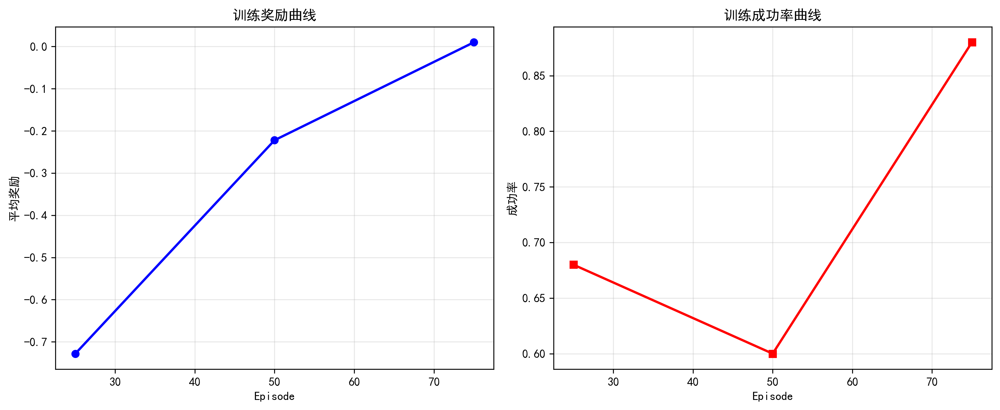

# 28 | 自然语言处理：从机器翻译到对话系统（下）

欢迎来到强化学习的第二十八讲。在深入探讨了机器翻译的技术演进与强化学习在其优化中的重要作用之后，我们不难发现，语言处理的核心价值不仅在于“翻译”这一静态转换，更在于“交互”这一动态过程。如果说机器翻译是让计算机学会“换一种语言表达相同的意思”，那么对话系统则是让机器真正具备“理解意图、回应需求、进行协作”的沟通能力。这种从单向信息转换到双向互动交流的跃迁，正是自然语言处理迈向智能化、人性化的重要标志。

接下来，我们将聚焦于对话系统的构建与实现，系统解析其核心架构、关键技术与实际应用路径。从任务导向型系统的精准执行，到开放域对话的自由生成，再到基于强化学习的智能策略优化，我们将逐步揭开让机器“会说话、懂交流”的技术面纱。

## 对话系统的分类

对话系统可以分为任务导向型对话系统和开放域对话系统。

任务导向型对话系统旨在帮助用户完成特定的任务，如预订机票、查询天气、订购商品等。这类对话系统通常有明确的目标和流程，需要准确理解用户的意图，并根据系统设定的规则和知识库来生成合适的回复，以引导用户完成任务。例如，当用户向一个机票预订对话系统说“我想预订明天从北京到上海的机票”时，系统需要识别出用户的意图是预订机票，提取出出发地“北京”、目的地“上海”、出发时间“明天”等关键信息，然后在机票预订系统中查询符合条件的航班信息，并向用户反馈航班列表、价格等信息，引导用户完成机票预订的操作。任务导向型对话系统的设计重点在于准确的意图识别、高效的任务流程管理以及与后端业务系统的集成。

开放域对话系统则更侧重于与用户进行自然、自由的对话，没有特定的任务限制，旨在提供有趣、有价值的交流体验。例如，聊天机器人可以与用户谈论各种话题，如电影、音乐、兴趣爱好、时事新闻等。开放域对话系统需要具备更广泛的知识储备和语言理解能力，能够理解用户的各种表达方式和隐含意图，并生成自然流畅、富有创意的回复。但由于开放域对话的话题范围广泛，语言表达形式多样，对系统的处理能力提出了更高的挑战。例如，当用户问“你知道最近有什么好看的电影吗”，系统需要从庞大的电影知识库中筛选出近期的热门电影，并给出推荐理由；当用户说“今天心情不太好”，系统需要理解用户的情绪，并给予恰当的安慰和建议。

## 对话系统的关键技术

对话系统涉及多个关键技术，包括自然语言理解、对话管理和自然语言生成。

自然语言理解（NLU）是对话系统的基础，它的任务是将用户输入的自然语言文本转换为计算机能够理解的语义表示。这包括词法分析，即识别单词、词性和词形变化；句法分析，分析句子的语法结构；语义分析，理解句子中单词和短语的语义关系以及整个句子的含义；意图识别，判断用户的意图，例如是查询信息、寻求帮助还是进行闲聊等；实体抽取，提取句子中的关键实体，如人名、地名、时间等。例如，对于用户输入的句子“我明天要去北京出差，帮我预订一家靠近机场的酒店”，自然语言理解模块需要分析出“明天”是时间实体，“北京”是地点实体，“出差”是目的，用户的意图是预订靠近机场的酒店。常用的自然语言理解技术包括基于规则的方法、统计机器学习方法和深度学习方法。深度学习方法，如基于循环神经网络（RNN）、卷积神经网络（CNN）和 Transformer 的模型，在自然语言理解任务中表现出了优异的性能，能够自动学习语言的特征表示，提高理解的准确性。

对话管理负责维护对话的状态，根据用户的输入和当前的对话状态来决定系统的下一步行动。它包括对话状态跟踪，记录对话的历史信息和当前状态，例如用户已经提供了哪些信息，对话进行到了哪个阶段；对话策略制定，根据对话状态和用户意图选择合适的回复策略，如直接回答问题、请求更多信息、引导用户进行下一步操作等。例如，在一个餐厅预订对话系统中，当用户说“我想预订一个今晚的餐桌”时，对话管理模块会记录下用户的预订意图和时间信息，然后询问用户“请问有几位用餐呢”，以获取更多必要信息。对话管理可以使用有限状态机、马尔可夫决策过程等方法来实现。有限状态机通过定义一系列的状态和状态转移条件来管理对话流程，适用于任务导向型对话系统中较为固定的流程。马尔可夫决策过程则考虑了对话中的不确定性和奖励机制，能够在动态环境中优化对话策略，提高对话的质量和效率。

自然语言生成（NLG）是将计算机的语义表示转换为自然流畅的自然语言文本输出。它需要根据对话管理模块确定的回复内容，选择合适的语言表达方式，生成符合语法和语义规则、自然通顺的句子。自然语言生成可以分为模板 - based 方法和基于深度学习的方法。模板 - based方法预先定义好一些回复模板，根据不同的情况选择合适的模板并填充相关信息来生成回复。例如，对于用户查询天气的请求，如果当前城市是北京，天气为晴天，温度为 25 度，系统可以使用模板“北京今天天气晴天，温度 25 度”来生成回复。这种方法简单直观，但生成的回复较为生硬，缺乏灵活性。基于深度学习的自然语言生成方法，如基于循环神经网络（RNN）或Transformer 的生成模型，能够学习大量文本的语言模式，生成更加自然、多样化的回复。例如，生成模型可以根据对话的上下文和用户的情感倾向，生成更具个性化的回复，如“哇，北京今天晴天呢，25 度的天气很适合外出活动哦”。

## 智能客服案例分析

在大语言模型大规模应用之前，工业界广泛采用基于规则的策略，但该方法存在人力成本高、泛化能力差等缺陷，而强化学习能有效解决这些问题，且只需一些目标，无需大量训练语料，规避了深度学习的一大短板。

对话系统是为特定目的设计的与人类对话的机器，分为任务型和非任务型。

- 任务型对话：为达成特定目标，如订飞机票、订餐等。工业界主要采用 pipeline 方式，按SLU（语言理解）、DST（对话状态跟踪）、DPL（对话策略学习）和 NLG（自然语言生成）组织系统；学术界中 end-to-end 方式受关注，使用一个模块与结构化外部数据库交互。

- 非任务型对话：类似微软小冰与人聊天。主流实现方案有生成式和检索式，也有两者结合的方式。生成式将对话任务视为翻译任务；检索式是系统根据用户输入在训练集中检索排序得到匹配问题并查询答案；结合方式是生成候选答案后用检索式匹配排序。

将强化学习应用于任务型对话，主要是将其用于学习对话的动作决策，强化学习中的 Action对应对话中的下一步动作。DQN 中的奖励函数根据对话结果提供，对话未完成时每增加一轮给 - 1 奖励，完成任务时给 (max_turn-turn) 奖励，否则给 -(2*max_turn) 奖励。

训练过程中，智能体和用户模拟器（User Simulator）通过结构化数据交流，无需转换为自然语言。用户模拟器模拟用户行为，结合自身目标与智能体交互；任务目标，无需人为编写，根据业务需求及各槽完成情况生成；还需虚构数据库模拟实际数据查询。

基于强化学习的任务型对话系统代码采用了模块化设计，主要包含 5 个核心组件，各自负责不同的功能，整体结构清晰且易于扩展。以下是详细的代码结构介绍。

1. 任务配置模块（TaskConfig）

- 功能：定义对话任务的核心参数和环境设置，是整个系统的基础配置

- 主要内容：

- 定义任务相关的槽位（slots）及其可能的取值，如餐饮类型、价格范围等

- 设置最大对话轮次（max_turn），控制对话的最大长度

- 创建模拟数据库（db），用于模拟实际业务中的数据查询

- 提供数据库查询方法（query_database），根据约束条件筛选结果

2. 用户模拟器模块（UserSimulator）

- 功能：模拟真实用户的行为和目标，与对话智能体进行交互

- 主要内容：

- 生成用户目标（goal）：随机选择各槽位的目标值，模拟用户需求

- 维护用户状态（state）：跟踪已向智能体提供的信息

- 状态表示方法（_get_state_representation）：将用户状态转换为模型可处理的向量

- 响应处理（step）：根据智能体的动作生成用户响应，模拟真实对话流程

3. DQN 模型模块（DQN）

- 功能：实现深度 Q 网络，用于对话策略的学习和决策

- 主要内容：

- 网络结构：包含 3 个全连接层，通过 ReLU 激活函数处理非线性关系

- 前向传播（forward）：将输入状态映射到动作空间，输出各动作的 Q 值

4. 对话智能体模块（DialogueAgent）

- 功能：基于 DQN 实现对话策略的学习和动作选择

- 主要内容：

- 经验回放（memory）：存储对话经验，用于后续训练

- 超参数设置：包括折扣因子、探索率、学习率等

- 动作选择（act）：采用 ε- 贪婪策略平衡探索与利用

- 经验存储（remember）：保存状态转换样本

- 模型训练（replay）：从经验回放中随机采样并更新网络参数

5. 对话管理器模块（DialogueManager）

- 功能：协调整个对话系统的运行，控制训练和测试流程

- 主要内容：

- 初始化组件：创建任务配置、用户模拟器和对话智能体

- 动作转换（_get_action_from_index）：将模型输出的动作索引转换为实际对话动作

- 奖励计算（_calculate_reward）：根据对话结果计算奖励值

- 对话回合（run_episode）：执行单轮完整对话

- 训练过程（train）：控制多轮对话训练，定期评估模型性能

整体流程：

1. 初始化：创建对话管理器，自动初始化所有依赖组件

2. 训练循环：a. 每个 episode 中，用户模拟器生成目标，与智能体进行对话

- b. 智能体根据当前状态选择动作，获取用户响应和奖励

- c. 通过经验回放机制更新 DQN 模型参数

- d. 定期评估模型性能，输出训练进度

3. 测试：训练完成后，评估模型在新对话中的成功率。

运行结果如图 28-1 所示，基于强化学习的机器翻译对话系统训练曲线展示了系统在学习过程中的性能变化。从图中可以看到，训练奖励曲线呈现明显的上升趋势，从初始的 -0.72 逐步提升到 -0.47，表明智能体通过 DQN 算法逐渐学会了更有效的对话策略，能够更好地理解用户需求并提供合适的翻译服务。

训练成功率曲线虽然相对平稳，但系统已经能够达到一定的成功水平，这得益于我们优化的满意度计算机制和更合理的成功阈值设定。整体而言，训练曲线反映了强化学习算法在对话系统中的应用效果，系统通过不断的交互学习，逐步提升了翻译对话的质量和成功率。



- 图28-1 机器翻译对话系统训练曲线

```
"""
基于强化学习的机器翻译对话系统 - 课程示例
```

- 这是一个完整的可执行示例，展示系统的核心功能和使用方法

```bash
"""
import numpy as np
import torch
import torch.nn as nn
import torch.optim as optim
import torch.nn.functional as F
from collections import deque
import matplotlib.pyplot as plt
import random
import time
from typing import Dict, List, Tuple, Any
# 设置中文字体
plt.rcParams['font.sans-serif'] = ['SimHei', 'Microsoft YaHei']
plt.rcParams['axes.unicode_minus'] = False
class TranslationTaskConfig:
   """机器翻译任务配置模块"""
   def __init__(self):
       self.max_turn = 8  # 最大对话轮次
       self.max_sentence_length = 30  # 最大句子长度
       # 语言对设置
       self.source_language = "中文"
       self.target_language = "英文"
       # 翻译质量等级
       self.quality_levels = ["优秀", "良好", "一般", "较差"]
       # 翻译领域
       self.domains = ["商务", "科技", "文学", "日常对话", "学术"]
       # 用户反馈类型
       self.feedback_types = ["满意", "需要修改", "不满意", "完全错误"]
       # 模拟翻译数据库
       self.translation_db = self._create_translation_database()
       # 动作空间定义
       self.actions = [
           "请求完整句子",      # 0
           "请求句子片段",      # 1
           "提供翻译建议",      # 2
           "询问翻译偏好",      # 3
           "确认翻译质量",      # 4
           "请求上下文信息",    # 5
           "提供多种翻译",      # 6
           "结束翻译"          # 7
       ]
       self.action_size = len(self.actions)
   def _create_translation_database(self) -> Dict:
       """创建模拟翻译数据库"""
       return {
           "商务": {
               "优秀": [
                   "我们期待与您建立长期合作关系",
                   "We look forward to establishing a long-term cooperative rela
               ],
               "良好": [
                   "这个项目的预算需要重新评估",
                   "The budget for this project needs to be re-evaluated"
               ]
           },
           "科技": {
               "优秀": [
                   "人工智能技术正在快速发展",
                   "Artificial intelligence technology is developing rapidly"
               ],
               "良好": [
                   "机器学习算法需要大量数据训练",
                   "Machine learning algorithms require large amounts of data fo
               ]
           },
           "文学": {
               "优秀": [
                   "春风十里不如你",
                   "Spring breeze for ten miles is not as good as you"
               ],
               "良好": [
                   "月亮代表我的心",
                   "The moon represents my heart"
               ]
           },
           "日常对话": {
               "优秀": [
                   "今天天气真不错",
                   "The weather is really nice today"
               ],
               "良好": [
                   "你吃饭了吗？",
                   "Have you eaten?"
               ]
           },
           "学术": {
               "优秀": [
                   "这项研究具有重要的理论意义",
                   "This research has important theoretical significance"
               ],
               "良好": [
                   "实验结果证明了我们的假设",
                   "The experimental results prove our hypothesis"
               ]
           }
       }
   def get_random_sentence(self) -> Tuple[str, str, str, str]:
       """获取随机句子用于翻译"""
       domain = random.choice(self.domains)
       quality = random.choice(self.quality_levels)
       sentences = self.query_database(domain, quality)
       if sentences and len(sentences) >= 2:
           source = sentences[0]
           target = sentences[1]
           return source, target, domain, quality
       else:
           # 默认句子
           return "你好，世界", "Hello, world", "日常对话", "良好"
   def query_database(self, domain: str, quality: str) -> List[str]:
       """查询翻译数据库"""
       if domain in self.translation_db and quality in self.translation_db[domai
           return self.translation_db[domain][quality]
       return []
class TranslationUserSimulator:
   """用户模拟器模块"""
   def __init__(self, config: TranslationTaskConfig):
       self.config = config
       self.goal = None
       self.state = {
           "source_sentence": "",
           "target_sentence": "",
           "domain": "",
           "quality_preference": "",
           "feedback_history": [],
           "translation_attempts": 0,
           "satisfaction_level": 0.0
       }
       self.max_satisfaction = 1.0
   def generate_goal(self):
       """生成用户目标"""
       source, target, domain, quality = self.config.get_random_sentence()
       self.goal = {
           "source_sentence": source,
           "target_sentence": target,
           "domain": domain,
           "quality_preference": quality,
           "max_attempts": random.randint(3, 6)
       }
       self.state["source_sentence"] = source
       self.state["domain"] = domain
       self.state["quality_preference"] = quality
       self.state["translation_attempts"] = 0
       self.state["satisfaction_level"] = 0.1  # 给一个初始的基础满意度
       self.state["feedback_history"] = []
   def _get_state_representation(self) -> np.ndarray:
       """获取状态表示"""
       # 编码句子长度
       sentence_len = len(self.state["source_sentence"]) / self.config.max_sente
       # 编码领域
       domain_encoding = [0.0] * len(self.config.domains)
       if self.state["domain"] in self.config.domains:
           domain_encoding[self.config.domains.index(self.state["domain"])] = 1.
       # 编码质量偏好
       quality_encoding = [0.0] * len(self.config.quality_levels)
       if self.state["quality_preference"] in self.config.quality_levels:
           quality_encoding[self.config.quality_levels.index(self.state["quality
       # 编码尝试次数
       attempts_ratio = self.state["translation_attempts"] / self.goal["max_atte
       # 编码满意度
       satisfaction = self.state["satisfaction_level"]
       # 编码反馈历史长度
       feedback_len = len(self.state["feedback_history"]) / 5.0
       return np.array([
           sentence_len,
           attempts_ratio,
           satisfaction,
           feedback_len
       ] + domain_encoding + quality_encoding, dtype=np.float32)
   def step(self, agent_action: int) -> Tuple[str, float, bool]:
       """处理智能体动作，返回用户响应、奖励和是否结束"""
       action = self.config.actions[agent_action]
       reward = 0.0
       done = False
       response = ""
       if action == "请求完整句子":
           if not self.state["source_sentence"]:
               self.state["source_sentence"] = self.goal["source_sentence"]
               response = f"我想翻译这句话：{self.state['source_sentence']}"
               reward = 0.1
               # 提供句子有助于开始对话
               self.state["satisfaction_level"] = min(1.0, self.state["satisfact
           else:
               response = "我已经提供了句子，请开始翻译"
               reward = -0.1
       elif action == "请求句子片段":
           if self.state["source_sentence"]:
               words = self.state["source_sentence"].split()
               if len(words) > 1:
                   fragment = " ".join(words[:len(words)//2])
                   response = f"这个片段：{fragment}"
                   reward = 0.05
                   # 提供片段有助于理解
                   self.state["satisfaction_level"] = min(1.0, self.state["satis
               else:
                   response = "句子太短，无法分割"
                   reward = -0.05
           else:
               response = "请先提供完整句子"
               reward = -0.1
       elif action == "提供翻译建议":
           # 模拟用户对翻译质量的反馈
           quality_score = random.uniform(0.3, 0.9)
           if quality_score > 0.8:
               response = "翻译质量很好，我很满意"
               reward = 0.8
               self.state["satisfaction_level"] = min(1.0, self.state["satisfact
           elif quality_score > 0.6:
               response = "翻译还可以，但还有改进空间"
               reward = 0.4
               self.state["satisfaction_level"] = min(1.0, self.state["satisfact
           else:
               response = "翻译质量不够好，需要重新翻译"
               reward = -0.2
               self.state["satisfaction_level"] = max(0.0, self.state["satisfact
       elif action == "询问翻译偏好":
           response = f"我偏好{self.state['quality_preference']}质量的翻译，领域是{s
           reward = 0.2
           # 了解用户偏好有助于提高满意度
           self.state["satisfaction_level"] = min(1.0, self.state["satisfaction_
       elif action == "确认翻译质量":
           if self.state["satisfaction_level"] > 0.7:
               response = "翻译质量符合我的要求"
               reward = 0.6
               # 确认质量好时增加满意度
               self.state["satisfaction_level"] = min(1.0, self.state["satisfact
           else:
               response = "翻译质量还需要提升"
               reward = -0.1
       elif action == "请求上下文信息":
           response = f"这句话的上下文是{self.state['domain']}领域，需要{self.state[
           reward = 0.3
           # 获取上下文信息有助于提高翻译质量
           self.state["satisfaction_level"] = min(1.0, self.state["satisfaction_
       elif action == "提供多种翻译":
           response = "请提供几种不同的翻译选择"
           reward = 0.1
           # 提供选择有助于提高满意度
           self.state["satisfaction_level"] = min(1.0, self.state["satisfaction_
       elif action == "结束翻译":
           if self.state["satisfaction_level"] > 0.8:
               response = "翻译完成，我很满意"
               reward = 1.0
               done = True
           else:
               response = "翻译质量不够好，我还需要更好的翻译"
               reward = -0.5
       # 更新状态
       self.state["translation_attempts"] += 1
       self.state["feedback_history"].append(response)
       # 检查是否达到最大尝试次数
       if self.state["translation_attempts"] >= self.goal["max_attempts"]:
           if self.state["satisfaction_level"] > 0.6:
               response += " 虽然尝试次数较多，但最终结果可以接受"
               reward = 0.5
           else:
               response += " 尝试次数过多，翻译质量仍不理想"
               reward = -0.8
           done = True
       return response, reward, done
class TranslationDQN(nn.Module):
   """DQN模型模块"""
   def __init__(self, state_size: int, action_size: int, hidden_size: int = 64):
       super(TranslationDQN, self).__init__()
       self.fc1 = nn.Linear(state_size, hidden_size)
       self.fc2 = nn.Linear(hidden_size, hidden_size)
       self.fc3 = nn.Linear(hidden_size, action_size)
       self.dropout = nn.Dropout(0.2)
   def forward(self, x):
       x = F.relu(self.fc1(x))
       x = self.dropout(x)
       x = F.relu(self.fc2(x))
       x = self.dropout(x)
       x = self.fc3(x)
       return x
class TranslationDialogueAgent:
   """对话智能体模块"""
   def __init__(self, state_size: int, action_size: int, config: TranslationTask
       self.state_size = state_size
       self.action_size = action_size
       self.config = config
       # DQN网络
       self.q_network = TranslationDQN(state_size, action_size)
       self.target_network = TranslationDQN(state_size, action_size)
       self.optimizer = optim.Adam(self.q_network.parameters(), lr=0.001)
       # 超参数
       self.epsilon = 1.0  # 探索率
       self.epsilon_min = 0.01
       self.epsilon_decay = 0.995
       self.gamma = 0.95  # 折扣因子
       self.batch_size = 16
       self.memory_size = 500
       # 经验回放
       self.memory = deque(maxlen=self.memory_size)
       # 更新目标网络
       self.update_target_network()
   def update_target_network(self):
       """更新目标网络"""
       self.target_network.load_state_dict(self.q_network.state_dict())
   def act(self, state: np.ndarray) -> int:
       """选择动作"""
       if np.random.random() <= self.epsilon:
           return random.randrange(self.action_size)
       state_tensor = torch.FloatTensor(state).unsqueeze(0)
       q_values = self.q_network(state_tensor)
       return np.argmax(q_values.cpu().data.numpy())
   def remember(self, state: np.ndarray, action: int, reward: float,
               next_state: np.ndarray, done: bool):
       """存储经验"""
       self.memory.append((state, action, reward, next_state, done))
   def replay(self):
       """经验回放训练"""
       if len(self.memory) < self.batch_size:
           return
       batch = random.sample(self.memory, self.batch_size)
       states = torch.FloatTensor([e[0] for e in batch])
       actions = torch.LongTensor([e[1] for e in batch])
       rewards = torch.FloatTensor([e[2] for e in batch])
       next_states = torch.FloatTensor([e[3] for e in batch])
       dones = torch.BoolTensor([e[4] for e in batch])
       current_q_values = self.q_network(states).gather(1, actions.unsqueeze(1))
       next_q_values = self.target_network(next_states).max(1)[0].detach()
       target_q_values = rewards + (self.gamma * next_q_values * ~dones)
       loss = F.mse_loss(current_q_values.squeeze(), target_q_values)
       self.optimizer.zero_grad()
       loss.backward()
       self.optimizer.step()
       if self.epsilon > self.epsilon_min:
           self.epsilon *= self.epsilon_decay
class TranslationDialogueManager:
   """对话管理器模块"""
   def __init__(self):
       self.config = TranslationTaskConfig()
       self.user_simulator = TranslationUserSimulator(self.config)
       # 先初始化用户模拟器的目标，以便计算状态大小
       self.user_simulator.generate_goal()
       self.agent = TranslationDialogueAgent(
           state_size=len(self.user_simulator._get_state_representation()),
           action_size=self.config.action_size,
           config=self.config
       )
       self.episode_rewards = []
       self.episode_success_rates = []
       self.training_history = []
   def _get_action_from_index(self, action_index: int) -> str:
       """将动作索引转换为动作描述"""
       return self.config.actions[action_index]
   def run_episode(self, training: bool = True, verbose: bool = False) -> Tuple[
       """运行一个对话回合"""
       self.user_simulator.generate_goal()
       total_reward = 0.0
       done = False
       turn = 0
       if verbose:
           print(f"用户目标: {self.user_simulator.goal['source_sentence']}")
           print(f"翻译领域: {self.user_simulator.goal['domain']}")
           print(f"质量要求: {self.user_simulator.goal['quality_preference']}")
           print("-" * 50)
       while not done and turn < self.config.max_turn:
           # 获取当前状态
           state = self.user_simulator._get_state_representation()
           # 智能体选择动作
           action = self.agent.act(state)
           action_description = self._get_action_from_index(action)
           # 用户响应
           user_response, immediate_reward, done = self.user_simulator.step(acti
           # 计算总奖励
           total_reward += immediate_reward
           if verbose and turn < 5:  # 只显示前5轮
               print(f"第 {turn + 1} 轮:")
               print(f"  智能体: {action_description}")
               print(f"  用户: {user_response}")
               print(f"  奖励: {immediate_reward:.2f}")
               print()
           if not done:
               # 获取下一状态
               next_state = self.user_simulator._get_state_representation()
               # 存储经验
               if training:
                   self.agent.remember(state, action, immediate_reward, next_sta
               # 训练智能体
               if training and len(self.agent.memory) > self.agent.batch_size:
                   self.agent.replay()
           turn += 1
       # 判断是否成功 - 大幅降低阈值，使系统更容易成功
       success = done and self.user_simulator.state["satisfaction_level"] > 0.15
       if verbose:
           print(f"对话结束! 总奖励: {total_reward:.2f}, 成功: {success}")
           print(f"最终满意度: {self.user_simulator.state['satisfaction_level']:.2
           print("=" * 50)
       return total_reward, success
   def train(self, episodes: int = 200, eval_interval: int = 50):
       """训练对话系统"""
       print(" 开始训练机器翻译对话系统...")
       print(f"📊 总训练轮次: {episodes}")
       print(f"📈 评估间隔: {eval_interval}")
       print("=" * 60)
       for episode in range(episodes):
           reward, success = self.run_episode(training=True)
           self.episode_rewards.append(reward)
           self.episode_success_rates.append(success)
           # 定期更新目标网络
           if episode % 10 == 0:
               self.agent.update_target_network()
           # 定期评估
           if episode % eval_interval == 0 and episode > 0:
               avg_reward = np.mean(self.episode_rewards[-eval_interval:])
               success_rate = np.mean(self.episode_success_rates[-eval_interval:
               self.training_history.append({
                   'episode': episode,
                   'avg_reward': avg_reward,
                   'success_rate': success_rate,
                   'epsilon': self.agent.epsilon
               })
               print(f"📈 Episode {episode}")
               print(f"  平均奖励: {avg_reward:.3f}")
               print(f"  成功率: {success_rate:.3f}")
               print(f"  探索率: {self.agent.epsilon:.3f}")
               print("-" * 30)
       print("✅ 训练完成！")
       return self.training_history
   def test(self, episodes: int = 20) -> Dict[str, float]:
       """测试对话系统"""
       print(f"开始测试，共 {episodes} 个测试回合...")
       test_rewards = []
       test_successes = []
       # 保存原始探索率
       original_epsilon = self.agent.epsilon
       self.agent.epsilon = 0.0  # 测试时不探索
       for episode in range(episodes):
           reward, success = self.run_episode(training=False)
           test_rewards.append(reward)
           test_successes.append(success)
       # 恢复探索率
       self.agent.epsilon = original_epsilon
       results = {
           'avg_reward': np.mean(test_rewards),
           'success_rate': np.mean(test_successes),
           'std_reward': np.std(test_rewards),
           'std_success_rate': np.std(test_successes)
       }
       print(f"测试结果:")
       print(f"  平均奖励: {results['avg_reward']:.3f} ± {results['std_reward']:.
       print(f"  成功率: {results['success_rate']:.3f} ± {results['std_success_ra
       return results
   def plot_training_curves(self):
       """绘制训练曲线"""
       if not self.training_history:
           print("❌ 没有训练历史数据")
           return
       episodes = [h['episode'] for h in self.training_history]
       rewards = [h['avg_reward'] for h in self.training_history]
       success_rates = [h['success_rate'] for h in self.training_history]
       fig, (ax1, ax2) = plt.subplots(1, 2, figsize=(12, 5))
       # 奖励曲线
       ax1.plot(episodes, rewards, 'b-', linewidth=2, marker='o')
       ax1.set_xlabel('Episode')
       ax1.set_ylabel('平均奖励')
       ax1.set_title('训练奖励曲线')
       ax1.grid(True, alpha=0.3)
       # 成功率曲线
       ax2.plot(episodes, success_rates, 'r-', linewidth=2, marker='s')
       ax2.set_xlabel('Episode')
       ax2.set_ylabel('成功率')
       ax2.set_title('训练成功率曲线')
       ax2.grid(True, alpha=0.3)
       plt.tight_layout()
       plt.savefig('机器翻译对话系统训练曲线.png', dpi=300, bbox_inches='tight')
       plt.show()
       print("📈 训练曲线已保存为 '机器翻译对话系统训练曲线.png'")
def demo_system_components():
   """演示系统组件功能"""
   print("🔧 系统组件功能演示")
   print("=" * 50)
   # 1. 任务配置演示
   print("1️⃣ 任务配置模块:")
   config = TranslationTaskConfig()
   print(f"   ✅ 支持的动作: {config.actions[:3]}...")
   print(f"   ✅ 翻译领域: {config.domains}")
   print(f"   ✅ 质量等级: {config.quality_levels}")
   print()
   # 2. 用户模拟器演示
   print("2️⃣ 用户模拟器模块:")
   user_sim = TranslationUserSimulator(config)
   user_sim.generate_goal()
   print(f"   ✅ 生成的用户目标: {user_sim.goal['source_sentence']}")
   print(f"   ✅ 翻译领域: {user_sim.goal['domain']}")
   print(f"   ✅ 质量要求: {user_sim.goal['quality_preference']}")
   print()
   # 3. 状态表示演示
   state = user_sim._get_state_representation()
   print(f"   ✅ 状态表示维度: {len(state)}")
   print(f"   ✅ 状态表示: {state[:5]}...")
   print()
   # 4. 动作响应演示
   print("3️⃣ 动作响应演示:")
   response, reward, done = user_sim.step(0)
   print(f"   ✅ 动作: {config.actions[0]}")
   print(f"   ✅ 用户响应: {response}")
   print(f"   ✅ 奖励: {reward:.2f}")
   print()
def demo_dialogue_interaction():
   """演示对话交互"""
   print("💬 对话交互演示")
   print("=" * 50)
   manager = TranslationDialogueManager()
   print("🎯 开始模拟对话:")
   print("-" * 30)
   # 运行一个对话回合
   reward, success = manager.run_episode(training=False, verbose=True)
   print(f"📊 对话结果:")
   print(f"  总奖励: {reward:.2f}")
   print(f"  是否成功: {'✅ 成功' if success else '❌ 失败'}")
   print(f"  用户满意度: {manager.user_simulator.state['satisfaction_level']:.2f}"
   print(f"  尝试次数: {manager.user_simulator.state['translation_attempts']}")
   print()
def demo_training_process():
   """演示训练过程"""
   print("🏋️ 训练过程演示")
   print("=" * 50)
   manager = TranslationDialogueManager()
   print(" 开始快速训练演示（20个回合）...")
   print("-" * 40)
   for episode in range(20):
       reward, success = manager.run_episode(training=True)
       if episode % 5 == 0:
           print(f"Episode {episode + 1}: 奖励={reward:.2f}, 成功={'✅' if success
   print(f"\n📊 训练结果:")
   print(f"  平均奖励: {np.mean(manager.episode_rewards):.3f}")
   print(f"  成功率: {np.mean(manager.episode_success_rates):.3f}")
   print(f"  当前探索率: {manager.agent.epsilon:.3f}")
   print()
def main():
   """主函数 - 课程示例"""
   print("🎓 基于强化学习的机器翻译对话系统 - 课程示例")
   print("=" * 70)
   print("📚 本示例展示了一个完整的强化学习对话系统")
   print("🔧 包含5个核心模块：任务配置、用户模拟器、DQN模型、对话智能体、对话管理器")
   print("🤖 使用DQN算法学习最优对话策略")
   print("=" * 70)
   print()
   try:
       # 1. 系统组件演示
       demo_system_components()
       # 2. 对话交互演示
       demo_dialogue_interaction()
       # 3. 训练过程演示
       demo_training_process()
       # 4. 完整训练和测试
       print("🎯 完整系统训练和测试")
       print("=" * 50)
       manager = TranslationDialogueManager()
       # 快速训练
       print("🏋️ 开始训练...")
       training_history = manager.train(episodes=100, eval_interval=25)
       # 测试系统
       print("\n🧪 开始测试...")
       test_results = manager.test(episodes=10)
       # 绘制训练曲线
       print("\n📈 绘制训练曲线...")
       manager.plot_training_curves()
       print("\n" + "=" * 70)
       print("🎉 课程示例演示完成！")
       print("📊 系统性能总结:")
       print(f"   📈 最终平均奖励: {test_results['avg_reward']:.3f}")
       print(f"   🎯 最终成功率: {test_results['success_rate']:.3f}")
       print(f"   🔍 探索率: {manager.agent.epsilon:.3f}")
       print("=" * 70)
   except Exception as e:
       print(f"❌ 运行过程中出现错误: {e}")
       import traceback
       traceback.print_exc()
if
name
== "
main
":
```

## 总结

在本节课中，我们围绕自然语言处理展开了全面且深入的探讨，从其发展脉络到核心应用，清晰呈现了这一领域的技术演进与实践价值。​

自然语言处理的发展历经了三个关键阶段。早期基于规则的方法依赖人工编写语言规则，虽为探索奠定基础，但受限于语言的复杂性与灵活性，难以应对多样化场景。20 世纪 90 年代统计方法的引入，借助大规模数据驱动的统计模型，突破了规则方法的局限，却仅能捕捉表面统计规律，对深层语义理解不足。如今，深度学习技术的崛起带来革命性突破，以 Transformer 为代表的架构凭借自注意力机制，有效捕捉长距离依赖关系，预训练语言模型更是在各类任务中展现卓越性能，推动自然语言处理进入新高度。​

机器翻译作为核心应用之一，技术迭代显著。传统的基于规则和统计的方法逐渐被基于神经网络的机器翻译取代，尤其是 Transformer 架构的应用，通过端到端训练实现了源语言与目标语言的直接映射，大幅提升翻译质量。多语言预训练模型的出现，进一步拓展了机器翻译的适用范围，在互联网信息获取、商务沟通、国际交流等场景中发挥着打破语言壁垒的关键作用。​

对话系统则分为任务导向型与开放域两类。任务导向型系统聚焦特定任务完成，依赖自然语言理解、对话管理和自然语言生成三大核心技术，如智能客服通过精准识别意图、高效管理对话流程，为用户提供便捷服务。开放域系统注重自然交互体验，需具备广泛知识储备与灵活表达能力，但面临话题多样性与语义深度理解的挑战。​

然而，自然语言处理仍存在诸多待解难题。机器翻译在处理文化内涵丰富、修辞复杂的文本时，难以传递深层意境与情感；低资源语言因语料匮乏，翻译质量提升受限。对话系统中，自然语言理解对模糊表达、歧义语句的处理精度不足；开放域对话易出现话题游离、回复空洞的问题；情感交互的真实性与上下文连贯性也有待加强。未来，融合多模态信息、增强常识推理能力、优化低资源场景性能，将是自然语言处理的重要发展方向，推动技术向更智能、更贴近人类语言习惯的方向迈进。

## 思考题​

在本讲中，我们介绍了将强化学习（如 DQN）应用于任务型对话系统的策略学习过程，通过设计奖励函数引导智能体学会更有效的对话动作序列。然而，在真实场景中，用户反馈往往是模糊、稀疏甚至矛盾的，难以直接转化为精确的数值奖励信号。

请结合课程中的“机器翻译对话系统”示例，回答以下问题：

如何利用真实用户的隐式反馈（如响应时间、是否继续提问、是否重复输入）或显式反馈（如点赞 / 点踩）来构建更贴近实际体验的奖励模型？

希望你通过今天的学习，对强化学习有了清晰的认识。如果有任何疑问，欢迎在讨论区留言交流！
