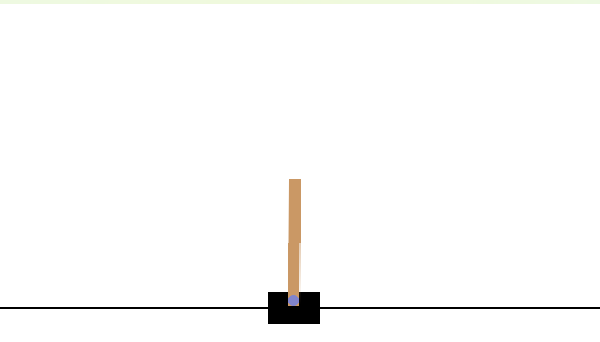

# 30 | 强化学习平台与工具：从OpenAIGym到Ray

欢迎来到强化学习的第三十讲。在强化学习的研究与应用中，选择合适的平台与工具至关重要。合适的平台可以提升我们的开发效率，帮助我们更有效地探索和验证各种算法。接下来，我们将详细介绍两款在强化学习领域极具影响力的平台与工具：OpenAI Gym 和 Ray。

## 一、OpenAI Gym：强化学习的标准测试平台

OpenAI Gym 是 OpenAI 开发的一个用于开发和对比强化学习算法的标准接口。它的出现极大地简化了强化学习算法的测试过程，为研究人员和开发者提供了一个统一的实验环境。总结起来，Gym 有如下优点：

## 1.1 丰富的环境集合

OpenAI Gym 包含了大量预定义的环境，涵盖了从经典控制问题到复杂游戏的多个领域。例如：

- 经典控制环境：如 CartPole（小车倒立摆）、MountainCar（爬山车）等，这些环境简单直观，非常适合初学者理解强化学习的基本概念和算法。以 CartPole 为例，智能体需要通过控制小车的左右移动，使得杆子保持垂直不倒。这个环境虽然看似简单，但却涉及到状态空间、动作空间、奖励机制等强化学习的核心要素。

- Atari 游戏环境：基于 Arcade Learning Environment，Gym 提供了一系列 Atari 游戏环境，如 Pong（乒乓球）、Breakout（打砖块）等。在这些环境中，智能体需要根据游戏画面的像素信息做出决策，这对于研究基于视觉输入的强化学习算法非常有帮助。例如在 Pong 游戏中，智能体要控制球拍上下移动，接住对方打来的球并将球打到对方场地，通过不断与环境交互学习最优的击球策略。

## 1.2 简洁易用的接口

Gym 设计了简洁、易用的接口，主要包括 reset() 和 step() 方法。

- reset() 方法用于重置环境，将环境状态重置为初始状态，并返回初始观测值。例如在使用CartPole 环境时，调用 env.reset() 后，环境会回到小车和杆子的初始位置，并返回此时小车和杆子的状态信息，如小车的位置、速度，杆子的角度、角速度等。

- step() 方法用于在环境中执行一个动作。它接受一个动作作为输入，并返回四个值：新的观测值、奖励、是否结束标志以及其他信息。以在 CartPole 环境中执行动作为例，假设智能体选择让小车向右移动（对应一个动作值），调用 env.step(action) 后，环境会根据这个动作更新状态，返回新的小车和杆子状态（新观测值），如果杆子保持垂直不倒，会给予一定的正奖励，若杆子倒下则给予负奖励，同时返回一个标志表示该 episode 是否结束（杆子倒下则结束），以及可能的其他辅助信息。

## 1.3 促进算法对比与评估

为了公平地比较不同算法，OpenAI Gym 强调了评估方法的重要性。用户需要报告算法的性能分数以及评估过程中的不确定性。这有助于研究人员了解算法在不同环境中的性能，并找到改进的方法。

例如，在比较两个不同的强化学习算法在 CartPole 环境中的表现时，通过记录它们在多个episode 中的平均奖励、达到一定奖励阈值所需的 episode 数量等指标，可以直观地判断哪个算法更优。同时，通过多次运行实验并统计结果的标准差等指标，可以了解算法性能的稳定性。

## 1.4 Gym 开发样例

下面的代码展示了 Gym 的基本使用流程：

1. 使用 gym.make() 创建环境

2. 使用 reset() 方法初始化环境

3. 在循环中使用 step() 方法执行动作并获取反馈

4. 累积奖励并判断回合是否结束

5. 最后使用 close() 关闭环境

代码中使用了随机策略来选择动作，在实际应用中，这里会被强化学习算法所替代，以学习到最优的动作选择策略。运行这段代码，你会看到小车尝试保持杆子垂直不倒的过程，每个回合的目标是获得尽可能高的总奖励（图 30-1）。



- 图30-1 Gym 样例

```python
import gym
import time
# 创建 CartPole 环境
env = gym.make('CartPole-v1')
# 重置环境，获取初始观测值
observation = env.reset()
print("初始观测值:", observation)
# 运行多个 episode
episodes = 5
for episode in range(episodes):
   print(f"\n第 {episode + 1} 个回合")
   observation = env.reset()  # 重置环境
   total_reward = 0
   done = False
   # 一个回合的循环
   while not done:
       # 渲染环境（可视化）
       env.render()
       # 随机选择一个动作（0: 向左移动, 1: 向右移动）
       action = env.action_space.sample()
       # 执行动作
       next_observation, reward, done, info = env.step(action)
       # 累积奖励
       total_reward += reward
```

如果你想尝试其他环境，只需将 CartPole-v1 替换为其他环境名称，如 MountainCar-v0 或Pong-v0（需要额外安装 atari 环境支持）。

## 1.5 丰富的资源及社区支持

作为一个开源项目，OpenAI Gym 拥有一个活跃的社区。社区成员提供了大量的教程、示例代码和解决方案，这对于初学者快速上手强化学习非常有帮助。在社区论坛上，用户可以交流在使用 Gym 过程中遇到的问题和解决方案，分享自己在不同环境中实现强化学习算法的经验。

例如，很多人会分享如何在 Atari 游戏环境中优化 DQN 等其他算法以提高游戏得分的技巧，也有不少人发布了针对特定环境的自定义奖励函数的方法。

## 二、Ray：可扩展的强化学习框架

Ray 是由 UC Berkeley 开发的一个高性能、可扩展的分布式计算框架，其 RLlib 模块为强化学习提供了强大的支持。在处理大规模数据和复杂模型时，Ray RLlib 展现出了显著的优势。尤其是在大语言模型时代，Ray 成为构建大模型后训练框架的基石。总结起来，Ray 有如下优点：

## 2.1 分布式训练能力

Ray RLlib 支持大规模分布式训练，能够充分利用集群资源加速强化学习模型的训练过程。在训练复杂的强化学习模型时，比如在大规模的机器人仿真环境中训练智能体时，单台机器的计算资源往往有限，训练时间会非常漫长。而使用 Ray RLlib，我们可以轻松地将训练任务分布到多个节点上并行执行。这样，在一个由多台服务器组成的集群中，每台服务器可以负责一部分智能体的训练，通过分布式的方式大大缩短了训练时间，提升训练效率。

## 2.2 丰富的算法库

RLlib 提供了多种经典和前沿的强化学习算法实现，包括 PPO（近端策略优化）、DQN（深度Q 网络）、A2C（异步优势演员 - 评论家）等。用户可以方便地使用这些算法进行实验和开发，无需从头实现。以 PPO 算法为例，在使用 Ray RLlib 时，只需几行代码就可以配置并启动一个基于 PPO 的强化学习训练任务。例如：

```python
from ray import tune
from ray.rllib.algorithms.ppo import PPOConfig
config = (
   PPOConfig()
  .environment("CartPole-v1")
  .training(gamma=0.99, lr=0.0003)
  .resources(num_gpus=0)
)
tune.run(
   "PPO",
   config=config.to_dict(),
   stop={"episode_reward_mean": 450},
   checkpoint_freq=10,
)
```

这段代码配置了一个在 CartPole 环境中使用 PPO 算法进行训练的任务，设置了折扣因子gamma、学习率 lr 等参数，并指定了训练停止条件为平均 episode 奖励达到 450，同时每训练 10 个 checkpoint 保存一次模型。可以看到，基于 Ray RLlib 的强化学习配置是非常简单直观的。

## 2.3 灵活的 API 设计

RLlib 的 API 设计非常灵活，允许用户自定义环境、策略和算法。这使得研究人员可以根据具体的需求进行定制化开发。当我们有一个特定领域的任务，现有的 Gym 环境无法满足需求时，可以通过继承 RLlib 的环境基类来自定义环境。同样，对于一些特殊的策略或算法改进，也可以通过继承相应的类进行实现。例如，自定义一个继承自 gym.Env 的环境类，并重写reset、step 等方法来适应特定的任务需求，然后在 Ray RLlib 中使用这个自定义环境进行强化学习训练。

## 2.4 与其他工具的集成

Ray 可以与其他常用的机器学习和深度学习工具集成，如 TensorFlow、PyTorch 等。这为用户在不同的技术栈之间切换和结合使用提供了便利。例如，我们可以在 Ray RLlib 的框架下，使用 PyTorch 构建智能体的神经网络模型，利用 PyTorch 强大的张量计算和自动微分功能来优化模型参数。同时，Ray 还支持与一些数据处理和分析工具集成，方便在强化学习过程中处理和分析大量的数据。

## 总结​

OpenAI Gym 和 Ray RLlib 在强化学习领域都扮演着重要的角色。

OpenAI Gym 以其丰富的预定义环境和简洁的接口，成为了强化学习算法测试和初学者入门的首选平台。它让研究人员能够快速地在各种标准环境中验证自己的算法，促进了强化学习算法的比较和评估。

而 Ray RLlib 具有强大的分布式训练能力，具有丰富的算法库和灵活的 API，适用于处理大规模、复杂的强化学习任务，当前在工业级应用和前沿研究中发挥着重要作用。

在实际的强化学习项目中，我们可以根据具体的需求选择合适的工具，或者将两者结合使用。例如，在算法探索阶段，可以先使用 OpenAI Gym 在简单环境中快速验证想法，然后将成熟的算法迁移到 Ray RLlib 上，利用分布式训练加速在复杂环境中的训练过程。

## 思考题​

1. 在 OpenAI Gym 的 Atari 游戏环境中，智能体仅通过像素信息进行决策，这会带来哪些挑战？如何利用深度学习技术来应对这些挑战？例如，在 Pong 游戏中，像素信息量大且复杂，智能体如何从这些像素中提取有效的特征来指导决策？可以考虑使用卷积神经网络（CNN）等深度学习模型，分析其在处理视觉信息方面的优势以及可能遇到的问题，如计算资源消耗、训练数据量需求等。

2. 尝试在 OpenAI Gym 的一个复杂环境（如 FetchReach，一个机器人抓取任务环境）中，使用 Ray RLlib 的一种算法（如 SAC，软行动评论家算法）进行训练，并分析训练过程中的性能指标（如奖励变化、成功率等）。思考如何调整算法参数和环境设置来进一步优化智能体的表现。例如，在 FetchReach 环境中，智能体需要控制机械臂抓取目标物体，训练过程中可能会出现智能体无法准确找到目标位置或者抓取动作不稳定的情况。通过调整 SAC算法的参数，如学习率、折扣因子、熵系数等，观察这些参数变化对智能体性能的影响。同时，也可以尝试调整环境的一些设置，如目标物体的初始位置分布、机械臂的运动速度限制等，分析环境设置对训练结果的作用。

希望你通过今天的学习，对强化学习有了清晰的认识。如果有任何疑问，欢迎在讨论区留言交流！
