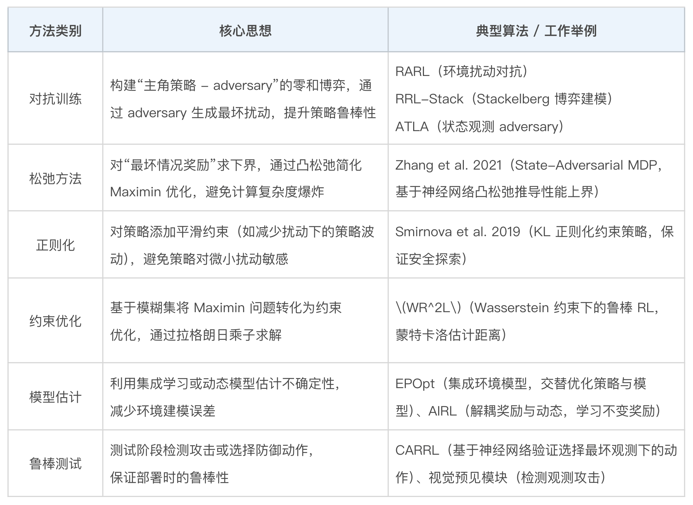

# 结束语 | 共赴强化学习的未来征程

你好，极客时间的朋友。时光飞逝，转眼间，持续更新两个多月的强化学习专栏就要结课了。最后一节课，我还是想和你再聊一聊强化学习，这条通往 AGI 的必经学习路径。

## 一、强化学习面临的挑战与应对

尽管强化学习算法在机器人协作与路径规划中取得了显著的进展，但仍存在一些限制和挑战，需要进一步的研究和改进。

## 1.1 样本效率与计算资源难题

强化学习高度依赖与环境的交互来获取训练样本，但在自动驾驶等真实复杂场景中，其应用面临双重瓶颈。一方面，海量路况等场景下的样本采集成本高昂、耗时长；另一方面，深度强化学习模型训练对计算资源需求巨大。

当前主要应对方向包括三类：一是发展高效采样技术，如基于模型的强化学习，通过环境模型模拟生成样本，以减少真实交互；二是优化神经网络架构与训练算法，例如在稀疏奖励场景下采用课程学习、分层强化学习，提升样本利用效率；三是结合边缘计算与分布式计算，合理分配计算负载，降低对单一高端硬件的依赖。

在强化学习的技术版图中，样本效率始终是制约其发展的核心难题。这如同在贫瘠土地上求丰收，智能体需从有限的交互样本中挖掘足够知识以找到最优策略，难度极大。传统强化学习算法往往需要海量样本，才能让智能体在复杂环境中摸索出有效行为模式。这一过程不仅耗时费力，还在诸多实际场景中受资源条件严格限制，而群组相对策略优化（GRPO）的出现，为突破这一瓶颈带来了关键曙光，推动强化学习迈入新发展阶段。

传统强化学习算法的核心逻辑，是通过智能体与环境的持续交互实现学习。每次交互中，智能体依据当前状态选择动作，环境则反馈相应奖励与新状态。智能体的最终目标，是通过不断试错学习策略，以实现长期累积奖励的最大化。以经典的 Q 学习算法为例，其通过构建 Q 值表记录“状态 - 动作”对应的预期奖励，随着交互次数增加逐步更新 Q 值，最终逼近最优策略。

然而在现实场景中，环境的复杂性与不确定性远超算法假设。以自动驾驶为例，路况瞬息万变，车辆需应对多变天气、复杂道路状况及其他交通参与者的随机行为。这要求智能体探索极为庞大的“状态 - 动作”空间，才能学会在各类场景下做出安全高效的驾驶决策。更关键的是，此类场景中奖励信号往往高度稀疏——仅在发生碰撞或抵达目的地时才会出现明显反馈，导致智能体难以从有限样本中快速学习有效策略。为达到可用性能，传统强化学习常需数以百万甚至亿计的样本，高昂的成本与漫长的训练周期，使其在实际应用中举步维艰。

作为创新型强化学习算法，GRPO 从底层逻辑出发对传统方法进行革新，多维度提升样本效率，其核心在于引入“群组相对评估与优化机制”，打破了传统算法对单个样本逐一评估更新的模式。

在 GRPO 框架下，智能体针对每个输入状态，不再生成单一动作，而是通过策略网络生成一组动作序列。这类似学生解题时不局限于单一思路，而是尝试多种方案。随后，GRPO 会对这组动作序列的表现进行“相对评估”，而非依赖绝对奖励值。通过对比同一问题的多个响应，算法能更充分挖掘样本中的信息，精准定位相对更优策略，避免因单一动作评估的局限性导致策略偏差。

同时，GRPO 摒弃了传统强化学习中常用的价值网络（critic）。在近端策略优化（PPO）等经典算法中，价值网络需评估状态价值以辅助策略网络更新，但这一过程不仅增加计算复杂度，还需额外样本与资源。GRPO 通过“群组内奖励归一化”直接估计基线优势值，从生成的多个动作序列奖励中计算优势，无需单独训练价值网络。这一设计大幅降低了内存占用与计算开销，让有限样本能更高效地投入策略优化。

在实际应用中，GRPO 的样本效率优势已得到充分验证。以大语言模型训练为例，传统基于强化学习的微调方法需大量标注数据与计算资源，而 GRPO 借助群组采样与相对优势估计，能在更少样本下实现更高效的模型优化。DeepSeek 团队将 GRPO 应用于 DeepSeek-Math与 DeepSeek-R1 模型，在数学推理、问题解决等任务中取得显著成果：模型性能大幅提升的同时，训练所需的样本量与计算成本显著降低。

从行业发展视角看，GRPO 的出现为强化学习拓展了应用边界。在移动设备智能应用、实时工业控制等资源受限场景中，GRPO 能利用有限样本让智能体快速学习有效策略，提升系统响应速度与性能。同时，它也为解决强化学习的长期挑战提供了新思路，如探索与利用的平衡、策略的稳定性与泛化性等。随着研究深入与技术迭代，GRPO 有望推动强化学习在更多复杂关键领域实现突破，让智能体在更广阔的场景中展现出强大的决策能力与环境适应性。

## 1.2 安全性与鲁棒性保障

强化学习智能体在实际应用中，需保障决策安全（如机器人操作不能伤害人类、金融决策不能引发系统性风险），且面对环境微小变化、对抗干扰时要保持鲁棒性。需构建安全约束下的强化学习框架，引入安全奖励、约束策略优化（如在机器人控制中，设定物理安全边界的状态惩罚）；开发鲁棒强化学习算法，增强智能体对环境不确定性的适应能力，通过对抗训练、分布鲁棒优化等方法，让智能体在复杂扰动下仍能稳定输出可靠决策。

鲁棒强化学习如表 32-1 所示，方法分为 6 类，覆盖训练与测试阶段，核心思路是“主动对抗扰动”或“被动约束风险”。

- 表32-1 强化学习鲁棒性分类

强化学习的安全性与鲁棒性是其走向现实应用的“双基石”，当前研究已形成系统的建模与方法体系，但仍有关键挑战待解决：

1. 认证与评估：需开发更贴近现实的认证目标（如“鲁棒动作动态”“长周期安全”），以及覆盖罕见风险（如极端天气下的自动驾驶）的基准环境；

2. 权衡与协同：需量化“鲁棒性 - 安全性 - 奖励性能”的权衡关系，设计能同时优化三者的统一框架；

3. 物理与人类融合：需结合物理 Agent 设计（如机器人形态）提升鲁棒性，同时融入人类反馈（可解释性、隐私、公平性），实现“物理可信 + 社会可信”的强化学习。

## 1.3 伦理与社会影响考量

强化学习的广泛应用会引发伦理问题，如智能体决策的责任归属（自动驾驶事故中，强化学习算法、人类设计者、车企谁担责），数据采集与使用中的隐私侵犯（智能体学习过程中涉及用户行为数据），以及对人类就业结构的冲击（自动化决策系统替代部分人工岗位）。

需建立伦理规范与监管机制，明确技术应用的责任边界，制定数据伦理准则保障用户权益；同时，通过教育与培训，助力人类适应人机协作新就业形态，让强化学习技术在伦理与社会可接受的轨道上发展。

强化学习与 AI 伦理共同构成 AI 发展的重要维度：前者为复杂环境中的智能决策提供方法，后者为技术发展划定道德边界，二者促使 AI 技术的开发者、使用者及受影响者参与伦理对话，以确保技术契合社会价值观与期望。

面向未来，既期待涌现更多技术先进且能促进社会公正福祉的负责任 AI 系统，也希望相关法规与标准随技术发展持续更新，进一步引导 AI 朝着伦理、有益的方向推进，实现技术与道德的协同发展。

## 二、行业应用拓展：从现有场景到新兴领域

在明确了强化学习面临的样本效率、安全性及伦理等核心挑战，并探索了应对方向后，技术的价值最终需要通过实际应用来落地与验证。

当前，强化学习已不再局限于实验室中的理论探索或单一领域的试点，而是开始以更成熟的姿态，一方面向制造业、农业等传统行业深度渗透，通过优化生产流程、提升资源利用率，为产业升级注入新动能；另一方面，也在元宇宙、脑机接口等新兴领域积极开拓，凭借其自主学习与决策优化的特性，探索全新的应用场景与价值空间。接下来，我们将具体剖析强化学习在这些领域的应用路径与发展潜力。

## 2.1 传统行业的深度渗透

传统行业是经济发展的基石，也是强化学习技术从理论走向实用、释放规模化价值的核心阵地。相较于新兴领域，传统行业积累了海量真实场景数据与明确的效率优化需求，而强化学习“试错学习 - 动态优化”的核心能力，恰好能针对性解决其长期存在的生产流程固化、资源配置粗放、决策依赖经验等痛点。接下来，我们将聚焦制造业与农业两大关键领域，具体拆解强化学习如何推动传统行业实现从局部改造到全面升级的深度变革。

### 2.1.1 制造业：智能工厂的全面升级

在制造业，强化学习将从单一设备控制向整个工厂的智能调度、工艺优化深度延伸。智能工厂中，强化学习智能体可统筹生产设备（如机床、机械臂）的运行参数调整、订单排产、物料配送，根据实时生产数据（设备能耗、产品质量检测结果）动态优化，实现生产效率最大化与资源浪费最小化，推动制造业向柔性化、智能化生产模式转型，重塑工业 4.0 时代的生产范式。

制造业场景是指制造企业或产业链在创造价值的过程中，特定技术、流程或业务需求所对应的应用环境或情境，主要包括研发设计、生产制造、运维服务、经营管理、供应链管理及跨环节协同等典型场景。AI 技术可以根据不同场景的独特需求，精准地发挥监测与安全、感知与识别、分析与预测、协同与交互、决策与优化、学习与创新等多样化的功能，驱动传统制造业实现数智化转型。

生产制造场景应用，即借助 AI 技术、物联网等数智技术和工具，将原材料、零部件、能源、信息等智能转化为产品或服务，主要包含生产流程优化、质量智能检测、安环监测与监管等细分场景。

首先，采用深度强化学习算法构建动态流程优化模型，企业可对制造执行系统（MES）采集的时序数据进行特征挖掘与模式分析，识别生产中存在的潜在问题，提供改进建议，从而提高生产效率和产品质量。其次，AI 技术基于卷积神经网络（CNN）与迁移学习框架构建的视觉检测系统，通过高分辨率工业相机与激光扫描仪的多模态数据融合，对生产线上的产品进行实时、高效的缺陷检测和质量控制，从而提高检测效率和准确性。另外，通过 AI、传感器和物联网技术，能够实时监测生产设备的运行状态、物料消耗等关键数据，动态感知危化品的泄露与处置、污染物的排放与处理等各类安环风险，形成覆盖“感知 - 诊断 - 处置”全链路的智能安环监管体系。

人工智能技术助推制造业向服务创新化方向发展。服务创新化指制造业借助 AI 技术的分析与预测、协同与交互、学习与创新等功能，从“产品主导”向“产品 + 服务主导”的商业模式转型，实现服务效率化和服务增值化，推动“全生命周期服务”的价值跃迁。AI 技术通过重构制造业服务链路，系统性提升服务效率，如基于设备运行数据的机器学习模型，可以提前识别客户维保需求，使服务响应周期从“故障后救援”转向“预测性干预”，效率得以大幅提升。

### 2.1.2 农业：精准农业与智慧养殖

农业是人类社会的基石，为人类提供食物、纤维和能源等基本需求。农业领域，强化学习助力精准农业发展。在农田管理中，智能体根据气象数据、土壤传感器信息、作物生长模型，决策灌溉、施肥、植保的最优策略，实现资源精准投放；智慧养殖里，针对家禽家畜生长环境（温度、湿度、饲料配方）与健康状态，强化学习优化养殖流程，提升养殖效率与产品质量，缓解传统农业靠经验决策的粗放模式弊端，促进农业现代化升级。

传统农业增长受制于初级要素的边际报酬递减规律与简单技术的线性演进轨迹锁定。粗放型发展模式触及生态承载阈值，让农业发展陷入高投入、低效率且不可持续的恶性循环。在发展农业新质生产力与建设农业强国的战略交汇期，人工智能是技术－经济范式中的革命性变量，通过创新要素组合空间与变革基要生产函数等方式，为突破传统农业生产力发展桎梏提供可行方案。基于广泛渗透性、深度协同性、全域赋能性等基本属性，人工智能通过传感器、物联网、地理信息系统等媒介向农业领域渗透，健全智慧农业标准体系，赋予农业生产系统以稳定性、规律性、精准性，从而形成物理空间与数字空间双重映射的生产力迭代路径。

具体而言，人工智能赋能农业新质生产力的理论贡献与独特优势主要来源于三重机制创新。首先，人工智能数字化解耦与重组生物生长、环境参数等离散化变量，突破要素不可分性约束与传统生产可能性边界，不断开辟农业新质生产力新的发展空间，推动农业发展方式由促增量向提质量转变。其次，人工智能撬动先进优质生产要素顺畅流向农业新质生产力领域，并借助机器学习等算法，动态优化生产决策与实时响应生产调控，实现要素组合边际效率提高的正反馈循环。最后，人工智能重构农业产业链的价值创造逻辑与价值表现形态。农业全产业链中的数据穿透体系与技术融合应用，能够催生农产品质量溯源、碳足迹交易等新型农业服务经济，有助于增强农业的可持续发展能力和市场竞争力，从而加速形成农业新质生产力，最终实现农业高质量发展。

## 2.2 新兴领域的开拓创新

在为传统行业注入升级动能的同时，强化学习的探索脚步并未停歇。新兴领域的技术特性与场景需求，为强化学习提供了突破既有边界、释放更多创新潜力的舞台——这些领域或具备虚拟仿真的天然优势，或能实现人机交互的深度融合，恰好与强化学习“自主探索、动态适应”的核心逻辑高度契合。接下来，我们将聚焦元宇宙与脑机接口两大前沿方向，看看强化学习如何在这些新兴领域开辟全新应用赛道，创造出超越传统场景的价值空间。

### 2.2.1 元宇宙与虚拟世界

元宇宙构建的虚拟空间，为强化学习提供了天然的大规模实验场与应用舞台。强化学习智能体可在元宇宙中自主探索、社交、创造价值，比如在虚拟城市中优化交通流（类似现实交通调度但更具灵活性），在虚拟社交场景中学习人类交互模式并生成自然的社交策略，甚至参与虚拟经济系统的资源分配、商业运营，成为元宇宙生态中自主进化的“数字居民”，丰富元宇宙的交互层次与生态活力。

在工业界也有一个相似的概念，叫“数字孪生”（Digital Twins），指人们用软件来模仿和增强人类世界的行为。就像电影《头号玩家》（图 32-1），玩家可以在虚拟世界中打造任何事物，比如造一座小城市，他们所打造的灵感往往是来源于对现实生活的观察。

- 图32-1《头号玩家》电影海报

那么，“元宇宙”、“数字孪生”这些概念与深度强化学习有什么关系呢？

事实上，“模仿”在深度强化学习的研究中非常重要：在研究者将深度强化学习技术落地在现实世界中时，为了避免灾难性的操作后果，他们往往要先做一个模拟器来模拟现实的物理世界，让算法在与人类直接交互前，先与虚拟的智能体进行交互试验，在不断的试错实验中找到行为主体的最优策略。

### 2.2.2 脑机接口与神经强化学习

脑机接口（BCI）技术让大脑信号与机器直接交互，与强化学习结合产生神经强化学习新方向。通过采集大脑的神经活动信号（如运动意图、奖励预期的神经表征），作为强化学习的状态或奖励输入，可实现更直接的人机协同控制（如残疾人用大脑意念通过强化学习控制外骨骼机器人精准动作），也为探索人类认知决策机制、治疗神经疾病（如通过强化学习优化神经反馈训练，干预抑郁症患者的情绪决策环路）开辟新路径，模糊生物智能与人工智能的边界，拓展强化学习的应用维度。

根据技术的侵入性，BCI 可分为如下三类：

1. 非侵入式 BCI 通过不接触大脑皮层的方式采集大脑信号，如 EEG、功能磁共振或近红外光谱（near-infrared spectroscopy，NIRS）等，风险较低，但信号精度较差，适用于智能设备控制和脑波训练等领域；

2. 半侵入式 BCI 通过将电极植入硬脑膜外获取神经信号，虽然风险较低，但仍需手术，设备的长期稳定性和耐用性存在挑战；

3. 侵入式 BCI 则通过外科手术将电极直接植入大脑皮层或深部脑结构，提供高质量信号，适用于精确神经调控，但伴随手术风险、设备寿命和免疫排斥等问题。

ZanderLabs 公司正在研究的被动脑机接口（pBCI）技术和神经适应性学习已成为关键考虑因素。与需要显式反馈的基于人类反馈强化学习不同，pBCI 技术可以实时内隐传递认知和情感见解。pBCI 通过头皮上的传感器记录自然脑活动来收集信息，这些传感器可检测神经信号，并将这些信号转换为数字数据。

通过这种方式，人工智能系统可以直接获取有关情绪状态、认知负荷和注意力水平的信息，从而更深入地了解用户的需求，而无需用户有意识地输入任何信息。用户只需专注于手头的工作，系统就会通过监测大脑活动自动评估他们的认知和情绪反应。当然，这需要获得伦理方面的批准。

被动式 BCI 是一项重大突破，因为它们在后台工作，就像无声的观察者一样，从我们无意识的大脑信号中学习。

## 三、强化学习研究生态的构建与发展

无论是传统行业的深度渗透，还是新兴领域的创新开拓，强化学习技术的持续演进与规模化落地，都离不开一个完善、协同的研究生态作为支撑。单一的技术突破或场景应用难以推动其长期发展，只有通过学术研究的跨界协同、产业与学界的深度联动，以及开源社区与教育的广泛赋能，才能为强化学习构建起可持续发展的“土壤”与“生态链”。接下来，我们将从学术协同、产学研联动、开源与教育三个维度，解析如何搭建强化学习研究生态，为技术创新与行业应用提供长久动力。

## 3.1 学术研究的协同与突破

强化学习的前沿突破需要不同学科（计算机科学、数学、心理学、神经科学等）的深度协同。计算机科学提供算法框架与工程实现，数学保障理论严谨性（如马尔可夫决策过程的数学推导、优化理论支撑），心理学和神经科学为理解人类学习决策机制、启发强化学习模型创新（如模拟人类大脑奖励系统设计强化学习奖励函数）提供灵感。搭建跨学科研究平台，促进学术思想碰撞，将加速强化学习从理论到应用的转化，推动如通用人工智能基础理论、可解释强化学习等关键问题的突破。

强化学习环境的跨学科与跨领域涉及到多个学科和领域的知识和技术，包括人工智能、机器学习、数学、统计学、计算机科学、物理学、生物学、心理学等。

以下是一些核心概念和联系：

- 人工智能：强化学习是人工智能的一个子领域，其目标是让计算机系统能够自主地学习和决策，以实现与人类相似的智能。

- 机器学习：强化学习是一种机器学习方法，它通过与环境的互动来学习如何做出最佳决策，而不是通过传统的监督学习或无监督学习方法。

- 数学：强化学习涉及到许多数学概念，如马尔可夫决策过程（MDP）、贝尔曼方程、值迭代、策略梯度等。

- 统计学：强化学习需要估计不确定性，因此涉及到许多统计学概念，如方差、协方差、信息增益、信息熵等。

- 计算机科学：强化学习需要设计和实现算法，以及处理大量数据，因此涉及到计算机科学的许多概念，如数据结构、算法设计、并行计算、分布式计算等。

- 物理学：强化学习可以应用于物理系统的控制和优化，因此需要了解物理学的概念和模型。

- 生物学：强化学习可以应用于生物系统的研究，如神经科学、生物学等，因此需要了解生物学的概念和模型。

- 心理学：强化学习可以应用于心理学研究，如人类行为、情感等，因此需要了解心理学的概念和模型。

## 3.2 产业界与学术界的联动

产业界拥有丰富的实际应用场景与数据资源，学术界具备理论创新与算法研发优势，二者深度联动至关重要。企业可向高校、科研机构开放真实场景数据与应用需求（如金融机构提供交易数据用于强化学习风险决策研究），学术界将研究成果（如新型高效强化学习算法）在企业场景中验证、迭代，形成“需求 - 研发 - 应用 - 反馈”的闭环，加速强化学习技术的产业化落地，同时也让学术研究更贴合实际价值创造，避免“空中楼阁”式研究。

具身智能，作为人工智能迈向物理世界的核心技术，正在打破虚拟与现实的边界。通过赋予AI 以感知、行动、学习的闭环能力，具身智能正在重塑算法、系统和应用之间的关系，推动从虚拟仿真到实体执行的全方位技术跃迁。

感知 - 决策 - 行动 - 反馈的闭环具身智能架构，这条路径中的技术支点主要包括：

- 更丰富、更主动的感知系统：二维视觉虽易获取，但对于构建世界模型与操作任务，缺乏空间与结构感知能力。尤其在数据稀缺或新场景下，单目图像很难区分物体的距离、形状与几何关系。

- 从模仿走向强化，构建闭环反馈：强化学习能构建奖励函数与策略优化之间的闭环，也就是说：机器人自己做事 → 环境给反馈（成功 / 失败） → 调整行为策略。

- 多模态融合与世界模型：真正的具身智能不仅需要感知，还需要构建一个可推理的世界模型。

相比构建超大模型、堆参数、调奖励函数，身处“大模型 + 端到端学习”的热潮之下，更重要的是谁在解决真实问题、谁在把机器人真正落地到农业、工厂、医院、仓库等。

## 结语：共赴强化学习的未来征程

回顾专栏历程，我们从强化学习的基础概念起步，穿梭于策略梯度、价值学习、深度强化学习等核心内容，见证了它在游戏、机器人、推荐系统等场景的实战应用。而展望未来，强化学习正站在新的历史起点，一边向着通用人工智能的宏伟蓝图奋勇迈进，尝试突破智能的边界，实现跨领域、可持续、创造性的学习与决策；一边深度融入人机协作的日常，重塑人类与智能系统共事的模式，从浅层配合走向心意相通、优势互补的协同进化。

强化学习的广泛传播与技术迭代离不开开源社区的力量。像 OpenAI Gym 等开源平台，为全球开发者提供实验环境与基准测试，促进算法共享与对比。未来需进一步壮大开源生态，完善工具链（如强化学习与大数据、物联网平台的集成工具），降低技术使用门槛。同时，强化学习教育要从高校科研向职业教育、大众科普延伸，通过在线课程、实战竞赛等形式，培养更多跨领域的强化学习人才，为行业发展注入新鲜血液，让强化学习的创新活力持续涌动。

前行路上，强化学习面临着样本效率、安全性、伦理等挑战，但也正是这些挑战，为技术创新提供了生长的土壤。在学术与产业的协同、开源社区的滋养、教育推广的助力下，我们有理由相信，强化学习将持续绽放光彩。它会让智能体在复杂现实与虚拟世界中更聪明、更可靠，也会让人类与机器的协作更自然、更高效，共同书写从通用人工智能探索到人机和谐共生的精彩篇章。

这不是强化学习探索的终点，而是新征程的开端。愿你我在未来的日子里，持续关注、参与强化学习的发展，见证它为人工智能乃至整个人类社会带来的深刻变革，让我们在智能浪潮中，携手奔赴充满无限可能的明天！

