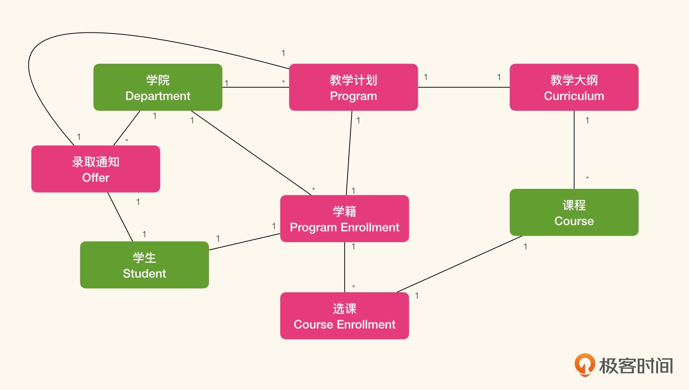
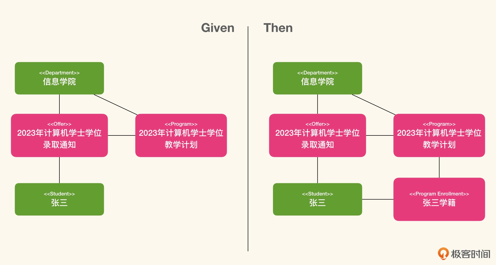
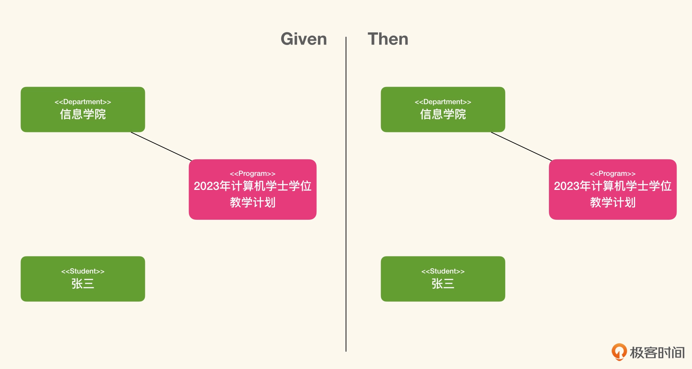
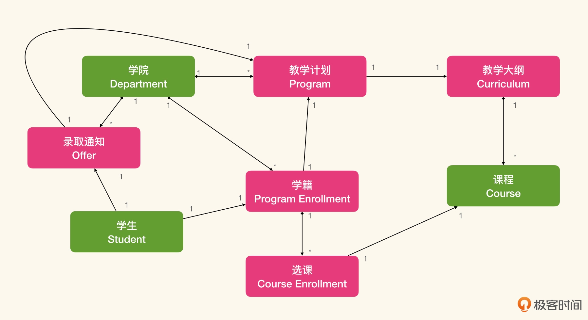
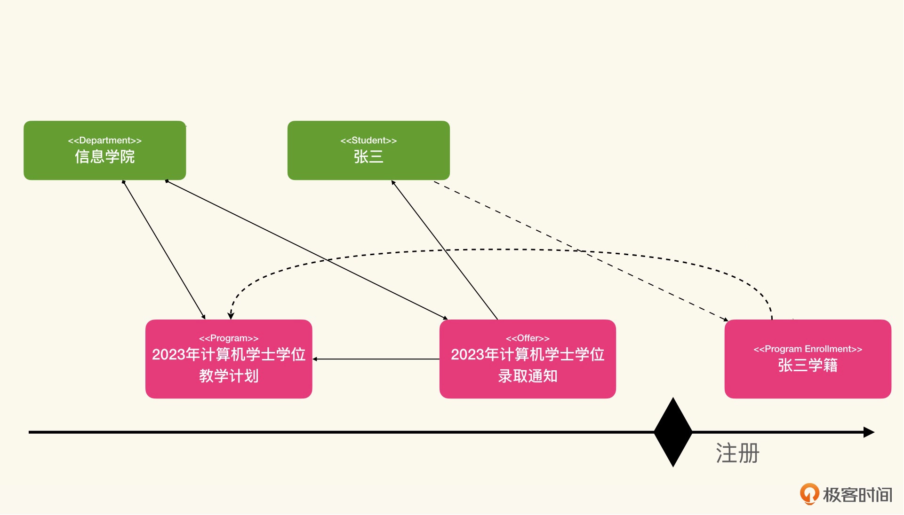
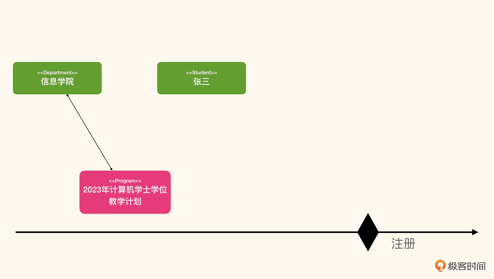

# 07 | 通过业务建模应用业务知识

你好，我是徐昊，今天我们来继续学习 AI 时代的软件工程。

从今天开始，我们进入到第二部分的学习：如何使用大语言模型（Large Langauge Model，LLM）辅助我们的软件研发和交付过程。在前面一节课里，我们已经从宏观层面上厘清了这个思路：将软件交付看作知识过程，识别其中的认知行为模式，并选择恰当的 LLM 交互模式，有目的性和针对性地提高整个知识过程的效率。

在这个过程中，我们将着重看待不同种类的知识是如何发挥作用的，以及如何将它们转化为LLM 易于理解的结构。

那么今天我们先从业务模型开始，看一下业务模型是如何帮助我们理解业务的。

## 业务模型是如何发挥作用的

我们都知道，软件开发的核心难度在于处理隐藏在业务知识中的复杂度，模型就是对这种复杂度的简化与精炼。

我们通过模型捕捉领域或业务知识，使用模型构造更易维护的软件。模型就是精粹的知识。我们借助模型形成统一语言（Ubiquitous Language），达成对于问题或解决方案的理解。

我们通过建模获得模型，而建模是一个非常复杂的问题，有各种不同方法。我之前有一个专门的课程讲述这个问题，这里就不再赘述了。有需要了解这方面知识的同学，可以参看相应的课程。

我们目前关注的是，当得到了模型之后，怎么使用模型，帮助我们应用凝结在模型中的业务知识。这个过程，我称之为模型展开。所谓模型展开，就是在给定的业务上下文中，将模型中的概念实例化，通过实例化的模型，解释业务上发生了什么。下面看一个例子。

假设我们现在为某学校研发学籍管理系统，那么它的模型可能是这样的：

这是一个简化的领域模型，描述了学籍管理系统的核心知识：

- 学院提供不同的教学计划，比如信息学院可能提供计算机科学与技术学士学位教学计划，或是计算机科学与技术硕士学位教学计划；

- 不同教学计划有对应的教学大纲。教学大纲中则规定了学生需要学习的课程。比如，计算机科学与技术学士学位教学计划的教学大纲中，规定了学生的必修课离散数学；

- 学院为学生发放录取通知，通知学生被哪个教学计划录取，比如张三录取为学士学位学生；

- 学生根据录取通知将学籍注册到指定的教学计划，比如，张三根据录取通知注册为 2023 年入学的计算机科学与技术学士学位教学计划学生；

- 学士在学籍有效期内，需要根据教学大纲选课。比如，张三在攻取学士学位的时候，学习了离散数学。

接下来，我们就可以在具体的业务场景或是功能需求中，通过模型来应用这些知识了。让我们看几个例子。这里所有的需求我都会以用户故事（User Story）的形式给出。

以学生入学为例，按照我们要求学生需要拿到录取通知后，方能入学，那么用户故事可以写成：

- 作为学校的教职员工（As a faculty），我希望学生可以根据录取通知书将学籍注册到教学计划上（I want the student to be able toenroll in an academic program with given offer），从而我可以跟踪他们的获取学位的进度（So that I can track their progress）

第一个验收条件是可以成功注册的情况。我们使用如果 / 当 / 那么（Given/When/Then）的形式描述验收条件：

- 如果获取了录取通知书的学生没有注册学籍时（Given student with offer hasn’t enrolledany program），当这个学生注册时（When the student enroll），那么这个学生将能成功注册学籍到录取通知书指定的教学计划中（Then the student willsuccessfully enroll the program specified in the offer）

那么我们可以在这个验收条件的上下文中将模型展开。

如上图所示，我们将模型在这个验收条件的上下文中做了实例化。对应验收条件中，Given 的描述是“获取了录取通知的学生没有注册学籍时”，这表示存在一个 Offer 对象实例，而没有Program Enrollment 的实例；而 Then 的描述“这个学生将能成功注册学籍”，则表示我们可以生成 Program Enrollment 的实例，并将这个实例与 Offer 中的教学计划关联。

另一个验收条件是，如果没有拿到 offer 则不能注册。我们仍然使用如果 / 当 / 那么（Given/When/Then）的形式描述验收条件：

- 如果学生没有获取录取通知书（Given student doesn’t have an offer），当他尝试注册时（When the student try to enroll），那么这个学生将无法注册学籍（Then the student can’t enroll any program）

同样我们可以根据这个验收条件的上下文将模型展开。

展开之后，这个模型就简单明了了，Given 的描述是“学生没有获取录取通知”，那么也就是不存在 Offer 对象实例；而 Then 的描述“这个学生将无法注册学籍”，则表示我们不会生成Program Enrollment 的实例。

在这两个例子中，我们关注的是学生学籍注册这个行为或功能。但是我们并没有直接描述它，而是从状态 / 数据改变的角度，描绘了业务行为发生前后模型实例的变化。这样，我们就使用了静态的模型解释了动态的行为或功能。

在使用模型解释业务的时候，是否会出现多种不同的解决方案呢？在解释的过程中，我们只使用了模型中的概念和关系，因而对于某一个场景，实际只存在唯一符合业务场景的描述。这是因为在模型中还隐藏着时间维度。

## 模型中的时间维度

让我们再仔细看一下前面的模型，就会发现其中实际存在着时间顺序。首先是学院。学院是早于教学计划的。没有对应的学院，也就不存在各种学位的教学计划。然后教学计划是早于录取通知书的，如果没有教学计划也不可能发放相应的录取通知书；最后是录取通知书是早于学籍，因为学生是根据录取通知书注册的，如果没有录取通知书，学籍注册也就无法完成。

模型中的时间维度，与模型中关系的性质有关。这就是为什么无论在面向对象设计还是领域驱动设计，抑或是其他什么设计方法中，对于聚合、组合、引用等概念都要详加区分。因为它们表示了不同的时间关系。

如上图所示，我们在模型中标注了引用与聚合关系。不难看出：

- 聚合根要先于被聚合的对象存在。比如，学院 - 教学计划。

- 被引用的对象要先于引用对象存在。比如，录取通知 - 教学计划。

那么我们在展开模型的时候，也可以把时间维度单独标示出来，这样更利于我们处理数据持久化时，理解不同对象的生命周期。比如，在针对这个验收条件：

- 如果获取了录取通知书的学生没有注册学籍时（Given student with offer hasn’t enrolledany program），当这个学生注册时（When the student enroll），那么这个学生将能成功注册学籍到录取通知书指定的教学计划中（Then the student willsuccessfully enroll the program specified in the offer）

进行模型展开的时候，我们可以加入时间的维度：

图中最下方的横轴，表示时间轴，也就是时间的顺序。图形在时间轴上的位置，表示了它们产生的时间的顺序，也就是学院早于教学计划，早于学生，早于录取通知书，早于学籍。当然，严格来说，学生与学院哪个是最先产生的并不重要。它们可能是从其他数据源导入的，是时间不敏感的信息，类似的还有课程，也是一样的情况。

时间轴上有一个关键节点，就是我们当前的业务场景注册。在注册之后，我们产生了新的实体学籍，同时产生了新的关联关系，也就是图中用虚线表示的张三 - 张三的学籍，还有教学计划- 张三的学籍。

类似的，对于第二个验收条件“如果没有拿到 offer 则不能注册”。

- 如果学生没有获取录取通知书（Given student doesn’t have an offer），当他尝试注册时（When the student try to enroll），那么这个学生将无法注册学籍（Then the student can’t enroll any program）包含时间线的模型展开后是这样的。

可以看到，我们既没有生成新的实体，也没有建立新的关联。

在理解了模型中的时间维度之后，通过模型展开，在产生了什么样的实体与关联，这些实体和关联产生的顺序是怎么样的这两点上，我们就能容易地达成共识。也就是使用了模型帮助我们理解了业务。

## 小结

今天我们讲解了模型展开，以及如何利用模型展开去理解业务。通常我们会更关注于建模，也就是模型的提取过程，而往往忽略了模型提取后如何有效应用模型。

行业里有大量关于建模的讨论，但是涉及真正使用模型去形成统一语言，就很少有人提及了。这一方面是因为利用模型形成的统一语言，是一种不可言说知识。另一方面也是因为，我们往往更关注知识的产生，而忽略知识的消费。

从知识工程的角度来看，在我们应用模型来理解业务的过程中，我们处在什么样的认知行为模式呢？很显然，我们是处在庞杂的认知行为模式上的。通过分析，我们将模型中定义的模式（对象类型与关系种类）应用到当前的上下文中。

那么我们使用 LLM 帮助提效的思路是什么呢？思路就是构建思维链（Chain of Thought），也就是通过思维链辅助 LLM 理解模型应该如何展开，这就是我们下节课要讲的内容。

## 思考题

模型展开这部分推荐你自己练习一下，才能充分掌握。请你结合你的工作实践，思考另外几个业务场景，并做模型展开。

欢迎在留言区分享你的想法，我会让编辑置顶一些优质回答供大家学习讨论。
