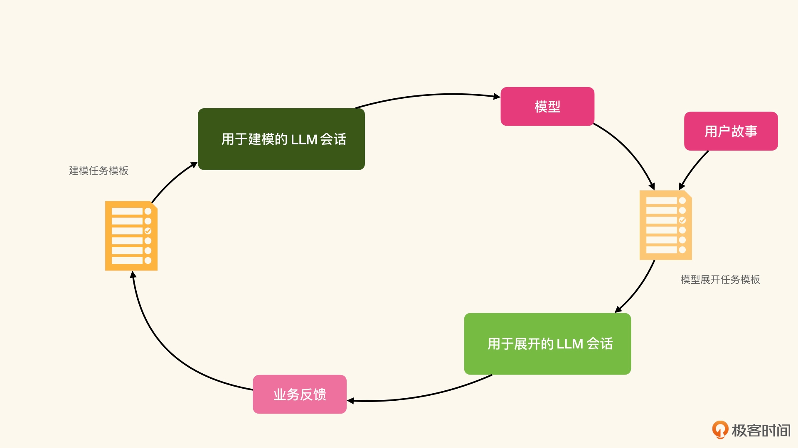
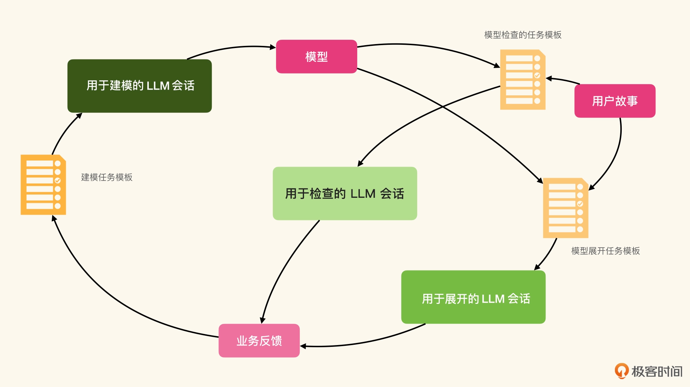
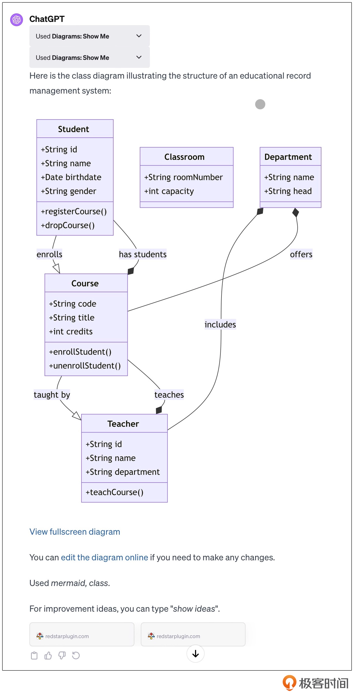
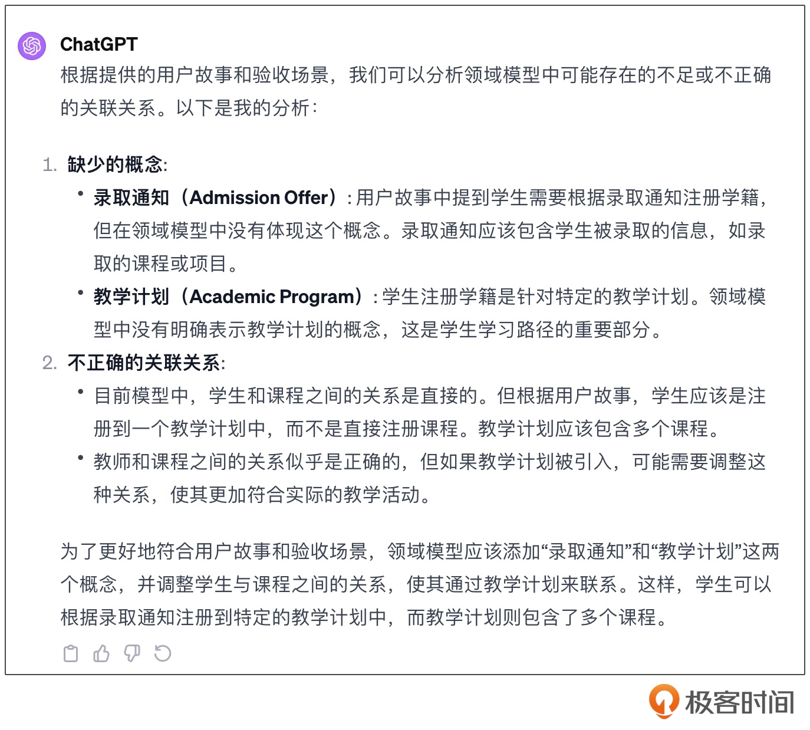
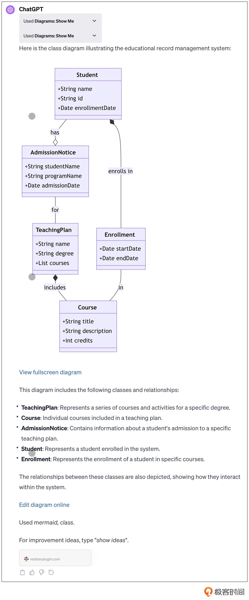
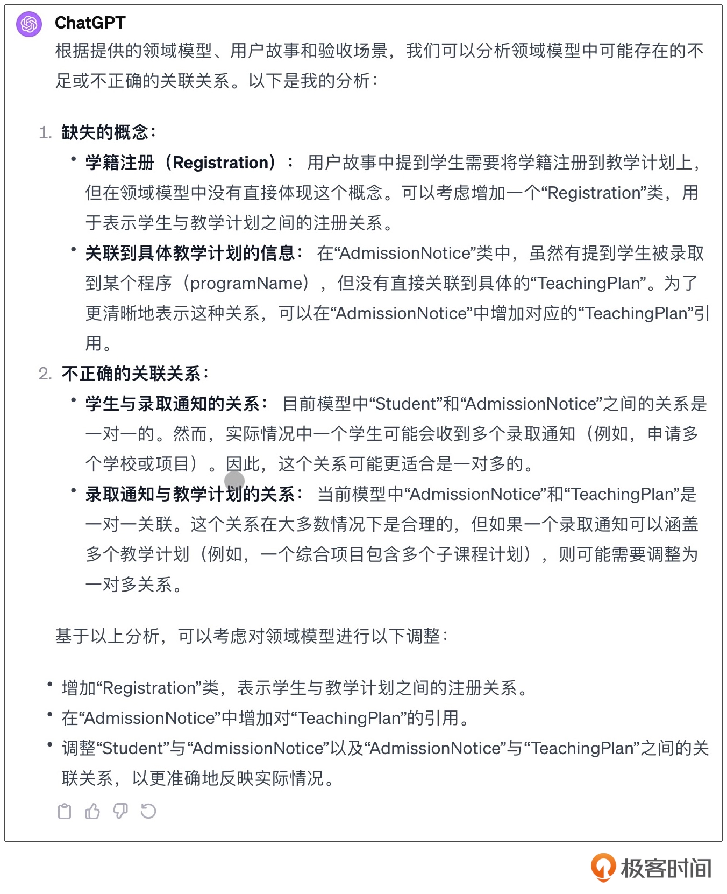
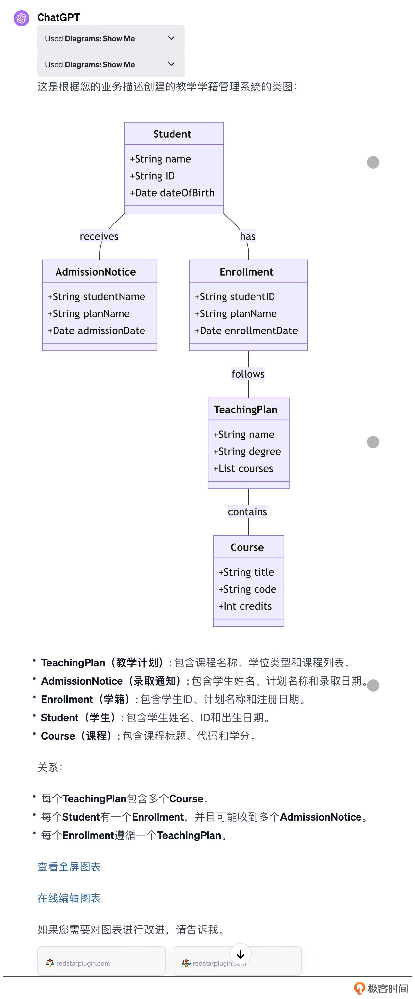
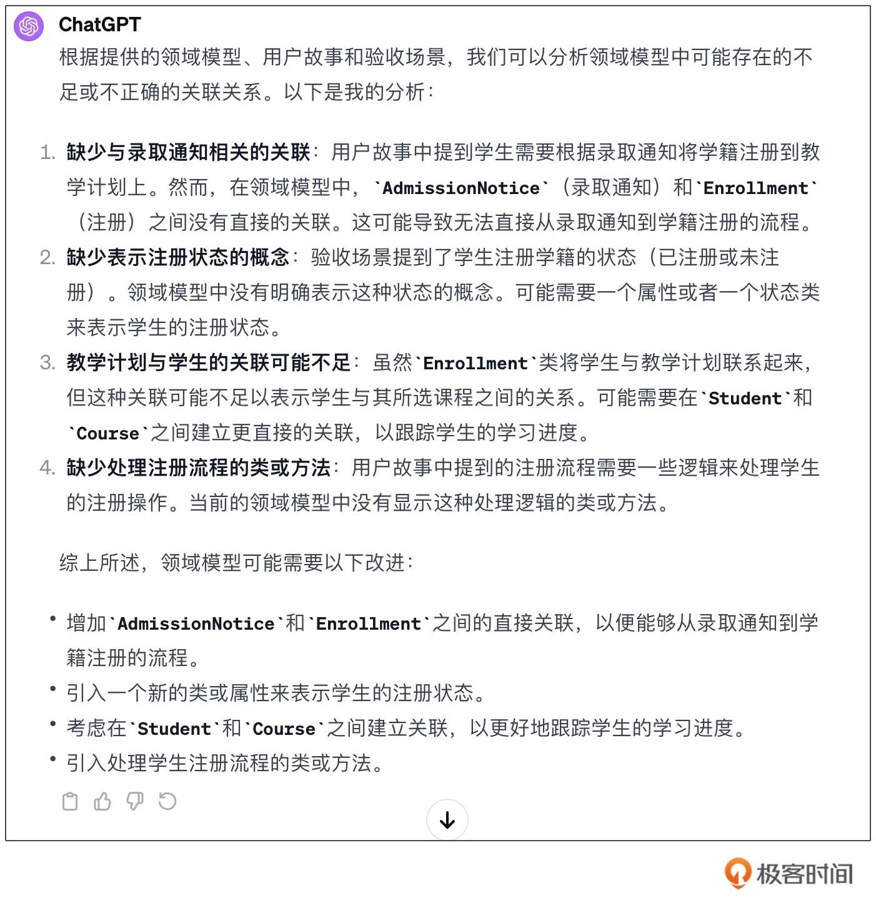
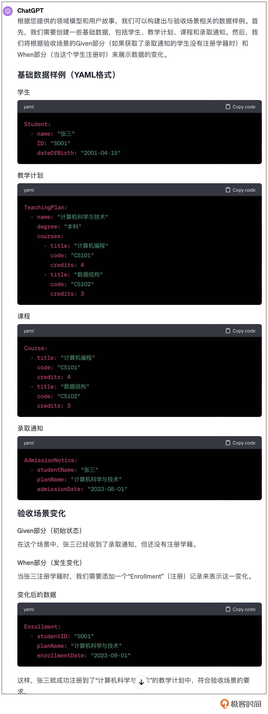

# 09 | LLM辅助建模（一）：构造反馈循环

你好，我是徐昊，今天我们来继续学习 AI 时代的软件工程。

上节课，我们介绍了如何使用 LLM 辅助进行模型展开，从而应用业务知识。具体做法是通过Mermaid 将业务模型转化为大语言模型（Large Language Model，LLM）易于理解的方式，再用半结构化自然语言补充上下文，让思维链的构造更加简单。

但是如果我们没有模型要怎么处理呢？利用 LLM 辅助建模是否也能比传统建模方法更有效率呢？这是我们今天要讨论的问题。

## 构造反馈循环

建模的过程，是学习业务知识并提炼知识的过程。我们在第六节课提到使用 LLM 时，可以通过缩短反馈周期提高知识学习的效率。那么我们可以通过构造一个反馈循环，使用 LLM 帮助我们完成建模的过程。

在反馈循环的过程中，我们处在复杂的认知模式下，也就是遵循探测（Probe）- 感知（Sense）- 响应（Respond）的认知行为模式。

我们之前提到过，由于探测环节费力费时，往往会成为整个反馈周期的瓶颈。但是有了 LLM的辅助，我们可以在探测阶段快速产生初始结果，或是根据反馈重新执行任务。那么感知这一环节就可能会成为新的瓶颈。

在我们前面课程的例子里，我们希望 LLM 帮助我们把一个基于关系型数据的解决方案，改造为使用 MongoDB 的解决方案。感知就比较直接了：将 LLM 生成的代码直接执行就可以了。但对于模型就没有这么简单了。

模型是对于现实世界的抽象，是没有对错之分的，只有不同的角度和抽象的方式。我们评价一个模型，首先看能否适用于业务场景，然后是能否应对业务场景的变化。那么我们可以通过模型展开验证模型的适用度，以及应对变化的能力。

正如我们在上节课的演示，这个过程也可以通过 LLM 辅助。因而，我们使用 LLM 辅助建模的过程，就是利用 LLM 快速构建一个模型，并在不同的业务场景中展开这个模型，收集反馈再让 LLM 帮助我们调整模型。



如上图所示，在这里我们需要利用两个 LLM 的会话（Session），一个用于生成模型，一个用于模型展开。同样我们也需要两个任务模板，一个负责建模，一个负责模型的展开。

但是这里还有一点需要注意，上一节课我们介绍模型展开的时候，不涉及模型的修改。只需要在特定的上下文中，使用模型中的概念给出解释就行了。

但是在建模的过程中，不可能一次就建模正确。我们很可能碰到概念缺失的情况，也就是在用户故事或其他业务上下文中提及的概念，在模型中不存在。或是关系错置的情况，也就是模型中对象间的关联关系不正确的情况。因而在展开之前，我们可以先行反馈这些问题。于是，我们最终的反馈循环看起来是这个样子的：



我们使用的三个模板分别如下。

建模任务模板：

- 业务描述

```
=======
{context}
```

- 任务

```
====
根据业务描述，为系统建立模型。可以添加你认为必要的实体和关系。并将模型表示为mermaid的class dia
```

模型检查任务模板：

```
```plain
```

- 领域模型

```
======
```mermaid
{model}
```
```

- 用户故事

```
======
{user_story}
```

- 验收场景

```
======
{ac}
```

- 任务

```
===
```

- 针对这个用户故事和验收场景，领域模型中缺少哪些概念？或者存在哪些不正确的关联关系。请用文字表示缺失的概念是什么？以及存在哪些不正确的关联。

```
```
```

模型展开任务模板：

```
```plain
```

- 领域模型

```
======
```mermaid
{model}
```
```

- 用户故事

```
======
{user_story}
```

- 验收场景

```
======
{ac}
```

- 任务

```
===
数据都以yaml格式给出。
首先，请根据领域模型理解用户故事中的场景，并针对验收场景中Given的部分，给出样例数据。
然后，参看验收场景中When的部分，给出样例数据会产生怎样的改变。
```
```

在模型展开的模板中，我们需要用户故事和验收场景。同样，我们可以使用上一节课中的用户故事和验收条件。

- 作为学校的教职员工（As a faculty），我希望学生可以根据录取通知将学籍注册到教学计划上（I want the student to be able toenroll in an academic program with given offer），从而我可以跟踪他们的获取学位的进度（So that I can track their progress）

- 如果获取了录取通知的学生没有注册学籍时（Given student with offer hasn’t enrolled anyprogram），当这个学生注册时（When the student enroll），那么这个学生将能成功注册学籍到录取通知指定的教学计划中（Then the student willsuccessfully enroll the program specified in the offer）x

下面让我们使用这两个模板，通过反馈循环，对这个系统进行建模。

## 使用反馈循环完成建模

首先，让我们先描述一下我们要建模的业务系统，因为我们存在一个让 ChatGPT 检查的环节，出于展示的目的，我们不需要放入太多的内容。但在正常的使用过程中，更多的上下文总是会产生更好的结果。

- 这是一个教学学籍管理系统

我们套入模板，先让 ChatGPT 帮我们建模。我这里使用了 ChatGPT-4 的插件，可以直接显示模型图。如果没有插件的话，可以根据 ChatGPT 生成的 Mermaid 在使用在线编辑器看图。



可以看到，结果跟我们建模的结果相去甚远。因为我们并没有给出具体的业务描述，ChatGPT只能根据对于学籍管理的泛泛理解，完成建模的过程。那么我们可以把这次生成的结果，代入到模型检查的任务模板中去。



ChatGPT 给出了对于概念缺失的提示。我们可以根据这个反馈，修改对于业务的描述。一个简单的办法是，我们可以列出当前业务中的核心概念，让 LLM 重新生成模型：

- 这是一个教学学籍管理系统。系统中应该包含以下的核心概念：

```
- 教学计划: 一系列相关课程和活动，这些课程和活动旨在培养特定领域的知识和技能。比如，计算机科学与技
- 录取通知: 学生需要根据录取通知注册学籍。录取通知应该包含学生被录取的信息，如录取的教学计划
```



我们可以看到，这次已经非常接近我们之前给出的结果了。让我们再继续验证一下这个模型。



可以看到 ChatGPT 给出的建议非常类似我们前面课程中给出的模型。接下来，我们继续补充需要的核心概念：

- 这是一个教学学籍管理系统。系统中应该包含以下的核心概念：

```
- 教学计划: 一系列相关课程和活动，这些课程和活动旨在培养特定领域的知识和技能。比如，计算机科学与技
- 录取通知: 学生需要根据录取通知注册学籍。录取通知应该包含学生被录取的信息，如录取的教学计划
- 学籍：当学生注册之后，学籍记录学生在校将按照哪个教学计划学习
- 学生
```



已经非常接近了。让我们再检查一次：



好了，现在对于实体已经没有遗漏了，只有对于关联关系的建议，这些目前我们并不需要非常关注，我们建模第一步先把实体找清楚，然后再来看建模关系。下面让我们进行模型展开：



至此为止，我们就通过 LLM 辅助，借助反馈循环得到了与之前类似的模型，并且这个模型也可以解释当前的业务。

## 小结

今天我们介绍了如何通过构造反馈循环，并使用 LLM 加速反馈循环中不同的环节，辅助我们完成建模的过程。

我们首先描述了系统的大致情况，然后通过 LLM 在不同的业务上下文中，验证模型的完备性，提出缺失的概念。之后将缺失的概念添加回业务上下文中，再做模型改进。利用这种方法，我们哪怕预先不知道太多业务上下文，也可以仅仅通过 LLM 的反馈来辅助建模。

我们展示的方式，也是知识工程的一个基本模式，构造复杂认知模式的反馈循环并通过 LLM加速。在后面的课程中，我们会反复看到这个模式的应用。

## 思考题

有没有其他的方式构造反馈的循环？

欢迎你在留言区分享自己的思考或疑惑，我们会把精彩内容置顶供大家学习讨论。
