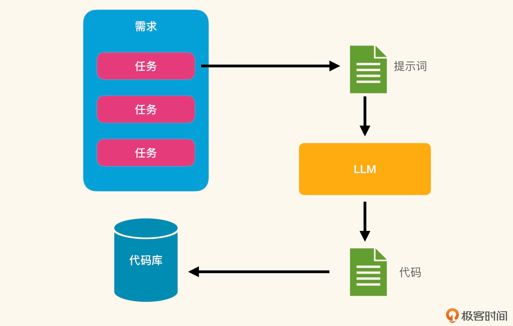
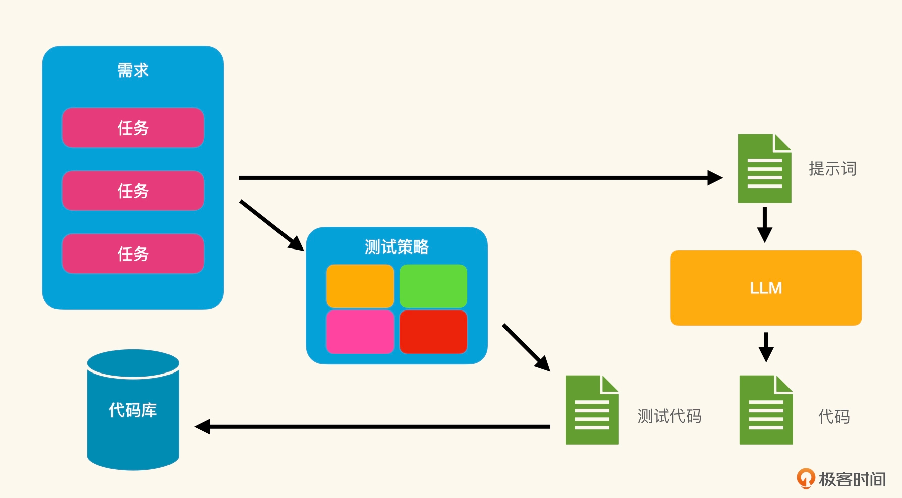
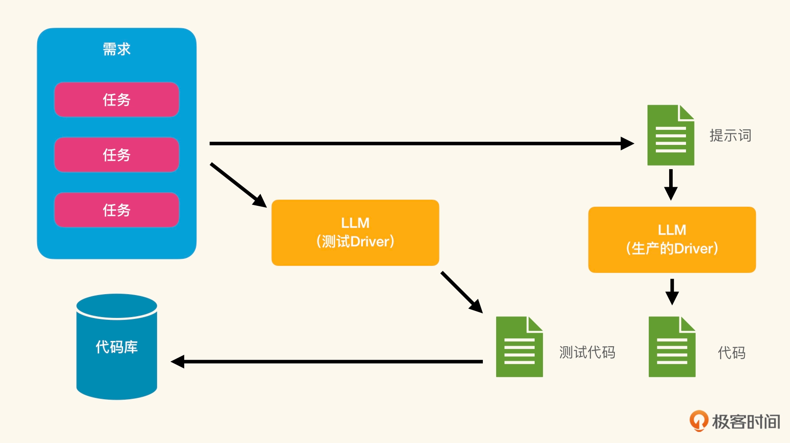
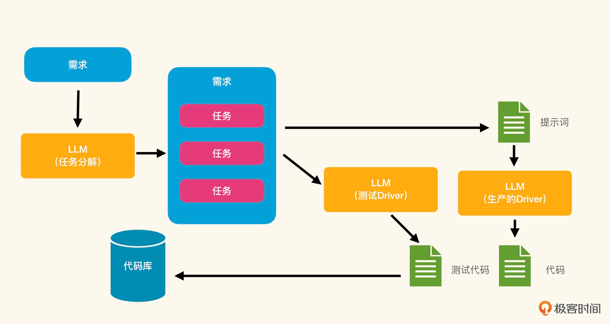

# 16 | 任务划分与测试驱动AI开发

你好，我是徐昊，今天我们来继续学习 AI 时代的软件工程。

上一节课，我们展示了直接使用大语言模型（Large Language Model，LLM）辅助进行软件开发的例子，我们看到虽然在速度上 LLM 有惊人的提高，但是质量堪忧。而且在与 LLM 一起开发的时候，我们的关注点更多集中在测试上，通过测试提炼需要给予 LLM 的反馈，而不是编码。

可能有同学会说，那是因为你擅长测试驱动开发（Test Driven Development，TDD），有路径依赖。那么今天这节课，我们就从根本上讲一讲，使用 LLM 辅助软件开发的核心思路。

## 从任务划分开始

我们都知道，LLM 存在技术限制，每一次 LLM 只能处理有限数量的 token 以及产生有限数量token 的结果。因而 LLM 能够理解的上下文规模，以及能够生成的应用规模都是有限的。对于大型系统，我们无法一次性将上下文传递给 LLM，也无法从 LLM 中一次性获取整个应用。

那么使用 LLM 辅助软件交付的关键就在于将需求分解成足够小的任务，然后将这个任务转化为 LLM 的提示词，交由 LLM 处理，最后我们再将 LLM 的生成结果组合成生产或测试代码。

那么如何把任务划分成 LLM 易于处理的形式，就成为了使用 LLM 辅助软件开发的关键。而对于任务的划分，通常需要考虑两个维度，即软件的架构与测试策略。

软件架构是指在设计和构建软件系统时所选择的组件（Component）以及组件间的交互方式。它涉及到软件系统的各个部分之间的关系、组件的功能划分、数据流程以及整体系统的性能和可维护性等方方面面的决策。软件架构在整个软件开发过程中起着关键的指导作用，它是我们划分任务的重要依据。

比如，我们使用分层架构（Layered architecture）构造一个微服务系统，架构分成三层：接入层负责处理 HTTP 请求，业务层处理核心逻辑，数据访问层负责读取数据。

那么当我们处理业务需求时，业务需求总会被分解为针对这三层的某种任务。比如，我们要增加一个新的 API，那么我们需要在接入层增加处理新的 HTTP 的请求，需要在业务层增加相应的逻辑代码，需要在数据访问层增加对于数据的访问。

任务总是以架构为基准划分的，架构最大的作用，也是指导每日工作的任务划分。当任务划分与架构规划不一致时，架构就会开始腐化。

测试策略是软件测试计划的一部分，它是为了确保软件项目的测试活动能够达到预期目标而定义的一组指导性原则和方法。测试策略通常在项目的早期制定，并为整个测试过程提供一个框架，以确保测试活动能够有效地进行、有组织地执行，并产生可靠的测试结果。

对于使用 LLM 辅助软件交付来说，测试策略非常重要。请回想之前在业务知识管理的部分，我们讨论为什么无法通过直接构造快速反馈构造软件的时候，提到过反馈循环的瓶颈是我们如何验证 LLM 生成的系统是正确且有效的。比如上一节课，我们与 LLM 交互的过程中，大量的时间都花费在了验证和测试上。

这是因为 LLM 生成的回答是基于其在训练数据中学到的模式和信息。模型的目标是根据输入提供有用和合理的文本，但并不能真正理解问题的含义。有时候，模型可能会生成看似合理但事实上不正确或不准确的答案。

由于我们不可能在每一次 LLM 根据我们的反馈提供新的答案时都进行全量回归测试（Fullregression test）。因而，选择恰当的测试策略，快速有效地验证 LLM 给出的结果，就成了利用 LLM 辅助软件开发的关键。

那么使用 LLM 辅助软件交付的核心方法已经呼之欲出了。没错，就是测试驱动开发。

## 测试驱动 AI 开发

测试驱动开发是一种软件开发方法，其核心思想是在编写实际代码之前先编写测试。TDD 的基本循环通常被称为“红 - 绿 - 重构”：

1. 红（Red）： 开发者首先编写一个失败的测试用例，该测试用例通常反映了新功能或修改的期望行为。在这个阶段，测试会失败，因为尚未编写与之相匹配的实际代码。

2. 绿（Green）：开发者接着编写足够的代码以满足测试用例。目标是使测试用例通过，即使这意味着编写简单且基本的代码，只是足够满足当前测试的要求。

3. 重构（Refactor）： 一旦测试用例通过，开发者可以对代码进行重构，改进其设计、性能或可读性，而不改变其行为。在这个过程中，开发者可以保持测试通过的状态。

这个循环不断重复，每次都添加新的测试用例，然后编写足够的代码以满足这些测试用例，最后进行重构。关于测试驱动开发的详细内容，可以参看我另外一个专栏。

当我们使用 LLM 辅助软件开发时，我们应该遵循一样的规则，按照测试策略，为 LLM 编写的代码提供对应的测试。当然，这个测试可以是手动测试，也可以是自动化测试。鉴于通常我们需要与 LLM 交互迭代多次，才能得到最终的代码，自动化测试的投资回报率和效率要高得多。

然而我们容易忽略的一个事实是，测试驱动开发通常需要配合结对编程（Pair Programming）一起应用。

使用结对编程时，两名程序员共同在同一台计算机上工作，共同完成一个编码任务。在结对编程中，两名程序员分别扮演“司机”（Driver）和 “导航员”（Navigator）的角色，通过不断交流和协作来完成编码工作。

所谓司机是当前掌握键盘和鼠标的人，负责实际的编码工作；导航员是司机的搭档，负责审查代码、提出改进意见、思考问题，并与司机共同制定解决方案。导航员通常专注于更高层次的设计。

在同时使用结对编程和测试驱动开发时，结对的两个人轮流扮演司机和导航员的角色。只不过这种角色转换的依据，是正在编写的代码是测试代码还是生产代码。其中一个人作为测试代码的司机，编写测试代码，然后交给另一个人扮演生产代码的司机，编写生产代码。

当我们使用 LLM 辅助软件开发时，显然 LLM 在绝大多数的时间里扮演的是“司机”的角色。因而，我们需要按照测试驱动开发“红 - 绿 - 重构”的节奏，分别扮演测试代码的导航员和生产代码的导航员，与 LLM 一起完成编码的工作。

请再一次回想我们上节课所展示的例子：

- 在初始环节，我们扮演的是生产代码的导航员，通过将需求改造为提示词模板，让 LLM 扮演了生产代码的司机，生成了生产代码；

- 然后，我们扮演的是测试代码的导航员，提出需求，让 LLM 扮演了测试代码的司机，生产了测试代码；

- 在第一次调试的时候，我们又成了生产代码的导航员，此时我们处在 TDD“红 - 绿 - 重构”的红这一阶段。将错误信息提供给了 LLM，LLM 扮演了生产代码的司机，修改了生产代码；

- 第二次调试的时候，我们还是生产代码的导航员，我们快速地通过了测试（如果切分为更小粒度的话，是一个独立测试）。此时我们处在 TDD“红 - 绿 - 重构”的绿这一阶段。但是我们发现了设计问题，给出了设计修改的建议，进入了“TDD"红 - 绿 - 重构”的重构这一阶段，LLM 再次扮演了生产代码的司机，修改了生产代码；

- 第三次调试与第二次调试类似，只不过我们通过设计建议，完成了 TDD“红 - 绿 - 重构”中由红到绿的过程。

所以，哪怕我们没有刻意使用 TDD 和结对编程，当我们使用 LLM 辅助开发时，还是会不自觉地，进入这个步调。

## 总结

通过前面的讲解我们可以发现，使用 LLM 辅助软件开发的核心思路是使用测试驱动的方法与LLM 进行结对编程。这一方面解决了我们验证 LLM 生成结果是否正确的需要，满足了质量诉求，另一个方面最大化了使用 LLM 的效用。

如果是辅助个人开发，那么按照前面讲的这个思路就已经足够了。而如果是对于使用 LLM 辅助团队开发的场景，我们还可以更进一步，将任务分解的部分也交给 LLM 辅助。由于任务分解属于庞杂认知模式（Complicated），我们可以通过思维链（Chain of Thought，CoT）交由LLM 辅助。

道理我们之前已经讲过很多次了，对个人而言，利用 LLM 庞杂模式提效不明显，需要在团队中通过提高不可言说传递的效率，才能带来效率的提升。

在这样的图景中，我们不难发现不同的 LLM 所需要管理的知识：

1. 对于任务分解的 LLM 而言，它需要了解架构和测试策略的知识，并将这些知识形成对应的思维链。

2. 对于扮演测试 Driver 的 LLM 而言，它需要知道测试策略的知识以及测试技术栈的知识。

3. 对于扮演生产代码 Driver 的 LLM 而言，它需要知道架构的知识以及技术栈的知识。

那么后续的课程，我们就将围绕如何整理归纳这些知识，讲述如何利用 LLM 辅助软件交付。

## 思考题

根据前面的提示，构造一个用于测试 Driver 的提示词模板。

欢迎你在留言区分享自己的思考或疑惑，我们会把精彩内容置顶供大家学习讨论。
