# 20 | 使用LLM按照测试策略生成代码

你好，我是徐昊，今天我们来继续学习 AI 时代的软件工程。

上节课，我们讲解了如何利用架构划分功能上下文，以及如何为不同的架构组件，选择恰当的测试替身技术（Test Double），从而构造恰当的测试策略。

那么构建了测试策略之后，对于我们使用大语言模型（Large Language Model）生成代码有什么帮助呢？那么今天就让我们来看一看。

## 按照测试策略构造提示词模板

我们仍然使用上节课的例子，在上节课的讨论中，我们最后得到的测试策略是这样的：

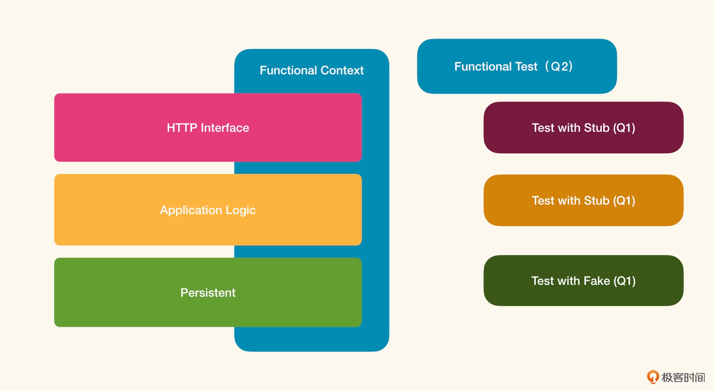

也就是说，我们将架构中的三种不同的组件分别进行测试，其中 Persistent 层中的组件，使用假对象（Fake，内存数据库）作为测试替身。而 HTTP interface 和 Application Logic 层则通过存根（Stub）作为测试替身。最后，再通过功能测试，对整个系统进行验证。

接下来让我们按照测试策略，针对不同的组件构造提示词模板（Prompting template）。我们先从 Persistent 层开始：

- 架构描述=======当前系统技术栈为 Spring Boot，Jersey 和 MyBatis。

- 当前系统采用典型的三层架构设计，分布为:- HTTP interface 层，负责提供 RESTful API，命名规则为 XXXAPI，比如 OrdersAPI；– Application Logic 层，负责提供核心逻辑，命名规则为 XXXService，比如OrderService；– Persistent 层，负责与持久化数据交互，命名规则为 XXXDAO，比如 OrderDAO；– DAO 通过 MyBatis 的 Mapper 实现

- – 在对 DAO 进行测试时，使用 H2 数据库作为 fake implementation，也就是在测试中，初始化 H2 数据库，然后保证应用程序链接到这个数据库，并在测试结束后销毁这个数据库。

- 功能需求======={functionalities}

- 任务====上面功能需求描述的场景，在 Persistent 层中需要哪些组件（目标组件）；列出需求描述的场景使用到目标组件的功能（目标功能）；列出目标功能需要测试的场景。描述场景，并给出相关的测试数据。

注意在这个提示词模板中，我们并没有直接要求 LLM 帮助我们生成代码，还是与之前一样，先让 LLM 给出场景和测试数据。ChatGPT 的答案如下：

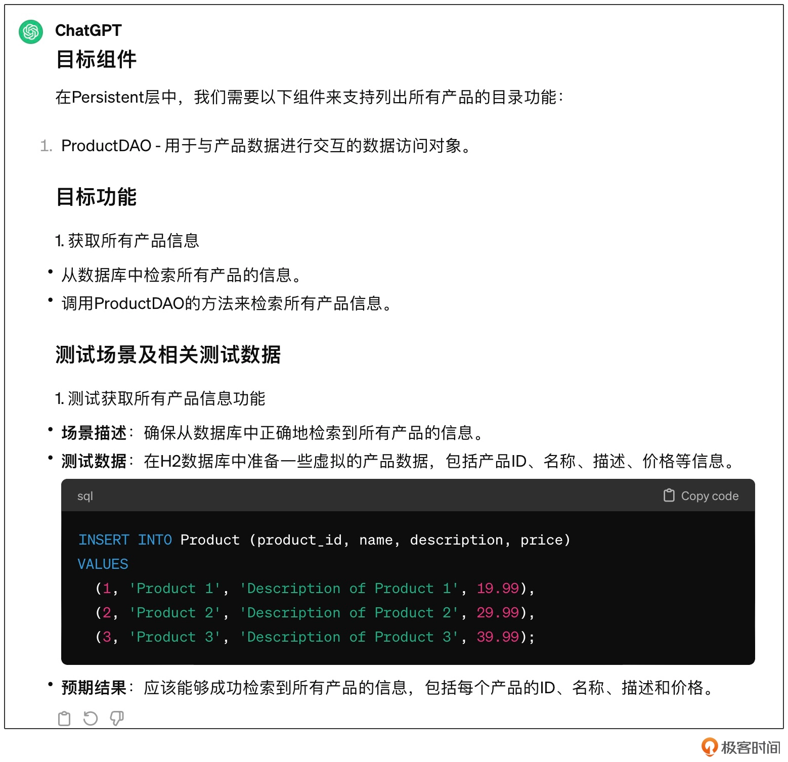

在这个提示词模板中，使用了另一个我发明的小技巧，叫代词消除，可以在上下文中去除隐含的歧义。通过目标组件和目标功能的明确指示，我们可以确保 LLM 在后续交互中保持上下文连贯。

随后，我们就可以要求 LLM 帮助我们生成测试代码：

- 请按照指定技术栈，为目标功能场景提供测试代码

LLM 给出的结果是：

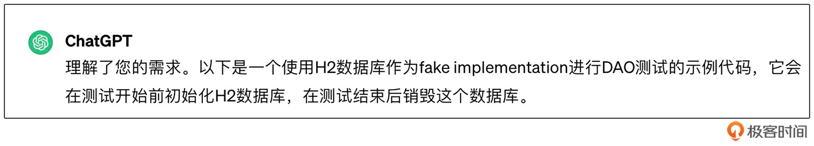

```java
import static org.junit.jupiter.api.Assertions.assertEquals;
import static org.junit.jupiter.api.Assertions.assertTrue;
import java.sql.Connection;
import java.sql.SQLException;
import java.sql.Statement;
import java.util.List;
import javax.sql.DataSource;
import org.junit.jupiter.api.AfterEach;
import org.junit.jupiter.api.BeforeEach;
import org.junit.jupiter.api.Test;
import org.mybatis.spring.boot.test.autoconfigure.MybatisTest;
import org.springframework.beans.factory.annotation.Autowired;
import org.springframework.boot.test.context.SpringBootTest;
import org.springframework.test.context.TestPropertySource;
@SpringBootTest
@MybatisTest
@TestPropertySource(locations = "classpath:application-test.properties") // 使用测
public class ProductDAOTest {
 @Autowired
 private DataSource dataSource;
 @Autowired
 private ProductDAO productDAO;
 private Connection connection;
 @BeforeEach
 public void setUp() throws SQLException {
   // 获取H2数据库连接
   connection = dataSource.getConnection();
   // 创建测试表
   try (Statement statement = connection.createStatement()) {
     statement.executeUpdate("CREATE TABLE Product (product_id INT PRIMARY KEY,
     // 插入测试数据
     statement.executeUpdate("INSERT INTO Product (product_id, name, description
     statement.executeUpdate("INSERT INTO Product (product_id, name, description
     statement.executeUpdate("INSERT INTO Product (product_id, name, description
   }
 }
 @Test
 public void testGetAllProducts() {
   // 调用被测试的方法
   List<Product> products = productDAO.getAllProducts();
   // 验证结果
   assertEquals(3, products.size());
   assertTrue(products.stream().anyMatch(p -> p.getProductId() == 1 && p.getName
   assertTrue(products.stream().anyMatch(p -> p.getProductId() == 2 && p.getName
   assertTrue(products.stream().anyMatch(p -> p.getProductId() == 3 && p.getName
 }
 @AfterEach
 public void tearDown() throws SQLException {
   // 删除测试表并关闭连接
   try (Statement statement = connection.createStatement()) {
     statement.executeUpdate("DROP TABLE IF EXISTS Product");
   }
   if (connection != null) {
     connection.close();
   }
 }
}
```

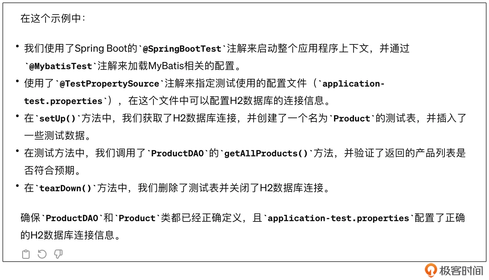

接下来，我们进一步要求 LLM 给出 application-test.properties 的具体配置，也可以让 LLM 帮助我们补全一些其他的细节。现在也可以直接让 LLM 帮助我们生成代码。

- 请给出 ProductDAO 的实现

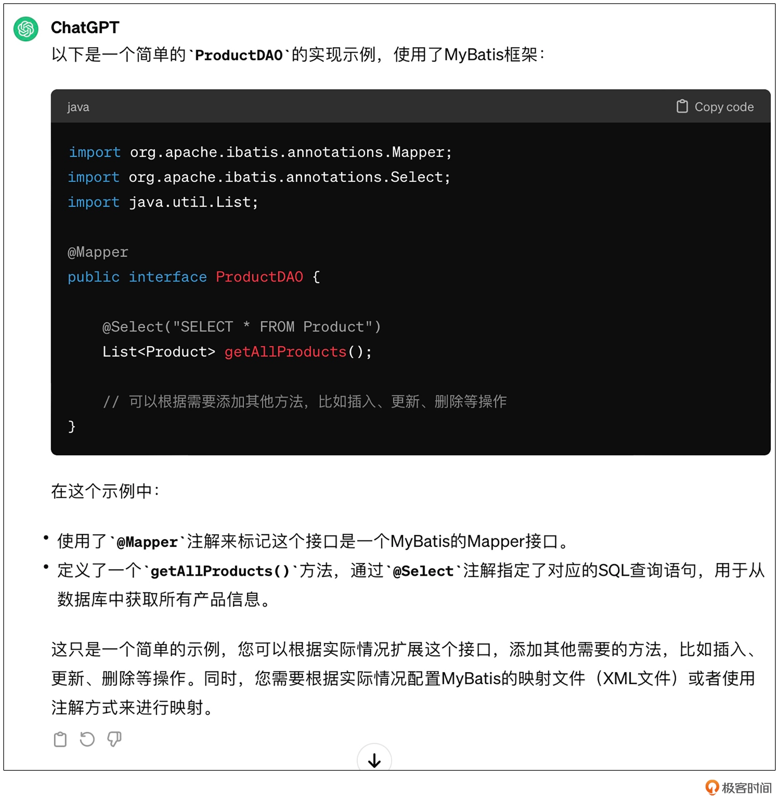

对于现在这个简单的例子，这个代码也就足够了。接下来，我们可以补充提示词模板中关于HTTP Interface 部分的架构描述，并更改任务描述：

- 架构描述=======当前系统技术栈为 Spring Boot，Jersey 和 MyBatis。

- 当前系统采用典型的三层架构设计，分布为:- HTTP interface 层，负责提供 RESTful API，命名规则为 XXXAPI，比如 OrdersAPI；- API 通过 JAX-RS 的 Resource 实现- 在对 API 进行测试时，首先要 stub 掉 Application Logic 层中的 Services，然后再使用JerseyTest 对 API 进行测试

- - Application Logic 层，负责提供核心逻辑，命名规则为 XXXService，比如OrderService；- Persistent 层，负责与持久化数据交互，命名规则为 XXXDAO，比如 OrderDAO；- DAO 通过 MyBatis 的 Mapper 实现- 在对 DAO 进行测试时，使用 H2 数据库作为 fake implementation，也就是在测试中，初始化 H2 数据库，然后保证应用程序链接到这个数据库，并在测试结束后销毁这个数据库。

- 功能需求======={functionalities}

- 任务====上面功能需求描述的场景，在 HTTP Interface 层中需要哪些组件（目标组件）；列出需求描述的场景使用到目标组件的功能（目标功能）；列出目标功能需要测试的场景。描述场景，并给出相关的测试数据。

ChatGPT 的答案如下：

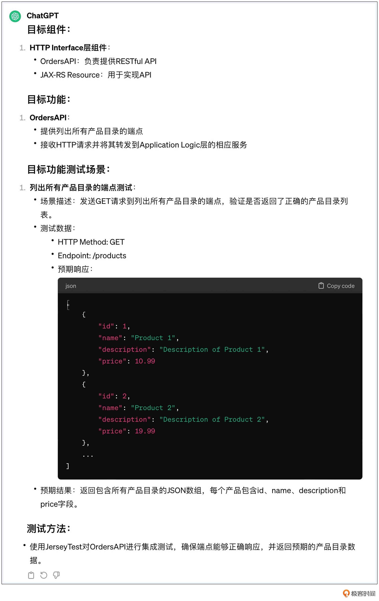

- 请按照指定技术栈，为目标功能场景提供测试代码

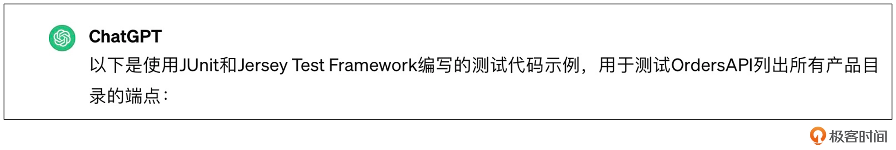

```java
import static org.junit.Assert.assertEquals;
import static org.junit.Assert.assertNotNull;
import java.util.List;
import javax.ws.rs.client.Entity;
import javax.ws.rs.client.Invocation;
import javax.ws.rs.core.Application;
import javax.ws.rs.core.GenericType;
import javax.ws.rs.core.Response;
import org.glassfish.jersey.server.ResourceConfig;
import org.glassfish.jersey.test.JerseyTest;
import org.junit.Test;
public class OrdersAPITest extends JerseyTest {
 @Override
 protected Application configure() {
   return new ResourceConfig(OrdersAPI.class);
 }
 @Test
 public void testGetAllProducts() {
   // 发送GET请求到/products端点
   Response response = target("/products").request().get();
   // 确保响应状态码为200
   assertEquals(Response.Status.OK.getStatusCode(), response.getStatus());
   // 从响应中获取产品目录列表
   List<Product> productList = response.readEntity(new GenericType<List<Product>
   // 确保产品目录列表不为空
   assertNotNull(productList);
   // 检查第一个产品的信息
   Product firstProduct = productList.get(0);
   assertEquals(1, firstProduct.getId());
   assertEquals("Product 1", firstProduct.getName());
   assertEquals("Description of Product 1", firstProduct.getDescription());
   assertEquals(10.99, firstProduct.getPrice(), 0.001);
   // 可以继续检查其他产品信息...
 }
}
```

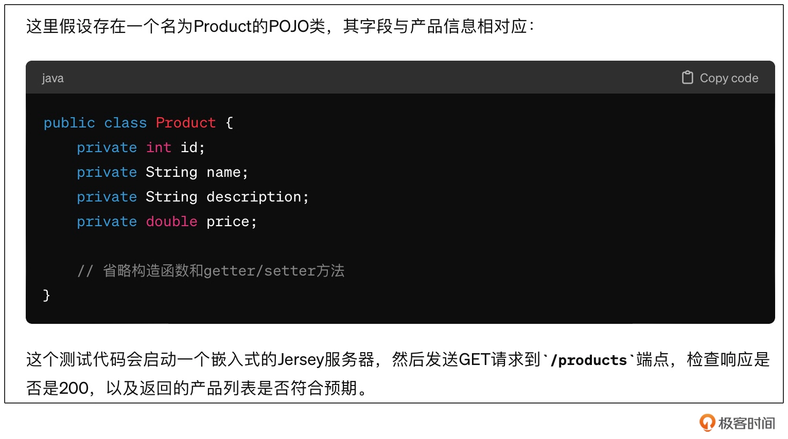

还剩下一个 Application Logic 层，做法大同小异，我给你留作课后作业自行练习。

## 使用 LLM 构造功能测试

按照我们之前讨论的测试策略，我们已经使用 LLM 完成了三个 Q1 象限的测试。在测试策略中，除去 Q1 象限之外，我们还有 Q2 象限的功能测试。现在来构造提示词模板，完成这个Q2 的测试。需要注意的是，为了测试的可重复性，我们会在功能测试中，完成测试数据的灌入。

首先给出任务描述：

- 架构描述=======当前系统采用典型的三层架构设计，分布为:HTTP interface 层，负责提供 RESTful API，命名规则为 XXXAPI，比如 OrdersAPI；Application Logic 层，负责提供核心逻辑，命名规则为 XXXService，比如 OrderService；Persistent 层，负责与持久化数据交互，命名规则为 XXXDAO，比如 OrderDAO；

- 当前系统技术栈为 Spring Boot、Jersery 和 MyBatis

- 当为当前系统生成功能测试时，我们使用 Http Client 通过访问 API 完成真正的测试。但是为了保证测试的可重复性，我们在 setup 测试的时候，链接数据库，完成测试数据的准备。测试时，使用 MySQL 数据库。

- 功能需求=======目前为一个电子商务系统。需要列出所有产品的目录

- 任务====上面功能需求描述的场景，需要用到哪些 API（目标 API）；列出需求描述的场景使用到目标 API 的功能（目标功能）；列出目标功能需要测试的场景。描述场景，并给出相关的测试数据。

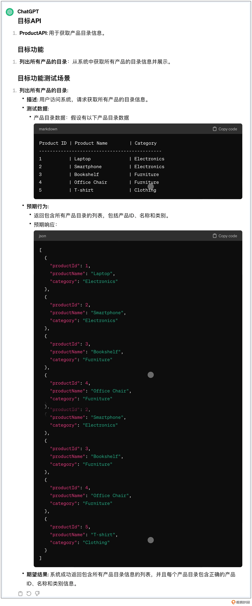

接着要求 GPT 提供测试，返回结果如下。

- 请为目标功能测试场景提供测试

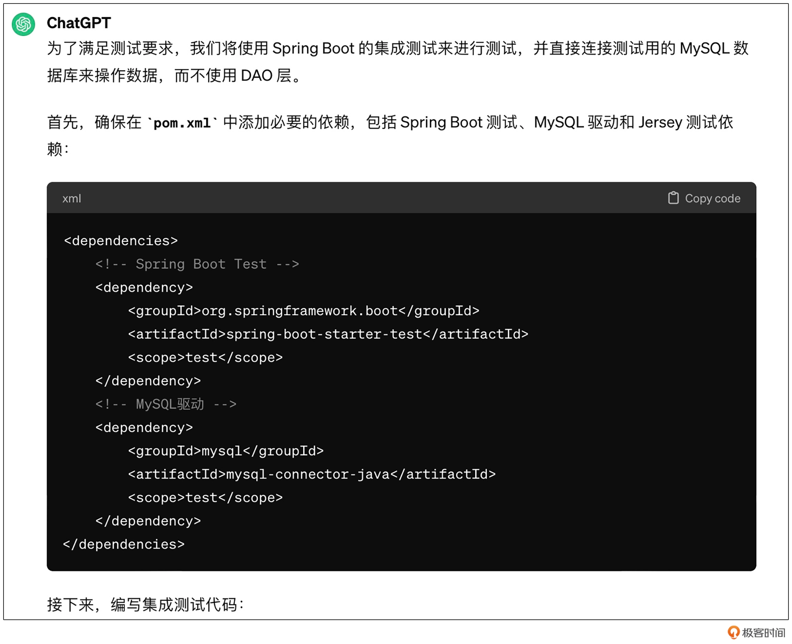

```java
import org.junit.jupiter.api.AfterEach;
import org.junit.jupiter.api.BeforeEach;
import org.junit.jupiter.api.Test;
import org.springframework.beans.factory.annotation.Autowired;
import org.springframework.boot.test.context.SpringBootTest;
import org.springframework.boot.web.server.LocalServerPort;
import org.springframework.http.HttpStatus;
import org.springframework.http.ResponseEntity;
import org.springframework.web.client.RestTemplate;
import java.sql.Connection;
import java.sql.DriverManager;
import java.sql.SQLException;
import java.sql.Statement;
import static org.junit.jupiter.api.Assertions.assertEquals;
@SpringBootTest(webEnvironment = SpringBootTest.WebEnvironment.RANDOM_PORT)
public class ProductAPITest {
 @LocalServerPort
 private int port;
 @Autowired
 private RestTemplate restTemplate;
 private Connection connection;
 @BeforeEach
 public void setUp() throws SQLException {
   // 连接测试用MySQL数据库，准备测试数据
   connection = DriverManager.getConnection("jdbc:mysql://localhost:3306/test_db
   Statement statement = connection.createStatement();
   statement.executeUpdate("INSERT INTO products (product_id, product_name, cate
   statement.executeUpdate("INSERT INTO products (product_id, product_name, cate
   statement.executeUpdate("INSERT INTO products (product_id, product_name, cate
   statement.executeUpdate("INSERT INTO products (product_id, product_name, cate
   statement.executeUpdate("INSERT INTO products (product_id, product_name, cate
 }
 @AfterEach
 public void tearDown() throws SQLException {
   // 清除测试数据库中的数据
   Statement statement = connection.createStatement();
   statement.executeUpdate("DELETE FROM products");
   connection.close();
 }
 @Test
 public void testListAllProducts() {
   // 发送GET请求到API端点
   ResponseEntity<String> responseEntity = restTemplate.getForEntity("http://loc
   // 验证响应状态码为200
   assertEquals(HttpStatus.OK, responseEntity.getStatusCode());
   // 验证响应内容是否符合预期
   String expectedResponseBody = "[{\"productId\":1,\"productName\":\"Laptop\",\
       "{\"productId\":2,\"productName\":\"Smartphone\",\"category\":\"Electroni
       "{\"productId\":3,\"productName\":\"Bookshelf\",\"category\":\"Furniture\
       "{\"productId\":4,\"productName\":\"Office Chair\",\"category\":\"Furnitu
       "{\"productId\":5,\"productName\":\"T-shirt\",\"category\":\"Clothing\"}]
   assertEquals(expectedResponseBody, responseEntity.getBody());
 }
}
```

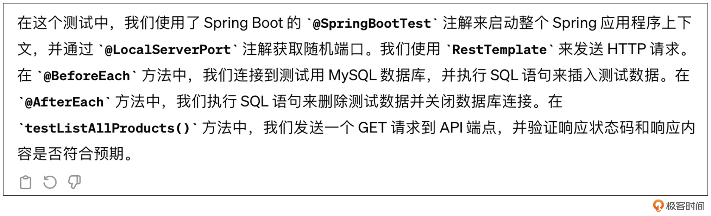

## 小结

至此，我们按照测试策略的指导，遵循前面讲过的测试驱动开发的节奏，完成了一个简单的功能。那么这么做有什么用处呢？最显而易见的用处是，针对存量系统，我们可以由测试策略切入，让 LLM 生成符合我们要求的代码。

所谓存量系统，就是指不是全部由 LLM/AI 主导生成的代码库。在这样的代码库中，组织结构已经存在，LLM 生成的代码需要符合既定的结构，才能被引入代码库中。

那么通过这节课我们所介绍的方法，我们就可以在任何代码库中，随时引入 LLM 的辅助了。

## 思考题

请完成 Application Layer 的架构说明，并使用 LLM 完成代码生成。

欢迎在留言区分享你的想法，我会让编辑置顶一些优质回答供大家学习讨论。
