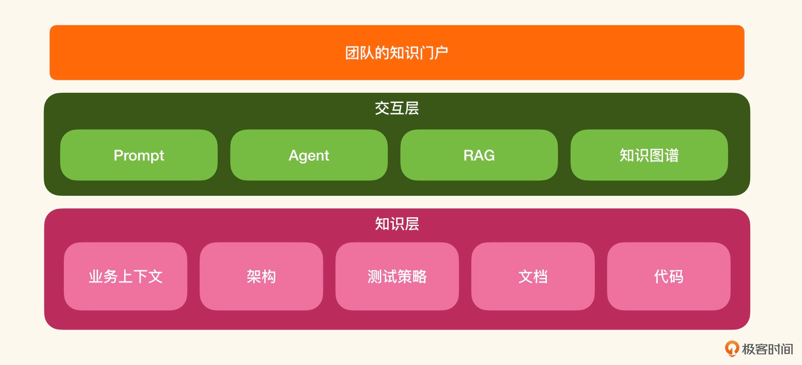
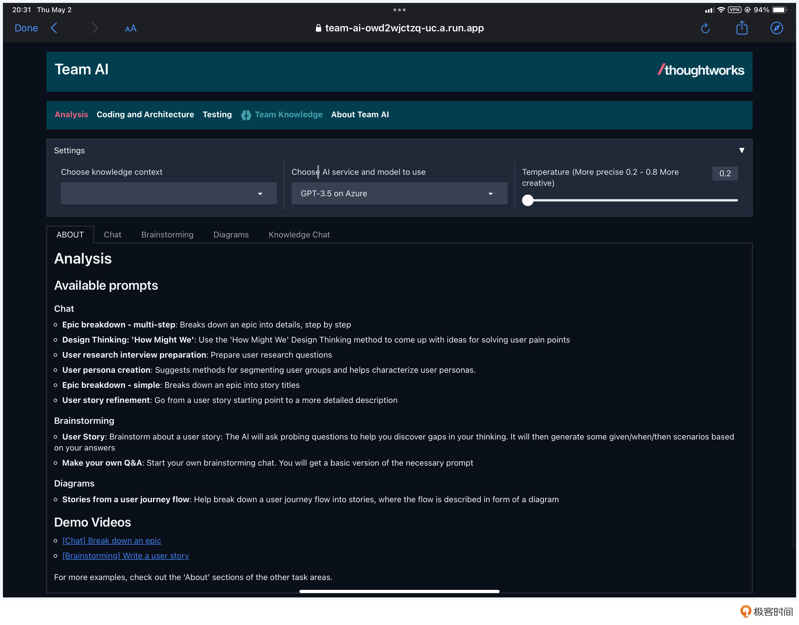
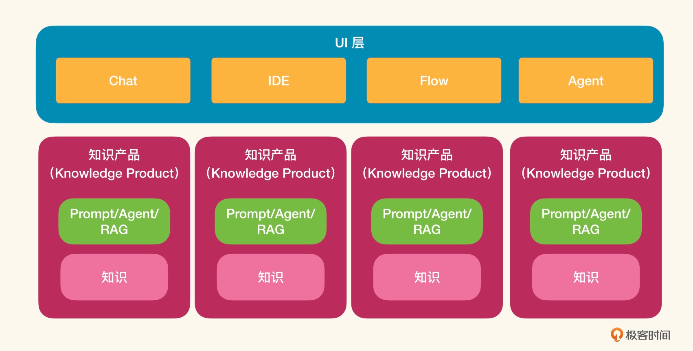

# 28&结束语 | 通过LLM构建团队门户

你好，我是徐昊，今天我们来继续学习 AI 时代的软件工程。

前面两节课我们学习了团队视角下无法根本消除的认知分歧，以及如何围绕测试工序拉齐认知分歧。今天我们就来看看大语言模型（Large Language Model，LLM）在这个过程中能发挥什么作用。

之前课程群里就有同学提出能否从需求开始，用 LLM 来构造“一条龙的服务”，我们先来讨论一下这个想法在当前（2024 年 5 月）是否可行。

## 无法通过 LLM 构成工作流

我们在前面的章节中讲述了大量 LLM 技巧，包含建模、模型验证、任务拆分、测试构造、代码编写等等。几乎覆盖了软件生命周期的全部环节。这时候，我们不禁有一个疑问，我们能否使用 LLM 拉通所有的环节，构建一个完全基于 LLM 的工作流？毕竟围绕测试工序，我们还是给过一个类似 Devin 的方案的。

那么能不能利用多 Agents 架构，把范围进一步扩展到软件开发的全流程呢？

简单来说，还不能。而且我也不太看好这个方向。想要理解其中的原因，还是要回到认知行为模式上。

当我们和 LLM 一起完成任务时，基本上是 LLM 负责干活人负责喊停。那么何时喊停，取决于人对于 LLM 产生内容质量的判断。也就是说，人对于问题的认知，和对于质量的理解，决定了最终人与 LLM 合作结果的质量与效率。那么这就又回到了认知行为模式上。

正如我们在前面课程中讲过的，当我们处在复杂认知模式时（Complex），我们对于问题缺乏深入的理解，以至于无法判断 LLM 产生结果的有效性；当我们处于庞杂认知模式时（Complicated），我们又需要依赖深入分析才能理解 LLM 的结果，这必然会降低与 LLM 合作的效率；而当我们处于清晰模式时（Clear/Obvious），人不再是瓶颈，但是 LLM 又很难准确生产我们所需要的结果。

最终的结果就是，哪怕我们将整个流程串接成一个完整的流程。我们对于不同节点（建模、模型验证、任务拆分、测试、代码编写）的不同认知，也会极大地降低这个流程的效率。

截止到目前为止（2024 年 5 月），面向全流程的工具，自主成功率大概也只有 20-30% 左右。

那我们能不能把喊停的工作也交给 LLM？也是不太行的。首先，LLM 本身不善于定义问题。然后很多情况下，喊停需要的是不可言说知识。比如，是否遵循了某种架构模式，再比如是否处在投资回报率（ROI）最高的需求范围等等。这些本身就很难传递给 LLM。

消除掉所有不可能的选项，最后剩下的唯一可能性就是如何通过 LLM 提高人的认知水平了。

可能与大家构想的不同，LLM 并不能直接提升认知水平。人的认知水平在某一时刻是一个客观的水准，并不随使用的工具而改变。

比如我们前面课程里的例子，某位架构设计师，将架构模式转化为思维链（Chain of Thought,CoT），拿到这个 CoT 的团队其他成员，并不会直接提升到和架构师一样的水平。

他们只是多了一个参考答案而已。至于 CoT 返回的任务列表质量如何，还是要依赖于他们自己的判断。他们可能仍然需要通过后续流程，在 LLM 指引下完成整个开发的过程，然后再根据结果，反思任务划分的是否合理。

也就是说，虽然架构师的目的是以庞杂模式记录下测试工序的不可言说知识，但是初次接触到这个 CoT 的人，仍然要走过复杂模式，以完成对于这些知识的学习。

所以，我们这门课所讲的很多技巧，从某种程度上来说，是提供了贴近某个不可言说知识的训练法而已。当然，可能这也是我们能获得的最佳结构，毕竟我们在讨论的是不可言说知识。

记得我们在第一课里的这一段吗？

- 我经常会用这样一个比喻，比如你看上了某个健身教练的肌肉，那么无论你想花多少钱，他都没办法把肌肉卖给你。他能带给你的是一套训练法。然而通过这套训练法，你增长的是自己的肌肉。对于不可言说的知识，很多时候我们能从别人那里获得的最好的东西，也就是一套训练法。而我们能给予别人最好的东西，也是提供对应的训练法。

很多时候我们能做的就是提供一套有效的训练法，而基于 LLM 构造训练法，无论从教还是从学的角度上来讲，恰恰是非常有效的。所以今天（2024 年 5 月），我们应用 LLM 最有效的方法，是构造一组辅助工具，以贴近项目的方式，快速培养人员能力。

## 通过 LLM 构造团队知识门户

为了实现这个目的，我们可以利用 LLM 构造团队知识门户。按照分层架构表示的知识门户的架构如下图所示：

最基础也是最核心的内容就是知识层，也就是我们在知识过程中提取的所有知识。这里的知识既包含不可言说知识，比如，业务上下文、架构、测试策略等，也可以包含各种显式或隐式知识，比如文档、代码等等。

然后中间的交互层，这里是指与 LLM 的交互模式，也是知识的主要消费形式。我们前面讲到以任务为核心的各种提示词模版，略有提及的 Agent 都是与知识交互的主要形式。我们前面针对每种不同的知识，讲解了潜在的不同交互模式，这里就不再重复了。

现在，我们要讲一下两个与显式 / 隐式知识交互的模式，即 RAG 和知识图谱。

检索增强生成（Retrieval-Augmented Generation，RAG）是对 LLM 的输出进行优化的过程。RAG 在 LLM 生成响应之前会参考训练数据源之外的权威知识库。RAG 可以将 LLM 本已强大的功能扩展到特定领域或组织的内部知识库，而且无需重新训练模型。

这是一种改进 LLM 输出的有效方法，可使其在各种情况下保持相关性、准确性和实用性。非常适合用以检索超过 LLM 上下文限制的信息和内容。

本来我们在课程中也计划了一些构造 RAG 方面的内容，但是现在的几个改变，使得 RAG 变得非常容易实现了。第一个改变是，头部大语言模型都极大地增加了上下文窗口（ContextWindow）的大小，对于中小团队在开发过程中产生的文档和代码，我们只需要将所有内容拼接成一个文件，引入到上下文中即可。对于大型团队，在合理划分模块边界之后，每个模块的认知边界内产生的文档与代码，也不太会超过上下文限制。

第二是头部大语言模型或多或少都对 RAG 提供了内建的支持，比如 ChatGPT 的 AssistantAPI，或 MyGPTs，都有内建的 RAG 机制，用起来已经非常方便了。我们就不做过多介绍了。

现在（2024 年 5 月）更新的一个方向是 GraphRAG，也就是结合了知识图谱的 RAG 架构。首先通过 LLM 提取知识图谱，然后再通过技术图谱的机器学习算法，生产查询时的提示词模板。相当于是结合使用了知识图谱和知识生成，只不过这里生产的是中间环节的提示词模板。这是非常有意思的方向，希望大家可以多多关注。

交互层之上就是知识门户的 UI 层了，我们在前面讲过，LLM 无法构成端到端的流程，那么门户只能以工具集的形式组织，比如下图所示，就是我司 AI 门户 Team AI 的样子：

除了分层架构之外，我们也可以按照知识产品（Knowledge Product）的形式来构建门户：

这样我们就可以把 LLM 封装为一个个独立的产品，正如我们将单体应用拆分为微服务一样。

## 结束语

正如开篇词里我提到的，这门课的初衷是让你更好地利用 LLM 提高效率，以及站在一个更全面的立场上，了解如何将 LLM 引入团队或是组织。感谢你的一路支持陪伴，到此我们的全部课程就结束了，我想你们应该松了一口气，从 AI 来临的恐慌中彻底解放出来了。

学到现在你应该清楚了，AI 展现的逆天的能力，实际上不过是利用了认知差，以及海量的知识积累，在我们的不擅长的领域中，打了我们一个措手不及。而真正来到实际工作里，在我们处于高认知的领域，AI 并不一定比我们更有效率。所以我们不要夸大 AI 解决实际问题的能力，也不要忽略 AI 在学习和传递知识方面带来的革命性改变。

如果让我现在（2024 年 5 月）总结 AI 会给软件开发带来什么影响。第一点我会讲，AI 可能让很多从业人士第一次认识到，软件开发是团体赛而不是个人赛。

可能从大学接触软件开发开始，我们就忽略了这一点。编程作业是自己一个人做的，项目练习可能也是自己一个人做的。我们关注自己的产出，远远大于关注我们对别人的影响。如何有效地影响他人，如何在团队中最大化自己的效率，这些重要的技能，在很多从业人员的职业生涯中，始终都是被忽略的，把篮球打成了乒乓球。

而进入 AI 时代，我们终于发现，传递知识比产生知识更重要了。毕竟 AI 不会算命，也不知道你想要什么。我们需要陈述清楚，它才能发挥作用。一个被忽略已久的技能，变成每日必备技能了。这个影响必将是深刻且深远的。

第二点，AI 让我们把重点再次放回到对人的关注上，把人看作资产而非成本。资产是需要增值的，而成本需要降低。我们打造更好的人，让更好的人做更好的软件。我们前面讲认知分歧，讲人在 AI 使用中，是负责喊停的。这都在强调，我们无法通过 AI 直接抹平认知分歧，只能通过 AI 辅助学习，来抹平认知分歧。这都不是什么新观点，但是 AI 让差距凸显了出来。

大家可以去一些采纳了 AI 辅助编程的团队看一看，你会发现在使用 AI 一段时间之后，团队会觉得 AI 工具的效率越来越低。那其实是因为人的认知水平越来越高。逐渐摆脱了复杂认知模式，也就摆脱了 AI 工具的甜点位（Sweet spot），去除了一些水分而已。这个时候，再想进一步提升，就要更仔细地关注认知分歧，以及人员的培养了。

总之，无论我们喜欢或是不喜欢，随着 AI 的逐步普及，软件开发正在回到它应该有的样子，也是我期待了三十年的样子。

最后，我为你准备了一份调查问卷，题目不多，希望你可以几分钟填写一下。很期待能听到你的反馈，说说你对这门课程的想法和建议。
