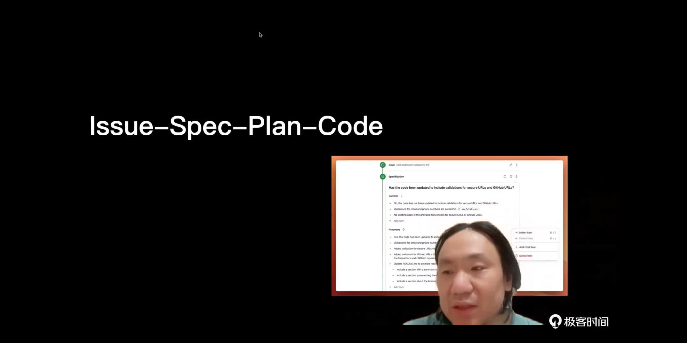

# 直播专场（三） | 如何理解测试策略与测试工序

本节内容为 5 月 9 日老师第三场直播回放内容，建议看完第三章更新的内容，再行学习，效果更好。

00:19 Issue-Spec-Plan-Code

02:56 Story-AC-Task list-Test-Prod code

04:30 评价产品的测试 vs 支撑团队的测试

09:30 很多团队实施自动化测试时的最大误区

10:40 测试金字塔中的对应关系

11:50 不同软件架构里的测试策略不同

15:00 Filter 单独测试难点分析20:00 测试方法选择的考量

25:47 测试工具的本质

29:33 测试工序背后的两类不可言说知识

30:34 架构分解与任务分解

36:56 更高效的结对编程方法

41:15 为什么要从测试工序出发

43:30 答疑交流环节

PPT 下载链接（第三场直播对应 P57～73）：https://pan.baidu.com/s/1E6ep3wL29j1Z5DJvDDlsiw 提取码: 8hbf。
