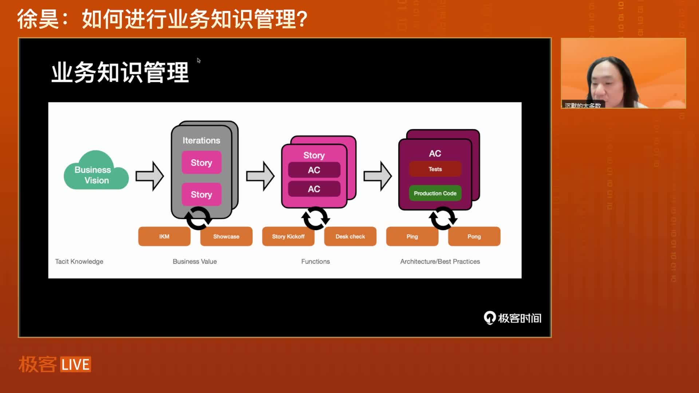

# 直播专场（二） | 如何进行业务知识管理？

本节内容为 4 月 10 日老师第二场直播回放内容，建议看完第二章更新的内容，再行学习，效果更好。

01:16 理解迭代式交付（Iterative Delivery）

03:30 从行为模式角度，比较增量式交付和迭代式交付的差异

08:10 特性交付 VS 价值交付

09:30 Now VS Why Now

16:00 业务知识传递重点——优先级判定

18:00 User Story VS Use Case

20:00 线上 Q&A24:30 编写有效用例

27:50 为什么价值是一种假设

30:25 用户故事 3C

32:40 第二章顺序安排思考

34:17 领域模型最大的困难

40:00 LLM 辅助建模与模型应用、TQA

45:00 半结构化自然语言

48:00 ReAct

52:00 LLM 交互的三个模式（可以对照[第 14 节课](https://time.geekbang.org/column/article/764756））

53:30 线上 Q&A 第二轮

课程学习反馈持续收集中，期待你抽几分钟提交反馈，你的建议意见会作为后续课程的参考依据，问卷提交链接： https://jinshuju.net/f/YzTEQa

PPT 下载链接（34 页开始是第二章内容）链接:https://pan.baidu.com/s/1RVKd1rOgWPfTTIWXwvfNPA 提取码: cbxb
