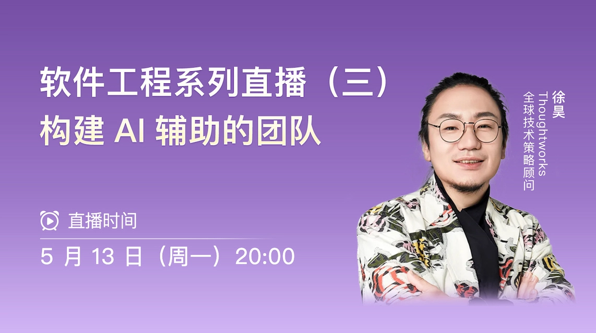
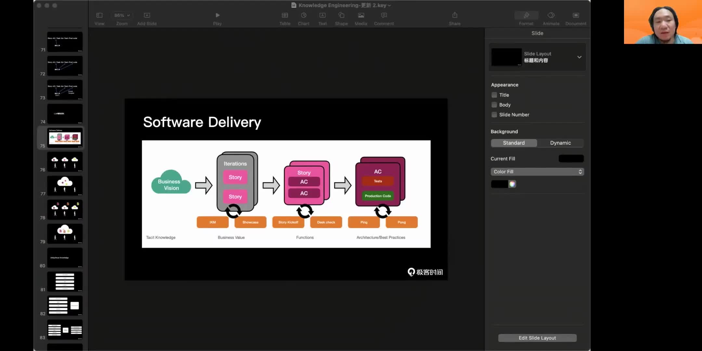

# 直播专场（四） | 构建AI辅助的团队

本节内容为 5 月 13 日老师第四场直播回放内容，建议看完第四章更新的内容，再行学习，效果更好。

时间轴打点提示今日下午更新。

00:00 回顾迭代开发的流程

02:33 认知分歧从何而来

03:27 拉齐分歧的另一选项——LLM

08:04 引入 LLM 做知识管理有什么不同

10:40 引入 LLM 辅助开发容易忽略的地方

12:56 知识提取与知识应用14:10 团队里的知识提取问题

15:30 提取知识后接下来怎么做

16:40～17:49 网络卡顿 可以跳过

21:03 知识本身 VS 知识应用

22:25 再谈认知分歧

26:25 传统软件为什么难以管理

27:15 高效软件团队的理想状态（行为模式维度）

33:40 提升认知的模式和手段

36:15 如何尝试抹平认知差

38:00 On Boarding

44:33 Task review

46:33 Retro

50:24 答疑环节

直播 PPT 下载链接：链接: https://pan.baidu.com/s/1E6ep3wL29j1Z5DJvDDlsiw 提取码:8hbf
