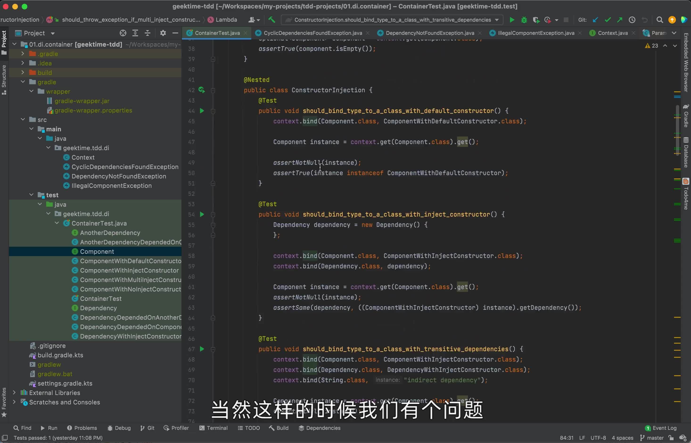

# 17 | DIContainer（5）：API接口该怎么设计？

你好，我是徐昊。今天我们继续使用 TDD 的方式实现注入依赖容器。

## 回顾代码与任务列表

到目前为止，我们的代码是这样的：

```java
package geektime.tdd.di;
import jakarta.inject.Inject;
import jakarta.inject.Provider;
import java.lang.reflect.Constructor;
import java.lang.reflect.InvocationTargetException;
import java.util.HashMap;
import java.util.List;
import java.util.Map;
import java.util.Optional;
import java.util.stream.Collectors;
import static java.util.Arrays.stream;
public class Context {
   private Map<Class<?>, Provider<?>> providers = new HashMap<>();
   public <Type> void bind(Class<Type> type, Type instance) {
       providers.put(type, (Provider<Type>) () -> instance);
   }
   public <Type, Implementation extends Type>
   void bind(Class<Type> type, Class<Implementation> implementation) {
       Constructor<Implementation> injectConstructor = getInjectConstructor(impl
       providers.put(type, new ConstructorInjectionProvider(type, injectConstruc
   }
   public <Type> Optional<Type> get(Class<Type> type) {
       return Optional.ofNullable(providers.get(type)).map(provider -> (Type) pr
   }
   class ConstructorInjectionProvider<T> implements Provider<T> {
       private Class<?> componentType;
       private Constructor<T> injectConstructor;
       private boolean constructing = false;
       public ConstructorInjectionProvider(Class<?> componentType, Constructor<T
           this.componentType = componentType;
           this.injectConstructor = injectConstructor;
       }
       @Override
       public T get() {
           if (constructing) throw new CyclicDependenciesFoundException(componen
           try {
               constructing = true;
               Object[] dependencies = stream(injectConstructor.getParameters())
                       .map(p -> Context.this.get(p.getType())
                               .orElseThrow(() -> new DependencyNotFoundExceptio
                       .toArray(Object[]::new);
               return injectConstructor.newInstance(dependencies);
           } catch (CyclicDependenciesFoundException e) {
               throw new CyclicDependenciesFoundException(componentType, e);
           } catch (InvocationTargetException | InstantiationException | Illegal
               throw new RuntimeException(e);
           } finally {
               constructing = false;
           }
       }
   }
   private <Type> Constructor<Type> getInjectConstructor(Class<Type> implementat
       List<Constructor<?>> injectConstructors = stream(implementation.getConstr
               .filter(c -> c.isAnnotationPresent(Inject.class)).collect(Collect
       if (injectConstructors.size() > 1) throw new IllegalComponentException();
       return (Constructor<Type>) injectConstructors.stream().findFirst().orElse
           try {
               return implementation.getConstructor();
           } catch (NoSuchMethodException e) {
               throw new IllegalComponentException();
           }
       });
   }
}
```

任务列表状态为：


## 视频演示

让我们进入今天的部分：



## 思考题

为了我们更好的交流与互动，从这节课开始，思考题目除了固定的技术问题外，我还会设置一道较为轻松的题目，供你选择与回答。

1. 在当前结构下，如何实现对循环依赖的检查？

2. 你学习这节课的方式是什么？写实现代码了吗？有遇到卡壳的地方吗？

欢迎把你的想法分享在留言区，也欢迎把你的项目代码的链接分享出来。相信经过你的思考与实操，学习效果会更好！
