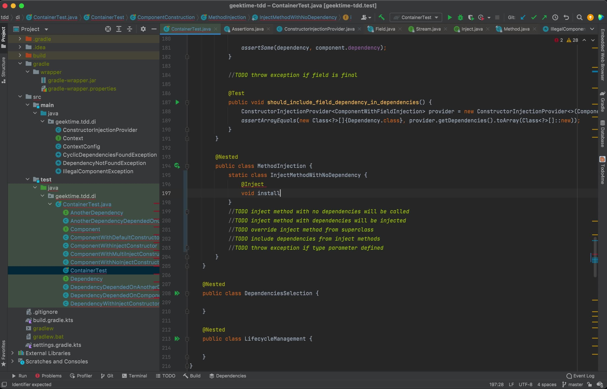

# 20 | DIContainer（8）：如何实现MethodInjection部分的功能？

你好，我是徐昊。今天我们继续使用 TDD 的方式实现注入依赖容器。

## 回顾代码与任务列表

到目前为止，我们的代码是这样的：

```java
ContextConfig.java:
package geektime.tdd.di;
import java.util.*;
import static java.util.List.of;
public class ContextConfig {
   private Map<Class<?>, ComponentProvider<?>> providers = new HashMap<>();
   public <Type> void bind(Class<Type> type, Type instance) {
       providers.put(type, new ComponentProvider<Type>() {
           @Override
           public Type get(Context context) {
               return instance;
           }
           @Override
           public List<Class<?>> getDependencies() {
               return of();
           }
       });
   }
   public <Type, Implementation extends Type>
   void bind(Class<Type> type, Class<Implementation> implementation) {
       providers.put(type, new ConstructorInjectionProvider<>(implementation));
   }
   public Context getContext() {
       providers.keySet().forEach(component -> checkDependencies(component, new
       return new Context() {
           @Override
           public <Type> Optional<Type> get(Class<Type> type) {
               return Optional.ofNullable(providers.get(type)).map(provider -> (
           }
       };
   }
   private void checkDependencies(Class<?> component, Stack<Class<?>> visiting)
       for (Class<?> dependency: providers.get(component).getDependencies()) {
           if (!providers.containsKey(dependency)) throw new DependencyNotFoundE
           if (visiting.contains(dependency)) throw new CyclicDependenciesFoundE
           visiting.push(dependency);
           checkDependencies(dependency, visiting);
           visiting.pop();
       }
   }
   interface ComponentProvider<T> {
       T get(Context context);
       List<Class<?>> getDependencies();
   }
}
ConstructorInjectionProvider.java:
package geektime.tdd.di;
import jakarta.inject.Inject;
import java.lang.reflect.Constructor;
import java.lang.reflect.Field;
import java.lang.reflect.InvocationTargetException;
import java.lang.reflect.Parameter;
import java.util.ArrayList;
import java.util.List;
import java.util.stream.Collectors;
import java.util.stream.Stream;
import static java.util.Arrays.stream;
class ConstructorInjectionProvider<T> implements ContextConfig.ComponentProvider<
   private Constructor<T> injectConstructor;
   private List<Field> injectFields;
   public ConstructorInjectionProvider(Class<T> component) {
       this.injectConstructor = getInjectConstructor(component);
       this.injectFields = getInjectFields(component);
   }
   @Override
   public T get(Context context) {
       try {
           Object[] dependencies = stream(injectConstructor.getParameters())
                   .map(p -> context.get(p.getType()).get())
                   .toArray(Object[]::new);
           T instance = injectConstructor.newInstance(dependencies);
           for (Field field : injectFields)
               field.set(instance, context.get(field.getType()).get());
           return instance;
       } catch (InvocationTargetException | InstantiationException | IllegalAcce
           throw new RuntimeException(e);
       }
   }
   @Override
   public List<Class<?>> getDependencies() {
       return Stream.concat(stream(injectConstructor.getParameters()).map(Parame
               injectFields.stream().map(Field::getType)).toList();
   }
   private static <T> List<Field> getInjectFields(Class<T> component) {
       List<Field> injectFields = new ArrayList<>();
       Class<?> current = component;
       while (current != Object.class) {
           injectFields.addAll(stream(current.getDeclaredFields()).filter(f -> f
                   .toList());
           current = current.getSuperclass();
       }
       return injectFields;
   }
   private static <Type> Constructor<Type> getInjectConstructor(Class<Type> impl
       List<Constructor<?>> injectConstructors = stream(implementation.getConstr
               .filter(c -> c.isAnnotationPresent(Inject.class)).collect(Collect
       if (injectConstructors.size() > 1) throw new IllegalComponentException();
       return (Constructor<Type>) injectConstructors.stream().findFirst().orElse
           try {
               return implementation.getDeclaredConstructor();
           } catch (NoSuchMethodException e) {
               throw new IllegalComponentException();
           }
       });
   }
}
Context.java:
package geektime.tdd.di;
import java.util.Optional;
public interface Context {
   <Type> Optional<Type> get(Class<Type> type);
}
```

任务列表状态为：

- 无需构造的组件——组件实例

- 如果注册的组件不可实例化，则抛出异常

- 抽象类

- 接口

- 构造函数注入

- 无依赖的组件应该通过默认构造函数生成组件实例

- 有依赖的组件，通过 Inject 标注的构造函数生成组件实例

- 如果所依赖的组件也存在依赖，那么需要对所依赖的组件也完成依赖注入

- 如果组件有多于一个 Inject 标注的构造函数，则抛出异常

- 如果组件没有 Inject 标注的构造函数，也没有默认构造函数（新增任务）

- 如果组件需要的依赖不存在，则抛出异常

- 如果组件间存在循环依赖，则抛出异常

- 字段注入

- 通过 Inject 标注将字段声明为依赖组件

- 如果字段为 final，则抛出异常

- 依赖中应包含 Inject Field 声明的依赖

- 方法注入

- 通过 Inject 标注的方法，其参数为依赖组件

- 通过 Inject 标注的无参数方法，会被调用

- 按照子类中的规则，覆盖父类中的 Inject 方法

- 如果方法定义类型参数，则抛出异常

- 依赖中应包含 Inject Method 声明的依赖

- 对 Provider 类型的依赖

- 注入构造函数中可以声明对于 Provider 的依赖

- 注入字段中可以声明对于 Provider 的依赖

- 注入方法中可以声明对于 Provider 的依赖

- 自定义 Qualifier 的依赖

- 注册组件时，可额外指定 Qualifier

- 注册组件时，可从类对象上提取 Qualifier

- 寻找依赖时，需同时满足类型与自定义 Qualifier 标注

- 支持默认 Qualifier——Named

- Singleton 生命周期

- 注册组件时，可额外指定是否为 Singleton

- 注册组件时，可从类对象上提取 Singleton 标注

- 对于包含 Singleton 标注的组件，在容器范围内提供唯一实例

- 容器组件默认不是 Single 生命周期

- 自定义 Scope 标注

- 可向容器注册自定义 Scope 标注的回调

## 视频演示

让我们进入今天的部分：



## 思考题

在进入下节课之前，希望你能认真思考如下两个问题，并选择最有感触的一道进行回答。

1. 要怎样重构测试代码？可以分享一下你的大致思路。

2. 在这节课中，让你比较有收获的地方是什么？可以分享一到两个。

欢迎把你的想法分享在留言区，也欢迎把你的项目代码的链接分享出来。相信经过你的思考与实操，学习效果会更好！
