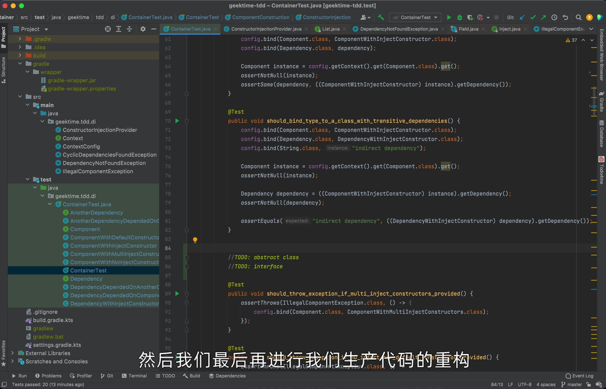

# 21 | DIContainer（9）：怎样重构测试代码？

你好，我是徐昊。今天我们继续使用 TDD 的方式实现注入依赖容器。

## 回顾代码与任务列表

到目前为止，我们的代码是这样的：


```
ContextConfig.java:
```


```java
package geektime.tdd.di;
import java.util.*;
import static java.util.List.of;
public class ContextConfig {
   private Map<Class<?>, ComponentProvider<?>> providers = new HashMap<>();
   public <Type> void bind(Class<Type> type, Type instance) {
       providers.put(type, new ComponentProvider<Type>() {
           @Override
           public Type get(Context context) {
               return instance;
           }
           @Override
           public List<Class<?>> getDependencies() {
               return of();
           }
       });
   }
   public <Type, Implementation extends Type>
   void bind(Class<Type> type, Class<Implementation> implementation) {
       providers.put(type, new ConstructorInjectionProvider<>(implementation));
   }
   public Context getContext() {
       providers.keySet().forEach(component -> checkDependencies(component, new
       return new Context() {
           @Override
           public <Type> Optional<Type> get(Class<Type> type) {
               return Optional.ofNullable(providers.get(type)).map(provider -> (
           }
       };
   }
   private void checkDependencies(Class<?> component, Stack<Class<?>> visiting)
       for (Class<?> dependency: providers.get(component).getDependencies()) {
           if (!providers.containsKey(dependency)) throw new DependencyNotFoundE
           if (visiting.contains(dependency)) throw new CyclicDependenciesFoundE
           visiting.push(dependency);
           checkDependencies(dependency, visiting);
           visiting.pop();
       }
   }
```

```
   interface ComponentProvider<T> {
       T get(Context context);
```

```java
       List<Class<?>> getDependencies();
   }
}
ConstructorInjectionProvider.java:
package geektime.tdd.di;
import jakarta.inject.Inject;
import java.lang.reflect.*;
import java.util.ArrayList;
import java.util.Arrays;
import java.util.Collections;
import java.util.List;
import java.util.stream.Collectors;
import java.util.stream.Stream;
import static java.util.Arrays.stream;
import static java.util.stream.Stream.concat;
class ConstructorInjectionProvider<T> implements ContextConfig.ComponentProvider<
   private Constructor<T> injectConstructor;
   private List<Field> injectFields;
   private List<Method> injectMethods;
   public ConstructorInjectionProvider(Class<T> component) {
       this.injectConstructor = getInjectConstructor(component);
       this.injectFields = getInjectFields(component);
       this.injectMethods = getInjectMethods(component);
   }
   @Override
   public T get(Context context) {
       try {
           Object[] dependencies = stream(injectConstructor.getParameters())
                   .map(p -> context.get(p.getType()).get())
                   .toArray(Object[]::new);
           T instance = injectConstructor.newInstance(dependencies);
           for (Field field : injectFields)
               field.set(instance, context.get(field.getType()).get());
           for (Method method : injectMethods)
               method.invoke(instance, stream(method.getParameterTypes()).map(t
                       .toArray(Object[]::new));
           return instance;
       } catch (InvocationTargetException | InstantiationException | IllegalAcce
           throw new RuntimeException(e);
       }
```

```
   }
   @Override
```

```java
   public List<Class<?>> getDependencies() {
       return concat(concat(stream(injectConstructor.getParameters()).map(Parame
                       injectFields.stream().map(Field::getType)),
               injectMethods.stream().flatMap(m -> stream(m.getParameterTypes())
       ).toList();
   }
   private static <T> List<Method> getInjectMethods(Class<T> component) {
       List<Method> injectMethods = new ArrayList<>();
       Class<?> current = component;
       while(current != Object.class) {
           injectMethods.addAll(stream(current.getDeclaredMethods()).filter(m ->
                           .filter(m -> injectMethods.stream().noneMatch(o -> o.
                                   Arrays.equals(o.getParameterTypes(), m.getPar
                           .filter(m -> stream(component.getDeclaredMethods()).f
                                   .noneMatch(o -> o.getName().equals(m.getName(
                                           Arrays.equals(o.getParameterTypes(),
                   .toList());
           current = current.getSuperclass();
       }
       Collections.reverse(injectMethods);
       return injectMethods;
   }
   private static <T> List<Field> getInjectFields(Class<T> component) {
       List<Field> injectFields = new ArrayList<>();
       Class<?> current = component;
       while (current != Object.class) {
           injectFields.addAll(stream(current.getDeclaredFields()).filter(f -> f
                   .toList());
           current = current.getSuperclass();
       }
       return injectFields;
   }
   private static <Type> Constructor<Type> getInjectConstructor(Class<Type> impl
       List<Constructor<?>> injectConstructors = stream(implementation.getConstr
               .filter(c -> c.isAnnotationPresent(Inject.class)).collect(Collect
       if (injectConstructors.size() > 1) throw new IllegalComponentException();
       return (Constructor<Type>) injectConstructors.stream().findFirst().orElse
           try {
               return implementation.getDeclaredConstructor();
           } catch (NoSuchMethodException e) {
               throw new IllegalComponentException();
           }
       });
```

```
   }
}
```

```java
Context.java:
package geektime.tdd.di;
import java.util.Optional;
public interface Context {
   <Type> Optional<Type> get(Class<Type> type);
}
```

测试代码为：

```java
package geektime.tdd.di;
import jakarta.inject.Inject;
import org.junit.jupiter.api.BeforeEach;
import org.junit.jupiter.api.Disabled;
import org.junit.jupiter.api.Nested;
import org.junit.jupiter.api.Test;
import org.junit.platform.commons.annotation.Testable;
import org.mockito.Mockito;
import org.mockito.internal.util.collections.Sets;
import java.util.*;
import static org.junit.jupiter.api.Assertions.*;
import static org.mockito.ArgumentMatchers.eq;
public class ContainerTest {
   ContextConfig config;
   @BeforeEach
   public void setup() {
       config = new ContextConfig();
   }
   @Nested
   public class ComponentConstruction {
       @Test
       public void should_bind_type_to_a_specific_instance() {
           Component instance = new Component() {
           };
           config.bind(Component.class, instance);
           Context context = config.getContext();
           assertSame(instance, context.get(Component.class).get());
       }
       @Test
       public void should_return_empty_if_component_not_defined() {
```

```
           Optional<Component> component = config.getContext().get(Component.cla
           assertTrue(component.isEmpty());
```

```java
       }
       @Nested
       public class ConstructorInjection {
           //TODO: abstract class
           //TODO: interface
           @Test
           public void should_bind_type_to_a_class_with_default_constructor() {
               config.bind(Component.class, ComponentWithDefaultConstructor.clas
               Component instance = config.getContext().get(Component.class).get
               assertNotNull(instance);
               assertTrue(instance instanceof ComponentWithDefaultConstructor);
           }
           @Test
           public void should_bind_type_to_a_class_with_inject_constructor() {
               Dependency dependency = new Dependency() {
               };
               config.bind(Component.class, ComponentWithInjectConstructor.class
               config.bind(Dependency.class, dependency);
               Component instance = config.getContext().get(Component.class).get
               assertNotNull(instance);
               assertSame(dependency, ((ComponentWithInjectConstructor) instance
           }
           @Test
           public void should_bind_type_to_a_class_with_transitive_dependencies(
               config.bind(Component.class, ComponentWithInjectConstructor.class
               config.bind(Dependency.class, DependencyWithInjectConstructor.cla
               config.bind(String.class, "indirect dependency");
               Component instance = config.getContext().get(Component.class).get
               assertNotNull(instance);
               Dependency dependency = ((ComponentWithInjectConstructor) instanc
               assertNotNull(dependency);
               assertEquals("indirect dependency", ((DependencyWithInjectConstru
           }
           @Test
           public void should_throw_exception_if_multi_inject_constructors_provi
               assertThrows(IllegalComponentException.class, () -> {
                   config.bind(Component.class, ComponentWithMultiInjectConstruc
               });
           }
           @Test
           public void should_throw_exception_if_no_inject_nor_default_construct
               assertThrows(IllegalComponentException.class, () -> {
                   config.bind(Component.class, ComponentWithNoInjectConstructor
               });
           }
           @Test
```

```java
           public void should_throw_exception_if_dependency_not_found() {
               config.bind(Component.class, ComponentWithInjectConstructor.class
               DependencyNotFoundException exception = assertThrows(DependencyNo
```

```java
               assertEquals(Dependency.class, exception.getDependency());
               assertEquals(Component.class, exception.getComponent());
           }
           @Test
           public void should_throw_exception_if_transitive_dependency_not_found
               config.bind(Component.class, ComponentWithInjectConstructor.class
               config.bind(Dependency.class, DependencyWithInjectConstructor.cla
               DependencyNotFoundException exception = assertThrows(DependencyNo
               assertEquals(String.class, exception.getDependency());
               assertEquals(Dependency.class, exception.getComponent());
           }
           @Test
           public void should_throw_exception_if_cyclic_dependencies_found() {
               config.bind(Component.class, ComponentWithInjectConstructor.class
               config.bind(Dependency.class, DependencyDependedOnComponent.class
               CyclicDependenciesFoundException exception = assertThrows(CyclicD
               Set<Class<?>> classes = Sets.newSet(exception.getComponents());
               assertEquals(2, classes.size());
               assertTrue(classes.contains(Component.class));
               assertTrue(classes.contains(Dependency.class));
           }
           @Test
           public void should_throw_exception_if_transitive_cyclic_dependencies_
               config.bind(Component.class, ComponentWithInjectConstructor.class
               config.bind(Dependency.class, DependencyDependedOnAnotherDependen
               config.bind(AnotherDependency.class, AnotherDependencyDependedOnC
               CyclicDependenciesFoundException exception = assertThrows(CyclicD
               List<Class<?>> components = Arrays.asList(exception.getComponents
               assertEquals(3, components.size());
               assertTrue(components.contains(Component.class));
               assertTrue(components.contains(Dependency.class));
               assertTrue(components.contains(AnotherDependency.class));
           }
       }
       @Nested
       public class FieldInjection {
           static class ComponentWithFieldInjection {
               @Inject
               Dependency dependency;
           }
           static class SubclassWithFieldInjection extends ComponentWithFieldInj
           }
           @Test
           public void should_inject_dependency_via_field() {
               Dependency dependency = new Dependency() {
               };
```

```
               config.bind(Dependency.class, dependency);
               config.bind(ComponentWithFieldInjection.class, ComponentWithField
               ComponentWithFieldInjection component = config.getContext().get(C
```

```java
               assertSame(dependency, component.dependency);
           }
           @Test
           public void should_inject_dependency_via_superclass_inject_field() {
               Dependency dependency = new Dependency() {
               };
               config.bind(Dependency.class, dependency);
               config.bind(SubclassWithFieldInjection.class, SubclassWithFieldIn
               SubclassWithFieldInjection component = config.getContext().get(Su
               assertSame(dependency, component.dependency);
           }
           //TODO throw exception if field is final
           @Test
           public void should_include_field_dependency_in_dependencies() {
               ConstructorInjectionProvider<ComponentWithFieldInjection> provide
               assertArrayEquals(new Class<?>[]{Dependency.class}, provider.getD
           }
       }
       @Nested
       public class MethodInjection {
           static class InjectMethodWithNoDependency {
               boolean called = false;
               @Inject
               void install() {
                   this.called = true;
               }
           }
           @Test
           public void should_call_inject_method_even_if_no_dependency_declared(
               config.bind(InjectMethodWithNoDependency.class, InjectMethodWithN
               InjectMethodWithNoDependency component = config.getContext().get(
               assertTrue(component.called);
           }
           static class InjectMethodWithDependency {
               Dependency dependency;
               @Inject
               void install(Dependency dependency) {
                   this.dependency = dependency;
               }
           }
           @Test
           public void should_inject_dependency_via_inject_method() {
               Dependency dependency = new Dependency() {
               };
               config.bind(Dependency.class, dependency);
               config.bind(InjectMethodWithDependency.class, InjectMethodWithDep
```

```
               InjectMethodWithDependency component = config.getContext().get(In
               assertSame(dependency, component.dependency);
           }
```

```java
           static class SuperClassWithInjectMethod {
               int superCalled = 0;
               @Inject
               void install() {
                   superCalled++;
               }
           }
           static class SubclassWithInjectMethod extends SuperClassWithInjectMet
               int subCalled = 0;
               @Inject
               void installAnother() {
                   subCalled = superCalled + 1;
               }
           }
           @Test
           public void should_inject_dependencies_via_inject_method_from_supercl
               config.bind(SubclassWithInjectMethod.class, SubclassWithInjectMet
               SubclassWithInjectMethod component = config.getContext().get(Subc
               assertEquals(1, component.superCalled);
               assertEquals(2, component.subCalled);
           }
           static class SubclassOverrideSuperClassWithInject extends SuperClassW
               @Inject
               void install() {
                   super.install();
               }
           }
           @Test
           public void should_only_call_once_if_subclass_override_inject_method_
               config.bind(SubclassOverrideSuperClassWithInject.class, SubclassO
               SubclassOverrideSuperClassWithInject component = config.getContex
               assertEquals(1, component.superCalled);
           }
           static class SubclassOverrideSuperClassWithNoInject extends SuperClas
               void install() {
                   super.install();
               }
           }
           @Test
           public void should_not_call_inject_method_if_override_with_no_inject(
               config.bind(SubclassOverrideSuperClassWithNoInject.class, Subclas
               SubclassOverrideSuperClassWithNoInject component = config.getCont
               assertEquals(0, component.superCalled);
           }
           @Test
           public void should_include_dependencies_from_inject_method() {
```

```
               ConstructorInjectionProvider<InjectMethodWithDependency> provider
               assertArrayEquals(new Class<?>[]{Dependency.class}, provider.getD
           }
```

```java
           //TODO throw exception if type parameter defined
       }
   }
   @Nested
   public class DependenciesSelection {
   }
   @Nested
   public class LifecycleManagement {
   }
}
interface Component {
}
interface Dependency {
}
interface AnotherDependency {
}
class ComponentWithDefaultConstructor implements Component {
   public ComponentWithDefaultConstructor() {
   }
}
class ComponentWithInjectConstructor implements Component {
   private Dependency dependency;
   @Inject
   public ComponentWithInjectConstructor(Dependency dependency) {
       this.dependency = dependency;
   }
   public Dependency getDependency() {
       return dependency;
   }
}
class ComponentWithMultiInjectConstructors implements Component {
   @Inject
   public ComponentWithMultiInjectConstructors(String name, Double value) {
   }
   @Inject
   public ComponentWithMultiInjectConstructors(String name) {
   }
}
class ComponentWithNoInjectConstructorNorDefaultConstructor implements Component
   public ComponentWithNoInjectConstructorNorDefaultConstructor(String name) {
   }
}
class DependencyWithInjectConstructor implements Dependency {
   private String dependency;
   @Inject
   public DependencyWithInjectConstructor(String dependency) {
```

```
       this.dependency = dependency;
   }
   public String getDependency() {
```

```python
       return dependency;
   }
}
class DependencyDependedOnComponent implements Dependency {
   private Component component;
   @Inject
   public DependencyDependedOnComponent(Component component) {
       this.component = component;
   }
}
class AnotherDependencyDependedOnComponent implements AnotherDependency {
   private Component component;
   @Inject
   public AnotherDependencyDependedOnComponent(Component component) {
       this.component = component;
   }
}
class DependencyDependedOnAnotherDependency implements Dependency {
   private AnotherDependency anotherDependency;
   @Inject
   public DependencyDependedOnAnotherDependency(AnotherDependency anotherDepende
       this.anotherDependency = anotherDependency;
   }
}
```

任务列表状态为：

- 无需构造的组件——组件实例

- 如果注册的组件不可实例化，则抛出异常

- 抽象类

- 接口

- 构造函数注入

- 无依赖的组件应该通过默认构造函数生成组件实例

- 有依赖的组件，通过 Inject 标注的构造函数生成组件实例

- 如果所依赖的组件也存在依赖，那么需要对所依赖的组件也完成依赖注入

- 如果组件有多于一个 Inject 标注的构造函数，则抛出异常

- 如果组件没有 Inject 标注的构造函数，也没有默认构造函数（新增任务）

- 如果组件需要的依赖不存在，则抛出异常

- 如果组件间存在循环依赖，则抛出异常

- 字段注入

- 通过 Inject 标注将字段声明为依赖组件

- 如果字段为 final 则抛出异常

- 依赖中应包含 Inject Field 声明的依赖

- 方法注入

- 通过 Inject 标注的方法，其参数为依赖组件

- 通过 Inject 标注的无参数方法，会被调用

- 按照子类中的规则，覆盖父类中的 Inject 方法

- 如果方法定义类型参数，则抛出异常

- 依赖中应包含 Inject Method 声明的依赖

- 对 Provider 类型的依赖

- 注入构造函数中可以声明对于 Provider 的依赖

- 注入字段中可以声明对于 Provider 的依赖

- 注入方法中可声明对于 Provider 的依赖

- 自定义 Qualifier 的依赖

- 注册组件时，可额外指定 Qualifier

- 注册组件时，可从类对象上提取 Qualifier

- 寻找依赖时，需同时满足类型与自定义 Qualifier 标注

- 支持默认 Qualifier——Named

- Singleton 生命周期

- 注册组件时，可额外指定是否为 Singleton

- 注册组件时，可从类对象上提取 Singleton 标注

- 对于包含 Singleton 标注的组件，在容器范围内提供唯一实例

- 容器组件默认不是 Single 生命周期

- 自定义 Scope 标注

- 可向容器注册自定义 Scope 标注的回调

## 视频演示

让我们进入今天的部分：



## 思考题

在进入下节课之前，希望你能认真思考如下两个问题，并选择最有感触的一道进行回答。

1. 要怎样将大粒度的测试，重构为等效的小粒度测试代码？可以分享一下你的大致思路。

2. 请对比一下重构前后的代码结构，体会其中的改变。这会让你逐渐养成习惯，建立重构的大

- 局观。

欢迎把你的想法分享在留言区，也欢迎把你的项目代码的链接分享出来。相信经过你的思考与实操，学习效果会更好！
