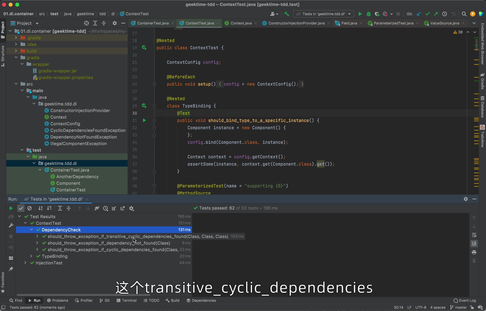

# 23 | DIContainer（11）：如何对ContainerTest进行文档化改造？

你好，我是徐昊。今天我们继续使用 TDD 的方式实现注入依赖容器。

## 回顾测试代码与任务列表

上节课我们专注于测试代码的重构，目前我们的测试是这样的：

```java
InjectTest：
package geektime.tdd.di;
import jakarta.inject.Inject;
import org.junit.jupiter.api.BeforeEach;
import org.junit.jupiter.api.Nested;
import org.junit.jupiter.api.Test;
import java.util.Optional;
import static org.junit.jupiter.api.Assertions.*;
import static org.mockito.ArgumentMatchers.eq;
import static org.mockito.Mockito.mock;
import static org.mockito.Mockito.when;
public class InjectionTest {
   private Dependency dependency = mock(Dependency.class);
   private Context context = mock(Context.class);
   @BeforeEach
   public void setup() {
       when(context.get(eq(Dependency.class))).thenReturn(Optional.of(dependency
   }
   @Nested
   public class ConstructorInjection {
       @Nested
       class Injection {
           static class DefaultConstructor {
           }
           @Test
           public void should_call_default_constructor_if_no_inject_constructor(
               DefaultConstructor instance = new ConstructorInjectionProvider<>(
               assertNotNull(instance);
           }
           static class InjectConstructor {
               Dependency dependency;
               @Inject
               public InjectConstructor(Dependency dependency) {
                   this.dependency = dependency;
               }
           }
           @Test
           public void should_inject_dependency_via_inject_constructor() {
               InjectConstructor instance = new ConstructorInjectionProvider<>(I
               assertSame(dependency, instance.dependency);
           }
           @Test
           public void should_include_dependency_from_inject_constructor() {
               ConstructorInjectionProvider<InjectConstructor> provider = new Co
               assertArrayEquals(new Class<?>[]{Dependency.class}, provider.getD
           }
       }
       @Nested
       class IllegalInjectConstructors {
           abstract class AbstractComponent implements Component {
               @Inject
               public AbstractComponent() {
               }
           }
           @Test
           public void should_throw_exception_if_component_is_abstract() {
               assertThrows(IllegalComponentException.class, () -> new Construct
           }
           @Test
           public void should_throw_exception_if_component_is_interface() {
               assertThrows(IllegalComponentException.class, () -> new Construct
           }
           static class MultiInjectConstructors {
               @Inject
               public MultiInjectConstructors(AnotherDependency dependency) {
               }
               @Inject
               public MultiInjectConstructors(Dependency dependency) {
               }
           }
           @Test
           public void should_throw_exception_if_multi_inject_constructors_provi
               assertThrows(IllegalComponentException.class, () -> new Construct
           }
           static class NoInjectNorDefaultConstructor {
               public NoInjectNorDefaultConstructor(Dependency dependency) {
               }
           }
           @Test
           public void should_throw_exception_if_no_inject_nor_default_construct
               assertThrows(IllegalComponentException.class, () -> new Construct
           }
       }
   }
   @Nested
   public class FieldInjection {
       @Nested
       class Injection {
           static class ComponentWithFieldInjection {
               @Inject
               Dependency dependency;
           }
           static class SubclassWithFieldInjection extends ComponentWithFieldInj
           }
           @Test
           public void should_inject_dependency_via_field() {
               ComponentWithFieldInjection component = new ConstructorInjectionP
               assertSame(dependency, component.dependency);
           }
           @Test
           public void should_inject_dependency_via_superclass_inject_field() {
               SubclassWithFieldInjection component = new ConstructorInjectionPr
               assertSame(dependency, component.dependency);
           }
           @Test
           public void should_include_dependency_from_field_dependency() {
               ConstructorInjectionProvider<ComponentWithFieldInjection> provide
               assertArrayEquals(new Class<?>[]{Dependency.class}, provider.getD
           }
       }
       @Nested
       class IllegalInjectFields {
           static class FinalInjectField {
               @Inject
               final Dependency dependency = null;
           }
           @Test
           public void should_throw_exception_if_inject_field_is_final() {
               assertThrows(IllegalComponentException.class, () -> new Construct
           }
       }
   }
   @Nested
   public class MethodInjection {
       @Nested
       class Injection {
           static class InjectMethodWithNoDependency {
               boolean called = false;
               @Inject
               void install() {
                   this.called = true;
               }
           }
           @Test
           public void should_call_inject_method_even_if_no_dependency_declared(
               InjectMethodWithNoDependency component = new ConstructorInjection
               assertTrue(component.called);
           }
           static class InjectMethodWithDependency {
               Dependency dependency;
               @Inject
               void install(Dependency dependency) {
                   this.dependency = dependency;
               }
           }
           @Test
           public void should_inject_dependency_via_inject_method() {
               InjectMethodWithDependency component = new ConstructorInjectionPr
               assertSame(dependency, component.dependency);
           }
           static class SuperClassWithInjectMethod {
               int superCalled = 0;
               @Inject
               void install() {
                   superCalled++;
               }
           }
           static class SubclassWithInjectMethod extends SuperClassWithInjectMet
               int subCalled = 0;
               @Inject
               void installAnother() {
                   subCalled = superCalled + 1;
               }
           }
           @Test
           public void should_inject_dependencies_via_inject_method_from_supercl
               SubclassWithInjectMethod component = new ConstructorInjectionProv
               assertEquals(1, component.superCalled);
               assertEquals(2, component.subCalled);
           }
           static class SubclassOverrideSuperClassWithInject extends SuperClassW
               @Inject
               void install() {
                   super.install();
               }
           }
           @Test
           public void should_only_call_once_if_subclass_override_inject_method_
               SubclassOverrideSuperClassWithInject component = new ConstructorI
               assertEquals(1, component.superCalled);
           }
           static class SubclassOverrideSuperClassWithNoInject extends SuperClas
               void install() {
                   super.install();
               }
           }
           @Test
           public void should_not_call_inject_method_if_override_with_no_inject(
               SubclassOverrideSuperClassWithNoInject component = new Constructo
               assertEquals(0, component.superCalled);
           }
           @Test
           public void should_include_dependencies_from_inject_method() {
               ConstructorInjectionProvider<InjectMethodWithDependency> provider
               assertArrayEquals(new Class<?>[]{Dependency.class}, provider.getD
           }
       }
       @Nested
       class IllegalInjectMethods {
           static class InjectMethodWithTypeParameter {
               @Inject
               <T> void install() {
               }
           }
           @Test
           public void should_throw_exception_if_inject_method_has_type_paramete
               assertThrows(IllegalComponentException.class, () -> new Construct
           }
       }
   }
}
```

待重构的 ContainerTest 是这样的：

```java
package geektime.tdd.di;
import jakarta.inject.Inject;
import org.junit.jupiter.api.BeforeEach;
import org.junit.jupiter.api.Nested;
import org.junit.jupiter.api.Test;
import org.mockito.internal.util.collections.Sets;
import java.util.*;
import static org.junit.jupiter.api.Assertions.*;
import static org.mockito.ArgumentMatchers.eq;
public class ContainerTest {
   ContextConfig config;
   @BeforeEach
   public void setup() {
       config = new ContextConfig();
   }
   @Nested
   public class ComponentConstruction {
       @Test
       public void should_bind_type_to_a_specific_instance() {
           Component instance = new Component() {
           };
           config.bind(Component.class, instance);
           Context context = config.getContext();
           assertSame(instance, context.get(Component.class).get());
       }
       @Test
       public void should_return_empty_if_component_not_defined() {
           Optional<Component> component = config.getContext().get(Component.cla
           assertTrue(component.isEmpty());
       }
       @Nested
       public class DependencyCheck {
           @Test
           public void should_throw_exception_if_dependency_not_found() {
               config.bind(Component.class, ComponentWithInjectConstructor.class
               DependencyNotFoundException exception = assertThrows(DependencyNo
               assertEquals(Dependency.class, exception.getDependency());
               assertEquals(Component.class, exception.getComponent());
           }
           @Test
           public void should_throw_exception_if_cyclic_dependencies_found() {
               config.bind(Component.class, ComponentWithInjectConstructor.class
               config.bind(Dependency.class, DependencyDependedOnComponent.class
               CyclicDependenciesFoundException exception = assertThrows(CyclicD
               Set<Class<?>> classes = Sets.newSet(exception.getComponents());
               assertEquals(2, classes.size());
               assertTrue(classes.contains(Component.class));
               assertTrue(classes.contains(Dependency.class));
           }
           @Test
           public void should_throw_exception_if_transitive_cyclic_dependencies_
               config.bind(Component.class, ComponentWithInjectConstructor.class
               config.bind(Dependency.class, DependencyDependedOnAnotherDependen
               config.bind(AnotherDependency.class, AnotherDependencyDependedOnC
               CyclicDependenciesFoundException exception = assertThrows(CyclicD
               List<Class<?>> components = Arrays.asList(exception.getComponents
               assertEquals(3, components.size());
               assertTrue(components.contains(Component.class));
               assertTrue(components.contains(Dependency.class));
               assertTrue(components.contains(AnotherDependency.class));
           }
       }
   }
   @Nested
   public class DependenciesSelection {
   }
   @Nested
   public class LifecycleManagement {
   }
}
interface Component {
}
interface Dependency {
}
interface AnotherDependency {
}
class ComponentWithInjectConstructor implements Component {
   private Dependency dependency;
   @Inject
   public ComponentWithInjectConstructor(Dependency dependency) {
       this.dependency = dependency;
   }
   public Dependency getDependency() {
       return dependency;
   }
}
class DependencyDependedOnComponent implements Dependency {
   private Component component;
   @Inject
   public DependencyDependedOnComponent(Component component) {
       this.component = component;
   }
}
class AnotherDependencyDependedOnComponent implements AnotherDependency {
   private Component component;
   @Inject
   public AnotherDependencyDependedOnComponent(Component component) {
       this.component = component;
   }
}
class DependencyDependedOnAnotherDependency implements Dependency {
   private AnotherDependency anotherDependency;
   @Inject
   public DependencyDependedOnAnotherDependency(AnotherDependency anotherDepende
       this.anotherDependency = anotherDependency;
   }
}
```

任务列表没有改变，目前的状态为：

- 无需构造的组件——组件实例

- 如果注册的组件不可实例化，则抛出异常

- 抽象类

- 接口

- 构造函数注入

- 无依赖的组件应该通过默认构造函数生成组件实例

- 有依赖的组件，通过 Inject 标注的构造函数生成组件实例

- 如果所依赖的组件也存在依赖，那么需要对所依赖的组件也完成依赖注入

- 如果组件有多于一个 Inject 标注的构造函数，则抛出异常

- 如果组件没有 Inject 标注的构造函数，也没有默认构造函数（新增任务）

- 如果组件需要的依赖不存在，则抛出异常

- 如果组件间存在循环依赖，则抛出异常

- 字段注入

- 通过 Inject 标注将字段声明为依赖组件

- 如果字段为 final 则抛出异常

- 依赖中应包含 Inject Field 声明的依赖

- 方法注入

- 通过 Inject 标注的方法，其参数为依赖组件

- 通过 Inject 标注的无参数方法，会被调用

- 按照子类中的规则，覆盖父类中的 Inject 方法

- 如果方法定义类型参数，则抛出异常

- 依赖中应包含 Inject Method 声明的依赖

- 对 Provider 类型的依赖

- 注入构造函数中可以声明对于 Provider 的依赖

- 注入字段中可以声明对于 Provider 的依赖

- 注入方法中可声明对于 Provider 的依赖

- 自定义 Qualifier 的依赖

- 注册组件时，可额外指定 Qualifier

- 注册组件时，可从类对象上提取 Qualifier

- 寻找依赖时，需同时满足类型与自定义 Qualifier 标注

- 支持默认 Qualifier——Named

- Singleton 生命周期

- 注册组件时，可额外指定是否为 Singleton

- 注册组件时，可从类对象上提取 Singleton 标注

- 对于包含 Singleton 标注的组件，在容器范围内提供唯一实例

- 容器组件默认不是 Single 生命周期

自定义 Scope 标注

- 可向容器注册自定义 Scope 标注的回调

## 视频演示

让我们进入今天的部分：



## 思考题

剩余任务在现有代码结构下，要如何实现？

欢迎把你的想法分享在留言区，也欢迎把你的项目代码的链接分享出来。相信经过你的思考与实操，学习效果会更好！
