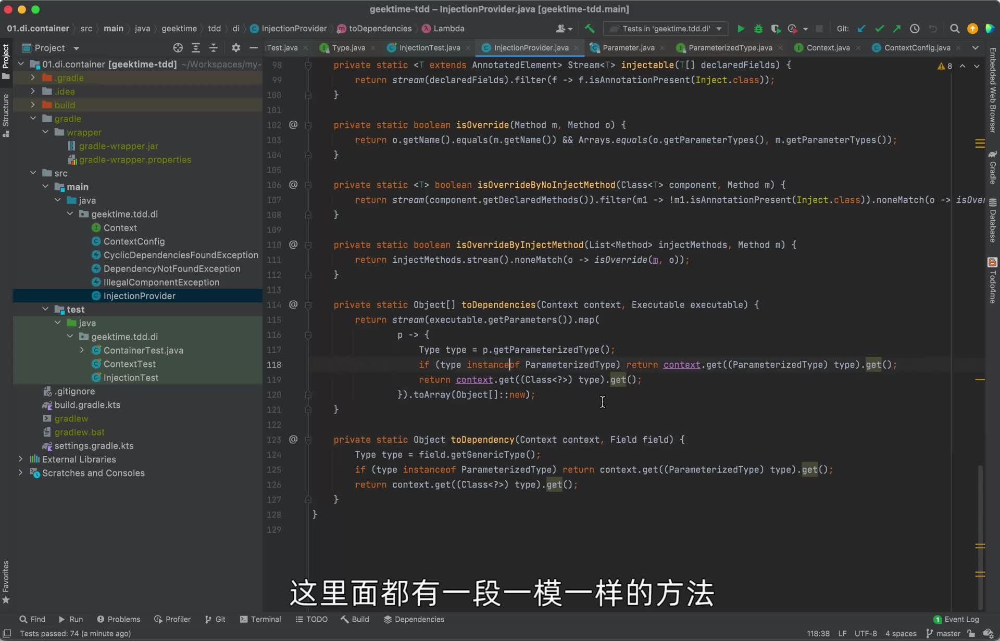

# 26 | DIContainer（14）：如何重构对Type类型判断的逻辑？

你好，我是徐昊。今天我们继续使用 TDD 的方式来实现注入依赖容器。

## 回顾代码与任务列表

到目前为止，我们的代码是这样的：

```java
enter code here
InjectProvider.java:
package geektime.tdd.di;
import jakarta.inject.Inject;
import java.lang.reflect.*;
import java.util.ArrayList;
import java.util.Arrays;
import java.util.Collections;
import java.util.List;
import java.util.function.BiFunction;
import java.util.stream.Stream;
import static java.util.Arrays.stream;
import static java.util.stream.Stream.concat;
class InjectionProvider<T> implements ContextConfig.ComponentProvider<T> {
   private Constructor<T> injectConstructor;
   private List<Field> injectFields;
   private List<Method> injectMethods;
   public InjectionProvider(Class<T> component) {
       if (Modifier.isAbstract(component.getModifiers())) throw new IllegalCompo
       this.injectConstructor = getInjectConstructor(component);
       this.injectFields = getInjectFields(component);
       this.injectMethods = getInjectMethods(component);
       if (injectFields.stream().anyMatch(f -> Modifier.isFinal(f.getModifiers()
           throw new IllegalComponentException();
       if (injectMethods.stream().anyMatch(m -> m.getTypeParameters().length !=
           throw new IllegalComponentException();
   }
   @Override
   public T get(Context context) {
       try {
           T instance = injectConstructor.newInstance(toDependencies(context, in
           for (Field field : injectFields) field.set(instance, toDependency(con
           for (Method method : injectMethods) method.invoke(instance, toDepende
           return instance;
       } catch (InvocationTargetException | InstantiationException | IllegalAcce
           throw new RuntimeException(e);
       }
   }
   @Override
   public List<Class<?>> getDependencies() {
       return concat(concat(stream(injectConstructor.getParameterTypes()),
                       injectFields.stream().map(Field::getType)),
               injectMethods.stream().flatMap(m -> stream(m.getParameterTypes())
   }
   @Override
   public List<Type> getDependencyTypes() {
       return concat(concat(stream(injectConstructor.getParameters()).map(Parame
                       injectFields.stream().map(Field::getGenericType)),
               injectMethods.stream().flatMap(m -> stream(m.getParameters()).map
   }
   private static <T> List<Method> getInjectMethods(Class<T> component) {
       List<Method> injectMethods = traverse(component, (methods, current) -> in
               .filter(m -> isOverrideByInjectMethod(methods, m))
               .filter(m -> isOverrideByNoInjectMethod(component, m)).toList());
       Collections.reverse(injectMethods);
       return injectMethods;
   }
   private static <T> List<Field> getInjectFields(Class<T> component) {
       return traverse(component, (fields, current) -> injectable(current.getDec
   }
   private static <Type> Constructor<Type> getInjectConstructor(Class<Type> impl
       List<Constructor<?>> injectConstructors = injectable(implementation.getCo
       if (injectConstructors.size() > 1) throw new IllegalComponentException();
       return (Constructor<Type>) injectConstructors.stream().findFirst().orElse
   }
   private static <Type> Constructor<Type> defaultConstructor(Class<Type> implem
       try {
           return implementation.getDeclaredConstructor();
       } catch (NoSuchMethodException e) {
           throw new IllegalComponentException();
       }
   }
   private static <T> List<T> traverse(Class<?> component, BiFunction<List<T>, C
       List<T> members = new ArrayList<>();
       Class<?> current = component;
       while (current != Object.class) {
           members.addAll(finder.apply(members, current));
           current = current.getSuperclass();
       }
       return members;
   }
   private static <T extends AnnotatedElement> Stream<T> injectable(T[] declared
       return stream(declaredFields).filter(f -> f.isAnnotationPresent(Inject.cl
   }
   private static boolean isOverride(Method m, Method o) {
       return o.getName().equals(m.getName()) && Arrays.equals(o.getParameterTyp
   }
   private static <T> boolean isOverrideByNoInjectMethod(Class<T> component, Met
       return stream(component.getDeclaredMethods()).filter(m1 -> !m1.isAnnotati
   }
   private static boolean isOverrideByInjectMethod(List<Method> injectMethods, M
       return injectMethods.stream().noneMatch(o -> isOverride(m, o));
   }
   private static Object[] toDependencies(Context context, Executable executable
       return stream(executable.getParameters()).map(
               p -> {
                   Type type = p.getParameterizedType();
                   if (type instanceof ParameterizedType) return context.get((Pa
                   return context.get((Class<?>) type).get();
               }).toArray(Object[]::new);
   }
   private static Object toDependency(Context context, Field field) {
       Type type = field.getGenericType();
       if (type instanceof ParameterizedType) return context.get((ParameterizedT
       return context.get((Class<?>) type).get();
   }
}
Context.java:
package geektime.tdd.di;
import java.lang.reflect.ParameterizedType;
import java.util.Optional;
public interface Context {
   <Type> Optional<Type> get(Class<Type> type);
   Optional get(ParameterizedType type);
}
ContextConfig.java:
package geektime.tdd.di;
import jakarta.inject.Provider;
import java.lang.reflect.ParameterizedType;
import java.lang.reflect.Type;
import java.util.*;
import static java.util.List.of;
public class ContextConfig {
   private Map<Class<?>, ComponentProvider<?>> providers = new HashMap<>();
   public <Type> void bind(Class<Type> type, Type instance) {
       providers.put(type, (ComponentProvider<Type>) context -> instance);
   }
   public <Type, Implementation extends Type>
   void bind(Class<Type> type, Class<Implementation> implementation) {
       providers.put(type, new InjectionProvider<>(implementation));
   }
   public Context getContext() {
       providers.keySet().forEach(component -> checkDependencies(component, new
       return new Context() {
           @Override
           public <Type> Optional<Type> get(Class<Type> type) {
               return Optional.ofNullable(providers.get(type)).map(provider -> (
           }
           @Override
           public Optional get(ParameterizedType type) {
               if (type.getRawType() != Provider.class) return Optional.empty();
               Class<?> componentType = (Class<?>) type.getActualTypeArguments()
               return Optional.ofNullable(providers.get(componentType))
                       .map(provider -> (Provider<Object>) () -> provider.get(th
           }
       };
   }
   private void checkDependencies(Class<?> component, Stack<Class<?>> visiting)
       for (Type dependency : providers.get(component).getDependencyTypes()) {
           if (dependency instanceof Class)
               checkDependency(component, visiting, (Class<?>) dependency);
           if (dependency instanceof ParameterizedType) {
               Class<?> type = (Class<?>) ((ParameterizedType)dependency).getAct
               if (!providers.containsKey(type)) throw new DependencyNotFoundExc
           }
       }
   }
   private void checkDependency(Class<?> component, Stack<Class<?>> visiting, Cl
       if (!providers.containsKey(dependency)) throw new DependencyNotFoundExcep
       if (visiting.contains(dependency)) throw new CyclicDependenciesFoundExcep
       visiting.push(dependency);
       checkDependencies(dependency, visiting);
       visiting.pop();
   }
   interface ComponentProvider<T> {
       T get(Context context);
       default List<Class<?>> getDependencies() {
           return of();
       }
       default List<Type> getDependencyTypes() {
           return of();
       }
   }
}
```

任务列表的状态为：

- 无需构造的组件——组件实例

- 如果注册的组件不可实例化，则抛出异常

- 抽象类

- 接口

- 构造函数注入

- 无依赖的组件应该通过默认构造函数生成组件实例

- 有依赖的组件，通过 Inject 标注的构造函数生成组件实例

- 如果所依赖的组件也存在依赖，那么需要对所依赖的组件也完成依赖注入

- 如果组件有多于一个 Inject 标注的构造函数，则抛出异常

- 如果组件没有 Inject 标注的构造函数，也没有默认构造函数（新增任务）

- 如果组件需要的依赖不存在，则抛出异常

- 如果组件间存在循环依赖，则抛出异常

- 字段注入

- 通过 Inject 标注将字段声明为依赖组件

- 如果字段为 final 则抛出异常

- 依赖中应包含 Inject Field 声明的依赖

- 方法注入

- 通过 Inject 标注的方法，其参数为依赖组件

- 通过 Inject 标注的无参数方法，会被调用

- 按照子类中的规则，覆盖父类中的 Inject 方法

- 如果方法定义类型参数，则抛出异常

- 依赖中应包含 Inject Method 声明的依赖

- 对 Provider 类型的依赖

- 从容器中取得组件的 Provider（新增任务）

- 注入构造函数中可以声明对于 Provider 的依赖

- 注入字段中可以声明对于 Provider 的依赖

- 注入方法中可声明对于 Provider 的依赖

- 将构造函数中的 Provider 加入依赖（新增任务）

- 将字段中的 Provider 加入依赖（新增任务）

- 将方法中的 Provider 加入依赖（新增任务）

- 自定义 Qualifier 的依赖

- 注册组件时，可额外指定 Qualifier

- 注册组件时，可从类对象上提取 Qualifier

- 寻找依赖时，需同时满足类型与自定义 Qualifier 标注

- 支持默认 Qualifier——Named

- Singleton 生命周期

- 注册组件时，可额外指定是否为 Singleton

- 注册组件时，可从类对象上提取 Singleton 标注

- 对于包含 Singleton 标注的组件，在容器范围内提供唯一实例

- 容器组件默认不是 Single 生命周期

- 自定义 Scope 标注

- 可向容器注册自定义 Scope 标注的回调

## 视频演示

让我们进入今天的部分：



## 思考题

在进入下节课之前，希望你能认真思考如下两个问题，并选择最有感触的一道进行回答。

1. 如何封装类型判断逻辑以替换对于 Type 的依赖？

2. 在最近的学习与实操过程中，有什么困难或疑惑的地方吗？

编辑来信：

- 第二期“TDD·代码评点”活动启动啦！为了帮助你更平滑地过渡到第三个实战项目，徐老师发起了代码评点活动。

- 你可以填写学习问卷提交项目代码，而后，徐老师会一一查看，并进行评点与答疑。关于评点的详细内容，我们也将制成加餐展示在专栏里，供其他同学学习与参考。

- 请注意，此次收集时间截至 5 月 27 日晚上 12 点。此外，我也会从中选出 1-2 位同学，送出《重构与模式》一书。请抓紧上车，入股不亏哦！

欢迎把你的想法分享在留言区，也欢迎把你的项目代码的链接分享出来。相信经过你的思考与实操，学习效果会更好！
