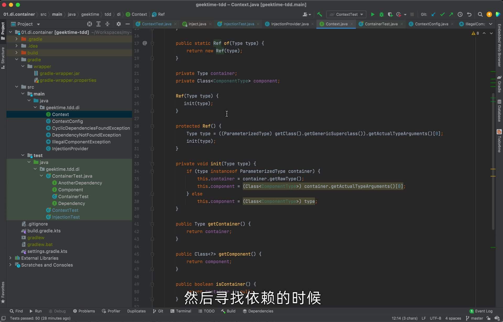

# 28 | DIContainer（16）：行为封装会对测试产生什么影响？

你好，我是徐昊。今天我们继续使用 TDD 的方式来实现注入依赖容器。

## 回顾代码与任务列表

到目前为止，我们的代码是这样的：

```java
InjectProvider.java:
package geektime.tdd.di;
import jakarta.inject.Inject;
import java.lang.reflect.*;
import java.util.*;
import java.util.function.BiFunction;
import java.util.stream.Stream;
import static java.util.Arrays.stream;
import static java.util.stream.Stream.concat;
class InjectionProvider<T> implements ContextConfig.ComponentProvider<T> {
   private Constructor<T> injectConstructor;
   private List<Field> injectFields;
   private List<Method> injectMethods;
   public InjectionProvider(Class<T> component) {
       if (Modifier.isAbstract(component.getModifiers())) throw new IllegalCompo
       this.injectConstructor = getInjectConstructor(component);
       this.injectFields = getInjectFields(component);
       this.injectMethods = getInjectMethods(component);
       if (injectFields.stream().anyMatch(f -> Modifier.isFinal(f.getModifiers()
           throw new IllegalComponentException();
       if (injectMethods.stream().anyMatch(m -> m.getTypeParameters().length !=
           throw new IllegalComponentException();
   }
@Override
public T get(Context context) {
   try {
       T instance = injectConstructor.newInstance(toDependencies(context, inject
       for (Field field : injectFields) field.set(instance, toDependency(context
       for (Method method : injectMethods) method.invoke(instance, toDependencie
       return instance;
   } catch (InvocationTargetException | InstantiationException | IllegalAccessEx
       throw new RuntimeException(e);
   }
}
@Override
public List<Context.Ref> getDependencies() {
   return concat(concat(stream(injectConstructor.getParameters()).map(Parameter:
                   injectFields.stream().map(Field::getGenericType)),
           injectMethods.stream().flatMap(m -> stream(m.getParameters()).map(Par
           .map(Context.Ref::of).toList();
}
private static <T> List<Method> getInjectMethods(Class<T> component) {
   List<Method> injectMethods = traverse(component, (methods, current) -> inject
           .filter(m -> isOverrideByInjectMethod(methods, m))
           .filter(m -> isOverrideByNoInjectMethod(component, m)).toList());
   Collections.reverse(injectMethods);
   return injectMethods;
}
private static <T> List<Field> getInjectFields(Class<T> component) {
   return traverse(component, (fields, current) -> injectable(current.getDeclare
}
private static <Type> Constructor<Type> getInjectConstructor(Class<Type> implemen
   List<Constructor<?>> injectConstructors = injectable(implementation.getConstr
   if (injectConstructors.size() > 1) throw new IllegalComponentException();
   return (Constructor<Type>) injectConstructors.stream().findFirst().orElseGet(
}
private static <Type> Constructor<Type> defaultConstructor(Class<Type> implementa
   try {
       return implementation.getDeclaredConstructor();
   } catch (NoSuchMethodException e) {
       throw new IllegalComponentException();
   }
}
private static <T> List<T> traverse(Class<?> component, BiFunction<List<T>, Class
   List<T> members = new ArrayList<>();
   Class<?> current = component;
   while (current != Object.class) {
       members.addAll(finder.apply(members, current));
       current = current.getSuperclass();
   }
   return members;
}
private static <T extends AnnotatedElement> Stream<T> injectable(T[] declaredFiel
   return stream(declaredFields).filter(f -> f.isAnnotationPresent(Inject.class)
}
private static boolean isOverride(Method m, Method o) {
   return o.getName().equals(m.getName()) && Arrays.equals(o.getParameterTypes()
}
private static <T> boolean isOverrideByNoInjectMethod(Class<T> component, Method
   return stream(component.getDeclaredMethods()).filter(m1 -> !m1.isAnnotationPr
}
private static boolean isOverrideByInjectMethod(List<Method> injectMethods, Metho
   return injectMethods.stream().noneMatch(o -> isOverride(m, o));
}
private static Object[] toDependencies(Context context, Executable executable) {
   return stream(executable.getParameters()).map(p -> toDependency(context, p.ge
}
private static Object toDependency(Context context, Field field) {
   return toDependency(context, field.getGenericType());
}
   private static Object toDependency(Context context, Type type) {
       return context.get(Context.Ref.of(type)).get();
   }
}
Context.java:
package geektime.tdd.di;
import java.lang.reflect.ParameterizedType;
import java.lang.reflect.Type;
import java.util.Objects;
import java.util.Optional;
public interface Context {
   <ComponentType> Optional<ComponentType> get(Ref<ComponentType> ref);
   class Ref<ComponentType> {
   public static <ComponentType> Ref<ComponentType> of(Class<ComponentType> comp
       return new Ref(component);
   }
   public static Ref of(Type type) {
       return new Ref(type);
   }
   private Type container;
   private Class<ComponentType> component;
   Ref(Type type) {
      init(type);
   }
   protected Ref() {
       Type type = ((ParameterizedType) getClass().getGenericSuperclass()).getAc
       init(type);
   }
   private void init(Type type) {
       if (type instanceof ParameterizedType container) {
           this.container = container.getRawType();
           this.component = (Class<ComponentType>) container.getActualTypeArgume
       } else
           this.component = (Class<ComponentType>) type;
   }
   public Type getContainer() {
       return container;
   }
   public Class<?> getComponent() {
       return component;
   }
   public boolean isContainer() {
       return container != null;
   }
   @Override
   public boolean equals(Object o) {
       if (this == o) return true;
       if (o == null || getClass() != o.getClass()) return false;
       Ref ref = (Ref) o;
       return Objects.equals(container, ref.container) && component.equals(ref.c
   }
   @Override
   public int h
ashCode() {
           return Objects.hash(container, component);
       }
   }
}
ContextConfig.java:
package geektime.tdd.di;
import jakarta.inject.Provider;
import java.util.*;
public class ContextConfig {
   private Map<Class<?>, ComponentProvider<?>> providers = new HashMap<>();
public <Type> void bind(Class<Type> type, Type instance) {
   providers.put(type, (ComponentProvider<Type>) context -> instance);
}
public <Type, Implementation extends Type> void bind(Class<Type> type, Class<Impl
   providers.put(type, new InjectionProvider<>(implementation));
}
public Context getContext() {
   providers.keySet().forEach(component -> checkDependencies(component, new Stac
   return new Context() {
       @Override
       public Optional<?> get(Ref ref) {
           if (ref.isContainer()) {
               if (ref.getContainer() != Provider.class) return Optional.empty()
               return Optional.ofNullable(providers.get(ref.getComponent()))
                       .map(provider -> (Provider<Object>) () -> provider.get(th
           }
           return Optional.ofNullable(providers.get(ref.getComponent())).map(pro
       }
   };
}
private void checkDependencies(Class<?> component, Stack<Class<?>> visiting) {
   for (Context.Ref dependency : providers.get(component).getDependencies()) {
       if (!providers.containsKey(dependency.getComponent())) throw new Dependen
       if (!dependency.isContainer()) {
           if (visiting.contains(dependency.getComponent())) throw new CyclicDep
           visiting.push(dependency.getComponent());
           checkDependencies(dependency.getComponent(), visiting);
           visiting.pop();
       }
   }
}
interface ComponentProvider<T> {
   T get(Context context);
   default List<Context.Ref> getDependencies() {
       return List.of();
   }
}
}
```

任务列表的状态为：

- 无需构造的组件——组件实例

- 如果注册的组件不可实例化，则抛出异常

- 抽象类

- 接口

- 构造函数注入

- 无依赖的组件应该通过默认构造函数生成组件实例

- 有依赖的组件，通过 Inject 标注的构造函数生成组件实例

- 如果所依赖的组件也存在依赖，那么需要对所依赖的组件也完成依赖注入

- 如果组件有多于一个 Inject 标注的构造函数，则抛出异常

- 如果组件没有 Inject 标注的构造函数，也没有默认构造函数（新增任务）

- 如果组件需要的依赖不存在，则抛出异常

- 如果组件间存在循环依赖，则抛出异常

- 字段注入

- 通过 Inject 标注将字段声明为依赖组件

- 如果字段为 final 则抛出异常

- 依赖中应包含 Inject Field 声明的依赖

- 方法注入

- 通过 Inject 标注的方法，其参数为依赖组件

- 通过 Inject 标注的无参数方法，会被调用

- 按照子类中的规则，覆盖父类中的 Inject 方法

- 如果方法定义类型参数，则抛出异常

- 依赖中应包含 Inject Method 声明的依赖

- 对 Provider 类型的依赖

- 从容器中取得组件的 Provider（新增任务）

- 注入构造函数中可以声明对于 Provider 的依赖

- 注入字段中可以声明对于 Provider 的依赖

- 注入方法中可声明对于 Provider 的依赖

- 将构造函数中的 Provider 加入依赖（新增任务）

- 将字段中的 Provider 加入依赖（新增任务）

- 将方法中的 Provider 加入依赖（新增任务）

- 自定义 Qualifier 的依赖

- 注册组件时，可额外指定 Qualifier

- 寻找依赖时，需同时满足类型与自定义 Qualifier 标注

- 支持默认 Qualifier——Named

- 注册组件时，可从类对象上提取 Qualifier

- Singleton 生命周期

- 注册组件时，可额外指定是否为 Singleton

- 注册组件时，可从类对象上提取 Singleton 标注

- 对于包含 Singleton 标注的组件，在容器范围内提供唯一实例

- 容器组件默认不是 Single 生命周期

- 自定义 Scope 标注

- 可向容器注册自定义 Scope 标注的回调

## 视频演示

让我们进入今天的部分：



## 思考题

在进入下节课之前，希望你能认真思考如下两个问题，并选择最有感触的一道进行回答。

1. 我们要如何重构 ContextConfig 内部的实现，从而可以使用 Component 代替 Class<?> ?

2. 你最近是怎样学习 TDD 的？可以分享一下你的学习方式，为其他同学提供参考。

编辑来信：

- 第二期“TDD·代码评点”活动启动啦！为了帮助你更平滑地过渡到第三个实战项目，徐老师发起了代码评点活动。

- 你可以填写学习问卷提交项目代码，而后，徐老师会一一查看，并进行评点与答疑。关于评点的详细内容，我们也将制成加餐展示在专栏里，供其他同学学习与参考。

- 请注意，此次收集时间截至 5 月 27 日晚上 12 点。此外，我也会从中选出 1-2 位同学，送出《重构与模式》一书。请抓紧上车，入股不亏哦！

欢迎把你的想法分享在留言区，也欢迎把你的项目代码的链接分享出来。相信经过你的思考与实操，学习效果会更好！
