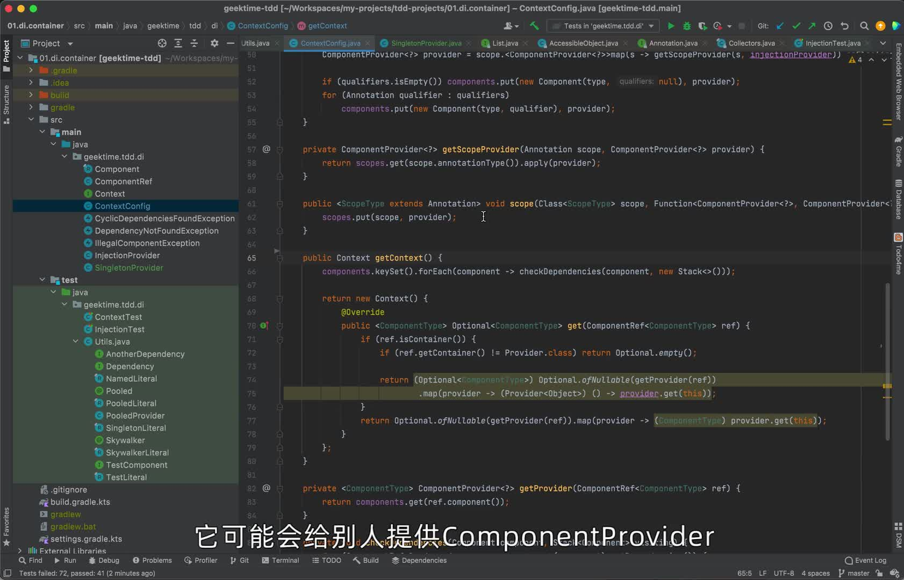

# 34 | DIContainer（22）：如何对Bind的逻辑进行重构？

你好，我是徐昊。今天我们继续使用 TDD 的方式实现注入依赖容器。

## 回顾代码与任务列表

到目前为止，我们的代码是这样的：

```java
Component.java
package geektime.tdd.di;
import java.lang.annotation.Annotation;
public record Component(Class<?> type, Annotation qualifiers) {
}
ComponentRef.java
package geektime.tdd.di;
import java.lang.annotation.Annotation;
import java.lang.reflect.ParameterizedType;
import java.lang.reflect.Type;
import java.util.Objects;
public class ComponentRef<ComponentType> {
   public static <ComponentType> ComponentRef<ComponentType> of(Class<ComponentT
       return new ComponentRef(component, null);
   }
   public static <ComponentType> ComponentRef<ComponentType> of(Class<ComponentT
       return new ComponentRef(component, qualifier);
   }
   public static ComponentRef of(Type type) {
       return new ComponentRef(type, null);
   }
   public static ComponentRef of(Type type, Annotation qualifier) {
       return new ComponentRef(type, qualifier);
   }
   private Type container;
   private Component component;
   ComponentRef(Type type, Annotation qualifier) {
       init(type, qualifier);
   }
   protected ComponentRef() {
       this(null);
   }
   protected ComponentRef(Annotation qualifier) {
       Type type = ((ParameterizedType) getClass().getGenericSuperclass()).getAc
       init(type, qualifier);
   }
   private void init(Type type, Annotation qualifier) {
       if (type instanceof ParameterizedType container) {
           this.container = container.getRawType();
           this.component = new Component((Class<ComponentType>) container.getAc
       } else
           this.component = new Component((Class<ComponentType>) type, qualifier
   }
   public Type getContainer() {
       return container;
   }
   public Class<?> getComponentType() {
       return component.type();
   }
   public boolean isContainer() {
       return container != null;
   }
   public Component component() {
       return component;
   }
   @Override
   public boolean equals(Object o) {
       if (this == o) return true;
       if (o == null || getClass() != o.getClass()) return false;
       ComponentRef<?> that = (ComponentRef<?>) o;
       return Objects.equals(container, that.container) && component.equals(that
   }
   @Override
   public int hashCode() {
       return Objects.hash(container, component);
   }
}
Context.java
package geektime.tdd.di;
import java.util.Optional;
public interface Context {
   <ComponentType> Optional<ComponentType> get(ComponentRef<ComponentType> ref);
}
ContextConfig.java
package geektime.tdd.di;
import jakarta.inject.Provider;
import jakarta.inject.Qualifier;
import jakarta.inject.Scope;
import jakarta.inject.Singleton;
import java.lang.annotation.Annotation;
import java.util.*;
import java.util.function.Function;
public class ContextConfig {
   private Map<Component, ComponentProvider<?>> components = new HashMap<>();
   private Map<Class<?>, Function<ComponentProvider<?>, ComponentProvider<?>>> s
   public ContextConfig() {
       scope(Singleton.class, SingletonProvider::new);
   }
   public <Type> void bind(Class<Type> type, Type instance) {
       components.put(new Component(type, null), (ComponentProvider<Type>) conte
   }
   public <Type> void bind(Class<Type> type, Type instance, Annotation... qualif
       if (Arrays.stream(qualifiers).anyMatch(q -> !q.annotationType().isAnnotat
           throw new IllegalComponentException();
       for (Annotation qualifier : qualifiers)
           components.put(new Component(type, qualifier), context -> instance);
   }
   public <Type, Implementation extends Type>
   void bind(Class<Type> type, Class<Implementation> implementation) {
       bind(type, implementation, implementation.getAnnotations());
   }
   public <Type, Implementation extends Type>
   void bind(Class<Type> type, Class<Implementation> implementation, Annotation.
       if (Arrays.stream(annotations).map(Annotation::annotationType)
               .anyMatch(t -> !t.isAnnotationPresent(Qualifier.class) && !t.isAn
           throw new IllegalComponentException();
       Optional<Annotation> scopeForType = Arrays.stream(implementation.getAnnot
       List<Annotation> qualifiers = Arrays.stream(annotations).filter(a -> a.an
       Optional<Annotation> scope = Arrays.stream(annotations).filter(a -> a.ann
               .or(() -> scopeForType);
       ComponentProvider<?> injectionProvider = new InjectionProvider<>(implemen
       ComponentProvider<?> provider = scope.<ComponentProvider<?>>map(s -> getS
       if (qualifiers.isEmpty()) components.put(new Component(type, null), provi
       for (Annotation qualifier : qualifiers)
           components.put(new Component(type, qualifier), provider);
   }
   private ComponentProvider<?> getScopeProvider(Annotation scope, ComponentProv
       return scopes.get(scope.annotationType()).apply(provider);
   }
   public <ScopeType extends Annotation> void scope(Class<ScopeType> scope, Func
       scopes.put(scope, provider);
   }
   static class SingletonProvider<T> implements ComponentProvider<T> {
       private T singleton;
       private ComponentProvider<T> provider;
       public SingletonProvider(ComponentProvider<T> provider) {
           this.provider = provider;
       }
       @Override
       public T get(Context context) {
           if (singleton == null) singleton = provider.get(context);
           return singleton;
       }
       @Override
       public List<ComponentRef<?>> getDependencies() {
           return provider.getDependencies();
       }
   }
   public Context getContext() {
       components.keySet().forEach(component -> checkDependencies(component, new
       return new Context() {
           @Override
           public <ComponentType> Optional<ComponentType> get(ComponentRef<Compo
               if (ref.isContainer()) {
                   if (ref.getContainer() != Provider.class) return Optional.emp
                   return (Optional<ComponentType>) Optional.ofNullable(getProvi
                           .map(provider -> (Provider<Object>) () -> provider.ge
               }
               return Optional.ofNullable(getProvider(ref)).map(provider -> (Com
           }
       };
   }
   private <ComponentType> ComponentProvider<?> getProvider(ComponentRef<Compone
       return components.get(ref.component());
   }
   private void checkDependencies(Component component, Stack<Component> visiting
       for (ComponentRef<?> dependency : components.get(component).getDependenci
           if (!components.containsKey(dependency.component()))
               throw new DependencyNotFoundException(component, dependency.compo
           if (!dependency.isContainer()) {
               if (visiting.contains(dependency.component())) throw new CyclicDe
               visiting.push(dependency.component());
               checkDependencies(dependency.component(), visiting);
               visiting.pop();
           }
       }
   }
   interface ComponentProvider<T> {
       T get(Context context);
       default List<ComponentRef<?>> getDependencies() {
           return List.of();
       }
   }
}
InjectionProvider.java
package geektime.tdd.di;
import jakarta.inject.Inject;
import jakarta.inject.Qualifier;
import java.lang.annotation.Annotation;
import java.lang.reflect.*;
import java.util.*;
import java.util.function.BiFunction;
import java.util.stream.Stream;
import static java.util.Arrays.stream;
import static java.util.stream.Stream.concat;
class InjectionProvider<T> implements ContextConfig.ComponentProvider<T> {
   private Injectable<Constructor<T>> injectConstructor;
   private List<Injectable<Method>> injectMethods;
   private List<Injectable<Field>> injectableFields;
   public InjectionProvider(Class<T> component) {
       if (Modifier.isAbstract(component.getModifiers())) throw new IllegalCompo
       this.injectConstructor = getInjectConstructor(component);
       this.injectMethods = getInjectMethods(component);
       this.injectableFields = getInjectFields(component);
       if (injectableFields.stream().anyMatch(f -> Modifier.isFinal(f.element().
           throw new IllegalComponentException();
       if (injectMethods.stream().anyMatch(m -> m.element().getTypeParameters().
           throw new IllegalComponentException();
   }
   @Override
   public T get(Context context) {
       try {
           T instance = injectConstructor.element().newInstance(injectConstructo
           for (Injectable<Field> field : injectableFields)
               field.element().set(instance, field.toDependencies(context)[0]);
           for (Injectable<Method> method : injectMethods)
               method.element().invoke(instance, method.toDependencies(context))
           return instance;
       } catch (InvocationTargetException | InstantiationException | IllegalAcce
           throw new RuntimeException(e);
       }
   }
   @Override
   public List<ComponentRef<?>> getDependencies() {
       return concat(concat(Stream.of(injectConstructor), injectableFields.strea
               .map(Injectable::required).flatMap(Arrays::stream).toList();
   }
   record Injectable<Element extends AccessibleObject>(Element element, Componen
       Object[] toDependencies(Context context) {
           return stream(required).map(context::get).map(Optional::get).toArray(
       }
       static <Element extends Executable> Injectable<Element> of(Element elemen
           return new Injectable<>(element, stream(element.getParameters()).map(
       }
       static Injectable<Field> of(Field field) {
           return new Injectable<>(field, new ComponentRef<?>[]{toComponentRef(f
       }
       private static ComponentRef<?> toComponentRef(Field field) {
           return ComponentRef.of(field.getGenericType(), getQualifier(field));
       }
       private static ComponentRef<?> toComponentRef(Parameter parameter) {
           return ComponentRef.of(parameter.getParameterizedType(), getQualifier
       }
       private static Annotation getQualifier(AnnotatedElement element) {
           List<Annotation> qualifiers = stream(element.getAnnotations())
                   .filter(a -> a.annotationType().isAnnotationPresent(Qualifier
           if (qualifiers.size() > 1) throw new IllegalComponentException();
           return qualifiers.stream().findFirst().orElse(null);
       }
   }
   private static <T> List<Injectable<Method>> getInjectMethods(Class<T> compone
       List<Method> injectMethods = traverse(component, (methods, current) -> in
               .filter(m -> isOverrideByInjectMethod(methods, m))
               .filter(m -> isOverrideByNoInjectMethod(component, m)).toList());
       Collections.reverse(injectMethods);
       return injectMethods.stream().map(Injectable::of).toList();
   }
   private static <T> List<Injectable<Field>> getInjectFields(Class<T> component
       return InjectionProvider.<Field>traverse(component, (fields, current) ->
               .stream().map(Injectable::of).toList();
   }
   private static <Type> Injectable<Constructor<Type>> getInjectConstructor(Clas
       List<Constructor<?>> injectConstructors = injectable(implementation.getCo
       if (injectConstructors.size() > 1) throw new IllegalComponentException();
       return Injectable.of((Constructor<Type>) injectConstructors.stream().find
   }
   private static <Type> Constructor<Type> defaultConstructor(Class<Type> implem
       try {
           return implementation.getDeclaredConstructor();
       } catch (NoSuchMethodException e) {
           throw new IllegalComponentException();
       }
   }
   private static <T> List<T> traverse(Class<?> component, BiFunction<List<T>, C
       List<T> members = new ArrayList<>();
       Class<?> current = component;
       while (current != Object.class) {
           members.addAll(finder.apply(members, current));
           current = current.getSuperclass();
       }
       return members;
   }
   private static <T extends AnnotatedElement> Stream<T> injectable(T[] declared
       return stream(declaredFields).filter(f -> f.isAnnotationPresent(Inject.cl
   }
   private static boolean isOverride(Method m, Method o) {
       return o.getName().equals(m.getName()) && Arrays.equals(o.getParameterTyp
   }
   private static <T> boolean isOverrideByNoInjectMethod(Class<T> component, Met
       return stream(component.getDeclaredMethods()).filter(m1 -> !m1.isAnnotati
   }
   private static boolean isOverrideByInjectMethod(List<Method> injectMethods, M
       return injectMethods.stream().noneMatch(o -> isOverride(m, o));
   }
}
```

任务列表的状态为：

- 无需构造的组件——组件实例

- 如果注册的组件不可实例化，则抛出异常

- 抽象类

- 接口

- 构造函数注入

- 无依赖的组件应该通过默认构造函数生成组件实例

- 有依赖的组件，通过 Inject 标注的构造函数生成组件实例

- 如果所依赖的组件也存在依赖，那么需要对所依赖的组件也完成依赖注入

- 如果组件有多于一个 Inject 标注的构造函数，则抛出异常

- 如果组件没有 Inject 标注的构造函数，也没有默认构造函数（新增任务）

- 如果组件需要的依赖不存在，则抛出异常

- 如果组件间存在循环依赖，则抛出异常

- 字段注入

- 通过 Inject 标注将字段声明为依赖组件

- 如果字段为 final 则抛出异常

- 依赖中应包含 Inject Field 声明的依赖

- 方法注入

- 通过 Inject 标注的方法，其参数为依赖组件

- 通过 Inject 标注的无参数方法，会被调用

- 按照子类中的规则，覆盖父类中的 Inject 方法

- 如果方法定义类型参数，则抛出异常

- 依赖中应包含 Inject Method 声明的依赖

- 对 Provider 类型的依赖

- 从容器中取得组件的 Provider（新增任务）

- 注入构造函数中可以声明对于 Provider 的依赖

- 注入字段中可以声明对于 Provider 的依赖

- 注入方法中可声明对于 Provider 的依赖

- 将构造函数中的 Provider 加入依赖（新增任务）

- 将字段中的 Provider 加入依赖（新增任务）

- 将方法中的 Provider 加入依赖（新增任务）

- 自定义 Qualifier 的依赖

- 注册组件时，可额外指定 Qualifier

- 针对 instance 指定一个 Qualifieri（新增任务）

- 针对组件指定一个 Qualiifer（新增任务）

- 针对 instance 指定多个 Qualifieri（新增任务）

- 针对组件指定多个 Qualiifer（新增任务）

- 注册组件时，如果不是合法的 Qualifier，则不接受组件注册（新增任务）

- 寻找依赖时，需同时满足类型与自定义 Qualifier 标注

- 在检查依赖时使用 Qualifier（新增任务）

- 在检查循环依赖时使用 Qualifier（新增任务）

- 构造函数注入可以使用 Qualifier 声明依赖（新增任务）

- 依赖中包含 Qualifier（新增任务）

- 如果不是合法的 Qualifier，则组件非法

- 字段注入可以使用 Qualifier 声明依赖（新增任务）

- 依赖中包含 Qualifier（新增任务）

- 如果不是合法的 Qualifier，则组件非法

- 函数注入可以使用 Qualifier 声明依赖（新增任务）

- 依赖中包含 Qualifier（新增任务）

- 如果不是合法的 Qualifier，则组件非法

- 支持默认 Qualifier——Named（不需要）

- 注册组件时，可从类对象上提取 Qualifier（不需要）

- Singleton 生命周期

- 注册组件时，可额外指定是否为 Singleton

- 注册包含 Qualifier 的组件时，可额外指定是否为 Singleton（新增任务）

- 注册组件时，可从类对象上提取 Scope 标注

- 对于包含 Singleton 标注的组件，在容器范围内提供唯一实例（不需要）

- 容器组件默认不是 Single 生命周期

- 包含 Qualifier 的组件默认不是 Single 生命周期（新增任务）

- 对于包含 Scope 的组件，检测依赖关系（新增任务）

- 自定义 Scope 标注

- 可向容器注册自定义 Scope 标注的回调

## 视频演示

让我们进入今天的部分：



## 思考题

在进入下节课的项目回顾与总结之前，希望你能认真思考如下两个问题，并选择最有感触的一道进行回答。

1. 要如何调整代码结构，以及增补什么样的特性，使得库对于使用者更友好？

2. 反思是学习真正发生的时候，一味地摄入内容和信息，并不一定真的能达到想要的效果。很欢迎把你反思的内容分享在留言区，我们共同交流，一起进步！

编辑来信：

- 第二期“TDD·代码评点”活动正式启动啦！为了帮助你更平滑地过渡到第三个实战项目，徐老师发起了代码评点活动。

- 你可以填写学习问卷提交项目代码，而后，徐老师会一一查看，并进行评点与答疑。关于评点的详细内容，我们也将制成加餐展示在专栏里，供其他同学学习与参考。

- 请注意，此次收集时间截至 5 月 27 日 12 点。此外，我也会从中选出 1-2 位同学，送出《重构与模式》一书。请抓紧上车，入股不亏哦！

欢迎把你的想法分享在留言区，也欢迎把你的项目代码的链接分享出来。相信经过你的思考与实操，学习效果会更好！
