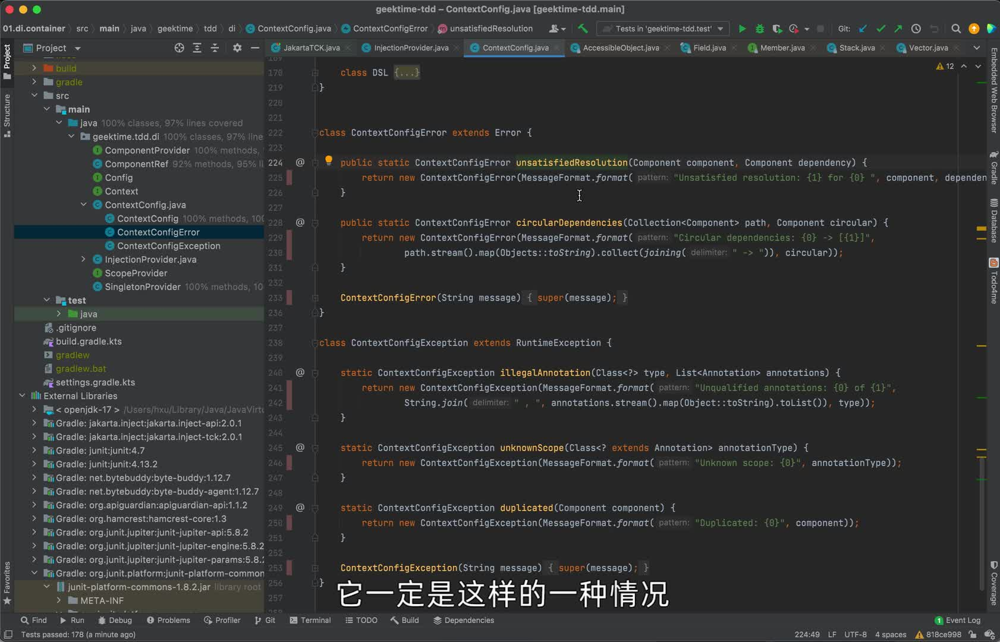
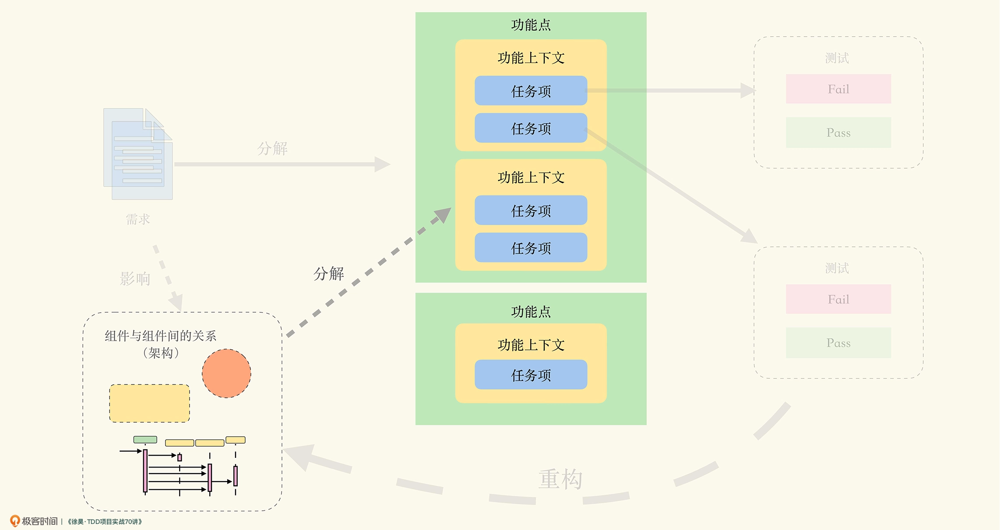
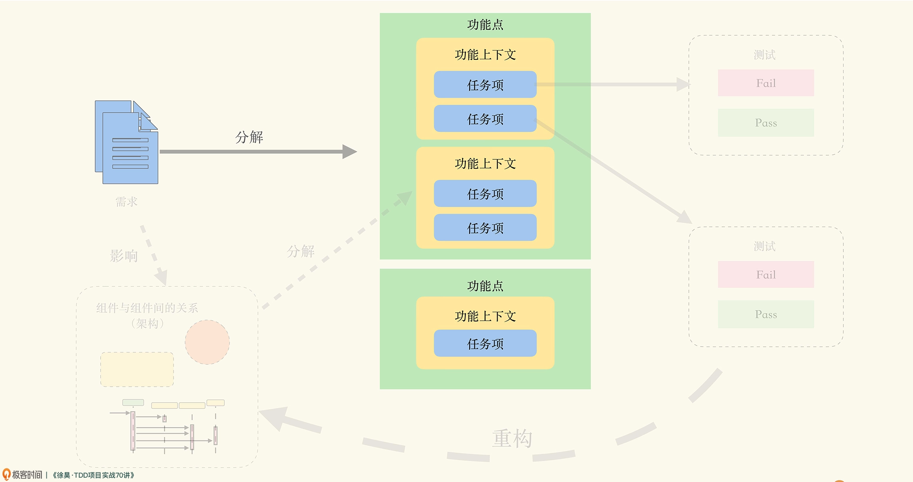
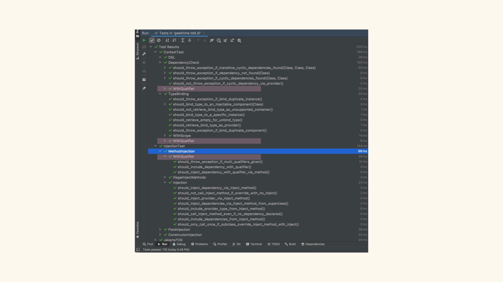

# 35 | DIContainer（23）：项目回顾与总结

你好，我是徐昊。今天我们来回顾一下第二个实战项目的整个过程。

## 最终的完成形态

首先，让我们来看一下最终的完成形态：



## 项目回顾与总结

首先是任务分解。在项目刚开始的时候，我们没有构想任何的架构愿景，而是直接采用经典模式，从功能点出发进行 TDD 开发。一开始进展是很顺利的，从任务列表上看，除了偶有遗落的功能点，基本上是按照任务列表顺畅进行的。

第一个转折点出现在我们第一次重构之后，我们将 InjectionProvider 从 ContextConfig 中分离了出来。并将依赖的检查从运行期检查，变成了在 ContextConfig.getContext 时预先检查。

也就是说，我们的架构愿景在此时发生了改变：只要 Context 能够被构建出来，其中就不存在无效组件和无效的组件关系（循环依赖、依赖缺失）。

这个架构愿景改变的直接影响，就是让我们分解任务的方式发生了变化。体现在任务列表上为：

- 方法注入（改变前）

- 通过 Inject 标注的方法，其参数为依赖组件

- 通过 Inject 标注的无参数方法，会被调用

- 按照子类中的规则，覆盖父类中的 Inject 方法

- 如果组件需要的依赖不存在，则抛出异常

- 如果方法定义类型参数，则抛出异常

- 如果组件间存在循环依赖，则抛出异常

- 方法注入（改变后）

- 通过 Inject 标注的方法，其参数为依赖组件

- 通过 Inject 标注的无参数方法，会被调用

- 按照子类中的规则，覆盖父类中的 Inject 方法

- 如果方法定义类型参数，则抛出异常

- 依赖中应包含 Inject Method 声明的依赖

也就是说，在这一刻，除了功能点之外，我们出现了两个功能上下文：ComponentProvider 和ContextConfig。很自然地，连带着分解任务的方式也发生了改变。如下图所示：



同时，我们的项目还发生过两次重大的模型调整：

- 第一次是在引入 Provider 接口的时候。也就是除了能够直接对组件依赖外，还可以通过Provider获取组件的工厂。

- 第二次则是在引入 Qualifier 的时候。

第一次模型调整的时候，我们发现之前都以 Class<?> 作为获取组件的标识。而当引入Provider 之后，我们就需要通过 Type 作为获取组件的标识。我们修改了 ComponentProvider的接口体现了这种变化：

```java
引入Provider之前：
   public interface ComponentProvider<T> {
       T get(Context context);
       default List<Class<?>> getDependencies() {
           return List.of();
       }
   }
引入Provider之后：
   public interface ComponentProvider<T> {
       T get(Context context);
       default List<Type> getDependencies() {
           return List.of();
       }
   }
```

第二次模型调整的时候，我们需要将 Type 和 Qualifier 标注组合在一起。于是我们引入了ComponentRef（最开始叫 Ref）对象，作为获取组件的标识。我们再次修改了ComponentProvider 的接口：

```java
public interface ComponentProvider<T> {
   T get(Context context);
   default List<ComponentRef<?>> getDependencies() {
       return List.of();
   }
}
```

模型调整之后，Context 中的组件就从实例组件（Instance）和注入组件（InjectableComponent），变成实例组件、注入组件、带 Qualifier 的实例组件、带 Qualifier 的注入组件以及它们对应的 Provider 形式等八种。

这也进一步帮助我们理解了软件的需求，帮助我们进一步有效率地分解了任务。如下图所示：



带来的结果是，任务列表发生了更为剧烈的改变：

- 自定义 Qualifier 的依赖（最开始的任务）

- 注册组件时，可额外指定 Qualifier

- 注册组件时，可从类对象上提取 Qualifier

- 寻找依赖时，需同时满足类型与自定义 Qualifier 标注

- 支持默认 Qualifier——Named

- 自定义 Qualifier 的依赖（实际完成的任务）

- 注册组件时，可额外指定 Qualifier

- 针对 instance 指定一个 Qualifieri（新增任务）

- 针对组件指定一个 Qualiifer（新增任务）

- 针对 instance 指定多个 Qualifieri（新增任务）

- 针对组件指定多个 Qualiifer（新增任务）

- 注册组件时，如果不是合法的 Qualifier，则不接受组件注册（新增任务）

- 寻找依赖时，需同时满足类型与自定义 Qualifier 标注

- 在检查依赖时使用 Qualifier（新增任务）

- 在检查循环依赖时使用 Qualifier（新增任务）

- 构造函数注入可以使用 Qualifier 声明依赖（新增任务）

- 依赖中包含 Qualifier（新增任务）

- 如果不是合法的 Qualifier，则组件非法

- 字段注入可以使用 Qualifier 声明依赖（新增任务）

- 依赖中包含 Qualifier（新增任务）

- 如果不是合法的 Qualifier，则组件非法

- 函数注入可以使用 Qualifier 声明依赖（新增任务）

- 依赖中包含 Qualifier（新增任务）

- 如果不是合法的 Qualifier，则组件非法

- 支持默认 Qualifier——Named（不需要）

- 注册组件时，可从类对象上提取 Qualifier（不需要）

我们通过重组测试，从结构上梳理并记录了这些改变。如下图所示：



这种对于核心模型的调整是痛苦的，在很多情况下，意味着软件需要重写。我们展示了如何通过重构来完成这种改写，所以请重点回看与重构有关的章节，反思我们是如何做到的。

最后，我的代码是这样的：

```java
ComponentProvider.java
package geektime.tdd.di;
import java.util.List;
public interface ComponentProvider<T> {
   T get(Context context);
   default List<ComponentRef<?>> getDependencies() {
       return List.of();
   }
}
ComponentRef.java
package geektime.tdd.di;
import java.lang.annotation.Annotation;
import java.lang.reflect.ParameterizedType;
import java.lang.reflect.Type;
import java.util.Objects;
public class ComponentRef<ComponentType> {
   public static <ComponentType> ComponentRef<ComponentType> of(Class<ComponentT
       return new ComponentRef<>(component, null);
   }
   public static <ComponentType> ComponentRef<ComponentType> of(Class<ComponentT
       return new ComponentRef<>(component, qualifier);
   }
   public static ComponentRef<?> of(Type type, Annotation qualifier) {
       return new ComponentRef<>(type, qualifier);
   }
   private Type container;
   private ContextConfig.Component component;
   ComponentRef(Type type, Annotation qualifier) {
       init(type, qualifier);
   }
   protected ComponentRef() {
       this(null);
   }
   protected ComponentRef(Annotation qualifier) {
       Type type = ((ParameterizedType) getClass().getGenericSuperclass()).getAc
       init(type, qualifier);
   }
   private void init(Type type, Annotation qualifier) {
       if (type instanceof ParameterizedType container) {
           this.container = container.getRawType();
           this.component = new ContextConfig.Component((Class<ComponentType>) c
       } else
           this.component = new ContextConfig.Component((Class<ComponentType>) t
   }
   public Type getContainer() {
       return container;
   }
   public boolean isContainer() {
       return container != null;
   }
   ContextConfig.Component component() {
       return component;
   }
   @Override
   public boolean equals(Object o) {
       if (this == o) return true;
       if (o == null || getClass() != o.getClass()) return false;
       ComponentRef<?> that = (ComponentRef<?>) o;
       return Objects.equals(container, that.container) && component.equals(that
   }
   @Override
   public int hashCode() {
       return Objects.hash(container, component);
   }
}
Config.java
package geektime.tdd.di;
import java.lang.annotation.Documented;
import java.lang.annotation.ElementType;
import java.lang.annotation.Retention;
import java.lang.annotation.Target;
import static java.lang.annotation.RetentionPolicy.RUNTIME;
public interface Config {
   @Documented
   @Retention(RUNTIME)
   @Target({ElementType.FIELD})
   @interface Export {
       Class<?> value();
   }
}
Context.java
package geektime.tdd.di;
import java.util.Optional;
public interface Context {
   <ComponentType> Optional<ComponentType> get(ComponentRef<ComponentType> ref);
}
ContextConfig.java
package geektime.tdd.di;
import geektime.tdd.di.ContextConfig.Component;
import jakarta.inject.Provider;
import jakarta.inject.Qualifier;
import jakarta.inject.Scope;
import jakarta.inject.Singleton;
import java.lang.annotation.Annotation;
import java.lang.reflect.Field;
import java.text.MessageFormat;
import java.util.*;
import java.util.function.Function;
import java.util.stream.Stream;
import static geektime.tdd.di.ContextConfigError.circularDependencies;
import static geektime.tdd.di.ContextConfigError.unsatisfiedResolution;
import static geektime.tdd.di.ContextConfigException.illegalAnnotation;
import static java.util.Arrays.spliterator;
import static java.util.Arrays.stream;
import static java.util.stream.Collectors.*;
public class ContextConfig {
   private final Map<Component, ComponentProvider<?>> components = new HashMap<>
   private final Map<Class<?>, ScopeProvider> scopes = new HashMap<>();
   public ContextConfig() {
       scope(Singleton.class, SingletonProvider::new);
   }
   public <Type> void instance(Class<Type> type, Type instance) {
       bind(new Component(type, null), context -> instance);
   }
   public <Type> void instance(Class<Type> type, Type instance, Annotation... an
       bindInstance(type, instance, annotations);
   }
   public <Type, Implementation extends Type>
   void component(Class<Type> type, Class<Implementation> implementation, Annota
       bindComponent(type, implementation, annotations);
   }
   public <ScopeType extends Annotation> void scope(Class<ScopeType> scope, Scop
       scopes.put(scope, provider);
   }
   public void from(Config config) {
       new DSL(config).bind();
   }
   public Context getContext() {
       components.keySet().forEach(component -> checkDependencies(component, new
       HashMap<Component, ComponentProvider<?>> context = new HashMap<>(componen
       return new Context() {
           @Override
           public <ComponentType> Optional<ComponentType> get(ComponentRef<Compo
               if (ref.isContainer()) {
                   if (ref.getContainer() != Provider.class) return Optional.emp
                   return (Optional<ComponentType>) Optional.ofNullable(getProvi
                           .map(provider -> (Provider<Object>) () -> provider.ge
               }
               return Optional.ofNullable(getProvider(ref)).map(provider -> (Com
           }
           private <ComponentType> ComponentProvider<?> getProvider(ComponentRef
               return context.get(ref.component());
           }
       };
   }
   private void bindComponent(Class<?> type, Class<?> implementation, Annotation
       Bindings bindings = Bindings.component(implementation, annotations);
       bind(type, bindings.qualifiers(), provider(implementation, bindings.scope
   }
   private void bindInstance(Class<?> type, Object instance, Annotation[] annota
       bind(type, Bindings.instance(type, annotations).qualifiers(), context ->
   }
   private <Type> void bind(Class<Type> type, List<Annotation> qualifiers, Compo
       if (qualifiers.isEmpty()) bind(new Component(type, null), provider);
       for (Annotation qualifier : qualifiers)
           bind(new Component(type, qualifier), provider);
   }
   private void bind(Component component, ComponentProvider<?> provider) {
       if (components.containsKey(component)) throw ContextConfigException.dupli
       components.put(component, provider);
   }
   private <Type> ComponentProvider<?> provider(Class<Type> implementation, Opti
       ComponentProvider<?> injectionProvider = new InjectionProvider<>(implemen
       return scope.<ComponentProvider<?>>map(s -> scoped(s, injectionProvider))
   }
   private ComponentProvider<?> scoped(Annotation scope, ComponentProvider<?> pr
       if (!scopes.containsKey(scope.annotationType()))
           throw ContextConfigException.unknownScope(scope.annotationType());
       return scopes.get(scope.annotationType()).create(provider);
   }
   private void checkDependencies(Component component, Stack<Component> visiting
       for (ComponentRef<?> dependency : components.get(component).getDependenci
           if (!components.containsKey(dependency.component()))
               throw unsatisfiedResolution(component, dependency.component());
           if (!dependency.isContainer()) {
               if (visiting.contains(dependency.component()))
                   throw circularDependencies(visiting, dependency.component());
               visiting.push(dependency.component());
               checkDependencies(dependency.component(), visiting);
               visiting.pop();
           }
       }
   }
   record Component(Class<?> type, Annotation qualifier) {
   }
   static class Bindings {
       public static Bindings component(Class<?> component, Annotation... annota
           return new Bindings(component, annotations, Qualifier.class, Scope.cl
       }
       public static Bindings instance(Class<?> instance, Annotation... annotati
           return new Bindings(instance, annotations, Qualifier.class);
       }
       Class<?> type;
       Map<Class<?>, List<Annotation>> group;
       public Bindings(Class<?> type, Annotation[] annotations, Class<? extends
           this.type = type;
           this.group = parse(type, annotations, allowed);
       }
       private static Map<Class<?>, List<Annotation>> parse(Class<?> type, Annot
           Map<Class<?>, List<Annotation>> annotationGroups = stream(annotations
           if (annotationGroups.containsKey(Illegal.class))
               throw illegalAnnotation(type, annotationGroups.get(Illegal.class)
           return annotationGroups;
       }
       private static Function<Annotation, Class<?>> allow(Class<? extends Annot
           return annotation -> Stream.of(annotations).filter(annotation.annotat
                   .findFirst().orElse(Illegal.class);
       }
       private @interface Illegal {
       }
       Optional<Annotation> scope() {
           List<Annotation> scopes = group.getOrDefault(Scope.class, from(type,
           if (scopes.size() > 1) throw illegalAnnotation(type, scopes);
           return scopes.stream().findFirst();
       }
       List<Annotation> qualifiers() {
           return group.getOrDefault(Qualifier.class, List.of());
       }
       private static List<Annotation> from(Class<?> implementation, Class<? ext
           return stream(implementation.getAnnotations()).filter(a -> a.annotati
       }
   }
   class DSL {
       private Config config;
       public DSL(Config config) {
           this.config = config;
       }
       void bind() {
           for (Declaration declaration : declarations())
               declaration.value().ifPresentOrElse(declaration::bindInstance, de
       }
       private List<Declaration> declarations() {
           return stream(config.getClass().getDeclaredFields()).filter(f -> !f.i
       }
       class Declaration {
           private Field field;
           Declaration(Field field) {
               this.field = field;
           }
           void bindInstance(Object instance) {
               ContextConfig.this.bindInstance(type(), instance, annotations());
           }
           void bindComponent() {
               ContextConfig.this.bindComponent(type(), field.getType(), annotat
           }
           private Optional<Object> value() {
               try {
                   return Optional.ofNullable(field.get(config));
               } catch (IllegalAccessException e) {
                   throw new RuntimeException(e);
               }
           }
           private Class<?> type() {
               Config.Export export = field.getAnnotation(Config.Export.class);
               return export != null ? export.value() : field.getType();
           }
           private Annotation[] annotations() {
               return stream(field.getAnnotations()).filter(a -> a.annotationTyp
           }
       }
   }
}
class ContextConfigError extends Error {
   public static ContextConfigError unsatisfiedResolution(Component component, C
       return new ContextConfigError(MessageFormat.format("Unsatisfied resolutio
   }
   public static ContextConfigError circularDependencies(Collection<Component> p
       return new ContextConfigError(MessageFormat.format("Circular dependencies
               path.stream().map(Objects::toString).collect(joining(" -> ")), ci
   }
   ContextConfigError(String message) {
       super(message);
   }
}
class ContextConfigException extends RuntimeException {
   static ContextConfigException illegalAnnotation(Class<?> type, List<Annotatio
       return new ContextConfigException(MessageFormat.format("Unqualified annot
               String.join(" , ", annotations.stream().map(Object::toString).toL
   }
   static ContextConfigException unknownScope(Class<? extends Annotation> annota
       return new ContextConfigException(MessageFormat.format("Unknown scope: {0
   }
   static ContextConfigException duplicated(Component component) {
       return new ContextConfigException(MessageFormat.format("Duplicated: {0}",
   }
   ContextConfigException(String message) {
       super(message);
   }
}
InjectionProvider.java
package geektime.tdd.di;
import jakarta.inject.Inject;
import jakarta.inject.Qualifier;
import java.lang.annotation.Annotation;
import java.lang.reflect.*;
import java.text.MessageFormat;
import java.util.*;
import java.util.function.BiFunction;
import java.util.function.Predicate;
import java.util.stream.Collectors;
import java.util.stream.Stream;
import static geektime.tdd.di.ComponentError.*;
import static java.util.Arrays.stream;
import static java.util.stream.Stream.concat;
class InjectionProvider<T> implements ComponentProvider<T> {
   private final Injectable<Constructor<T>> injectConstructor;
   private final Map<Class<?>, List<Injectable<Method>>> injectMethods;
   private final Map<Class<?>, List<Injectable<Field>>> injectFields;
   private final Collection<Class<?>> superClasses;
   private final List<ComponentRef<?>> dependencies;
   public InjectionProvider(Class<T> component) {
       this.injectConstructor = getInjectConstructor(component);
       this.superClasses = allSuperClass(component);
       var injectFields = getInjectFields(component);
       var injectMethods = getInjectMethods(component);
       this.dependencies = concat(concat(Stream.of(injectConstructor), injectFie
               .map(Injectable::required).flatMap(Arrays::stream).toList();
       this.injectFields = groupByClass(injectFields);
       this.injectMethods = groupByClass(injectMethods);
   }
   @Override
   public T get(Context context) {
       try {
           T instance = injectConstructor.element().newInstance(injectConstructo
           for (Class<?> c : superClasses) {
               for (Injectable<Field> field : injectFields.getOrDefault(c, List.
                   field.element().set(instance, field.toDependencies(context)[0
               for (Injectable<Method> method : injectMethods.getOrDefault(c, Li
                   method.element().invoke(instance, method.toDependencies(conte
           }
           return instance;
       } catch (InvocationTargetException | InstantiationException | IllegalAcce
           throw new RuntimeException(e);
       }
   }
   @Override
   public List<ComponentRef<?>> getDependencies() {
       return dependencies;
   }
   record Injectable<Element extends AccessibleObject>(Element element, Componen
       Object[] toDependencies(Context context) {
           return stream(required).map(context::get).map(Optional::get).toArray(
       }
       static <Element extends Executable> Injectable<Element> of(Element elemen
           element.setAccessible(true);
           return new Injectable<>(element, stream(element.getParameters()).map(
       }
       static Injectable<Field> of(Field field) {
           field.setAccessible(true);
           return new Injectable<>(field, new ComponentRef<?>[]{toComponentRef(f
       }
       private static ComponentRef<?> toComponentRef(Field field) {
           return ComponentRef.of(field.getGenericType(), getQualifier(field));
       }
       private static ComponentRef<?> toComponentRef(Parameter parameter) {
           return ComponentRef.of(parameter.getParameterizedType(), getQualifier
       }
       private static Annotation getQualifier(AnnotatedElement element) {
           List<Annotation> qualifiers = stream(element.getAnnotations())
                   .filter(a -> a.annotationType().isAnnotationPresent(Qualifier
           if (qualifiers.size() > 1) throw ComponentError.ambiguousQualifiers(e
           return qualifiers.stream().findFirst().orElse(null);
       }
   }
   private static <T> List<Injectable<Method>> getInjectMethods(Class<T> compone
       List<Method> injectMethods = traverse(component, (methods, current) -> in
               .filter(m -> isOverrideByInjectMethod(methods, m))
               .filter(m -> isOverrideByNoInjectMethod(component, m)).toList());
       List<Injectable<Method>> injectableMethods = injectMethods.stream().map(I
       return check(component, injectableMethods, InjectionProvider::noTypeParam
   }
   private static <T> List<Injectable<Field>> getInjectFields(Class<T> component
       List<Injectable<Field>> injectableFields = InjectionProvider.<Field>trave
               .stream().map(Injectable::of).toList();
       return check(component, injectableFields, InjectionProvider::notFinal, Co
   }
   private static <Type> Injectable<Constructor<Type>> getInjectConstructor(Clas
       if (Modifier.isAbstract(implementation.getModifiers())) throw abstractCom
       List<Constructor<?>> injectConstructors = injectable(implementation.getDe
       if (injectConstructors.size() > 1) throw ambiguousInjectableConstructors(
       return Injectable.of((Constructor<Type>) injectConstructors.stream().find
   }
   private static <Type> Constructor<Type> defaultConstructor(Class<Type> implem
       try {
           return implementation.getDeclaredConstructor();
       } catch (NoSuchMethodException e) {
           throw noDefaultConstructor(implementation);
       }
   }
   private static <E extends AccessibleObject> Map<Class<?>, List<Injectable<E>>
       return injectFields.stream().collect(Collectors.groupingBy(i -> ((Member)
   }
   private static Collection<Class<?>> allSuperClass(Class<?> component) {
       List<Class<?>> result = new ArrayList<>();
       for (Class superClass = component;
            superClass != Object.class;
            superClass = superClass.getSuperclass())
           result.add(0, superClass);
       return result;
   }
   private static <T> List<T> traverse(Class<?> component, BiFunction<List<T>, C
       List<T> members = new ArrayList<>();
       Class<?> current = component;
       while (current != Object.class) {
           members.addAll(finder.apply(members, current));
           current = current.getSuperclass();
       }
       return members;
   }
   private static <T extends AnnotatedElement> Stream<T> injectable(T[] declared
       return stream(declaredFields).filter(f -> f.isAnnotationPresent(Inject.cl
   }
   private static boolean isOverride(Method m, Method o) {
       boolean visible;
       if (m.getDeclaringClass().getPackageName().equals(o.getDeclaringClass().g
           visible = !Modifier.isPrivate(o.getModifiers()) && !Modifier.isPrivat
       else visible = (Modifier.isPublic(o.getModifiers()) || Modifier.isProtect
               && (Modifier.isPublic(m.getModifiers()) || Modifier.isProtected(m
       return visible && o.getName().equals(m.getName()) && Arrays.equals(o.getP
   }
   private static <T> boolean isOverrideByNoInjectMethod(Class<T> component, Met
       return stream(component.getDeclaredMethods()).filter(m1 -> !m1.isAnnotati
   }
   private static boolean isOverrideByInjectMethod(List<Method> injectMethods, M
       return injectMethods.stream().noneMatch(o -> isOverride(m, o));
   }
   private static <Element extends AccessibleObject> List<Injectable<Element>> c
       List<Element> found = target.stream().map(Injectable::element).filter(pre
       if (found.size() > 0) throw error.apply(component, found.stream().toList(
       return target;
   }
   private static boolean notFinal(Field field) {
       return Modifier.isFinal(field.getModifiers());
   }
   private static boolean noTypeParameter(Method method) {
       return method.getTypeParameters().length != 0;
   }
}
class ComponentError extends Error {
   public static ComponentError abstractComponent(Class<?> component) {
       return new ComponentError(MessageFormat.format("Can not be abstract: {0}"
   }
   public static ComponentError finalInjectFields(Class<?> component, Collection
       return new ComponentError(MessageFormat.format("Injectable field can not
               String.join(" , ", fields.stream().map(Field::getName).toList()),
   }
   public static ComponentError injectMethodsWithTypeParameter(Class<?> componen
       return new ComponentError(MessageFormat.format("Injectable method can not
               String.join(" , ", fields.stream().map(Method::getName).toList())
   }
   public static ComponentError ambiguousInjectableConstructors(Class<?> compone
       return new ComponentError(MessageFormat.format("Ambiguous injectable cons
   }
   public static ComponentError noDefaultConstructor(Class<?> component) {
       return new ComponentError(MessageFormat.format("No default constructors:
   }
   public static ComponentError ambiguousQualifiers(AnnotatedElement element, Li
       Class<?> component;
       if (element instanceof Parameter p) component = p.getDeclaringExecutable(
       else component = ((Field) element).getDeclaringClass();
       return new ComponentError(MessageFormat.format("Ambiguous qualifiers: {0}
               String.join(" , ", qualifiers.stream().map(Object::toString).toLi
   }
   ComponentError(String message) {
       super(message);
   }
}
ScopeProvider.java
package geektime.tdd.di;
public interface ScopeProvider {
   ComponentProvider<?> create(ComponentProvider<?> provider);
}
SingletonProvider.java
package geektime.tdd.di;
import java.util.List;
class SingletonProvider<T> implements ComponentProvider<T> {
   private T singleton;
   private ComponentProvider<T> provider;
   public SingletonProvider(ComponentProvider<T> provider) {
       this.provider = provider;
   }
   @Override
   public T get(Context context) {
       if (singleton == null) singleton = provider.get(context);
       return singleton;
   }
   @Override
   public List<ComponentRef<?>> getDependencies() {
       return provider.getDependencies();
   }
```

## 思考题

在进入下节课之前，希望你能认真思考如下两个问题。

1. 请增加 static 注入，并通过 Jakarta Inject TCK。

2. 请回顾整个项目实践，看看跟最开始学习 TDD 相比，都有哪些进步和改变。

与我们实际工作中的项目相比，DI Container 这个框架级实战的复杂度要略微高一些。经过这三个月的学习，除了提升你的技术能力外，相信对你的学习能力也有不小的磨练。所以，坚持到这一站的同学们，请为自己点个赞吧！
