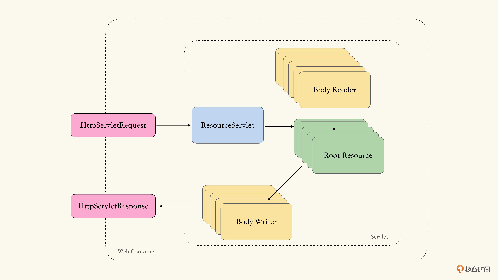
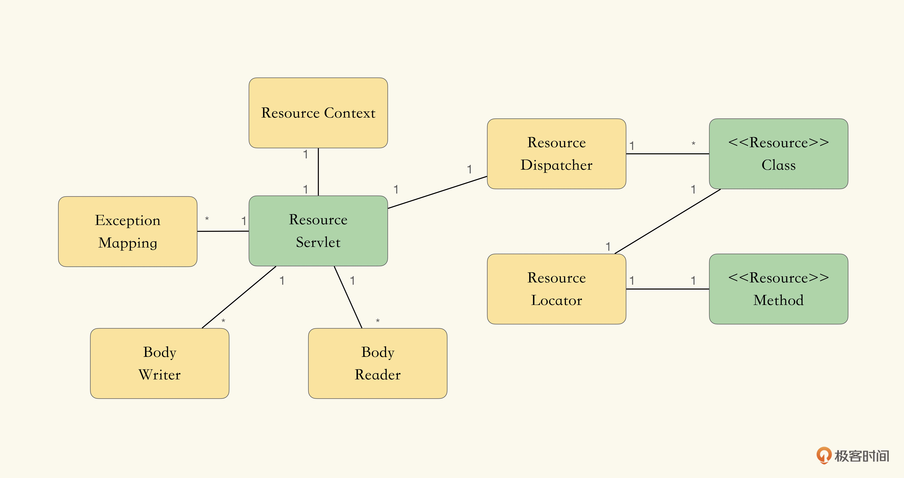
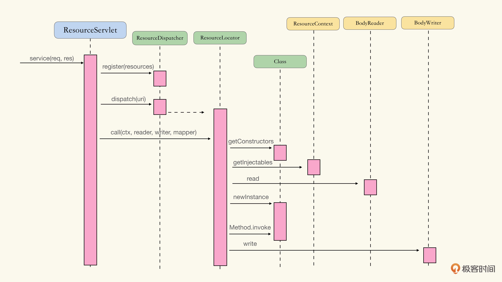
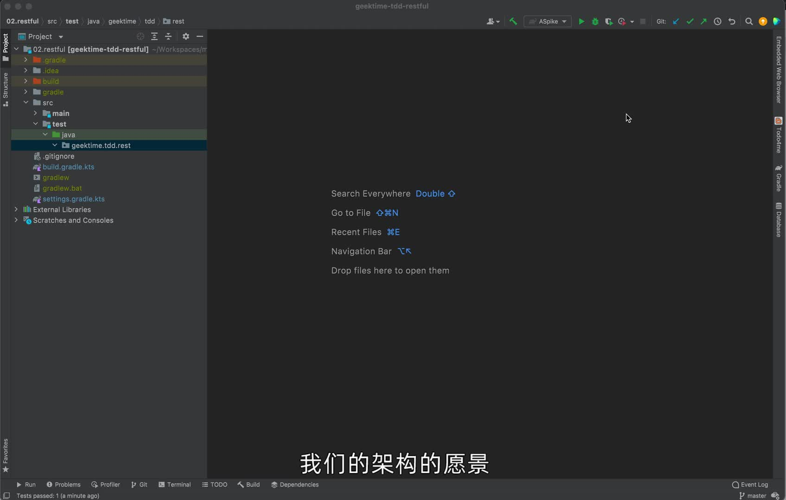

# 37 | RESTfulWebServices（1）：明确架构愿景与架构组件间的交互

你好，我是徐昊。从今天开始，我们就来使用 TDD 的方式实现 RESTful Web Services。

在上节课，我们展示了需要完成的几大功能块。我们很容易可以发现，RESTful Web Services需要多模块协同完成。而不是像 DI Container 那样，可以从单一模块入手，在完成几个功能之后再进行重构。

那么我们可以先简单地规划一下架构愿景（Architecture Vision），以简化后续的工作。

## 规划架构愿景

首先，我们需要明确的是，我们将以 Servlet 的方式来实现 RESTful Web Services 框架。也就是说，我们将提供一个 Servlet 作为主入口，在其中完成对资源对象（Resources）的派分，并根据不同的超媒体选择对应的 reader 和 writer 进行输入输出处理。大致结构如下图所示：

然而仅仅如此，还不足以让我们顺滑地进入伦敦学派的流程（如果你足够自信，已经可以开始经典学派 TDD 了），我们需要进一步细化 ResourceServlet 中的组件与交互：

如上图所示，为大致的组件划分：

- ResourceDispatcher 管理所有的 Root Resource，并根据 Root Resource 的标注形成路由表。它可以根据路由表，生产对应的 ResourceLocator。

- ResourceLocator 表示与 URI 中某一段相匹配的资源方法（Resource Method），并负责调用它。

- ResourceContext 表示 Resource 上下文，包含所有可注入的组件（通过 @Context 标注）。

- BodyReader 聚合了所有的 MessageBodyReader，可以根据所需的类型，从HttpServletRequest 中读取对象。

- BodyWriter 聚合了所有的 MessageBodyWriter，可根据提供的类型，将信息写回到HttpServletResponse 中。

- ExceptionMapping 聚合了所有的 ExceptionMapper，可根据提供的异常，将信息写回到HttpServletResponse 中。

在构想中，这些组件所对应的交互可能是这样的：

1. Serlvet 容器调用 ResourceServlet 的 service 方法，并提供 HttpServletRequest 和HttpServletResponse。

2. ResourceServlet 调用 ResourceDispatcher，将所有的 Root Resource 注册到ResourceDispatcher 上。

3. ResourceServlet 调用 ResourceDispatcher 的方法，根据 URI 查找路由表，生成对应的ReosurceLocator 方法。

4. ResourceServlet 调用 ResourceLocator，并提供 ResourceContext、BodyReader、BodyWriter 和 ExceptionMapping。

5. ResourceLocator 根据 Resource Class 的需要，从 ResourceContext 中寻找可注入的组件。初始化 Resource 对象，并完成注入。

6. ResourceLocator 根据 Resource Method 的需要，使用 BodyReader 从HttpServletRequest 中读取信息。

7. ResourceLocator 调用 Resource Method，并通过 BodyWriter 将结果写回HttpServletResponse 中。

8. 如果有异常，则使用 ExceptionMapping 将结果写回 HttpServletResponse 中。

如下图所示：

那么至此我们是否可以开始任务分解了呢？还不行。请回想一下伦敦学派的流程：

- 按照功能需求与架构愿景划分对象的角色和职责；

- 根据角色与职责，明确对象之间的交互；

- 按照调用栈（Call Stack）的顺序，自外向内依次实现不同的对象；

- 在实现的过程中，依照交互关系，使用测试替身替换所有与被实现对象直接关联的对象；

- 直到所有对象全部实现完成。

所以我们还需要明确对象（架构组件）之间的交互，明确到有清晰的调用栈顺序，足以支撑我们使用测试替身构造测试。

## 明确架构组件间的交互

明确架构组件间的交互有三种方法：根据经验设计，通过经典模式进行定向重构，以及Spike。

根据经验设计永远是一种可能的选项，不过我总觉得这是更难的一种方法（也更为不靠谱）。通过经典模式进行定向重构有个额外的好处，它可以看作是对于架构愿景的验证：通过一组典型场景测试，验证架构的可行性；然后在重构过程中，根据愿景提炼组件间的交互。具体过程和前一个项目差不多，这里可留给你们自己练习。

Spike 是另一种常用的方法，特别是对遗存代码或需求上下文不够熟悉，不能直接进入经典模式的情况下，经常采用的模式：

Spike 可以看作不严格的经典模式，通常只有非常简单的测试，并不限制一定要用重构，重写也可以。那么以最快的方式理解需求上下文，获得架构愿景就可以了。

## 思考题

在进入下节课之前，希望你能认真思考如下两个问题。

1. 根据 Spike 的结果，我们要如何调整架构愿景？

2. 学完这节课后，你最大的收获是什么？有没有让你特别惊喜的操作？

欢迎把你的想法分享在留言区，也欢迎把你的项目代码的链接分享出来。相信经过你的思考与实操，学习效果会更好！
