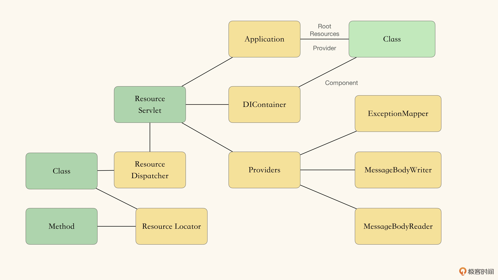
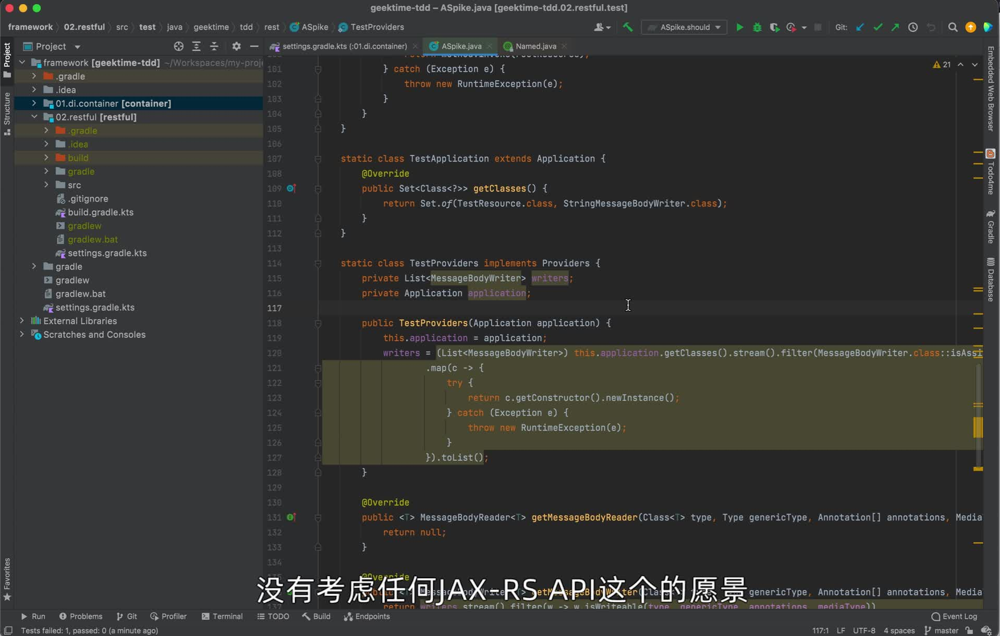

# 38 | RESTfulWebServices（2）：根据Spike的结果，要如何调整架构愿景？

你好，我是徐昊。今天我们继续使用 TDD 的方式实现 RESTful Web Services。

在上节课，我们通过 Spike 实现了一个非常简略的版本，可以通过 Root Resource 以及对应的方法处理请求，并使用 MessageBodyWriter 扩展点，将内容写入 Http 响应中。代码如下：

```java
static class ResourceServlet extends HttpServlet {
   private Application application;
   private Providers providers;
   public ResourceServlet(Application application, Providers providers) {
       this.application = application;
       this.providers = providers;
   }
   @Override
   protected void doGet(HttpServletRequest req, HttpServletResponse resp) throws
       Stream<Class<?>> rootResources = application.getClasses().stream().filter
       Object result = dispatch(req, rootResources);
       MessageBodyWriter<Object> writer = (MessageBodyWriter<Object>) providers.
       writer.writeTo(result, null, null, null, null, null, resp.getOutputStream
   }
   Object dispatch(HttpServletRequest req, Stream<Class<?>> rootResources) {
       try {
           Class<?> rootClass = rootResources.findFirst().get();
           Object rootResource = rootClass.getConstructor().newInstance();
           Method method = Arrays.stream(rootClass.getMethods()).filter(m -> m.i
           return method.invoke(rootResource);
       } catch (Exception e) {
           throw new RuntimeException(e);
       }
   }
}
```

在这个 Spike 的基础上，我们可以进一步细化架构的愿景：



通过结合 JAX-RS 的 Application 和 Providers，我们大致清楚了 ResourceServlet 如何使用Application 和 Providers，以及大致在什么地方需要使用依赖注入容器。

说到依赖注入，在 JAX-RS 中存在两种依赖注入：对于 Application Scope 的 Inject 注入，以及对于 Request Scope 的 Context 注入。这仍然是不太清晰的部分，我们需要进一步 Spike：



## 思考题

根据 Spike 的结果，接下来要如何进一步调整架构愿景？

欢迎把你的想法分享在留言区，也欢迎把你的项目代码分享出来。相信经过你的思考与实操，学习效果会更好！
