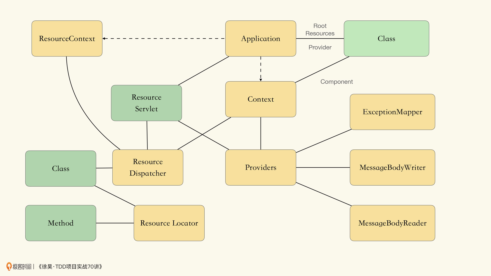
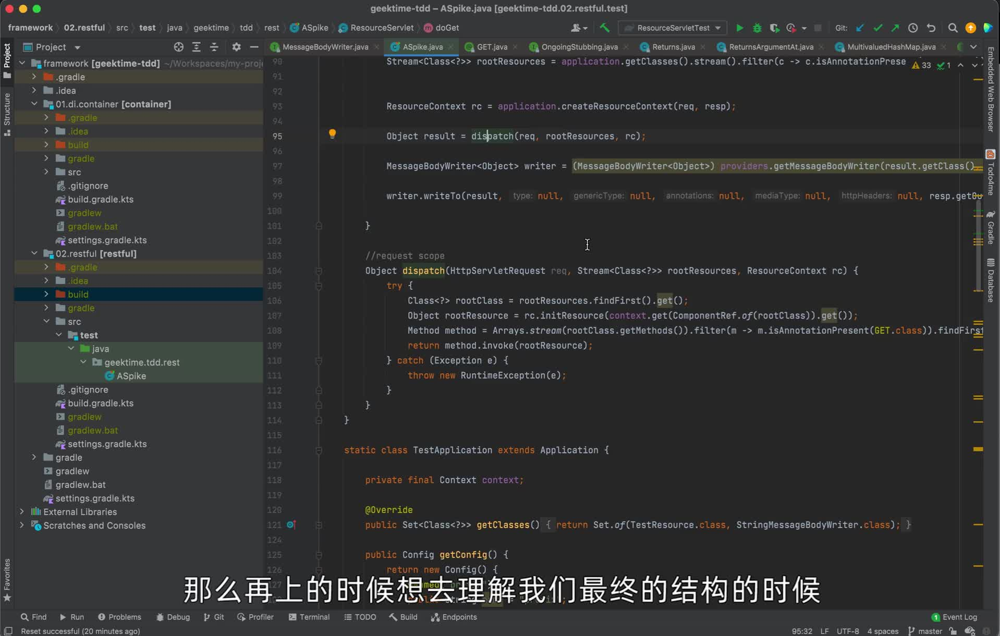
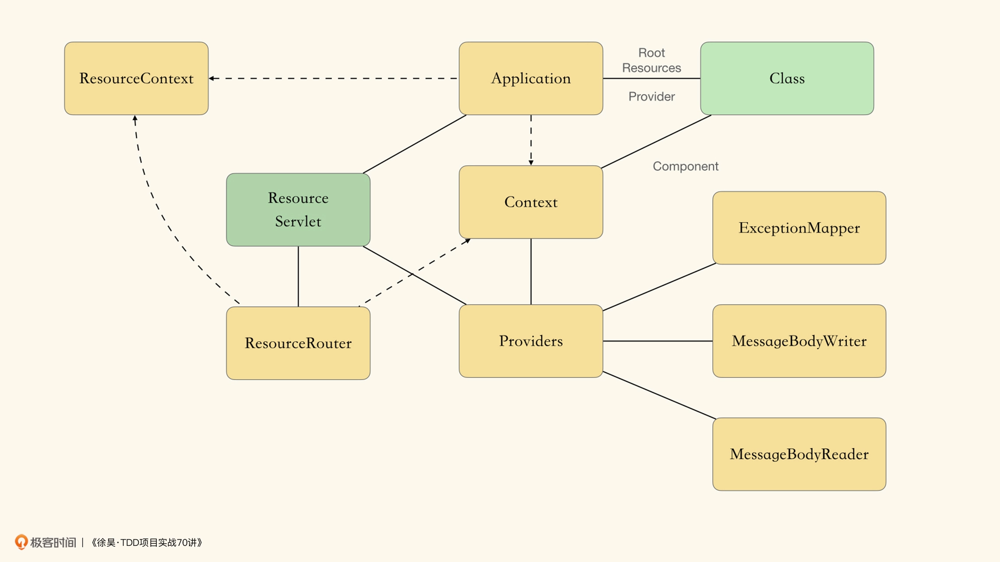
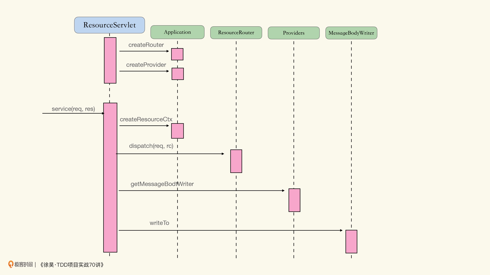
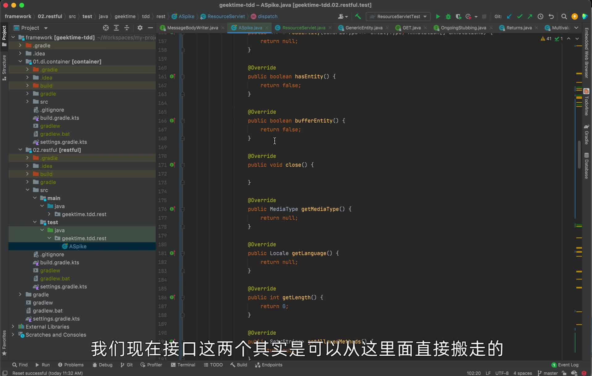

# 39 | RESTfulWebServices（3）：明确架构愿景与调用栈顺序

你好，我是徐昊。今天我们继续使用 TDD 的方式实现 RESTful Web Services。

在上节课，我们通过 Spike 将 DI 容器引入了实现，代码如下：

```java
static class ResourceServlet extends HttpServlet {
   private final Context context;
   private TestApplication application;
   private Providers providers;
   public ResourceServlet(TestApplication application, Providers providers) {
       this.application = application;
       this.providers = providers;
       context = application.getContext();
   }
   @Override
   protected void doGet(HttpServletRequest req, HttpServletResponse resp) throws
       Stream<Class<?>> rootResources = application.getClasses().stream().filter
       ResourceContext rc = application.createResourceContext(req, resp);
       Object result = dispatch(req, rootResources, rc);
       MessageBodyWriter<Object> writer = (MessageBodyWriter<Object>) providers.
       writer.writeTo(result, null, null, null, null, null, resp.getOutputStream
   }
   Object dispatch(HttpServletRequest req, Stream<Class<?>> rootResources, Resou
       try {
           Class<?> rootClass = rootResources.findFirst().get();
           Object rootResource = rc.initResource(context.get(ComponentRef.of(roo
           Method method = Arrays.stream(rootClass.getMethods()).filter(m -> m.i
           return method.invoke(rootResource);
       } catch (Exception e) {
           throw new RuntimeException(e);
       }
   }
}
```

在这个 Spike 的基础上，我们可以进一步细化架构的愿景：



## 明确调用栈顺序

接下来需要稍微 Spike 一下的，就是 Resource Dispatcher 的部分：



根据 Spike 的结果，我们可以得到这部分的架构愿景和调用栈顺序：





如上图所示，为大致的组件划分。

- ResourceServlet：以 Servlet 的形式作为入口，处理 Http 请求。

- Application：指明 RESTful 应用所需的所有组件，比如 Root Resource、Providers 等，也是对于框架提供的服务的访问入口。

- ResourceRouter：Http 请求派发算法的实现载体。

- Providers：三个扩展点，也就是 MessageBodyWriter，MessageBodyReader 以及ExceptionMapper。

明确了这些之后，就可以进入分解任务的环节了。但是，在这之前，我们要如何处理 Spike 代码呢？



## 思考题

在进入下节课之前，希望你能认真思考如下两个问题。

1. 在当前架构愿景下，我们要如何分解任务？

2. 关于架构愿景的学习，你有什么收获吗？

欢迎把你的想法分享在留言区，也欢迎把你的项目代码分享出来。相信经过你的思考与实操，学习效果会更好！
