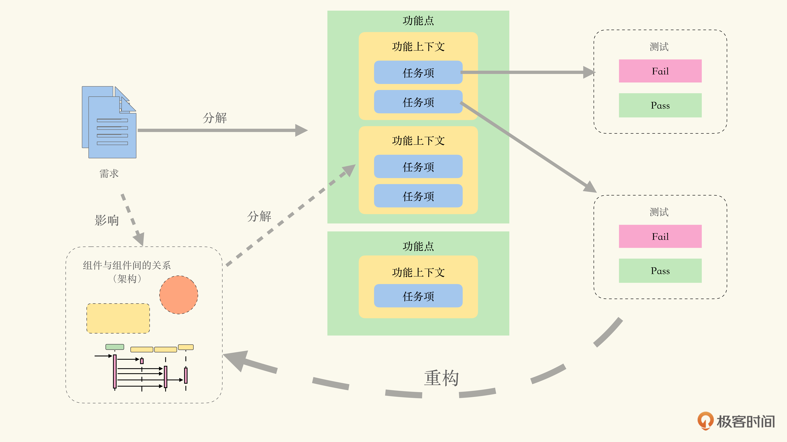
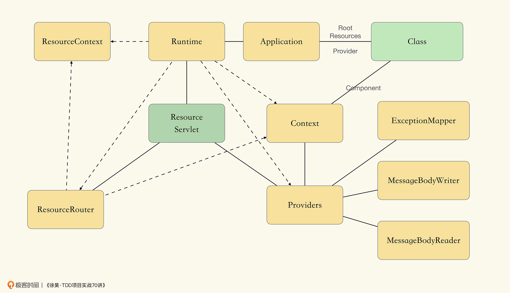
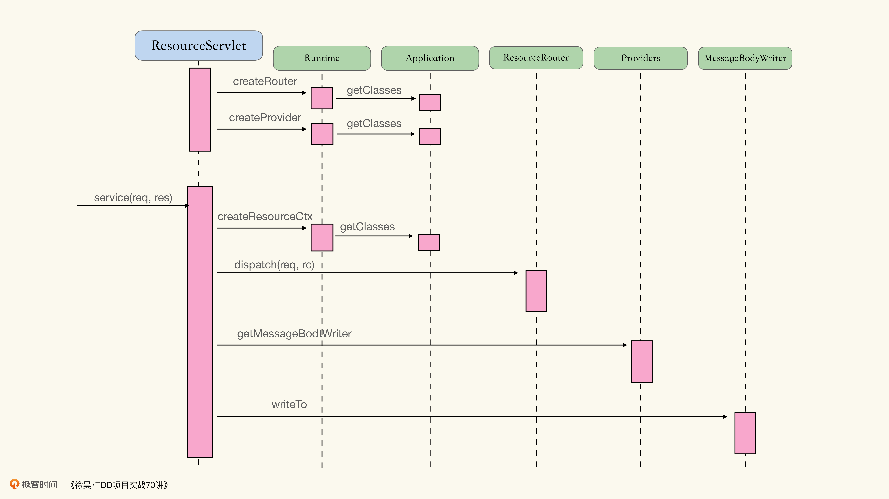
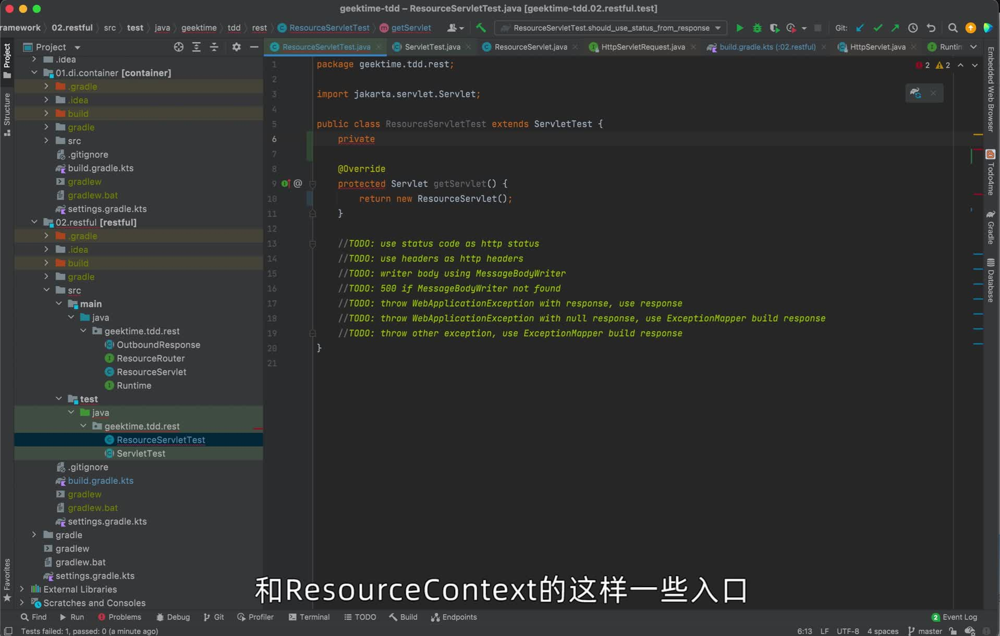

# 40 | RESTfulWebServices（4）：在当前架构愿景下，要如何分解任务？

你好，我是徐昊。今天我们继续使用 TDD 的方式实现 RESTful Web Services。

现在请回想一下 TDD 的流程（参看第 11 讲）：



目前的架构愿景如下：





## 将需求分解为任务列表

JAX-RS 的需求非常庞杂，根据前面我们介绍过的部分（参看第 36 讲），主要的功能有这样几个方面：

- 将请求派分给对应的资源（Resource），并根据返回的状态、超媒体类型、内容，响应 Http请求。

- 在处理请求派分时，可以支持多级子资源（Sub-Resource）。

- 在处理请求派分时，可以根据客户端提供的超媒体类型，选择对应的资源方法（ResourceMethod）。

- 在处理请求派分时，可以根据客户端提供的 Http 方法，选择对应的资源方法。

- 资源方法可以返回 Java 对象，由 Runtime 自行推断正确的返回状态。

- 资源方法可以不明确指定返回的超媒体类型，由 Runtime 自行推断。比如资源方法标注了Produces，那么就使用标注提供的超媒体类型等。

- 可通过扩展点 MessageBodyWriter 处理不同类型的返回内容。

- 当资源方法抛出异常时，根据异常影响 Http 请求。

- 可通过扩展点 ExceptionMapper 处理不同类型的异常。

- 资源方法可按照期望的类型，访问 Http 请求的内容。

- 可通过扩展点 MessageBodyReader 处理不同类型的请求内容。

- 资源对象和资源方法可接受环境组件的注入。

正如在 DI Container 项目中看到的那样，这并不一定是最终完成的功能。随着项目的进行，我们还可能会增加更多的功能点。下一步，是根据架构愿景，将功能点关联到不同的功能上下文（也就是架构愿景中的组件）：

- 将请求派分给对应的资源（Resource），并根据返回的状态、超媒体类型、内容，响应 Http请求

- ResourceServlet

- ResourceRouter

- 在处理请求派分时，可以支持多级子资源（Sub-Resource）

- ResourceRouter

- 在处理请求派分时，可以根据客户端提供的超媒体类型，选择对应的资源方法（ResourceMethod）

- ResourceRouter

- 在处理请求派分时，可以根据客户端提供的 Http 方法，选择对应的资源方法

- ResourceRouter

- 资源方法可以返回 Java 对象，由 Runtime 自行推断正确的返回状态

- ResourceRouter

- 资源方法可以不明确指定返回的超媒体类型，由 Runtime 自行推断，比如，资源方法标注了 Produces，那么就使用标注提供的超媒体类型等

- ResourceRouter

- 可通过扩展点 MessageBodyWriter 处理不同类型的返回内容

- Providers

- 当资源方法抛出异常时，根据异常影响 Http 请求

- ResourceServlet

- 可通过扩展点 ExceptionMapper 处理不同类型的异常

- Providers

- 资源方法可按找期望的类型，访问 Http 请求的内容

- ResourceRouter

- 可通过扩展点 MessageBodyReader 处理不同类型的请求内容

- Providers

- 资源对象和资源方法可接受环境组件的注入

- ResourceContext

- ReosurceRouter

如果是应用系统，那么我们可以继续分解到任务项。然而对于技术框架，特别是从头开始研发的技术框架，按照技术组件重组功能列表是更常用的手法：

- ResourceServlet

- 将请求派分给对应的资源（Resource），并根据返回的状态、超媒体类型、内容，响应Http 请求

- 当资源方法抛出异常时，根据异常影响 Http 请求

- ResourceRouter

- 将请求派分给对应的资源（Resource），并根据返回的状态、超媒体类型、内容，响应Http 请求

- 在处理请求派分时，可以支持多级子资源（Sub-Resource）

- 在处理请求派分时，可以根据客户端提供的超媒体类型，选择对应的资源方法（Resource Method）

- 在处理请求派分时，可以根据客户端提供的 Http 方法，选择对应的资源方法

- 资源方法可以返回 Java 对象，由 Runtime 自行推断正确的返回状态

- 资源方法可以不明确指定返回的超媒体类型，由 Runtime 自行推断，比如，资源方法标注了 Produces，那么就使用标注提供的超媒体类型等

- 资源方法可按找期望的类型，访问 Http 请求的内容

- 资源对象和资源方法可接受环境组件的注入

- Providers

- 可通过扩展点 MessageBodyWriter 处理不同类型的返回内容

- 可通过扩展点 ExceptionMapper 处理不同类型的异常

- ResourceContext

- 资源对象和资源方法可接受环境组件的注入

在这个任务列表中，会发现并没有涉及架构愿景中的全部组件。比如 Runtime，这类组件通常是支撑性的组件，可以在主要组件功能完成之后，再分解相关的需求。也可以在主要功能实现的过程中，逐渐明确它们的需求。

当采用伦敦学派时，会按照调用栈顺序从外而内地实现不同的组件。因而，我们首先需要先实现的是 ResourceServlet。那么细化任务列表：

- ResourceServlet

- 将请求派分给对应的资源（Resource），并根据返回的状态、超媒体类型、内容，响应Http 请求

- 使用 OutboundResponse 的 status 作为 Http Response 的状态；

- 使用 OutboundResponse 的 headers 作为 Http Response 的 Http Headers；

- 通过 MessageBodyWriter 将 OutboundResponse 的 GenericEntity 写回为 Body；

- 如果找不到对应的 MessageBodyWriter，则返回 500 族错误

- 当资源方法抛出异常时，根据异常影响 Http 请求

- 如果抛出 WebApplicationException，且 response 不为 null，则使用 response 响应Http

- 如果抛出 WebApplicationException，而 response 为 null，则通过异常的具体类型查找ExceptionMapper，生产 response 响应 Http 请求

- 如果抛出的不是 WebApplicationException，则通过异常的具体类型查找ExceptionMapper，生产 response 响应 Http 请求

## 进入红 / 绿循环

现在依照这个任务列表，进入 TDD 的红 / 绿循环，所使用的 build.grade.kts 文件为：

```bash
plugins {
   `java-library`
   "jacoco"
}
repositories {
   mavenCentral()
}
dependencies {
   implementation("jakarta.inject:jakarta.inject-api:2.0.1.MR")
   implementation("jakarta.ws.rs:jakarta.ws.rs-api:3.1.0")
   implementation("jakarta.servlet:jakarta.servlet-api:5.0.0")
   implementation(project(":01.di.container"))
   testImplementation("org.junit.jupiter:junit-jupiter:5.8.2")
   testImplementation("org.mockito:mockito-core:4.5.1")
   testImplementation("org.eclipse.jetty:jetty-server:11.0.9")
   testImplementation("org.eclipse.jetty:jetty-servlet:11.0.9")
}
tasks.withType<Test>() {
   useJUnitPlatform()
}
java {
   sourceCompatibility = JavaVersion.VERSION_17
   targetCompatibility = JavaVersion.VERSION_17
}
```



## 思考题

在进入下节课之前，希望你能认真思考如下两个问题。

1. 针对 RuntimeDelegate，我们要如何调整任务列表和架构愿景？

2. 你是怎么理解任务分解的？

欢迎把你的想法分享在留言区，也欢迎把你的项目代码的链接分享出来。相信经过你的思考与实操，学习效果会更好！
