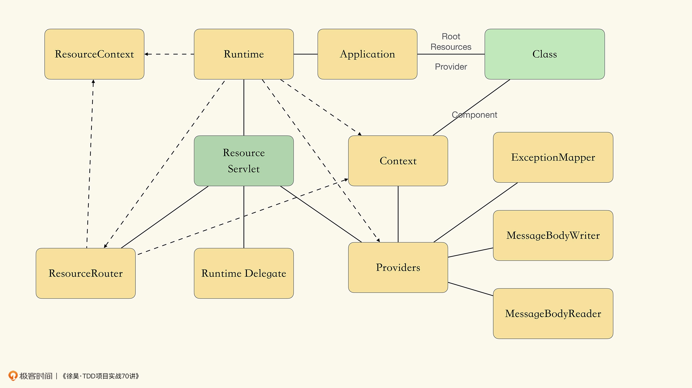
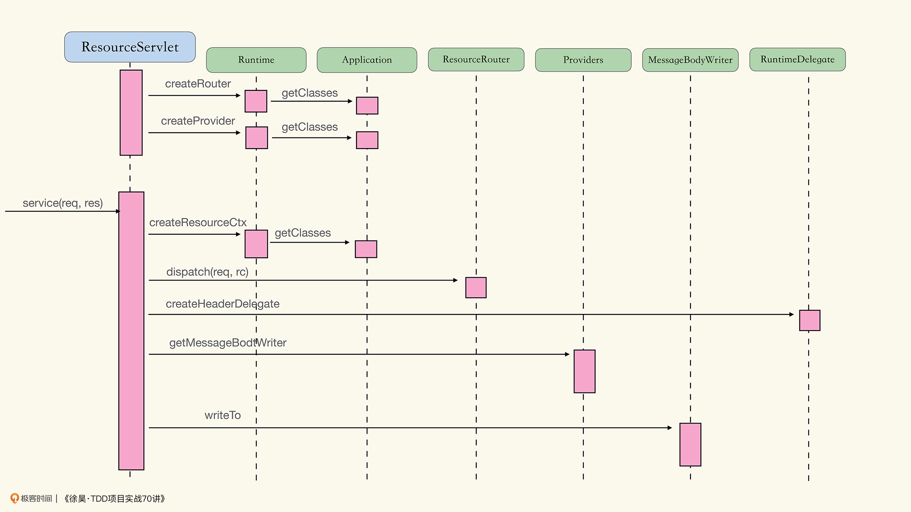
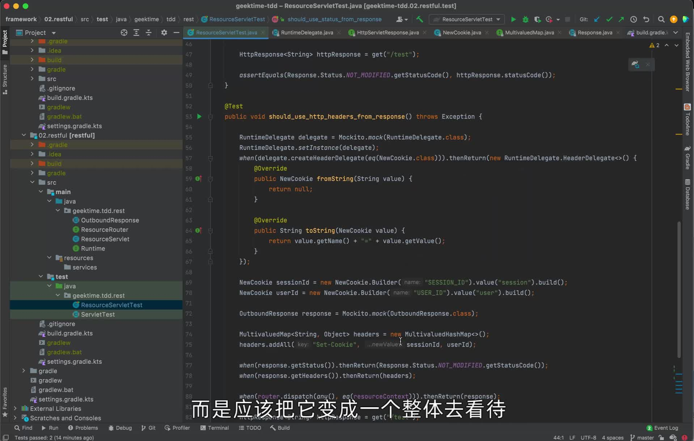

# 41 | RESTfulWebServices（5）：如何通过对数据测试的管理来凸显意图？

你好，我是徐昊。今天我们继续使用 TDD 的方式实现 RESTful Web Services。

## 回顾架构愿景与任务列表

在上节课最后的视频演示中，我们发现了新的扩展点 HeaderDelegate，调整后的架构愿景如下图所示：





调整后的任务列表为：

- ResourceServlet

- 将请求派分给对应的资源（Resource），并根据返回的状态、超媒体类型、内容，响应Http 请求

- 使用 OutboundResponse 的 status 作为 Http Response 的状态

- 使用 OutboundResponse 的 headers 作为 Http Response 的 Http Headers

- 通过 MessageBodyWriter 将 OutboundResponse 的 GenericEntity 写回为 Body

- 如果找不到对应的 MessageBodyWriter，则返回 500 族错误

- 当资源方法抛出异常时，根据异常影响 Http 请求

- 如果抛出 WebApplicationException，且 response 不为 null，则使用 response 响应Http

- 如果抛出 WebApplicationException，而 response 为 null，则通过异常的具体类型查找 ExceptionMapper，生产 response 响应 Http 请求

- 如果抛出的不是 WebApplicationException，则通过异常的具体类型查找ExceptionMapper，生产 response 响应 Http 请求

- RuntimeDelegate

- 为 MediaType 提供 HeaderDelegate

- 为 CacheControl 提供 HeaderDelegate

- 为 Cookie 提供 HeaderDelegates

- 为 EntityTag 提供 HeaderDelegate

- 为 Link 提供 HeaderDelegate

- 为 NewCookie 提供 HeaderDelegate

- 为 Date 提供 HeaderDelegate

代码为：

```java
package geektime.tdd.rest;
import jakarta.servlet.ServletException;
import jakarta.servlet.http.HttpServlet;
import jakarta.servlet.http.HttpServletRequest;
import jakarta.servlet.http.HttpServletResponse;
import jakarta.ws.rs.core.MultivaluedMap;
import jakarta.ws.rs.ext.RuntimeDelegate;
import java.io.IOException;
public class ResourceServlet extends HttpServlet {
   private Runtime runtime;
   public ResourceServlet(Runtime runtime) {
       this.runtime = runtime;
   }
   @Override
   protected void service(HttpServletRequest req, HttpServletResponse resp) thro
       ResourceRouter router = runtime.getResourceRouter();
       OutboundResponse response = router.dispatch(req, runtime.createResourceCo
       resp.setStatus(response.getStatus());
       MultivaluedMap<String, Object> headers = response.getHeaders();
       for (String name : headers.keySet())
           for (Object value : headers.get(name)) {
               RuntimeDelegate.HeaderDelegate headerDelegate = RuntimeDelegate.g
               resp.addHeader(name, headerDelegate.toString(value));
           }
   }
}
```

## 视频演示

下面让我们继续：



## 思考题

在进入下节课之前，希望你能认真思考如下两个问题，并选择最有感触的一道进行回答。

1. 有哪些模式可以帮助简化测试数据的管理？

2. 对于重构与重写，你的理解是什么？

欢迎把你的想法分享在留言区，也欢迎把你的项目代码分享出来。相信经过你的思考与实操，学习效果会更好！
