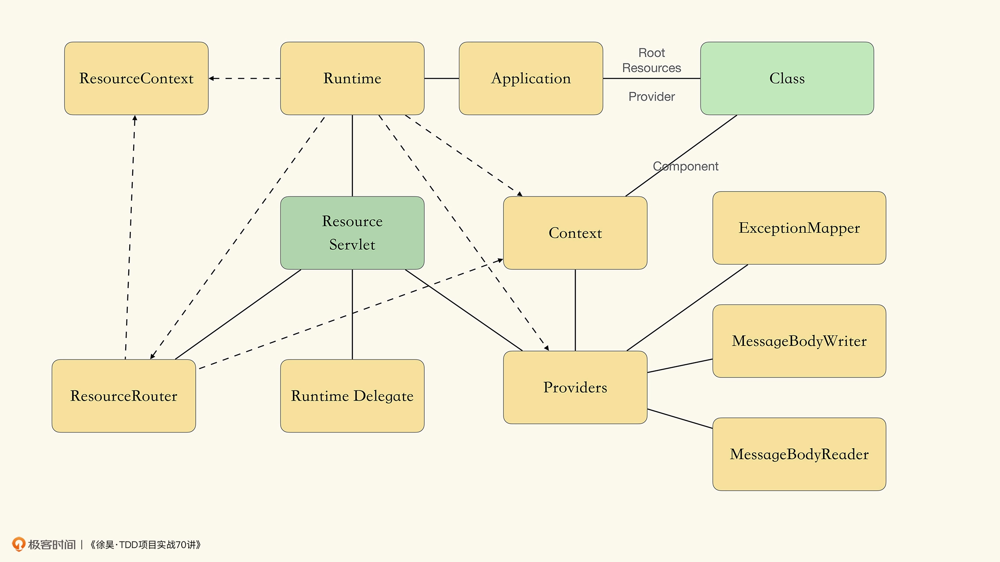
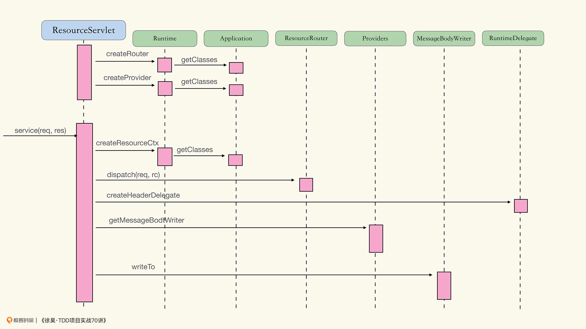
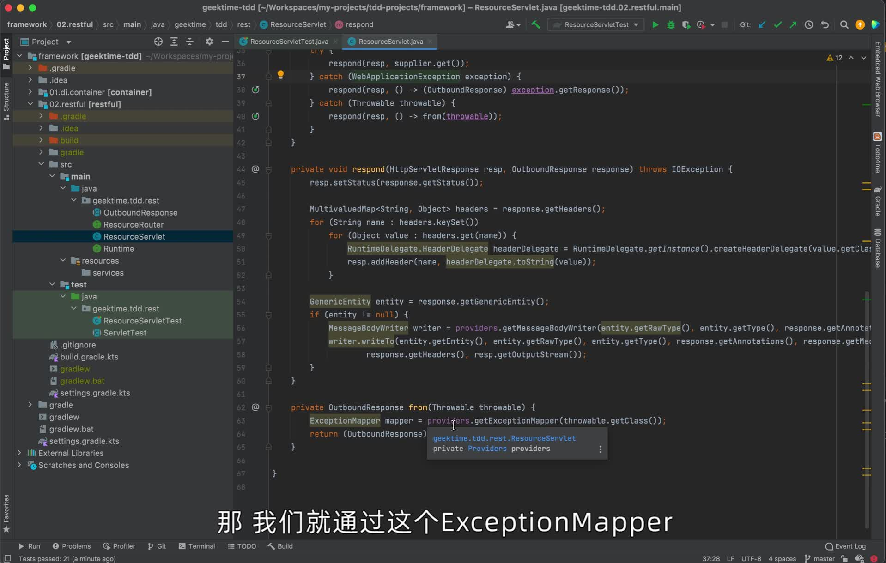

# 44 | RESTfulWebServices（8）：如何在现有代码的基础上构造测试？

你好，我是徐昊。今天我们继续使用 TDD 的方式实现 RESTful Web Services。

## 回顾架构愿景与任务列表

目前我们的架构愿景如下：





任务列表为：

- ResourceServlet

- 将请求派分给对应的资源（Resource），并根据返回的状态、超媒体类型、内容，响应Http 请求

- 使用 OutboundResponse 的 status 作为 Http Response 的状态

- 使用 OutboundResponse 的 headers 作为 Http Response 的 Http Headers

- 通过 MessageBodyWriter 将 OutboundResponse 的 GenericEntity 写回为 Body

- 如果找不到对应的 MessageBodyWriter，则返回 500 族错误

- 如果找不到对应的 HeaderDelegate，则返回 500 族错误

- 如果找不到对应的 ExceptionMapper，则返回 500 族错误

- 如果 entity 为空，则忽略 body

- 当资源方法抛出异常时，根据异常响应 Http 请求

- 如果抛出 WebApplicationException，且 response 不为 null，则使用 response 响应Http

- 如果抛出的不是 WebApplicationException，则通过异常的具体类型查找ExceptionMapper，生产 response 响应 Http 请求

- 当其他组件抛出异常时，根据异常响应 Http 请求

- 调用 ExceptionMapper 时

- 调用 HeaderDelegate 时

- 调用 MessageBodyWriter 时

- 通过 Providers 查找 ExceptionMapper 时

- 通过 Providers 查找 MessageBodyWriter 时

- 通过 RuntimeDelegate 查找 HeaderDelegate 时

- RuntimeDelegate

- 为 MediaType 提供 HeaderDelegate

- 为 CacheControl 提供 HeaderDelegate

- 为 Cookie 提供 HeaderDelegates

- 为 EntityTag 提供 HeaderDelegate

- 为 Link 提供 HeaderDelegate

- 为 NewCookie 提供 HeaderDelegate

- 为 Date 提供 HeaderDelegate

- 提供 OutboundResponseBuilder

- OutboundResponseBuilder

- OutboundResponse

代码为：

```java
package geektime.tdd.rest;
import jakarta.servlet.ServletException;
import jakarta.servlet.http.HttpServlet;
import jakarta.servlet.http.HttpServletRequest;
import jakarta.servlet.http.HttpServletResponse;
import jakarta.ws.rs.WebApplicationException;
import jakarta.ws.rs.core.GenericEntity;
import jakarta.ws.rs.core.MultivaluedMap;
import jakarta.ws.rs.ext.ExceptionMapper;
import jakarta.ws.rs.ext.MessageBodyWriter;
import jakarta.ws.rs.ext.Providers;
import jakarta.ws.rs.ext.RuntimeDelegate;
import java.io.IOException;
import java.util.function.Supplier;
public class ResourceServlet extends HttpServlet {
   private Runtime runtime;
   private Providers providers;
   public ResourceServlet(Runtime runtime) {
       this.runtime = runtime;
       this.providers = runtime.getProviders();
   }
   @Override
   protected void service(HttpServletRequest req, HttpServletResponse resp) thro
       ResourceRouter router = runtime.getResourceRouter();
       respond(resp, () -> router.dispatch(req, runtime.createResourceContext(re
   }
   private void respond(HttpServletResponse resp, Supplier<OutboundResponse> sup
       try {
           respond(resp, supplier.get());
       } catch (WebApplicationException exception) {
           respond(resp, () -> (OutboundResponse) exception.getResponse());
       } catch (Throwable throwable) {
           respond(resp, () -> from(throwable));
       }
   }
   private void respond(HttpServletResponse resp, OutboundResponse response) thr
       resp.setStatus(response.getStatus());
       MultivaluedMap<String, Object> headers = response.getHeaders();
       for (String name : headers.keySet())
           for (Object value : headers.get(name)) {
               RuntimeDelegate.HeaderDelegate headerDelegate = RuntimeDelegate.g
               resp.addHeader(name, headerDelegate.toString(value));
           }
       GenericEntity entity = response.getGenericEntity();
       if (entity != null) {
           MessageBodyWriter writer = providers.getMessageBodyWriter(entity.getR
           writer.writeTo(entity.getEntity(), entity.getRawType(), entity.getTyp
                   response.getHeaders(), resp.getOutputStream());
       }
   }
   private OutboundResponse from(Throwable throwable) {
       ExceptionMapper mapper = providers.getExceptionMapper(throwable.getClass(
       return (OutboundResponse) mapper.toResponse(throwable);
   }
}
```

## 视频演示

下面让我们继续：



## 思考题

在进入下节课之前，希望你能认真思考如下两个问题。

1. 请依据视频演示中的做法，继续对测试代码进行重构。

2. 我知道不少同学在学习课程的同时，还补习了很多相关知识，那么很欢迎把你的书单分享出来，供其他同学参考。

也欢迎把你的项目代码分享出来。相信经过你的思考与实操，学习效果会更好！
