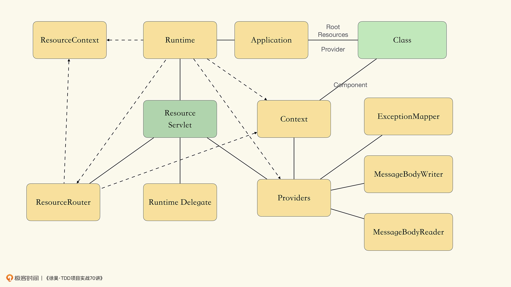
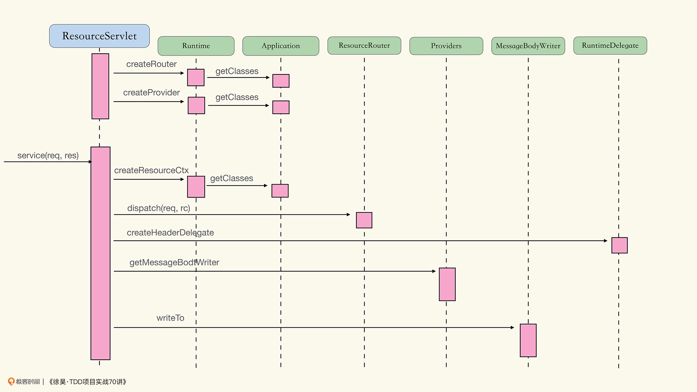
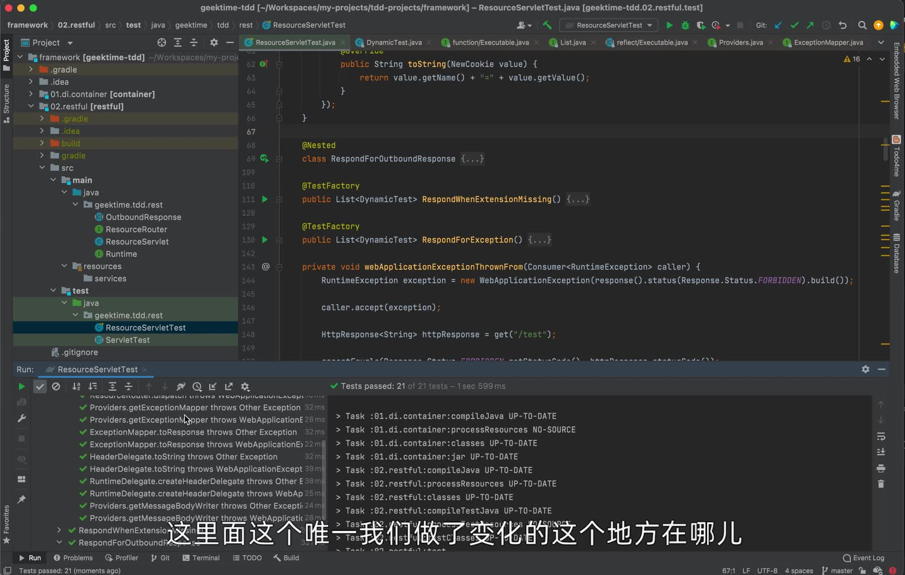

# 45 | RESTfulWebServices（9）：通过伦敦学派得到的测试风格是什么样的？

你好，我是徐昊。今天我们继续使用 TDD 的方式实现 RESTful Web Services。

## 回顾架构愿景与任务列表

目前我们的架构愿景如下：





任务列表为：

- ResourceServlet

- 将请求派分给对应的资源（Resource），并根据返回的状态、超媒体类型、内容，响应Http 请求

- 使用 OutboundResponse 的 status 作为 Http Response 的状态

- 使用 OutboundResponse 的 headers 作为 Http Response 的 Http Headers

- 通过 MessageBodyWriter 将 OutboundResponse 的 GenericEntity 写回为 Body

- 如果找不到对应的 MessageBodyWriter，则返回 500 族错误

- 如果找不到对应的 HeaderDelegate，则返回 500 族错误

- 如果找不到对应的 ExceptionMapper，则返回 500 族错误

- 如果 entity 为空，则忽略 body

- 当资源方法抛出异常时，根据异常响应 Http 请求

- 如果抛出 WebApplicationException，且 response 不为 null，则使用 response 响应Http

- 如果抛出的不是 WebApplicationException，则通过异常的具体类型查找ExceptionMapper，生产 response 响应 Http 请求

- 当其他组件抛出异常时，根据异常响应 Http 请求

- 调用 ExceptionMapper 时

- 调用 HeaderDelegate 时

- 调用 MessageBodyWriter 时

- 通过 Providers 查找 ExceptionMapper 时

- 通过 Providers 查找 MessageBodyWriter 时

- 通过 RuntimeDelegate 查找 HeaderDelegate 时

- RuntimeDelegate

- 为 MediaType 提供 HeaderDelegate

- 为 CacheControl 提供 HeaderDelegate

- 为 Cookie 提供 HeaderDelegates

- 为 EntityTag 提供 HeaderDelegate

- 为 Link 提供 HeaderDelegate

- 为 NewCookie 提供 HeaderDelegate

- 为 Date 提供 HeaderDelegate

- 提供 OutboundResponseBuilder

- OutboundResponseBuilder

- OutboundResponse

代码为：

```java
package geektime.tdd.rest;
import jakarta.servlet.ServletException;
import jakarta.servlet.http.HttpServlet;
import jakarta.servlet.http.HttpServletRequest;
import jakarta.servlet.http.HttpServletResponse;
import jakarta.ws.rs.WebApplicationException;
import jakarta.ws.rs.core.GenericEntity;
import jakarta.ws.rs.core.MultivaluedMap;
import jakarta.ws.rs.ext.ExceptionMapper;
import jakarta.ws.rs.ext.MessageBodyWriter;
import jakarta.ws.rs.ext.Providers;
import jakarta.ws.rs.ext.RuntimeDelegate;
import java.io.IOException;
import java.util.function.Supplier;
public class ResourceServlet extends HttpServlet {
   private Runtime runtime;
   private Providers providers;
   public ResourceServlet(Runtime runtime) {
       this.runtime = runtime;
       this.providers = runtime.getProviders();
   }
   @Override
   protected void service(HttpServletRequest req, HttpServletResponse resp) thro
       ResourceRouter router = runtime.getResourceRouter();
       respond(resp, () -> router.dispatch(req, runtime.createResourceContext(re
   }
   private void respond(HttpServletResponse resp, Supplier<OutboundResponse> sup
       try {
           respond(resp, supplier.get());
       } catch (WebApplicationException exception) {
           respond(resp, () -> (OutboundResponse) exception.getResponse());
       } catch (Throwable throwable) {
           respond(resp, () -> from(throwable));
       }
   }
   private void respond(HttpServletResponse resp, OutboundResponse response) thr
       resp.setStatus(response.getStatus());
       MultivaluedMap<String, Object> headers = response.getHeaders();
       for (String name : headers.keySet())
           for (Object value : headers.get(name)) {
               RuntimeDelegate.HeaderDelegate headerDelegate = RuntimeDelegate.g
               resp.addHeader(name, headerDelegate.toString(value));
           }
       GenericEntity entity = response.getGenericEntity();
       if (entity != null) {
           MessageBodyWriter writer = providers.getMessageBodyWriter(entity.getR
           writer.writeTo(entity.getEntity(), entity.getRawType(), entity.getTyp
                   response.getHeaders(), resp.getOutputStream());
       }
   }
   private OutboundResponse from(Throwable throwable) {
       ExceptionMapper mapper = providers.getExceptionMapper(throwable.getClass(
       return (OutboundResponse) mapper.toResponse(throwable);
   }
}
```

测试为：

```java
package geektime.tdd.rest;
import jakarta.servlet.Servlet;
import jakarta.ws.rs.WebApplicationException;
import jakarta.ws.rs.container.ResourceContext;
import jakarta.ws.rs.core.*;
import jakarta.ws.rs.ext.MessageBodyWriter;
import jakarta.ws.rs.ext.Providers;
import jakarta.ws.rs.ext.RuntimeDelegate;
import org.junit.jupiter.api.*;
import org.mockito.Mockito;
import java.io.IOException;
import java.io.OutputStream;
import java.io.PrintWriter;
import java.lang.annotation.Annotation;
import java.lang.annotation.Retention;
import java.lang.annotation.RetentionPolicy;
import java.lang.reflect.Method;
import java.lang.reflect.Type;
import java.net.http.HttpResponse;
import java.util.*;
import java.util.function.Consumer;
import static org.junit.jupiter.api.Assertions.assertArrayEquals;
import static org.junit.jupiter.api.Assertions.assertEquals;
import static org.mockito.ArgumentMatchers.*;
import static org.mockito.Mockito.when;
public class ResourceServletTest extends ServletTest {
   private Runtime runtime;
   private ResourceRouter router;
   private ResourceContext resourceContext;
   private Providers providers;
   private RuntimeDelegate delegate;
   @Override
   protected Servlet getServlet() {
       runtime = Mockito.mock(Runtime.class);
       router = Mockito.mock(ResourceRouter.class);
       resourceContext = Mockito.mock(ResourceContext.class);
       providers = Mockito.mock(Providers.class);
       when(runtime.getResourceRouter()).thenReturn(router);
       when(runtime.createResourceContext(any(), any())).thenReturn(resourceCont
       when(runtime.getProviders()).thenReturn(providers);
       return new ResourceServlet(runtime);
   }
   @BeforeEach
   public void before() {
       delegate = Mockito.mock(RuntimeDelegate.class);
       RuntimeDelegate.setInstance(delegate);
       when(delegate.createHeaderDelegate(eq(NewCookie.class))).thenReturn(new R
           @Override
           public NewCookie fromString(String value) {
               return null;
           }
           @Override
           public String toString(NewCookie value) {
               return value.getName() + "=" + value.getValue();
           }
       });
   }
   @Nested
   class RespondForOutboundResponse {
       @Test
       public void should_use_http_headers_from_response() throws Exception {
           response().headers("Set-Cookie", new NewCookie.Builder("SESSION_ID").
                   new NewCookie.Builder("USER_ID").value("user").build()).retur
           HttpResponse<String> httpResponse = get("/test");
           assertArrayEquals(new String[]{"SESSION_ID=session", "USER_ID=user"},
       }
       @Test
       public void should_write_entity_to_http_response_using_message_body_write
           response().entity(new GenericEntity<>("entity", String.class), new An
           HttpResponse<String> httpResponse = get("/test");
           assertEquals("entity", httpResponse.body());
       }
       @Test
       public void should_not_call_message_body_writer_if_entity_is_null() throw
           response().entity(null, new Annotation[0]).returnFrom(router);
           HttpResponse<String> httpResponse = get("/test");
           assertEquals(Response.Status.OK.getStatusCode(), httpResponse.statusC
           assertEquals("", httpResponse.body());
       }
       @Test
       public void should_use_status_from_response() throws Exception {
           response().status(Response.Status.NOT_MODIFIED).returnFrom(router);
           HttpResponse<String> httpResponse = get("/test");
           assertEquals(Response.Status.NOT_MODIFIED.getStatusCode(), httpRespon
       }
   }
   @TestFactory
   public List<DynamicTest> RespondWhenExtensionMissing() {
       List<DynamicTest> tests = new ArrayList<>();
       Map<String, org.junit.jupiter.api.function.Executable> extensions =
               Map.of("MessageBodyWriter", () -> response().entity(new GenericEn
                       "HeaderDelegate", () -> response().headers(HttpHeaders.DA
                       "ExceptionMapper", () -> when(router.dispatch(any(), eq(r
       for (String name : extensions.keySet())
           tests.add(DynamicTest.dynamicTest(name + " not found", () -> {
               extensions.get(name).execute();
               when(providers.getExceptionMapper(eq(NullPointerException.class))
               HttpResponse<String> httpResponse = get("/test");
               assertEquals(Response.Status.INTERNAL_SERVER_ERROR.getStatusCode(
           }));
       return tests;
   }
   @TestFactory
   public List<DynamicTest> RespondForException() {
       List<DynamicTest> tests = new ArrayList<>();
       Map<String, Consumer<Consumer<RuntimeException>>> exceptions = Map.of("Ot
               "WebApplicationException", this::webApplicationExceptionThrownFro
       for (Map.Entry<String, Consumer<RuntimeException>> caller : getCallers().
           for (Map.Entry<String, Consumer<Consumer<RuntimeException>>> exceptio
               tests.add(DynamicTest.dynamicTest(caller.getKey() + " throws " +
                       () -> exceptionThrownFrom.getValue().accept(caller.getVal
       return tests;
   }
   private void webApplicationExceptionThrownFrom(Consumer<RuntimeException> cal
       RuntimeException exception = new WebApplicationException(response().statu
       caller.accept(exception);
       HttpResponse<String> httpResponse = get("/test");
       assertEquals(Response.Status.FORBIDDEN.getStatusCode(), httpResponse.stat
   }
   private void otherExceptionThrownFrom(Consumer<RuntimeException> caller) {
       RuntimeException exception = new IllegalArgumentException();
       caller.accept(exception);
       when(providers.getExceptionMapper(eq(IllegalArgumentException.class))).th
       HttpResponse<String> httpResponse = get("/test");
       assertEquals(Response.Status.FORBIDDEN.getStatusCode(), httpResponse.stat
   }
   @Retention(RetentionPolicy.RUNTIME)
   @interface ExceptionThrownFrom {
   }
   @ExceptionThrownFrom
   private void providers_getExceptionMapper(RuntimeException exception) {
       when(router.dispatch(any(), eq(resourceContext))).thenThrow(RuntimeExcept
       when(providers.getExceptionMapper(eq(RuntimeException.class))).thenThrow(
   }
   @ExceptionThrownFrom
   private void runtimeDelegate_createHeaderDelegate(RuntimeException exception)
       response().headers(HttpHeaders.CONTENT_TYPE, MediaType.TEXT_PLAIN_TYPE).r
       when(delegate.createHeaderDelegate(eq(MediaType.class))).thenThrow(except
   }
   @ExceptionThrownFrom
   private void exceptionMapper_toResponse(RuntimeException exception) {
       when(router.dispatch(any(), eq(resourceContext))).thenThrow(RuntimeExcept
       when(providers.getExceptionMapper(eq(RuntimeException.class))).thenThrow(
   }
   @ExceptionThrownFrom
   private void headerDelegate_toString(RuntimeException exception) {
       response().headers(HttpHeaders.CONTENT_TYPE, MediaType.TEXT_PLAIN_TYPE).r
       when(delegate.createHeaderDelegate(eq(MediaType.class))).thenReturn(new R
           @Override
           public MediaType fromString(String value) {
               return null;
           }
           @Override
           public String toString(MediaType value) {
               throw exception;
           }
       });
   }
   @ExceptionThrownFrom
   private void providers_getMessageBodyWriter(RuntimeException exception) {
       response().entity(new GenericEntity<>(2.5, Double.class), new Annotation[
       when(providers.getMessageBodyWriter(eq(Double.class), eq(Double.class), e
               .thenThrow(exception);
   }
   @ExceptionThrownFrom
   private void messageBodyWriter_writeTo(RuntimeException exception) {
       response().entity(new GenericEntity<>(2.5, Double.class), new Annotation[
       when(providers.getMessageBodyWriter(eq(Double.class), eq(Double.class), e
               .thenReturn(new MessageBodyWriter<Double>() {
                   @Override
                   public boolean isWriteable(Class<?> type, Type genericType, A
                       return false;
                   }
                   @Override
                   public void writeTo(Double aDouble, Class<?> type, Type gener
                       throw exception;
                   }
               });
   }
   @ExceptionThrownFrom
   public void resourceRouter_dispatch(RuntimeException exception) {
       when(router.dispatch(any(), eq(resourceContext))).thenThrow(exception);
   }
   private Map<String, Consumer<RuntimeException>> getCallers() {
       Map<String, Consumer<RuntimeException>> callers = new HashMap<>();
       for (Method method : Arrays.stream(this.getClass().getDeclaredMethods()).
           String name = method.getName();
           String callerName = name.substring(0, 1).toUpperCase() + name.substri
           callers.put(callerName, e -> {
               try {
                   method.invoke(this, e);
               } catch (Exception ex) {
                   throw new RuntimeException(ex);
               }
           });
       }
       return callers;
   }
   private OutboundResponseBuilder response() {
       return new OutboundResponseBuilder();
   }
   class OutboundResponseBuilder {
       Response.Status status = Response.Status.OK;
       MultivaluedMap<String, Object> headers = new MultivaluedHashMap<>();
       GenericEntity<Object> entity = new GenericEntity<>("entity", String.class
       Annotation[] annotations = new Annotation[0];
       MediaType mediaType = MediaType.TEXT_PLAIN_TYPE;
       public OutboundResponseBuilder status(Response.Status status) {
           this.status = status;
           return this;
       }
       public OutboundResponseBuilder headers(String name, Object... values) {
           headers.addAll(name, values);
           return this;
       }
       public OutboundResponseBuilder entity(GenericEntity<Object> entity, Annot
           this.entity = entity;
           this.annotations = annotations;
           return this;
       }
       void returnFrom(ResourceRouter router) {
           build(response -> when(router.dispatch(any(), eq(resourceContext))).t
       }
       void build(Consumer<OutboundResponse> consumer) {
           consumer.accept(build());
       }
       OutboundResponse build() {
           OutboundResponse response = Mockito.mock(OutboundResponse.class);
           when(response.getStatus()).thenReturn(status.getStatusCode());
           when(response.getStatusInfo()).thenReturn(status);
           when(response.getHeaders()).thenReturn(headers);
           when(response.getGenericEntity()).thenReturn(entity);
           when(response.getAnnotations()).thenReturn(annotations);
           when(response.getMediaType()).thenReturn(mediaType);
           stubMessageBodyWriter();
           return response;
       }
       private void stubMessageBodyWriter() {
           when(providers.getMessageBodyWriter(eq(String.class), eq(String.class
                   .thenReturn(new MessageBodyWriter<>() {
                       @Override
                       public boolean isWriteable(Class<?> type, Type genericTyp
                           return false;
                       }
                       @Override
                       public void writeTo(String s, Class<?> type, Type generic
                           PrintWriter writer = new PrintWriter(entityStream);
                           writer.write(s);
                           writer.flush();
                       }
                   });
       }
   }
}
```

## 目前的代码与测试

下面让我们回顾一下目前的代码与测试：



## 思考题

在进入下节课之前，希望你能认真思考如下两个问题。

1. 伦敦学派与经典学派的差异是什么？

2. 伦敦学派与经典学派的这些差异，在编码过程中，对我们的思考方法带来了什么影响？

欢迎把你的想法分享在留言区，也欢迎把你的项目代码分享出来。相信经过你的思考与实操，学习效果会更好！
