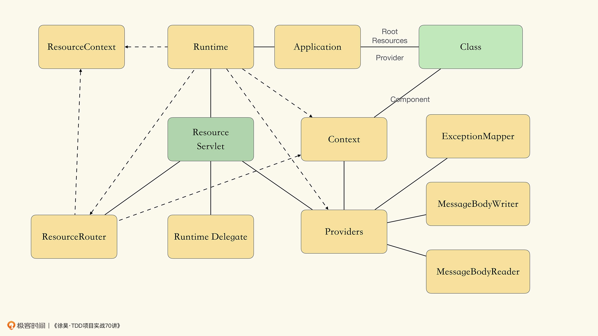
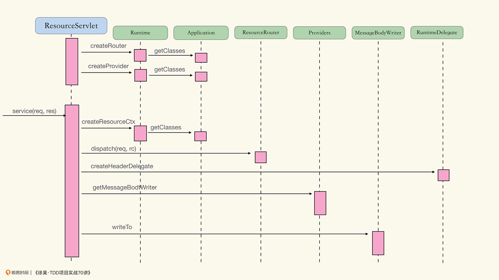

# 46 | RESTfulWebServices（10）：伦敦学派与经典学派的测试节奏有何不同？

你好，我是徐昊。今天我们继续使用 TDD 的方式实现 RESTful Web Services。

## 回顾架构愿景与任务列表

目前我们的架构愿景如下：





在继续拆分不同模块的任务之前，我们先回顾一下伦敦学派的做法：

- 按照功能需求与架构愿景，划分对象的角色和职责；

- 根据角色与职责，明确对象之间的交互；

- 按照调用栈（Call Stack）的顺序，自外向内依次实现不同的对象；

- 在实现的过程中，依照交互关系，使用测试替身替换所有与被实现对象直接关联的对象；

- 直到所有对象全部实现完成。

到目前为止，我们完成了第一层调用栈的测试。也就是以 ResourceServlet 为核心，测试驱动地实现了它与其他组件之间的交互。因为大量地使用测试替身（主要是 Stub），我们实际上围绕着 ResourceServlet 构建了一个抽象层。

如果我们继续沿着调用栈向内测试驱动，那么实际上就是为之前构建的抽象层提供了具体实现。因而，伦敦学派的过程就是一个从抽象到具体的测试驱动的过程。这也是为什么伦敦学派不惮于大量使用测试替身（甚至是 Mock）：具体实现是易变的，抽象是稳定的，因为它提炼了核心而忽略了细节。

如果抽象层构建合理，那么它就是稳定且不易改变的。重构和代码改写通常发生在实现层，合理的抽象可以屏蔽这些改变对于外界的影响。那么使用行为验证、mock、单元测试，也不会阻碍重构的进行。而随着调用栈向内，逐渐从抽象层走到具体实现的时候，具体的模块就不会再依赖额外的组件，那么单元测试自然变成状态验证的单元级别功能测试。

伦敦学派与经典学派具有完全不同的测试节奏。经典学派是从功能入手，完成功能之后，再通过重构做抽象与提炼。而伦敦学派则是从抽象入手，先构建一个抽象的机制（AbstractionMechanism），再逐步具化抽象机制中的组件。

因而，伦敦学派的难点有两个：在调用栈外层的时候，如何构建足够好的抽象层，以屏蔽具体实现变化带来的影响；逐步深入调用栈时，如何选择恰当的抽象层级。过多的抽象会不断加深调用栈，让代码变得细碎且难理解。

在前面的课程中，我们展示了如何构建外层的抽象：通过 Spike 消除不确定性，从中提取架构愿景，并转化为抽象的接口。换句话说，我们使用了不严格的经典学派（没有大量的测试，架构愿景提取代替了测试），构建了伦敦学派的起点。

## 继续分解任务

正如我在上节课中讲解过的，目前的代码具有相当抽象的程度：

```java
package geektime.tdd.rest;
import jakarta.servlet.ServletException;
import jakarta.servlet.http.HttpServlet;
import jakarta.servlet.http.HttpServletRequest;
import jakarta.servlet.http.HttpServletResponse;
import jakarta.ws.rs.WebApplicationException;
import jakarta.ws.rs.core.GenericEntity;
import jakarta.ws.rs.core.MultivaluedMap;
import jakarta.ws.rs.ext.ExceptionMapper;
import jakarta.ws.rs.ext.MessageBodyWriter;
import jakarta.ws.rs.ext.Providers;
import jakarta.ws.rs.ext.RuntimeDelegate;
import java.io.IOException;
import java.util.function.Supplier;
public class ResourceServlet extends HttpServlet {
   private Runtime runtime;
   private Providers providers;
   public ResourceServlet(Runtime runtime) {
       this.runtime = runtime;
       this.providers = runtime.getProviders();
   }
   @Override
   protected void service(HttpServletRequest req, HttpServletResponse resp) thro
       ResourceRouter router = runtime.getResourceRouter();
       respond(resp, () -> router.dispatch(req, runtime.createResourceContext(re
   }
   private void respond(HttpServletResponse resp, Supplier<OutboundResponse> sup
       try {
           respond(resp, supplier.get());
       } catch (WebApplicationException exception) {
           respond(resp, () -> (OutboundResponse) exception.getResponse());
       } catch (Throwable throwable) {
           respond(resp, () -> from(throwable));
       }
   }
   private void respond(HttpServletResponse resp, OutboundResponse response) thr
       resp.setStatus(response.getStatus());
       MultivaluedMap<String, Object> headers = response.getHeaders();
       for (String name : headers.keySet())
           for (Object value : headers.get(name)) {
               RuntimeDelegate.HeaderDelegate headerDelegate = RuntimeDelegate.g
               resp.addHeader(name, headerDelegate.toString(value));
           }
       GenericEntity entity = response.getGenericEntity();
       if (entity != null) {
           MessageBodyWriter writer = providers.getMessageBodyWriter(entity.getR
           writer.writeTo(entity.getEntity(), entity.getRawType(), entity.getTyp
                   response.getHeaders(), resp.getOutputStream());
       }
   }
   private OutboundResponse from(Throwable throwable) {
       ExceptionMapper mapper = providers.getExceptionMapper(throwable.getClass(
       return (OutboundResponse) mapper.toResponse(throwable);
   }
}
```

接下来，就要看我们如何继续分解任务了。目前的任务列表为：

- ResourceServlet

- 将请求派分给对应的资源（Resource），并根据返回的状态、超媒体类型、内容，响应Http 请求

- 使用 OutboundResponse 的 status 作为 Http Response 的状态

- 使用 OutboundResponse 的 headers 作为 Http Response 的 Http Headers

- 通过 MessageBodyWriter 将 OutboundResponse 的 GenericEntity 写回为 Body

- 如果找不到对应的 MessageBodyWriter，则返回 500 族错误

- 如果找不到对应的 HeaderDelegate，则返回 500 族错误

- 如果找不到对应的 ExceptionMapper，则返回 500 族错误

- 如果 entity 为空，则忽略 body

- 当资源方法抛出异常时，根据异常响应 Http 请求

- 如果抛出 WebApplicationException，且 response 不为 null，则使用 response 响应Http

- 如果抛出的不是 WebApplicationException，则通过异常的具体类型查找ExceptionMapper，生产 response 响应 Http 请求

- 当其他组件抛出异常时，根据异常响应 Http 请求

- 调用 ExceptionMapper 时

- 调用 HeaderDelegate 时

- 调用 MessageBodyWriter 时

- 通过 Providers 查找 ExceptionMapper 时

- 通过 Providers 查找 MessageBodyWriter 时

- 通过 RuntimeDelegate 查找 HeaderDelegate 时

- RuntimeDelegate

- 为 MediaType 提供 HeaderDelegate

- 为 CacheControl 提供 HeaderDelegate

- 为 Cookie 提供 HeaderDelegates

- 为 EntityTag 提供 HeaderDelegate

- 为 Link 提供 HeaderDelegate

- 为 NewCookie 提供 HeaderDelegate

- 为 Date 提供 HeaderDelegate

- 提供 OutboundResponseBuilder

- OutboundResponseBuilder

- OutboundResponse

我们需要把抽象层中其他使用到的组件也加入到任务列表当中，以及目前已知的任务列表中：

- RuntimeDelegate

- 为 MediaType 提供 HeaderDelegate

- 为 CacheControl 提供 HeaderDelegate

- 为 Cookie 提供 HeaderDelegates

- 为 EntityTag 提供 HeaderDelegate

- 为 Link 提供 HeaderDelegate

- 为 NewCookie 提供 HeaderDelegate

- 为 Date 提供 HeaderDelegate

- 提供 OutboundResponseBuilder

- OutboundResponseBuilder

- 可按照不同的 Status 生成 Resposne

- OutboundResponse

- ResourceDispatcher

- 将 Resource Method 的返回值包装为 Response 对象

- Providers

- 可获取 MessageBodyWriter

- 可获取 ExceptionMapper

- Runtimes

- 可获取 ResourceDispatcher

- 可获取 Providers

- MessageBodyWriter

- ExceptionMapper

- 需要提供默认的 ExceptionMapper

可以看到，列表中包含了抽象层中所有的组件，以及在最外层交互和测试的过程中识别的功能上下文，比如 ResourceDispatcher 按照 Resource Method 返回值来包装 Response 对象。这个时候，将要如何继续分解任务呢？

一个简单的考量是，能不能直接进入经典模式继续开发。如果可以，比如 Runtimes、Providers、OutboundResponseBuilder 等，就直接分解任务。如果不能，比如 ResourceDispatcher，那么可以继续通过 Spike 消除不确定性，再一层抽象。

## 思考题

在进入下节课之前，希望你能完成这个作业：请根据你的理解，继续拆分任务，并将拆分好的任务分享在留言区。

相信经过你的思考与实操，学习效果会更好！我们下节课再见！
