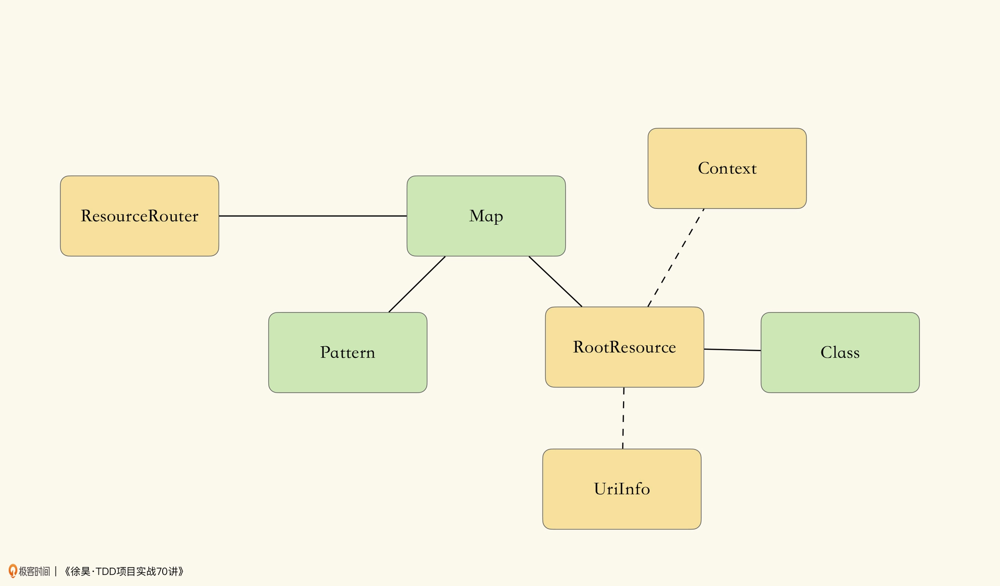
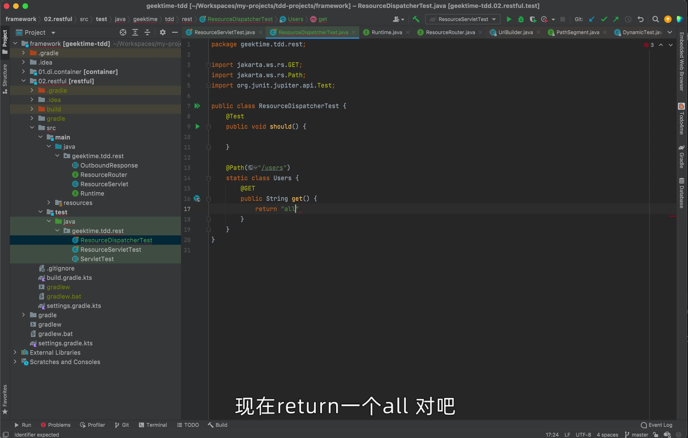

# 47 | RESTfulWebServices（11）：如何通过Spike来验证架构愿景？

你好，我是徐昊。今天我们继续使用 TDD 的方式实现 RESTful Web Services。

## 回顾架构愿景与任务列表

目前，我们的任务列表是这样的：

- RuntimeDelegate

- 为 MediaType 提供 HeaderDelegate

- 为 CacheControl 提供 HeaderDelegate

- 为 Cookie 提供 HeaderDelegates

- 为 EntityTag 提供 HeaderDelegate

- 为 Link 提供 HeaderDelegate

- 为 NewCookie 提供 HeaderDelegate

- 为 Date 提供 HeaderDelegate

- 提供 OutboundResponseBuilder

- OutboundResponseBuilder

- 可按照不同的 Status 生成 Resposne

- OutboundResponse

- ResourceDispatcher

- 将 Resource Method 的返回值包装为 Response 对象

- Providers

- 可获取 MessageBodyWriter

- 可获取 ExceptionMapper

- Runtimes

- 可获取 ResourceDispatcher

- 可获取 Providers

- MessageBodyWriter

- ExceptionMapper

- 需要提供默认的 ExceptionMapper

## 通过 Spike 验证架构愿景

上节课我们讨论到，当使用伦敦学派时，能不能直接进入经典模式继续开发，对于如何继续拆分任务起到了关键作用。在目前的任务列表中，ResourceDispatcher 显然难以直接进入经典模式（也不是不可以，如果你对重构足够自信的话，已经算是恰当的粒度了），那么我们可以围绕 ResourceDispatcher 继续构建架构愿景，澄清调用栈，然后采用伦敦学派继续开发。

如上图所示，是一个非常简单的架构构想：

- 将所有的 RootResource 的 Path 转化为正则表达式的 Pattern；

- ResourceRouter 拿到 HttpServletRequest 之后，尝试与 Pattern 匹配；

- 匹配到的 RootResource 通过 Context 实例化；

- 调用实例化后的 RootResource，处理请求，过程中把中间信息存入 UriInfo；

- ResourceRouter 拿到结果后，转化为 Response 对象返回。

接下来我们需要通过 Spike 验证架构愿景：

## 思考题

在进入下节课之前，希望你能认真思考如下两个问题。

1. 要如何调整架构愿景？

2. 进入项目三的学习后，你有什么有意思的收获吗？

欢迎把你的想法分享在留言区，也欢迎把你的项目代码分享出来。相信经过你的思考与实操，学习效果会更好！
