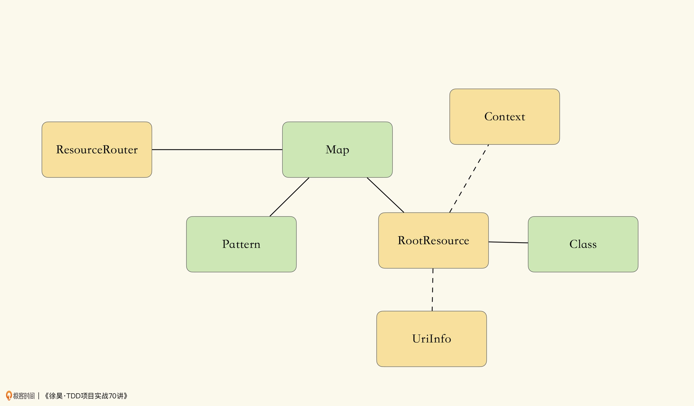
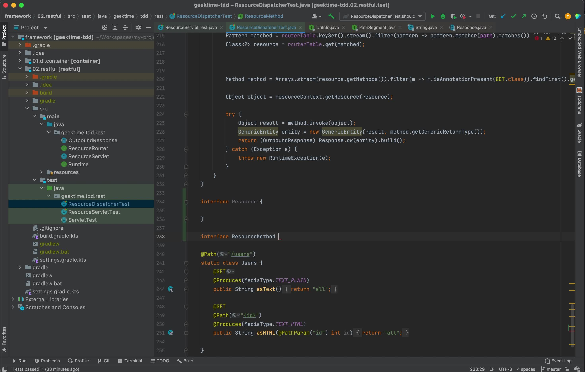

# 48 | RESTfulWebServices（12）：如何调整接口和架构愿景？

你好，我是徐昊。今天我们继续使用 TDD 的方式实现 RESTful Web Services。

## 回顾架构愿景与任务列表

目前我们 Spike 得到的代码如下：

```
static class Router implements ResourceRouter {
   private Map<Pattern, Class<?>> routerTable = new HashMap<>();
   public Router(Class<Users> rootResource) {
       Path path = rootResource.getAnnotation(Path.class);
       routerTable.put(Pattern.compile(path.value() + "(/.*)?"), rootResource);
   }
   @Override
   public OutboundResponse dispatch(HttpServletRequest request, ResourceContext
       String path = request.getServletPath();
       Pattern matched = routerTable.keySet().stream().filter(pattern -> pattern
       Class<?> resource = routerTable.get(matched);
       Method method = Arrays.stream(resource.getMethods()).filter(m -> m.isAnno
       Object object = resourceContext.getResource(resource);
       try {
           Object result = method.invoke(object);
           GenericEntity entity = new GenericEntity(result, method.getGenericRet
           return (OutboundResponse) Response.ok(entity).build();
       } catch (Exception e) {
           throw new RuntimeException(e);
       }
   }
}
```

构想中的架构愿景是这样的：



## 视频演示

那么进入今天的环节：



## 思考题

请 Spike Sub-Resource Locator。

欢迎把你的想法分享在留言区，也欢迎把你的项目代码分享出来。相信经过你的思考与实操，学习效果会更好！
