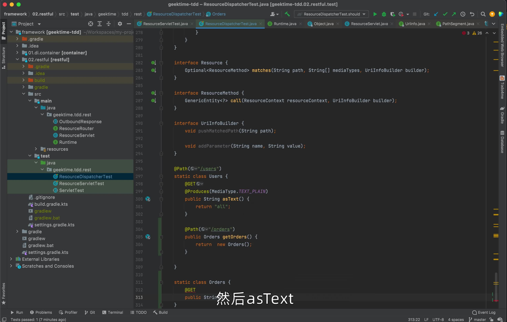

# 49 | RESTfulWebService（13）：如何SpikeSub-ResourceLocator？

你好，我是徐昊。今天我们继续使用 TDD 的方式实现 RESTful Web Services。

## 回顾架构愿景与任务列表

目前我们 Spike 得到的代码如下：

```
static class Router implements ResourceRouter {
   private Runtime runtime;
   private List<Resource> rootResources;
   public Router(Runtime runtime, List<Resource> rootResources) {
       this.runtime = runtime;
       this.rootResources = rootResources;
   }
   @Override
   public OutboundResponse dispatch(HttpServletRequest request, ResourceContext
       ResourceMethod resourceMethod = rootResources.stream().map(root -> root.m
               .filter(Optional::isPresent).findFirst().get().get();
       try {
           GenericEntity entity = resourceMethod.call(resourceContext, null);;
           return (OutboundResponse) Response.ok(entity).build();
       } catch (Exception e) {
           throw new RuntimeException(e);
       }
   }
}
```

## 视频演示

那么进入今天的环节：



到此为止，我们完成了 Spike 的工作，目前的架构愿景为：


## 思考题

在进入下节课之前，希望你能认真思考如下两个问题。

1. 在当前架构愿景下，要如何分解任务？

2. 学到这里，你对我们的课程有什么建议或反馈吗？很想听听你的声音。

欢迎把你的想法分享在留言区，也欢迎把你的项目代码分享出来。相信经过你的思考与实操，学习效果会更好！
