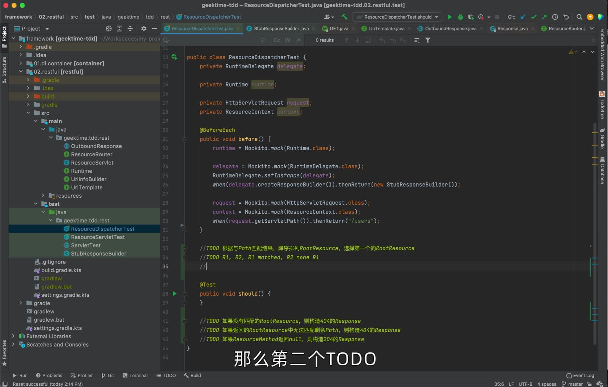

# 50 | RESTfulWebServices（14）：分解任务与Setup测试

你好，我是徐昊。今天我们继续使用 TDD 的方式实现 RESTful Web Services。

## 回顾架构愿景与任务列表

目前我们的架构愿景如下：

目前的任务列表为（仅列出与当前相关的模块），这里的列表我们合并了从 ResourceServlet发现的需求，以及在第 40 讲中分解的任务：

- ResourceRouter

- 在处理请求派分时，可以支持多级子资源（Sub-Resource）

- 在处理请求派分时，可以根据客户端提供的超媒体类型，选择对应的资源方法（Resource Method）

- 在处理请求派分时，可以根据客户端提供的 Http 方法，选择对应的资源方法

- 资源方法可以返回 Java 对象，由 Runtime 自行推断正确的返回状态

- 资源方法可以不明确指定返回的超媒体类型，由 Runtime 自行推断，比如，资源方法标注了 Produces 标注，那么就使用标注提供的超媒体类型等

- 资源方法可按找期望的类型，访问 Http 请求的内容

- 资源对象和资源方法可接受环境组件的注入

- 将 Resource Method 的返回值包装为 Response 对象

继续细化任务列表，根据架构愿景，分配到不同的模块：

- ResourceRouter

- 将 Resource Method 的返回值包装为 Response 对象

- 根据与 Path 匹配结果，降序排列 RootResource，选择第一个的 RootResource

- 如果没有匹配的 RootResource，则构造 404 的 Response

- 如果返回的 RootResource 中无法匹配剩余 Path，则构造 404 的 Response

- 如果 ResourceMethod 返回 null，则构造 204 的 Response

- Resource/RootResource/ResourceMethod

- 在处理请求派分时，可以支持多级子资源（Sub-Resource）

- 在处理请求派分时，可以根据客户端提供的超媒体类型，选择对应的资源方法（Resource Method）

- 在处理请求派分时，可以根据客户端提供的 Http 方法，选择对应的资源方法

- 资源方法可以返回 Java 对象，由 Runtime 自行推断正确的返回状态

- 资源方法可以不明确指定返回的超媒体类型，由 Runtime 自行推断，比如，资源方法标注了 Produces 标注，那么就使用标注提供的超媒体类型等

- 资源方法可按找期望的类型，访问 Http 请求的内容

- 资源对象和资源方法可接受环境组件的注入

可以看到在当前架构愿景下，原本设计的需求被分入了Resource/RootResource/ResourceMethod 模块中。

## 视频演示

下面进入今日的开发：

## 思考题

完成后的代码里其实是有一点问题的，请问问题出在哪儿？

欢迎把你的想法分享在留言区，也欢迎把你的项目代码分享出来。相信经过你的思考与实操，学习效果会更好！
