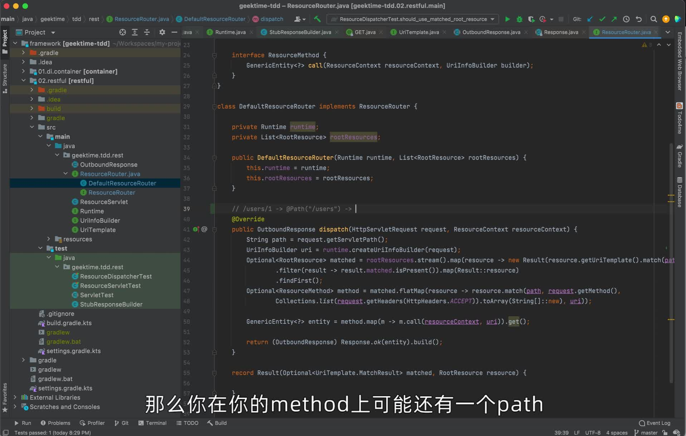

# 51 | RESTfulWebServices（15）：为什么选择在第一个测试之后就开始重构？

你好，我是徐昊。今天我们继续使用 TDD 的方式实现 RESTful Web Services。

## 回顾架构愿景与任务列表

目前我们的架构愿景如下：


任务列表如下：

- ResourceRouter

- 将 Resource Method 的返回值包装为 Response 对象

- 根据与 Path 匹配结果，降序排列 RootResource，选择第一个的 RootResource

- 如果没有匹配的 RootResource，则构造 404 的 Response

- 如果返回的 RootResource 中无法匹配剩余 Path，则构造 404 的 Response

- 如果 ResourceMethod 返回 null，则构造 204 的 Response

代码目前是：

```python
class DefaultResourceRouter implements ResourceRouter {
   private Runtime runtime;
   private List<RootResource> rootResources;
   public DefaultResourceRouter(Runtime runtime, List<RootResource> rootResource
       this.runtime = runtime;
       this.rootResources = rootResources;
   }
   @Override
   public OutboundResponse dispatch(HttpServletRequest request, ResourceContext
       String path = request.getServletPath();
       UriInfoBuilder uri = runtime.createUriInfoBuilder(request);
       Optional<RootResource> matched = rootResources.stream().map(resource -> n
               .filter(result -> result.matched.isPresent()).map(Result::resourc
               .findFirst();
       Optional<ResourceMethod> method = matched.flatMap(resource -> resource.ma
               Collections.list(request.getHeaders(HttpHeaders.ACCEPT)).toArray(
       GenericEntity<?> entity = method.map(m -> m.call(resourceContext, uri)).g
       return (OutboundResponse) Response.ok(entity).build();
   }
   record Result(Optional<UriTemplate.MatchResult> matched, RootResource resourc
   }
}
```

## 视频演示

下面进入今日的开发：



## 思考题

我们为什么选择在第一个测试之后就开始重构？

欢迎把你的想法分享在留言区，也欢迎把你的项目代码分享出来。相信经过你的思考与实操，学习效果会更好！
