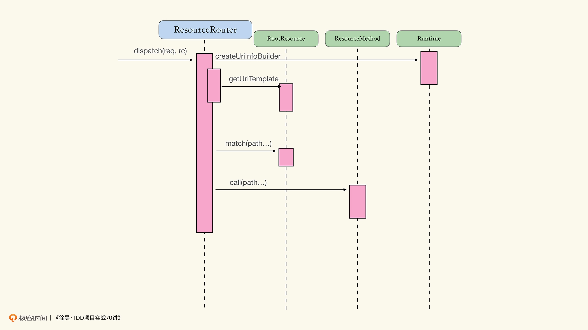
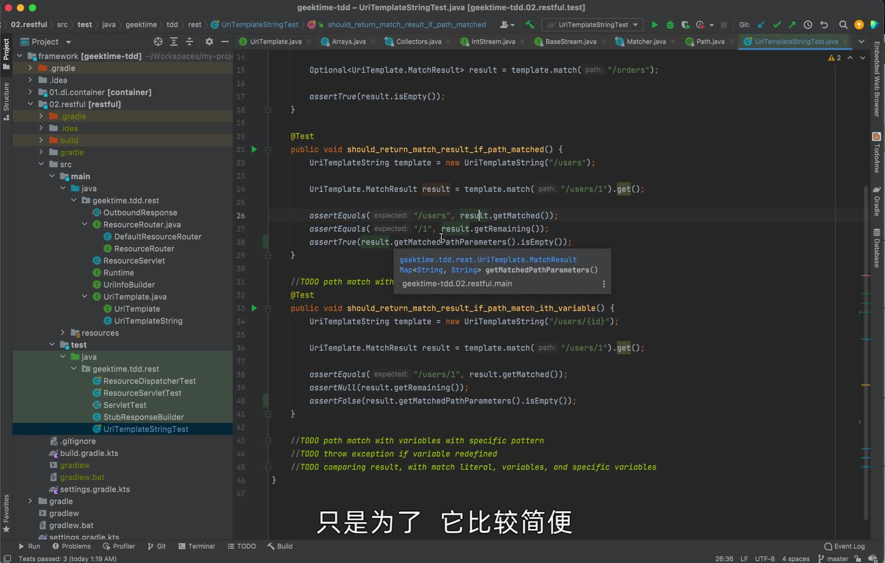

# 54 | RESTfulWebServices（18）：如何实现UriTemplate的主要功能？

你好，我是徐昊。今天我们继续使用 TDD 的方式实现 RESTful Web Services。

## 回顾架构愿景与任务列表

目前我们已经实现了 ResourceRouter，整体的架构愿景如下：




目前 UriTemplate 的任务列表为

- UriTemplate

- 匹配无参数的 Uri 模版

- 如果 Uri 可以与模版匹配，则返回匹配结果

- 如果 Uri 不能与模版匹配，则返回 Optional.empty

- 匹配带参数的 Uri 模版

- 如果 Uri 可以与模版匹配，按照指定参数从 Uri 中提取值

- 参数可以通过正则表达式指定格式

- 如果参数重复定义，则抛出异常

- 模版匹配的结果可以比较大小

- 如果匹配的非参字符多，则优先（长的优先）

- 如果匹配的非参数字符一样，匹配的分组多，则优先（参数优先）

- 如果匹配的分组一样多，指定格式参数匹配多的优先（指定格式参数优先）

代码为：

```java
class UriTemplateString implements UriTemplate {
   private static Pattern variable = Pattern.compile("\\{\\w[\\w\\.-]*\\}");
   private final Pattern pattern;
   public UriTemplateString(String template) {
       pattern = Pattern.compile("(" + variable(template) + ")" + "(/.*)?");
   }
   private String variable(String template) {
       return variable.matcher(template).replaceAll("([^/]+?)");
   }
   @Override
   public Optional<MatchResult> match(String path) {
       Matcher matcher = pattern.matcher(path);
       if (!matcher.matches()) return Optional.empty();
       int count = matcher.groupCount();
       return Optional.of(new MatchResult() {
           @Override
           public int compareTo(MatchResult o) {
               return 0;
           }
           @Override
           public String getMatched() {
               return matcher.group(1);
           }
           @Override
           public String getRemaining() {
               return matcher.group(count);
           }
           @Override
           public Map<String, String> getMatchedPathParameters() {
               return null;
           }
       });
   }
}
```

## 视频演示

进入今天的环节：



## 思考题

匹配结果按匹配的字符常量数、匹配的变量数、匹配的自定义变量数排序，如何寻找匹配结果排序的测试案例？

欢迎把你的想法分享在留言区，也欢迎把你的项目代码分享出来。相信经过你的思考与实操，学习效果会更好！
