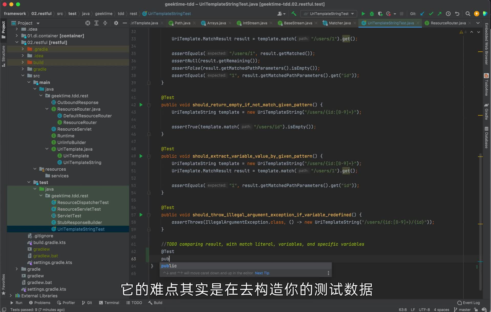

# 55 | RESTfulWebServices（19）：如何更有效地构造测试数据？

你好，我是徐昊。今天我们继续使用 TDD 的方式实现 RESTful Web Services。

## 回顾架构愿景与任务列表

目前我们已经实现了 ResourceRouter，整体的架构愿景如下：


目前 UriTemplate 的任务列表为

- UriTemplate

- 匹配无参数的 Uri 模版

- 如果 Uri 可以与模版匹配，则返回匹配结果

- 如果 Uri 不能与模版匹配，则返回 Optional.empty

- 匹配带参数的 Uri 模版

- 如果 Uri 可以与模版匹配，按照指定参数从 Uri 中提取值

- 参数可以通过正则表达式指定格式

- 如果参数重复定义，则抛出异常

- 模版匹配的结果可以比较大小

- 如果匹配的非参字符多，则优先（长的优先）

- 如果匹配的非参数字符一样，匹配的分组多，则优先（参数优先）

- 如果匹配的分组一样多，指定格式参数匹配多的优先（指定格式参数优先）

代码为：

```java
{
   private static final String LeftBracket = "\\{";
   private static final String RightBracket = "}";
   private static final String VariableName = "\\w[\\w\\.-]*";
   private static final String NonBrackets = "[^\\{}]+";
   private static final Pattern variable = Pattern.compile(LeftBracket + group(V
           group(":" + group(NonBrackets)) + "?" + RightBracket);
   private static final int variableNameGroup = 1;
   private static final int variablePatternGroup = 3;
   private static final String defaultVariablePattern = "([^/]+?)";
   private final Pattern pattern;
   private final List<String> variables = new ArrayList<>();
   private int variableGroupStartFrom;
   public UriTemplateString(String template) {
       pattern = Pattern.compile(group(variable(template)) + "(/.*)?");
       variableGroupStartFrom = 2;
   }
   private String variable(String template) {
       return variable.matcher(template).replaceAll(result -> {
           String variableName = result.group(variableNameGroup);
           String pattern = result.group(variablePatternGroup);
           if (variables.contains(variableName))
               throw new IllegalArgumentException("duplicate variable " + variab
           variables.add(variableName);
           return pattern == null ? defaultVariablePattern : group(pattern);
       });
   }
   @Override
   public Optional<MatchResult> match(String path) {
       Matcher matcher = pattern.matcher(path);
       if (!matcher.matches()) return Optional.empty();
       return Optional.of(new PathMatchResult(matcher));
   }
   class PathMatchResult implements MatchResult {
       private int count;
       private Matcher matcher;
       private Map<String, String> parameters = new HashMap<>();
       public PathMatchResult(Matcher matcher) {
           this.matcher = matcher;
           this.count = matcher.groupCount();
           for (int i = 0; i < variables.size(); i++)
               parameters.put(variables.get(i), matcher.group(variableGroupStart
       }
       @Override
       public int compareTo(MatchResult o) {
           return 0;
       }
       @Override
       public String getMatched() {
           return matcher.group(1);
       }
       @Override
       public String getRemaining() {
           return matcher.group(count);
       }
       @Override
       public Map<String, String> getMatchedPathParameters() {
           return parameters;
       }
   }
   private static String group(String pattern) {
       return "(" + pattern + ")";
   }
}
```

## 视频演示

进入今天的环节：



## 思考题

RootResource/Resource/ResourceMethod 部分的任务要如何分解？

欢迎把你的想法分享在留言区，也欢迎把你的项目代码分享出来。相信经过你的思考与实操，学习效果会更好！
