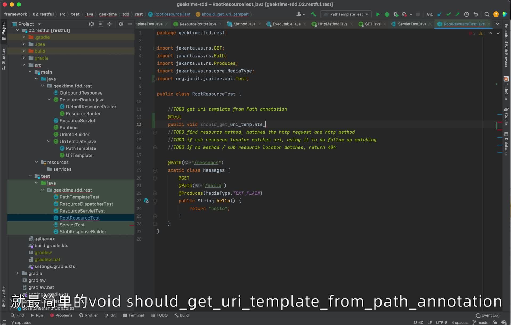

# 56 | RESTfulWebServices（20）：为什么要通过测试的方法来驱动出代码结构？

你好，我是徐昊。今天我们继续使用 TDD 的方式实现 RESTful Web Services。

## 回顾架构愿景与任务列表

目前我们已经实现了 ResourceRouter，和 UriTemplate 整体的架构愿景如下：

接下来要进入 RootResource/Resource 和 ResourceMethod 的开发。目前未经细化的任务列表如下：

- Resource/RootResource/ResourceMethod

- 在处理请求派分时，可以支持多级子资源（Sub-Resource）

- 在处理请求派分时，可以根据客户端提供的超媒体类型，选择对应的资源方法（Resource Method）

- 在处理请求派分时，可以根据客户端提供的 Http 方法，选择对应的资源方法

- 资源方法可以返回 Java 对象，由 Runtime 自行推断正确的返回状态

- 资源方法可以不明确指定返回的超媒体类型，由 Runtime 自行推断，比如，资源方法标注了 Produces 标注，那么就使用标注提供的超媒体类型等

- 资源方法可按找期望的类型，访问 Http 请求的内容

- 资源对象和资源方法可接受环境组件的注入

让我们细化一下任务列表。首先关注在请求派分的 Uri 匹配部分，暂时忽略其他部分：

- Resource/RootResource/ResourceMethod

- 从 Path 标注中获取 UriTemplate

- 如不存在 Path 标注，则抛出异常

- 在处理请求派分时，可以根据客户端提供的 Http 方法，选择对应的资源方法

- 当请求与资源方法的 Uri 模版一致，且 Http 方法一致时，派分到该方法

- 没有资源方法于请求的 Uri 和 Http 方法一致时，返回 404

- 在处理请求派分时，可以支持多级子资源

- 当没有资源方法可以匹配请求时，选择最优匹配 SubResourceLocater，通过它继续进行派分

- 如果 SubResourceLocator 也无法找到满足的请求时，返回 404

## 视频演示

进入今天的环节：

## 思考题

按照三角法，接下来要如何增加新的测试案例？
