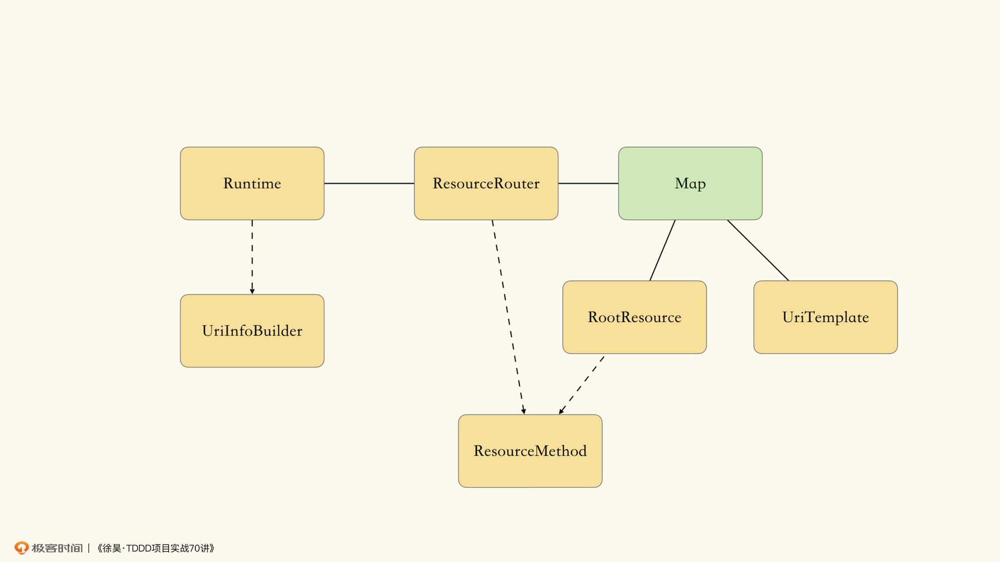
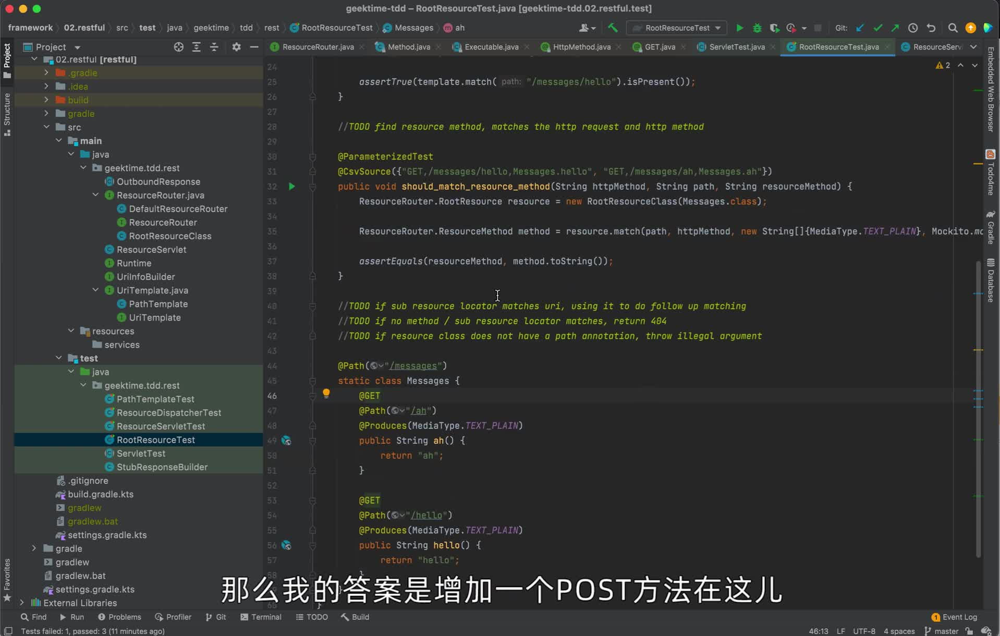

# 57 | RESTfulWebServices（21）：按照三角法，该如何增加新的测试案例？

你好，我是徐昊。今天我们继续使用 TDD 的方式实现 RESTful Web Services。

## 回顾架构愿景与任务列表

目前我们已经实现了 ResourceRouter，和 UriTemplate 整体的架构愿景如下：




目前的任务列表：

- Resource/RootResource/ResourceMethod

- 从 Path 标注中获取 UriTemplate

- 如不存在 Path 标注，则抛出异常

- 在处理请求派分时，可以根据客户端提供的 Http 方法，选择对应的资源方法

- 当请求与资源方法的 Uri 模版一致，且 Http 方法一致时，派分到该方法

- 没有资源方法于请求的 Uri 和 Http 方法一致时，返回 404

- 在处理请求派分时，可以支持多级子资源

- 当没有资源方法可以匹配请求时，选择最优匹配 SubResourceLocater，通过它继续进行派分

- 如果 SubResourceLocator 也无法找到满足的请求时，返回 404

代码为：

```python
class RootResourceClass implements ResourceRouter.RootResource {
   private PathTemplate uriTemplate;
   private Class<?> resourceClass;
   private List<ResourceRouter.ResourceMethod> resourceMethods;
   public RootResourceClass(Class<?> resourceClass) {
       this.resourceClass = resourceClass;
       this.uriTemplate = new PathTemplate(resourceClass.getAnnotation(Path.clas
       this.resourceMethods = Arrays.stream(resourceClass.getMethods()).filter(m
                       .anyMatch(a -> a.annotationType().isAnnotationPresent(Htt
               .map(m -> (ResourceRouter.ResourceMethod) new DefaultResourceMeth
   }
   @Override
   public Optional<ResourceRouter.ResourceMethod> match(String path, String meth
       UriTemplate.MatchResult result = uriTemplate.match(path).get();
       String remaining = result.getRemaining();
       return resourceMethods.stream().filter(m -> m.getUriTemplate().match(rema
               .orElse(false)).findFirst();
   }
   @Override
   public UriTemplate getUriTemplate() {
       return uriTemplate;
   }
   static class DefaultResourceMethod implements ResourceRouter.ResourceMethod {
       private UriTemplate uriTemplate;
       private Method method;
       public DefaultResourceMethod(Method method) {
           this.method = method;
           this.uriTemplate = new PathTemplate(method.getAnnotation(Path.class).
       }
       @Override
       public UriTemplate getUriTemplate() {
           return uriTemplate;
       }
       @Override
       public GenericEntity<?> call(ResourceContext resourceContext, UriInfoBuil
           return null;
       }
       @Override
       public String toString() {
           return method.getDeclaringClass().getSimpleName() + "." + method.getN
       }
   }
}
```

## 视频演示

进入今天的环节：



## 思考题

接下来要重构还是继续完成功能，让坏味道再多一点？
