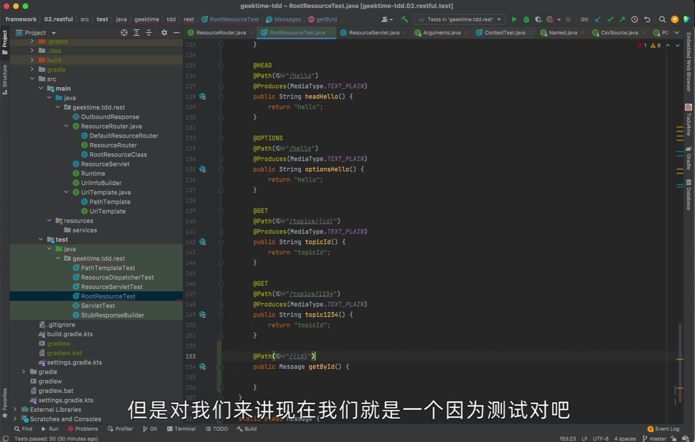

# 59 | RESTfulWebServices（23）：如何构造测试数据？

你好，我是徐昊。今天我们继续使用 TDD 的方式实现 RESTful Web Services。

## 回顾架构愿景与任务列表

目前我们已经实现了 ResourceRouter，和 UriTemplate 整体的架构愿景如下：


目前的任务列表：

- Resource/RootResource/ResourceMethod

- 从 Path 标注中获取 UriTemplate

- 如不存在 Path 标注，则抛出异常

- 在处理请求派分时，可以根据客户端提供的 Http 方法，选择对应的资源方法

- 当请求与资源方法的 Uri 模版一致，且 Http 方法一致时，派分到该方法

- 没有资源方法于请求的 Uri 和 Http 方法一致时，返回 404

- 在处理请求派分时，可以支持多级子资源

- 当没有资源方法可以匹配请求时，选择最优匹配 SubResourceLocater，通过它继续进行派分

- 如果 SubResourceLocator 也无法找到满足的请求时，返回 404

代码为：

```python
class RootResourceClass implements ResourceRouter.RootResource {
   private PathTemplate uriTemplate;
   private Class<?> resourceClass;
   private Map<String, List<ResourceRouter.ResourceMethod>> resourceMethods;
   public RootResourceClass(Class<?> resourceClass) {
       this.resourceClass = resourceClass;
       this.uriTemplate = new PathTemplate(resourceClass.getAnnotation(Path.clas
       this.resourceMethods = Arrays.stream(resourceClass.getMethods()).filter(m
                       .anyMatch(a -> a.annotationType().isAnnotationPresent(Htt
               .map(DefaultResourceMethod::new)
               .collect(Collectors.groupingBy(ResourceRouter.ResourceMethod::get
   }
   @Override
   public Optional<ResourceRouter.ResourceMethod> match(UriTemplate.MatchResult
       String remaining = Optional.ofNullable(result.getRemaining()).orElse("");
       return Optional.ofNullable(resourceMethods.get(method)).flatMap(methods -
               .findFirst().map(Result::resourceMethod));
   }
   @Override
   public UriTemplate getUriTemplate() {
       return uriTemplate;
   }
   private Result match(String path, ResourceRouter.ResourceMethod method) {
       return new Result(method.getUriTemplate().match(path), method);
   }
   record Result(Optional<UriTemplate.MatchResult> matched,
                 ResourceRouter.ResourceMethod resourceMethod) implements Compar
       public boolean isMatched() {
           return matched.map(r -> r.getRemaining() == null).orElse(false);
       }
       @Override
       public int compareTo(Result o) {
           return matched.flatMap(x -> o.matched.map(x::compareTo)).orElse(0);
       }
   }
   static class DefaultResourceMethod implements ResourceRouter.ResourceMethod {
       private String httpMethod;
       private UriTemplate uriTemplate;
       private Method method;
       public DefaultResourceMethod(Method method) {
           this.method = method;
           this.uriTemplate = new PathTemplate(Optional.ofNullable(method.getAnn
           this.httpMethod = Arrays.stream(method.getAnnotations()).filter(a ->
                   .findFirst().get().annotationType().getAnnotation(HttpMethod.
       }
       @Override
       public String getHttpMethod() {
           return httpMethod;
       }
       @Override
       public UriTemplate getUriTemplate() {
           return uriTemplate;
       }
       @Override
       public GenericEntity<?> call(ResourceContext resourceContext, UriInfoBuil
           return null;
       }
       @Override
       public String toString() {
           return method.getDeclaringClass().getSimpleName() + "." + method.getN
       }
   }
}
```

## 视频演示

进入今天的环节：



## 思考题

RootResource 的测试要如何改造？

欢迎把你的想法分享在留言区，也欢迎把你的项目代码分享出来。相信经过你的思考与实操，学习效果会更好！
