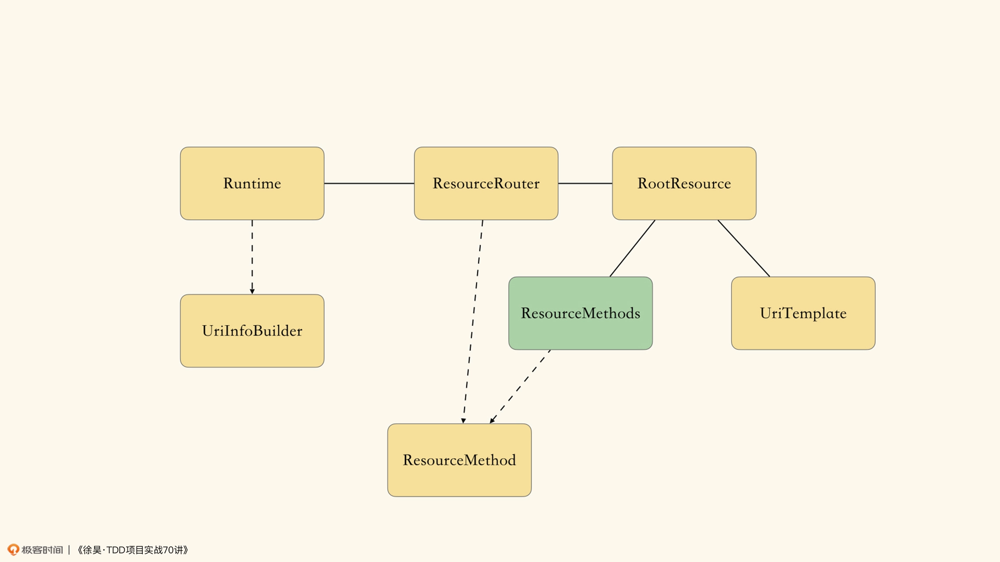
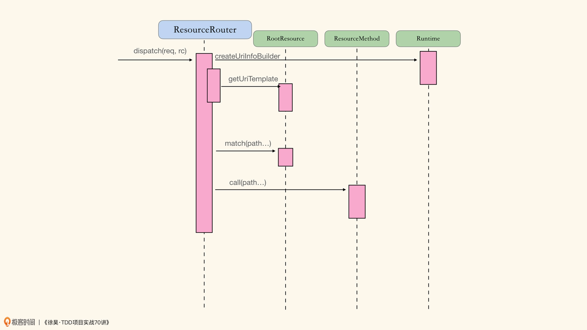
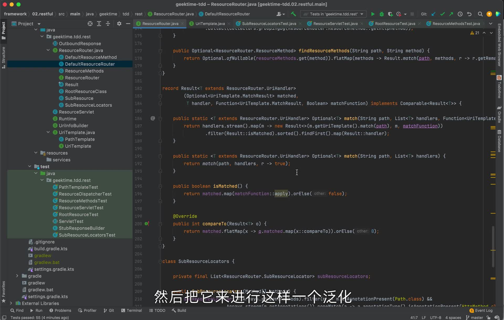

# 61 | RESTfulWebServices（25）：如何重构DefaultResourceRouter中的Result结构？

你好，我是徐昊。今天我们继续使用 TDD 的方式实现 RESTful Web Services。

## 回顾架构愿景与任务列表

目前我们已经实现了 ResourceRouter，和 UriTemplate 整体的架构愿景如下：





目前的任务列表：

- Resource/RootResource/ResourceMethod

- 从 Path 标注中获取 UriTemplate

- 如不存在 Path 标注，则抛出异常

- 在处理请求派分时，可以根据客户端提供的 Http 方法，选择对应的资源方法

- 当请求与资源方法的 Uri 模版一致，且 Http 方法一致时，派分到该方法

- 没有资源方法于请求的 Uri 和 Http 方法一致时，返回 404

- 在处理请求派分时，可以支持多级子资源

- 当没有资源方法可以匹配请求时，选择最优匹配 SubResourceLocater，通过它继续进行派分

- 如果 SubResourceLocator 也无法找到满足的请求时，返回 404

代码为：

```java
package geektime.tdd.rest;
import jakarta.servlet.http.HttpServletRequest;
import jakarta.ws.rs.HttpMethod;
import jakarta.ws.rs.Path;
import jakarta.ws.rs.container.ResourceContext;
import jakarta.ws.rs.core.GenericEntity;
import jakarta.ws.rs.core.HttpHeaders;
import jakarta.ws.rs.core.Response;
import java.lang.reflect.Method;
import java.util.*;
import java.util.function.Function;
import java.util.stream.Collectors;
interface ResourceRouter {
   OutboundResponse dispatch(HttpServletRequest request, ResourceContext resourc
   interface Resource {
       Optional<ResourceMethod> match(UriTemplate.MatchResult result, String met
   }
   interface RootResource extends Resource, UriHandler {
   }
   interface ResourceMethod extends UriHandler {
       String getHttpMethod();
       GenericEntity<?> call(ResourceContext resourceContext, UriInfoBuilder bui
   }
   interface SubResourceLocator extends UriHandler {
   }
   interface UriHandler {
       UriTemplate getUriTemplate();
   }
}
class DefaultResourceRouter implements ResourceRouter {
   private Runtime runtime;
   private List<RootResource> rootResources;
   public DefaultResourceRouter(Runtime runtime, List<RootResource> rootResource
       this.runtime = runtime;
       this.rootResources = rootResources;
   }
   @Override
   public OutboundResponse dispatch(HttpServletRequest request, ResourceContext
       String path = request.getServletPath();
       UriInfoBuilder uri = runtime.createUriInfoBuilder(request);
       Optional<ResourceMethod> method = rootResources.stream().map(resource ->
               .filter(Result::isMatched).sorted().findFirst().flatMap(result ->
       if (method.isEmpty()) return (OutboundResponse) Response.status(Response.
       return (OutboundResponse) method.map(m -> m.call(resourceContext, uri)).m
               .orElseGet(() -> Response.noContent().build());
   }
   private Result match(String path, RootResource resource) {
       return new Result(resource.getUriTemplate().match(path), resource);
   }
   record Result(Optional<UriTemplate.MatchResult> matched, RootResource resourc
       private boolean isMatched() {
           return matched.isPresent();
       }
       @Override
       public int compareTo(Result o) {
           return matched.flatMap(x -> o.matched.map(x::compareTo)).orElse(0);
       }
       private Optional<ResourceMethod> findResourceMethod(HttpServletRequest re
           return matched.flatMap(result -> resource.match(result, request.getMe
                   Collections.list(request.getHeaders(HttpHeaders.ACCEPT)).toAr
       }
   }
}
class RootResourceClass implements ResourceRouter.RootResource {
   private PathTemplate uriTemplate;
   private Class<?> resourceClass;
   private ResourceMethods resourceMethods;
   public RootResourceClass(Class<?> resourceClass) {
       this.resourceClass = resourceClass;
       this.uriTemplate = new PathTemplate(resourceClass.getAnnotation(Path.clas
       this.resourceMethods = new ResourceMethods(resourceClass.getMethods());
   }
   @Override
   public Optional<ResourceRouter.ResourceMethod> match(UriTemplate.MatchResult
       String remaining = Optional.ofNullable(result.getRemaining()).orElse("");
       return resourceMethods.findResourceMethods(remaining, method);
   }
   @Override
   public UriTemplate getUriTemplate() {
       return uriTemplate;
   }
}
class SubResource implements ResourceRouter.Resource {
   private Object subResource;
   private ResourceMethods resourceMethods;
   public SubResource(Object subResource) {
       this.subResource = subResource;
       this.resourceMethods = new ResourceMethods(subResource.getClass().getMeth
   }
   @Override
   public Optional<ResourceRouter.ResourceMethod> match(UriTemplate.MatchResult
       String remaining = Optional.ofNullable(result.getRemaining()).orElse("");
       return resourceMethods.findResourceMethods(remaining, method);
   }
}
class DefaultResourceMethod implements ResourceRouter.ResourceMethod {
   private String httpMethod;
   private UriTemplate uriTemplate;
   private Method method;
   public DefaultResourceMethod(Method method) {
       this.method = method;
       this.uriTemplate = new PathTemplate(Optional.ofNullable(method.getAnnotat
       this.httpMethod = Arrays.stream(method.getAnnotations()).filter(a -> a.an
               .findFirst().get().annotationType().getAnnotation(HttpMethod.clas
   }
   @Override
   public String getHttpMethod() {
       return httpMethod;
   }
   @Override
   public UriTemplate getUriTemplate() {
       return uriTemplate;
   }
   @Override
   public GenericEntity<?> call(ResourceContext resourceContext, UriInfoBuilder
       return null;
   }
   @Override
   public String toString() {
       return method.getDeclaringClass().getSimpleName() + "." + method.getName(
   }
}
class ResourceMethods {
   private Map<String, List<ResourceRouter.ResourceMethod>> resourceMethods;
   public ResourceMethods(Method[] methods) {
       this.resourceMethods = getResourceMethods(methods);
   }
   private static Map<String, List<ResourceRouter.ResourceMethod>> getResourceMe
       return Arrays.stream(methods).filter(m -> Arrays.stream(m.getAnnotations(
                       .anyMatch(a -> a.annotationType().isAnnotationPresent(Htt
               .map(DefaultResourceMethod::new)
               .collect(Collectors.groupingBy(ResourceRouter.ResourceMethod::get
   }
   public Optional<ResourceRouter.ResourceMethod> findResourceMethods(String pat
       return Optional.ofNullable(resourceMethods.get(method)).flatMap(methods -
   }
}
record Result<T extends ResourceRouter.UriHandler>
       (Optional<UriTemplate.MatchResult> matched,
        T handler, Function<UriTemplate.MatchResult, Boolean> matchFunction) imp
   public static <T extends ResourceRouter.UriHandler> Optional<T> match(String
       return handlers.stream().map(m -> new Result<>(m.getUriTemplate().match(p
               .filter(Result::isMatched).sorted().findFirst().map(Result::handl
   }
   public static <T extends ResourceRouter.UriHandler> Optional<T> match(String
       return match(path, handlers, r -> true);
   }
   public boolean isMatched() {
       return matched.map(matchFunction::apply).orElse(false);
   }
   @Override
   public int compareTo(Result<T> o) {
       return matched.flatMap(x -> o.matched.map(x::compareTo)).orElse(0);
   }
}
class SubResourceLocators {
   private final List<ResourceRouter.SubResourceLocator> subResourceLocators;
   public SubResourceLocators(Method[] methods) {
       subResourceLocators = Arrays.stream(methods).filter(m -> m.isAnnotationPr
                       Arrays.stream(m.getAnnotations()).noneMatch(a -> a.annota
               .map((Function<Method, ResourceRouter.SubResourceLocator>) Defaul
   }
   public Optional<ResourceRouter.SubResourceLocator> findSubResource(String pat
       return Result.match(path, subResourceLocators);
   }
   static class DefaultSubResourceLocator implements ResourceRouter.SubResourceL
       private PathTemplate uriTemplate;
       private Method method;
       public DefaultSubResourceLocator(Method method) {
           this.method = method;
           this.uriTemplate = new PathTemplate(method.getAnnotation(Path.class).
       }
       @Override
       public UriTemplate getUriTemplate() {
           return uriTemplate;
       }
       @Override
       public String toString() {
           return method.getDeclaringClass().getSimpleName() + "." + method.getN
       }
   }
}
```

## 视频演示

进入今天的环节：



## 思考题

如何继续划分 ResourceLocator 的任务？

欢迎把你的想法分享在留言区，也欢迎把你的项目代码分享出来。相信经过你的思考与实操，学习效果会更好！
