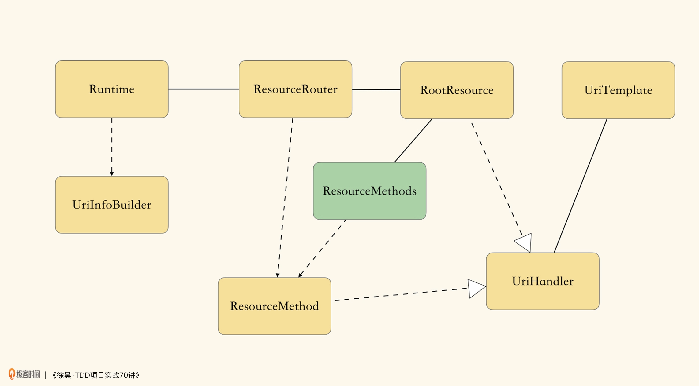
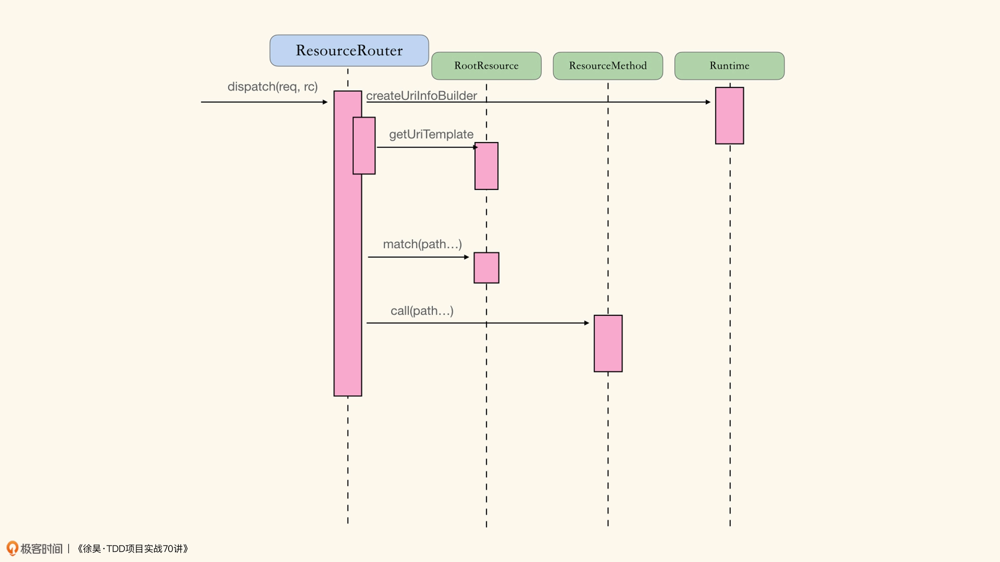
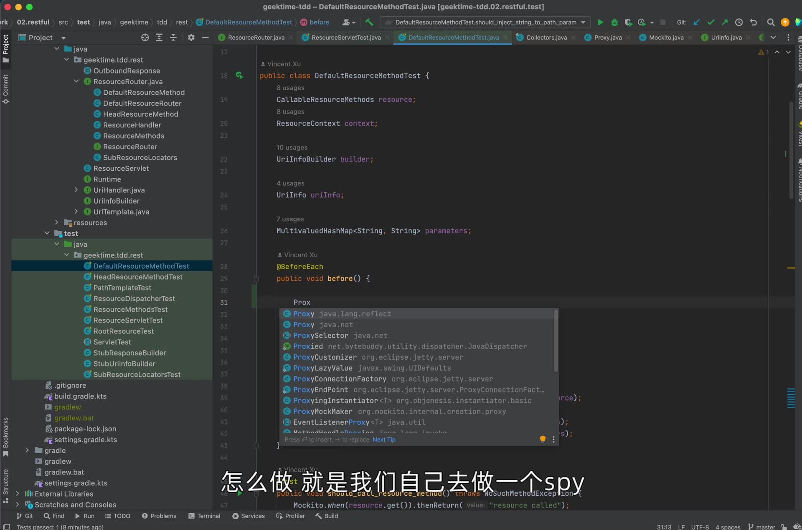

# 71 | RESTfulWebServices（35）：如何将测试改为动态测试？

你好，我是徐昊。今天我们继续使用 TDD 的方式实现 RESTful Web Services。

## 回顾架构愿景与任务列表





目前的任务列表：

- Resource/RootResource/ResourceMethods

- 当 HEAD 方法映射到 GET 方法时，忽略 GET 的返回值

- 当没有 OPTIONS 方法时，提供默认实现

代码为：

```java
package geektime.tdd.rest;
import jakarta.servlet.http.HttpServletRequest;
import jakarta.ws.rs.HttpMethod;
import jakarta.ws.rs.Path;
import jakarta.ws.rs.PathParam;
import jakarta.ws.rs.QueryParam;
import jakarta.ws.rs.container.ResourceContext;
import jakarta.ws.rs.core.GenericEntity;
import jakarta.ws.rs.core.HttpHeaders;
import jakarta.ws.rs.core.Response;
import jakarta.ws.rs.core.UriInfo;
import java.lang.reflect.InvocationTargetException;
import java.lang.reflect.Method;
import java.lang.reflect.Parameter;
import java.lang.reflect.Type;
import java.util.*;
import java.util.function.Function;
import java.util.stream.Collectors;
import static geektime.tdd.rest.DefaultResourceMethod.ValueConverter.singeValued;
import static java.util.Arrays.stream;
interface ResourceRouter {
   OutboundResponse dispatch(HttpServletRequest request, ResourceContext resourc
   interface Resource extends UriHandler {
       Optional<ResourceMethod> match(UriTemplate.MatchResult result, String htt
   }
   interface ResourceMethod extends UriHandler {
       String getHttpMethod();
       GenericEntity<?> call(ResourceContext resourceContext, UriInfoBuilder bui
   }
}
class DefaultResourceRouter implements ResourceRouter {
   private Runtime runtime;
   private List<Resource> rootResources;
   public DefaultResourceRouter(Runtime runtime, List<Resource> rootResources) {
       this.runtime = runtime;
       this.rootResources = rootResources;
   }
   @Override
   public OutboundResponse dispatch(HttpServletRequest request, ResourceContext
       String path = request.getServletPath();
       UriInfoBuilder uri = runtime.createUriInfoBuilder(request);
       Optional<ResourceMethod> method = UriHandlers.mapMatched(path, rootResour
       if (method.isEmpty()) return (OutboundResponse) Response.status(Response.
       return (OutboundResponse) method.map(m -> m.call(resourceContext, uri))
               .map(entity -> (entity.getEntity() instanceof OutboundResponse) ?
               .orElseGet(() -> Response.noContent().build());
   }
   private Optional<ResourceMethod> findResourceMethod(HttpServletRequest reques
       return handler.match(matched.get(), request.getMethod(),
               Collections.list(request.getHeaders(HttpHeaders.ACCEPT)).toArray(
   }
}
class DefaultResourceMethod implements ResourceRouter.ResourceMethod {
   private String httpMethod;
   private UriTemplate uriTemplate;
   private Method method;
   public DefaultResourceMethod(Method method) {
       this.method = method;
       this.uriTemplate = new PathTemplate(Optional.ofNullable(method.getAnnotat
       this.httpMethod = stream(method.getAnnotations()).filter(a -> a.annotatio
               .findFirst().get().annotationType().getAnnotation(HttpMethod.clas
   }
   @Override
   public String getHttpMethod() {
       return httpMethod;
   }
   @Override
   public UriTemplate getUriTemplate() {
       return uriTemplate;
   }
   @Override
   public GenericEntity<?> call(ResourceContext resourceContext, UriInfoBuilder
       try {
           UriInfo uriInfo = builder.createUriInfo();
           Object result = method.invoke(builder.getLastMatchedResource(),
                   stream(method.getParameters()).map(parameter ->
                           providers.stream().map(provider -> provider.provide(p
                                   .findFirst()
                                   .flatMap(values -> values.map(v -> converters
                                   .orElse(null)).toArray(Object[]::new));
           return result != null ? new GenericEntity<>(result, method.getGeneric
       } catch (IllegalAccessException | InvocationTargetException e) {
           throw new RuntimeException(e);
       }
   }
   private static ValueProvider pathParam = (parameter, uriInfo) ->
           Optional.ofNullable(parameter.getAnnotation(PathParam.class))
                   .map(annotation -> uriInfo.getPathParameters().get(annotation
   private static ValueProvider queryParam = (parameter, uriInfo) ->
           Optional.ofNullable(parameter.getAnnotation(QueryParam.class))
                   .map(annotation -> uriInfo.getQueryParameters().get(annotatio
   private static List<ValueProvider> providers = List.of(pathParam, queryParam)
   interface ValueProvider {
       Optional<List<String>> provide(Parameter parameter, UriInfo uriInfo);
   }
   interface ValueConverter<T> {
       T fromString(List<String> values);
       static <T> ValueConverter<T> singeValued(Function<String, T> converter) {
           return values -> converter.apply(values.get(0));
       }
   }
   private static Map<Type, ValueConverter<?>> converters = Map.of(
           int.class, singeValued(Integer::parseInt),
           String.class, singeValued(s -> s));
   @Override
   public String toString() {
       return method.getDeclaringClass().getSimpleName() + "." + method.getName(
   }
}
class ResourceMethods {
   private Map<String, List<ResourceRouter.ResourceMethod>> resourceMethods;
   public ResourceMethods(Method[] methods) {
       this.resourceMethods = getResourceMethods(methods);
   }
   private static Map<String, List<ResourceRouter.ResourceMethod>> getResourceMe
       return stream(methods).filter(m -> stream(m.getAnnotations())
                       .anyMatch(a -> a.annotationType().isAnnotationPresent(Htt
               .map(DefaultResourceMethod::new)
               .collect(Collectors.groupingBy(ResourceRouter.ResourceMethod::get
   }
   public Optional<ResourceRouter.ResourceMethod> findResourceMethods(String pat
       return findMethod(path, method).or(() -> findAlternative(path, method));
   }
   private Optional<ResourceRouter.ResourceMethod> findAlternative(String path,
       if (HttpMethod.HEAD.equals(method)) return findMethod(path, HttpMethod.GE
       if (HttpMethod.OPTIONS.equals(method)) return Optional.of(new OptionResou
       return Optional.empty();
   }
   private Optional<ResourceRouter.ResourceMethod> findMethod(String path, Strin
       return Optional.ofNullable(resourceMethods.get(method)).flatMap(methods -
   }
   class OptionResourceMethod implements ResourceRouter.ResourceMethod {
       private String path;
       public OptionResourceMethod(String path) {
           this.path = path;
       }
       @Override
       public String getHttpMethod() {
           return HttpMethod.OPTIONS;
       }
       @Override
       public GenericEntity<?> call(ResourceContext resourceContext, UriInfoBuil
           return new GenericEntity<>(Response.noContent().allow(findAllowedMeth
       }
       private Set<String> findAllowedMethods() {
           Set<String> allowed = List.of(HttpMethod.GET, HttpMethod.HEAD, HttpMe
                           HttpMethod.POST, HttpMethod.DELETE, HttpMethod.PATCH)
                   .filter(method -> findMethod(path, method).isPresent()).colle
           allowed.add(HttpMethod.OPTIONS);
           if (allowed.contains(HttpMethod.GET)) allowed.add(HttpMethod.HEAD);
           return allowed;
       }
       @Override
       public UriTemplate getUriTemplate() {
           return new PathTemplate(path);
       }
   }
}
class HeadResourceMethod implements ResourceRouter.ResourceMethod {
   ResourceRouter.ResourceMethod method;
   public HeadResourceMethod(ResourceRouter.ResourceMethod method) {
       this.method = method;
   }
   @Override
   public String getHttpMethod() {
       return HttpMethod.HEAD;
   }
   @Override
   public GenericEntity<?> call(ResourceContext resourceContext, UriInfoBuilder
       method.call(resourceContext, builder);
       return null;
   }
   @Override
   public UriTemplate getUriTemplate() {
       return method.getUriTemplate();
   }
}
class SubResourceLocators {
   private final List<ResourceRouter.Resource> subResourceLocators;
   public SubResourceLocators(Method[] methods) {
       subResourceLocators = stream(methods).filter(m -> m.isAnnotationPresent(P
                       stream(m.getAnnotations()).noneMatch(a -> a.annotationTyp
               .map((Function<Method, ResourceRouter.Resource>) SubResourceLocat
   }
   public Optional<ResourceRouter.ResourceMethod> findSubResourceMethods(String
       return UriHandlers.mapMatched(path, subResourceLocators, (result, locator
   }
   static class SubResourceLocator implements ResourceRouter.Resource {
       private PathTemplate uriTemplate;
       private Method method;
       public SubResourceLocator(Method method) {
           this.method = method;
           this.uriTemplate = new PathTemplate(method.getAnnotation(Path.class).
       }
       @Override
       public UriTemplate getUriTemplate() {
           return uriTemplate;
       }
       @Override
       public String toString() {
           return method.getDeclaringClass().getSimpleName() + "." + method.getN
       }
       @Override
       public Optional<ResourceRouter.ResourceMethod> match(UriTemplate.MatchRes
           Object resource = builder.getLastMatchedResource();
           try {
               Object subResource = method.invoke(resource);
               return new ResourceHandler(subResource, uriTemplate).match(result
           } catch (Exception e) {
               throw new RuntimeException(e);
           }
       }
   }
}
class ResourceHandler implements ResourceRouter.Resource {
   private UriTemplate uriTemplate;
   private ResourceMethods resourceMethods;
   private SubResourceLocators subResourceLocators;
   private Function<ResourceContext, Object> resource;
   public ResourceHandler(Class<?> resourceClass) {
       this(resourceClass, new PathTemplate(getTemplate(resourceClass)), rc -> r
   }
   private static String getTemplate(Class<?> resourceClass) {
       if (!resourceClass.isAnnotationPresent(Path.class)) throw new IllegalArgu
       return resourceClass.getAnnotation(Path.class).value();
   }
   public ResourceHandler(Object resource, UriTemplate uriTemplate) {
       this(resource.getClass(), uriTemplate, rc -> resource);
   }
   private ResourceHandler(Class<?> resourceClass, UriTemplate uriTemplate, Func
       this.uriTemplate = uriTemplate;
       this.resourceMethods = new ResourceMethods(resourceClass.getMethods());
       this.subResourceLocators = new SubResourceLocators(resourceClass.getMetho
       this.resource = resource;
   }
   @Override
   public Optional<ResourceRouter.ResourceMethod> match(UriTemplate.MatchResult
       builder.addMatchedResource(resource.apply(resourceContext));
       String remaining = Optional.ofNullable(result.getRemaining()).orElse("");
       return resourceMethods.findResourceMethods(remaining, httpMethod)
               .or(() -> subResourceLocators.findSubResourceMethods(remaining, h
   }
   @Override
   public UriTemplate getUriTemplate() {
       return uriTemplate;
   }
}
```

## 视频演示

进入今天的环节：



## 思考题

如何在现有结构下支持转换构造函数？

欢迎把你的思考和想法分享在留言区，我们下节课再见！
