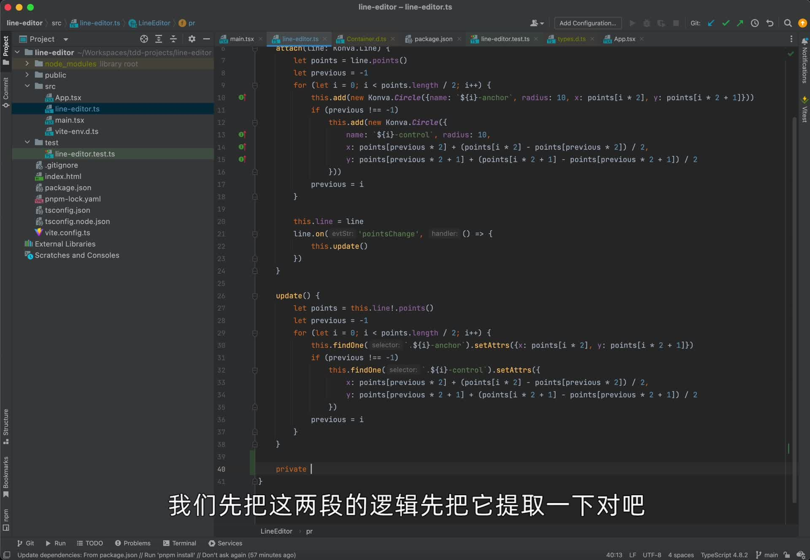

# 80 | LineEditor（2）：如何重构生成与更新锚点控制点的逻辑？

你好，我是徐昊。今天我们继续使用 TDD 的方式实现一个线段编辑器。

## 回顾任务与代码

目前代码为：

```sql
import Konva from "konva";
export class LineEditor extends Konva.Group {
   private line?: Konva.Line
   attach(line: Konva.Line) {
       let points = line.points()
       let previous = -1
       for (let i = 0; i < points.length / 2; i++) {
           this.add(new Konva.Circle({name: `${i}-anchor`, radius: 10, x: points
           if (previous !== -1)
               this.add(new Konva.Circle({
                   name: `${i}-control`, radius: 10,
                   x: points[previous * 2] + (points[i * 2] - points[previous *
                   y: points[previous * 2 + 1] + (points[i * 2 + 1] - points[pre
               }))
           previous = i
       }
       this.line = line
       line.on('pointsChange', () => {
           this.update()
       })
   }
   update() {
       let points = this.line!.points()
       let previous = -1
       for (let i = 0; i < points.length / 2; i++) {
           this.findOne(`.${i}-anchor`).setAttrs({x: points[i * 2], y: points[i
           if (previous !== -1)
               this.findOne(`.${i}-control`).setAttrs({
                   x: points[previous * 2] + (points[i * 2] - points[previous *
                   y: points[previous * 2 + 1] + (points[i * 2 + 1] - points[pre
               })
           previous = i
       }
   }
}
```

任务列表为：

- 在线段编辑（Line Editor）上设置锚点（Anchor）

- 将线（Line）数据，生成锚点

- 在 Line Editor 重绘时，按照数据更新锚点位置

- 在锚点与锚点之间设置控制点

- 通过线段数据，在两个锚点之间生成控制点（Control）

- 在 Line Editor 重绘时，按照数据更新控制点位置

- 拖动锚点时，改变线段中的位置

- 拖动控制点时，在线段上增加锚点

- 双击锚点时，删除锚点

## 视频演示

接下来让我们进入开发：



## 思考题

对于 UI 的样式要如何测试？

欢迎把你的项目代码地址分享在留言区，我们下节课再见！
