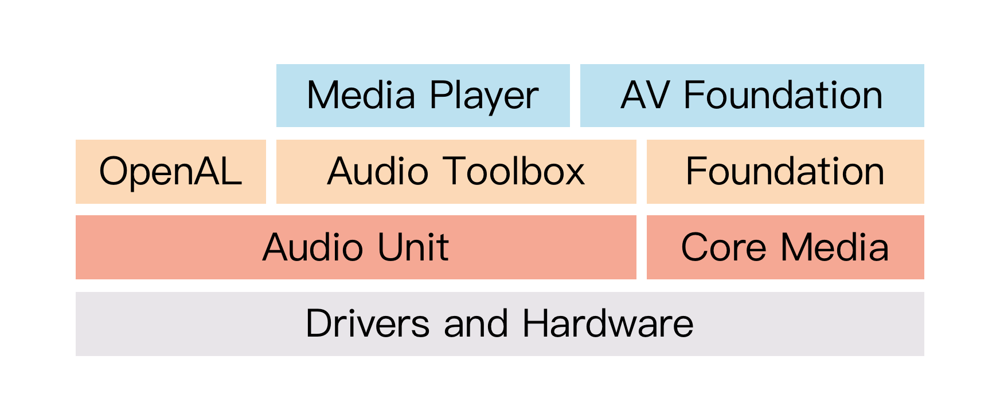
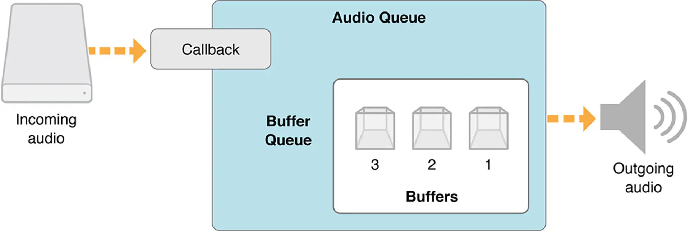
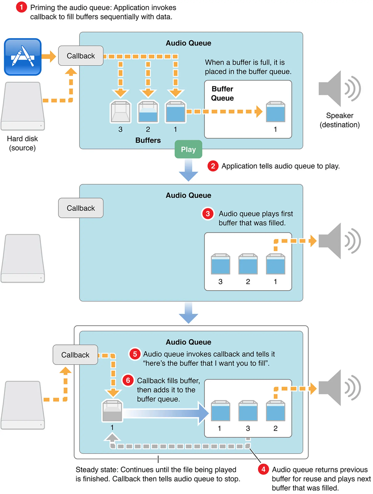
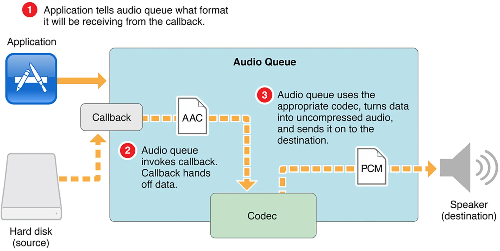
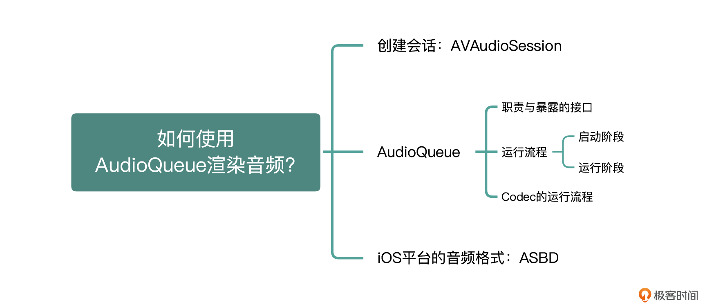

# 01 | iOS平台音频渲染（一）：使用AudioQueue渲染音频

- 登录

你好，我是展晓凯。

记得在开篇的时候我说过，我们最后的目标之一就是要实现一个视频播放器项目。而想要实现这个项目，需要我们先掌握音频渲染、视频渲染以及音视频同步等知识。所以今天我们就来迈出第一步——音频的渲染。

音频渲染相关的技术框架比较多，平台不同，需要用到的技术框架也不同。这节课我们就先来看一下 iOS 平台都有哪些音频框架可供我们选择，以及怎么在 iOS 平台做音频渲染。

我们先看一下图 1，iOS 平台的音频框架，里面比较高层次的音频框架有 Media Player、AVFoundation、OpenAL 和 Audio Toolbox（AudioQueue），这些框架都封装了 AudioUnit，然后提供了更高层次的、功能更精简、职责更加单一的 API 接口。这里你先简单地了解一下这些音频框架之间的关系，以及 AudioUnit 在整个音频体系中的作用，下节课我会给你详细地讲解

- 登录

AudioUnit 框架。



- 图1 iOS平台的音频框架（图片来自苹果官网）

如果我们想要低开销地实现录制或播放音频的功能，就需要用到 iOS 音频框架中一个非常重要的接口——AudioQueue，它是实现录制与播放功能最简单的 API 接口，作为开发者的我们无需知道太多内部细节，就可以简单地完成播放 PCM 数据的功能，可以说是非常方便了。

在实际学习 AudioQueue 框架之前，我会先把 AudioSession 给你讲清楚，因为AudioSession 是我们与系统对话的重要窗口，它能够向系统描述应用需要的音频能力，所以需要在学会使用 AudioSession 基础上，再去学习具体的框架。

## AVAudioSession

在 iOS 的音视频开发中，使用具体 API 之前都会先创建一个会话，而音频这里的会话就是AVAudioSession，它以单例的形式存在，用于管理与获取 iOS 设备音频的硬件信息。我们可以使用以下代码来获取 AudioSession 的实例：

```
AVAudioSession *audioSession = [AVAudioSession sharedInstance];
```

### 基本设置

获得 AudioSession 实例之后，就可以设置以何种方式使用音频硬件做哪些处理了，基本的设

- 登录

置如下所示：

1. 根据我们需要硬件设备提供的能力来设置类别：

```
[audioSession setCategory:AVAudioSessionCategoryPlayback error:&error];
```

2. 设置 I/O 的 Buffer，Buffer 越小说明延迟越低：

```
NSTimeInterval bufferDuration = 0.002;
[audioSession setPreferredIOBufferDuration:bufferDuration error:&error];
```

3. 设置采样频率，让硬件设备按照设置的采样率来采集或者播放音频：

```
double hwSampleRate = 44100.0;
[audioSession setPreferredSampleRate:hwSampleRate error:&error];
```

4. 当设置完毕所有参数之后就可以激活 AudioSession 了，代码如下：

```
[audioSession setActive:YES error:&error];
```

经过上述几个简单的调用，我们就完成了对 AVAudioSession 的设置。当我们使用具体 API 的时候，系统就会按照上述设置的参数进行播放或者回调给开发者进行处理。

### 深入理解 AudioSession

除了上述基本的设置之外，我们再从以下几个层面深入理解一下 AudioSession，在

- 登录

AVAudioSession 设置 Category 的时候是有很多细节的，分别是 Category 和CategoryOptions，在某些场景下，它可能会产生奇效。

1. Category 是向系统描述应用需要的能力，常用的分类如下：

- AVAudioSessionCategoryPlayback：用于播放录制音乐或者其它声音的类别，如要在应用程序转换到后台时继续播放（锁屏情况下），在 xcode 中设置 UIBackgroundModes 即可。默认情况下，使用此类别意味着，应用的音频不可混合，激活音频会话将中断其它不可混合的音频会话。如要使用混音，则使用 AVAudioSessionCategoryOptionMixWithOthers。

- AVAudioSessionCategoryPlayAndRecord : 同时需要录音（输入）和播放（输出）音频的类别，例如 K 歌、RTC 场景。注意：用户必须打开音频录制权限（iPhone 麦克风权限）。

2. CategoryOptions 是向系统设置类别的可选项，具体分类如下：

- AVAudioSessionCategoryOptionDefaultToSpeaker：此选项只能在使用 PlayAndRecord 类别时设置。它用于保证在没有使用其他配件（如耳机）的情况下，音频始终会路由至扬声器而不是听筒。而如果类别设置的是 Playback，系统会自动使用 Speaker 进行输出，无需进行此项设置。

- AVAudioSessionCategoryOptionAllowBluetooth：此选项代表音频录入和输出全部走蓝牙设备，仅可以为 PlayAndRecord 还有 Record 这两个类别设置这个选项，注意此时播放和录制的声音音质均为通话音质（16kHz），适用于 RTC 的通话场景，但不适用于 K 歌等需要高音质采集与播放的场景。

- AVAudioSessionCategoryOptionAllowBluetoothA2DP：此选项代表音频可以输出到高音质（立体声、仅支持音频输出不支持音频录入）的蓝牙设备中。如果使用 Playback 类别，系统将自动使用这个 A2DP 选项，如果使用 PlayAndRecord 类别，需要开发者自己手动设置这个选项，音频采集将使用机身内置麦克风（在需要高音质输出和输入的场景下可以设置成这种）。

3. 监听音频焦点抢占，一般在检测到音频被打断的时候处理一些自己业务上的操作，比如暂停播放音频等，代码如下：

- 登录

```
[[NSNotificationCenter defaultCenter] addObserver:self selector:@selector(audioSe
- (void)audioSessionInterruptionNoti:(NSNotification *)noti {
AVAudioSessionInterruptionType type = [noti.userInfo[AVAudioSessionInterruptionTy
if (type == AVAudioSessionInterruptionTypeBegan) {
//Do Something
}
}
```

4. 监听声音硬件路由变化，当检测到插拔耳机或者接入蓝牙设备的时候，业务需要做一些自己的操作，代码如下：

```
[[NSNotificationCenter defaultCenter] addObserver:self selector:@selector(audioRo
- (void)audioRouteChangeListenerCallback:(NSNotification*)notification {
NSDictionary *interuptionDict = notification.userInfo;
NSInteger routeChangeReason = [[interuptionDict valueForKey:AVAudioSessionRouteCh
if (routeChangeReason==AVAudioSessionRouteChangeReasonNewDeviceAvailable || route
//Do Something
} else if (
routeChangeReason == AVAudioSessionRouteChangeReasonCategoryChange ||
routeChangeReason == AVAudioSessionRouteChangeReasonOverride) {
//Do Something
}
}
```

5. 申请录音权限，首先判断授权状态，如果没有询问过，就询问用户授权，如果拒绝了就引导用户进入设置页面手动打开，代码如下：

```
AVAuthorizationStatus status = [AVCaptureDevice authorizationStatusForMediaType:A
   if (status == AVAuthorizationStatusNotDetermined) {
       [[AVAudioSession sharedInstance] requestRecordPermission:^(BOOL granted)
           //granted代表是否授权
       }];
   } else if (status == AVAuthorizationStatusRestricted || status == AVAuthoriza
       //引导用户跳入设置页面
   } else {
       // 已授权
```

- 登录

```
   }
```

注意：从 iOS 10 开始，所有访问任何设备麦克风的应用都必须静态声明其意图。为此，应用程序现在必须在其 Info.plist 文件中包含 NSMicrophoneUsageDescription 键，并为此密钥提供目的字符串。当系统提示用户允许访问时，这个字符串将显示为警报的一部分。如果应用程序尝试访问任何设备的麦克风而没有此键和值，则应用程序将终止。

现在，音频渲染第一步——会话创建就完成了，接下来就可以进入音频渲染框架的学习了，我们就先来看 AudioQueue 渲染音频的部分。

## AudioQueue 详解

iOS 为开发者在 AudioToolbox 这个 framework 中提供了一个名为 AudioQueueRef 的类，AudioQueue 内部会完成以下职责：

- 连接音频的硬件进行录音或者播放；

- 管理内存；

- 根据开发者配置的格式，调用编解码器进行音频格式转换。

接下来让我们一起看一下 AudioQueue 播放音频的结构图：



- 图2 AudioQueue播放音频结构图

AudioQueue 暴露给开发者的接口如下：

- 登录

- 使用正确的音频格式、回调方法等参数，创建出 AudioQueueRef 对象；

- 为 AudioQueueRef 分配 Buffer，并将 Buffer 入队，启动 AudioQueue；

- 在 AudioQueueRef 的回调中填充指定格式的音频数据，并且重新入队；

- 暂停、恢复等常规接口。

了解了 AudioQueue 的内部职责和暴露给开发者的接口之后，就让我们一起看一下AudioQueue 的运行流程吧！

### AudioQueue 运行流程

AudioQueue 的整体运行流程分为启动和运行阶段，启动阶段主要是应用程序配置和启动AudioQueue；运行阶段主要是 AudioQueue 开始播放之后回调给应用程序填充 buffer，并重新入队，3 个 buffer 周而复始地运行起来；直到应用程序调用 AudioQueue 的 Pause 或者Stop 等接口。下图是一个详细的运行流程：



- 登录

- 图3 AudioQueue运行流程

### 启动阶段

- 登录配置 AudioQueue：

```
AudioQueueNewInput(&dataformat, playCallback, (__bridge void *)self, NULL, NULL,
```

dataformat 就是音频格式，后面我们会重点讲解，playCallback 是当 AudioQueue 需要我们填充数据时的回调方法，函数返回值为 OSStatus 类型，如果为 noErr 则说明配置成功。

2. 分配 3 个 Buffer，并且依次灌到 AudioQueue 中：

```
for (int i = 0; i < kNumberBuffers; i++) {
 AudioQueueAllocateBuffer(queueRef, bufferBytesSize, &buffers[i]);
 AudioQueueEnqueueBuffer(queueRef, buffers[i], 0, NULL);
}
```

Buffer 类型为 AudioQueueBufferRef，是 AudioQueue 对外提供的数据封装，具体每个 Buffer的大小是如何决定的，我会在后面与 dataformat 一起讲解。

3. 调用 Play 方法进行播放：

```
AudioQueueStart(queueRef, NULL)
```

### 运行阶段

启动完毕后，接下来就到运行阶段了，运行阶段主要分为 4 步：

1. AudioQueue 启动之后会播放第一个 buffer；

2. 当播放完第一个 buffer 之后，会继续播放第二个 buffer，但是与此同时将第一个 buffer 回登录调给业务层由开发者进行填充，填充完毕重新入队；

3. 第二个 buffer 播放完毕后，会继续播放第三个 buffer，与此同时会将第二个 buffer 回调给业务层由开发者进行填充，填充完毕重新入队；

4. 第三个 buffer 播放完毕后，会继续循环播放队列中的第一个 buffer，也会将第三个 buffer回调给业务层由开发者进行填充，填充完毕重新入队。

```
static void playCallback(void *aqData, AudioQueueRef inAQ, AudioQueueBufferRef in
 KSAudioPlayer *player = (__bridge KSAudioPlayer *)aqData;
 //TODO: Fill Data
 AudioQueueEnqueueBuffer(player->queueRef, inBuffer, numPackets, player.mPacketD
}
```

这样一来，整个 AudioQueue 的运行流程就讲解完了，还记得我们在前面说过 AudioQueue内部会进行调用编解码器进行音频格式转换吗？接下来我们就详细介绍一下 AudioQueue 中的Codec 运行流程。

### AudioQueue 中 Codec 运行流程

值得一提的是，AudioQueue 的强大之处在于开发者可以不用关心播放的数据的编解码格式，它内部会帮助开发者将 Codec 的事情做好，所以这部分的流程我们是有必要单拎出来看一下的。



- 登录

- 图4 Codec运行流程

如图所示，主要分为 3 个步骤：

1. 开发者配置 AudioQueue 的时候告诉 AudioQueue 具体编码格式；

2. 开发者在回调函数中按照原始格式填充 buffer；

3. AudioQueue 会自己采用合适的 Codec 将压缩数据解码成 PCM 进行播放。

介绍完 Codec 相关的流程，你可能还有一个疑问，就是数据格式以及音频数据到底应该如何设置以及填充呢？这个其实就是之前我们说要重点讲解的音频格式（dataformat），接下来我们就一起来学习一下吧！

### iOS 平台的音频格式

iOS 平台的音频格式是 ASBD（AudioStreamBasicDescription），用来描述音频数据的表示方式，结构体如下：

```
struct AudioStreamBasicDescription
{
   AudioFormatID       mFormatID;
   Float64             mSampleRate;
   UInt32              mChannelsPerFrame;
   UInt32              mFramesPerPacket;
```

- 登录

```
   AudioFormatFlags    mFormatFlags;
   UInt32              mBytesPerPacket;
   UInt32              mBytesPerFrame;
   UInt32              mBitsPerChannel;
   UInt32              mReserved;
};
typedef struct AudioStreamBasicDescription  AudioStreamBasicDescription;
```

针对结构体中每个字段，我们需要配上一个实际的案例来逐个讲解一下，先看下面这个格式的配置：

```
UInt32 bytesPerSample = sizeof(Float32);
AudioStreamBasicDescription asbd;
bzero(&asbd, sizeof(asbd));
asbd.mFormatID = kAudioFormatLinearPCM;
asbd.mSampleRate = _sampleRate;
asbd.mChannelsPerFrame = channels;
asbd.mFramesPerPacket = 1;
asbd.mFormatFlags = kAudioFormatFlagsNativeFloatPacked | kAudioFormatFlagIsNonInt
asbd.mBitsPerChannel = 8 * bytesPerSample;
asbd.mBytesPerFrame = bytesPerSample;
asbd.mBytesPerPacket = bytesPerSample;
```

- mFormatID 这个参数是用来指定音频的编码格式，此处音频编码格式指定为 PCM 格式；

- 接下来设置声音的采样率、声道数以及每个 Packet 有几个 Frame 这三个参数；

- mFormatFlags 是用来描述声音表示格式的参数，代码中的第一个参数指定每个 sample 的表示格式是 Float 格式。这个类似于我们之前讲解的每个 sample 使用两个字节（SInt16）来表示；然后是后面的参数 NonInterleaved，表面理解这个单词的意思是非交错的，其实对音频来说，就是左右声道是非交错存放的，实际的音频数据会存储在一个AudioBufferList 结构中的变量 mBuffers 中。如果 mFormatFlags 指定的是NonInterleaved，那么左声道就会在 mBuffers[0]里面，右声道就会在 mBuffers[1]里面，而如果 mFormatFlags 指定的是 Interleaved 的话，那么左右声道就会交错排列在mBuffers[0]里面，理解这一点对后续的开发是十分重要的；

- 接下来的 mBitsPerChannel 表示的是一个声道的音频数据用多少位来表示，前面我们已经登录知道每个采样使用 Float 来表示，所以这里就使用 8 乘以每个采样的字节数来赋值；

- 最后是参数 mBytesPerFrame 和 mBytesPerPacket 的赋值，这里需要根据 mFormatFlags的值来分配。如果在 NonInterleaved 的情况下，就赋值为 bytesPerSample（因为左右声道是分开存放的）；但如果是 Interleaved 的话，那么就应该是 bytesPerSample * channels（因为左右声道是交错存放的），这样才能表示一个 Frame 里面到底有多少个 byte。

如果要播放的是一个 MP3 或者 M4A 的文件，这个 ASBD 应该如何确定呢？请看下面这个代码：

```
// 打开文件
NSURL *fileURL = [NSURL URLWithString:filePath];
OSStatus status = AudioFileOpenURL((__bridge CFURLRef)fileURL, kAudioFileReadPerm
if (status != noErr) {
 NSLog(@"open file error");
}
// 获取文件格式
UInt32 dataFromatSize = sizeof(dataFormat);
AudioFileGetProperty(_mAudioFile, kAudioFilePropertyDataFormat, &dataFromatSize,
```

第一步是用 AudioFile 打开文件，如果打开成功的话，直接获取出这个 AudioFile 的DataFormat 就好了，是不是很简单呢？对于填充数据也比较简单，直接从 AudioFile 中读取原始数据就可以了。

学到这里可能你会有疑问，绕了一大圈，用 AudioQueue 就直接播放了一个音频文件，那我直接使用 AVAudioPlayer 或者 AVPlayer 来播放这个音频文件不更简单吗？的确是的，但我更想通过这个例子来告诉你：这就是 iOS 给开发者提供的强大的多媒体处理能力，而AudioQueue 更适合开发者在一些更底层的数据处理的场景下使用。

## 小结

最后，我们可以一起来回顾一下。



- 登录

这节课我们对 iOS 的音频框架有了一个大致的了解。其中最重要的两个就是 AudioQueue 和AudioUnit。AudioQueue 使用起来非常方便，它是实现录制与播放功能最简单的 API 接口，就算你不知道内部的细节，也可以简单地完成播放 PCM 数据的功能。所以如果你的输入是PCM，比如视频播放器场景、RTC 等需要业务自己 Mix 或者处理 PCM 的场景，那么使用AudioQueue 是非常适合的一种方式。

AudioUnit 是 iOS 中最底层的音频框架，对音频能够实现更高程度的控制，所以也是我们的必学内容之一，下节课我会详细地讲一讲怎么使用 AudioUnit 实现音频的渲染，期待一下吧！

今天我通过代码带你创建并设置了 AVAudioSession，还带你详细了解了 AudioQueue 的运行流程以及 iOS 平台的音频格式 ASBD，希望你学完之后可以自己动手练一练，把今天学习的内容内化到自己的知识网络中。

## 思考题

学而不思则罔，最后我给你留一道思考题：你思考一下 AudioQueue 相比于 AVPlayer 或者AVAudioPlayer，它的灵活性或者说好处在哪儿呢？欢迎在评论区分享你的思考，也欢迎你把这节课分享给更多对音视频感兴趣的朋友，我们一起交流、共同进步。下节课再见！

- 登录
