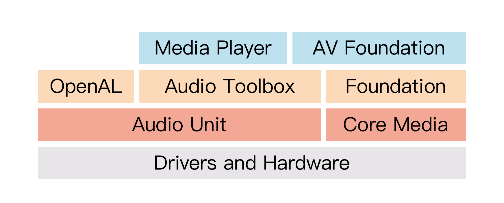
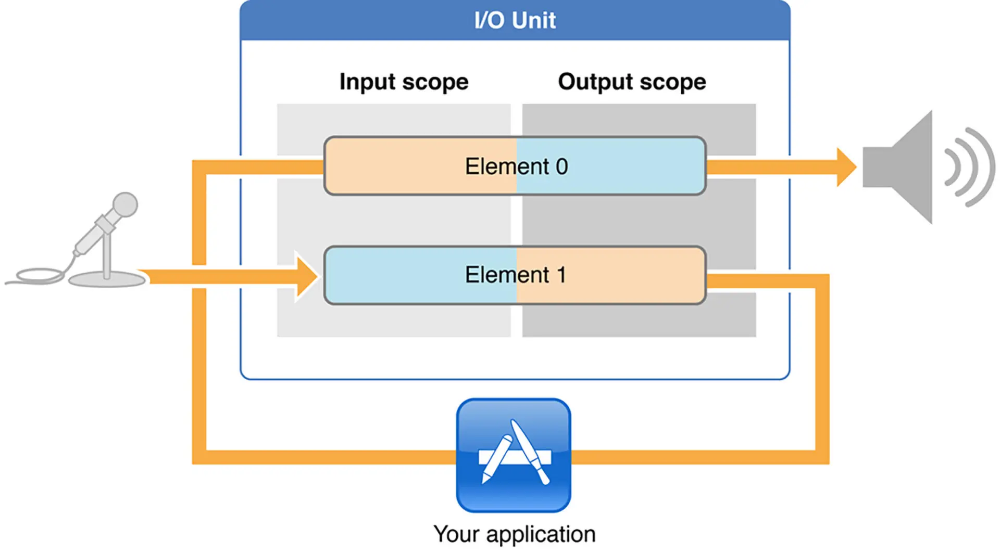
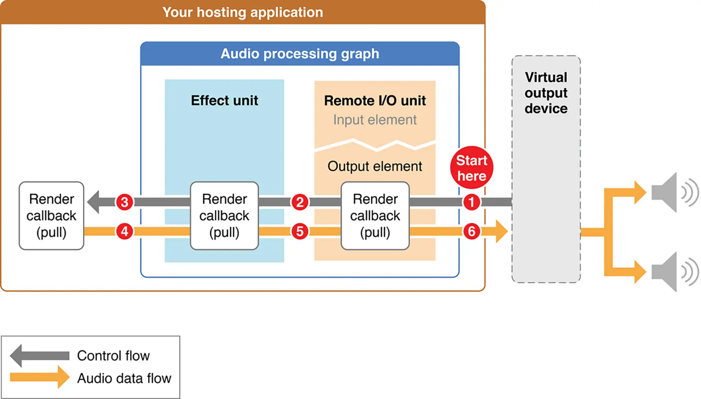

# 02 | iOS平台音频渲染（二）：使用AudioUnit渲染音频

你好，我是展晓凯。

上节课我们学习了 iOS 平台的音频框架的第一部分，深入了解了 AVAudioSession 以及AudioQueue 的使用方法，同时也学习了 iOS 音频格式的表示方法，就是 ASBD。其中重点学习了 AudioQueue 渲染音频的方法。AudioQueue 这个 API 其实是介于AVPlayer/AVAudioPlayer 与 Audio Unit 之间的一个音频渲染框架。如果我们想对音频有更高层次的控制，而 AudioQueue 满足不了我们的开发需求的时候，我们应该使用哪个音频框架呢？



- 图1 iOS平台的音频框架（图片来自苹果官网）

没错，就是 AudioUnit。作为 iOS 最底层的音频框架，AudioUnit 是音视频开发者必须要掌握的内容。我们在开发音频相关产品的时候，如果对音频有更高程度的控制、性能以及灵活性需求，或者想使用一些特殊功能（比如回声消除、实时耳返）的时候，就可以直接使用AudioUnit 这一层的 API，这些接口是面向 C 语言的。

随着 iOS 的 API 不断升级，AudioUnit 还逐渐演变出了 AUGraph 与 AVAudioEngine 框架，它们可以为你的 App 融入更强大的音频多媒体能力。

正如苹果官方文档中描述的，AudioUnit 提供了快速的音频模块化处理功能，如果是在以下场景中，更适合使用 AudioUnit，而不是高层次的音频框架。

- 在 VOIP 的应用场景下，想使用低延迟的音频 I/O；

- 合成多路声音并且回放，比如游戏或者音乐合成器（弹唱、多轨乐器）的应用；

- 使用 AudioUnit 里特有的功能，比如：均衡器、压缩器、混响器等效果器，以及回声消除、Mix 两轨音频等；

- 需要图状结构来处理音频时，可以使用 iOS 提供的 AUGraph 和 AVAudioEngine 的 API 接口，把音频处理模块组装到灵活的图状结构中。

既然 AudioUnit 这么强大，我们该怎么好好利用它呢？不要急，接下来我们就一起来看一下AudioUnit 的使用方法。

## AudioUnit

这部分我会从分类、创建、参数设置、构建处理框架四个方面来讲解，我们先看 AudioUnit 分为哪几类。

### AudioUnit 的分类

iOS 根据 AudioUnit 的功能不同，将 AudioUnit 分成了 5 大类，了解 AudioUnit 的分类对于音频渲染和处理是非常重要的。这里我们会从全局视角来认识一下每个大类型（Type）以及大类型下面的子类型（SubType），并且还会介绍每个大类型下面子类型 AudioUnit 的用途，以及对应参数的意义。

1. Effect Unit

第一个大类型是 kAudioUnitType_Effect，主要提供声音特效处理的功能。子类型及用途如下：

- 均衡效果器：子类型是 kAudioUnitSubType_NBandEQ，主要作用是给声音的某一些频带增强或者减弱能量，这个效果器需要指定多个频带，然后为每个频带设置宽度以及增益，最终将改变声音在频域上的能量分布。

- 压缩效果器：子类型是 kAudioUnitSubType_DynamicsProcessor，主要作用是当声音较小的时候可以提高声音的能量，当声音能量超过了设置的阈值，可以降低声音的能量，当然我们要设置合适的作用时间和释放时间以及触发值，最终可以将声音在时域上的能量压缩到一定范围之内。

- 混响效果器：子类型是 kAudioUnitSubType_Reverb2，是对人声处理非常重要的效果器，可以想象我们在一个空房子中，有非常多的反射声和原始声音叠加在一起，可能从听感上会更有震撼力，但是同时也会使原始声音更加模糊，遮盖掉原始声音的一些细节，所以混响设置得大或小对不同的人来讲非常不一致，可以根据自己的喜好来设置。

Effect Unit 下最常使用的就是这三种效果器，当然这个大类型下面还有很多种子类型的效果器，像高通（High Pass）、低通（Low Pass）、带通（Band Pass）、延迟（Delay）、压限（Limiter）等效果器，你可以自己使用一下，感受一下效果。

2. Mixer Units

第二个大类型是 kAudioUnitType_Mixer，主要提供 Mix 多路声音的功能。子类型及用途如下。

- 3D Mixer：这个效果器在移动设备上无法使用，只能在 OS X 上使用，所以这里不介绍了。

- MultiChannelMixer：子类型是 kAudioUnitSubType_MultiChannelMixer，这个效果器是我们重点介绍的对象，它是多路声音混音的效果器，可以接收多路音频的输入，还可以分别调整每一路音频的增益与开关，并将多路音频合并成一路，这个效果器在处理音频的图状结构中非常有用。

3. I/O Units

第三个大类型是 kAudioUnitType_Output，它的用途就像它分类的名字一样，主要提供的就是I/O 功能。子类型及用途如下：

- RemoteIO：子类型是 kAudioUnitSubType_RemoteIO，从名字上也可以看出，这是用来采集音频与播放音频的，当开发者在应用场景中要使用麦克风及扬声器的时候，都会用到这个AudioUnit。

- Generic Output：子类型是 kAudioUnitSubType_GenericOutput，当开发者需要离线处理，或者说在 AUGraph 中不使用 Speaker（扬声器）来驱动整个数据流，而是希望使用一个输出（可以放入内存队列或者进行磁盘 I/O 操作）来驱动数据流的话，就使用这个子类型。

4. Format Converter Units

第四个大类型是 kAudioUnitType_FormatConverter，提供格式转换的功能，比如：采样格式由 Float 到 SInt16 的转换、交错和平铺的格式转换、单双声道的转换等，子类型及用途说明如下。

- AUConverter：子类型是 kAudioUnitSubType_AUConverter，这是我们要重点介绍的格式转换效果器，某些效果器对输入的音频格式有明确要求，比如 3D Mixer Unit 就必须使用UInt16 格式的 sample，或者开发者将音频数据后续交给一些其他编码器处理，又或者开发

- 者想使用 SInt16 格式的 PCM 裸数据进行其他 CPU 上音频算法计算等场景下，就需要用到这个 ConverterNode。

比较典型的场景是我们自定义的一个音频播放器，由 FFmpeg 解码出来的 PCM 数据是SInt16 格式表示的，我们不可以直接让 RemoteIO Unit 播放，而是需要构建一个ConvertNode，将 SInt16 格式表示的数据转换为 Float32 表示的数据，然后再给到 RemoteIOUnit，最终才能正常播放出来。

- Time Pitch：子类型是 kAudioUnitSubType_NewTimePitch，即变速变调效果器，这是一个比较意思的效果器，可以对声音的音高、速度进行更改，像 Tom 猫这样的应用场景就可以使用这个效果器来实现。

5. Generator Units

第五个大类型是 kAudioUnitType_Generator，在开发中我们经常用它来提供播放器的功能。子类型及用途说明如下。

- AudioFilePlayer：子类型是 kAudioUnitSubType_AudioFilePlayer，在 AudioUnit 里面，如果我们的输入不是麦克风，而是一个媒体文件，要怎么办呢？当然也可以自己进行解码，通过转换之后给 RemoteIO Unit 播放出来。但其实还有一种更加简单、方便的方式，那就是使用 AudioFilePlayer 这个 AudioUnit，其实数据源还是会调用 AudioFile 里面的解码功能，将媒体文件中的压缩数据解压成为 PCM 裸数据，最终再交给 AudioFilePlayer Unit 进行后续处理。

这里需要注意，我们必须在 AUGraph 初始化了之后，再去配置 AudioFilePlayer 的数据源以及播放范围等属性，否则会出现错误。

### 创建 AudioUnit

构建 AudioUnit 时，需要指定类型（Type）、子类型（Subtype）以及厂商（Manufacture）。

类型就是刚刚我们讲到的几个大类型；而子类型是这个大类型下面的小类型，比如 Effect 这个大类型下面有 EQ、Compressor、limiter 等子类型；厂商一般情况下比较固定，直接写成kAudioUnitManufacturer_Apple 就好了。

利用以上这三个变量，开发者就可以完整描述出一个 AudioUnit 了，我们使用下面的代码创建一个 RemoteIO 类型的 AudioUnit 的描述。

```
AudioComponentDescription ioUnitDescription;
ioUnitDescription.componentType = kAudioUnitType_Output;
ioUnitDescription.componentSubType = kAudioUnitSubType_RemoteIO;
ioUnitDescription.componentManufacturer=kAudioUnitManufacturer_Apple;
ioUnitDescription.componentFlags = 0;
ioUnitDescription.componentFlagsMask = 0;
```

上述代码构造了 RemoteIO 这个 AudioUnit 描述的结构体，那如何再使用这个描述来构造真正的 AudioUnit 呢？有两种方式：第一种方式是直接使用 AudioUnit 裸的创建方式；第二种方式则是使用 AUGraph 和 AUNode（其实一个 AUNode 就是对 AudioUnit 的封装，可以理解为一个 AudioUnit 的 Wrapper）方式来构建。下面我来介绍一下这两种方式。

1. 裸创建方式

首先根据 AudioUnit 描述，找出实际的 AudioUnit 类型：

```
AudioComponent ioUnitRef = AudioComponentFindNext(NULL, &ioUnitDescription);
```

然后声明一个 AudioUnit 引用：

```
AudioUnit ioUnitInstance;
```

最后根据类型创建出这个 AudioUnit 实例：

```
AudioComponentInstanceNew(ioUnitRef, &ioUnitInstance);
```

2. AUGraph 创建方式

首先声明并且实例化一个 AUGraph：

```
AUGraph processingGraph;
NewAUGraph(&processingGraph);
```

然后利用 AudioUnit 的描述在 AUGraph 中按照描述增加一个 AUNode：

```
AUNode ioNode;
AUGraphAddNode(processingGraph, &ioUnitDescription, &ioNode);
```

接下来打开 AUGraph，其实打开 AUGraph 的过程也是间接实例化 AUGraph 中所有的AUNode 的过程。注意，必须在获取 AudioUnit 之前打开整个 Graph，否则我们不能从对应的 AUNode 里面获取到正确的 AudioUnit。

```
AUGraphOpen(processingGraph);
```

最后在 AUGraph 中的某个 Node 里面获得 AudioUnit 的引用：

```
AudioUnit ioUnit;
AUGraphNodeInfo(processingGraph, ioNode, NULL, &ioUnit);
```

无论使用上面的哪一种方式，都可以创建出我们想要的 AudioUnit，而具体应该使用哪一种方式，其实还是应该根据实际的应用场景来决定。结合我的实际工作经验，我认为使用AUGraph 的结构可以在我们的应用中搭建出扩展性更高的系统，所以我推荐你使用第二种方式，我们整个音频处理系统就是使用的第二种方式来搭建的。

### RemoteIO 详解

AudioUnit 创建好之后，就应该对其进行配置和使用了，因为我们后面的播放器项目会用到RemoteIO Unit，所以在这里我就以 RemoteIO 这个 AudioUnit 为例，详细讲解 AudioUnit 的使用。

RemoteIO 这个 AudioUnit 是与硬件 IO 相关的一个 Unit，它可以控制硬件设备的输入和输出（I 代表 Input，O 代表 Output）。输入端是麦克风（机身麦克风或者蓝牙耳机麦克风），输出端的话可能是扬声器（Speaker）或者耳机。如果要同时使用输入输出，即 K 歌应用中的耳返功能（用户在唱歌或者说话的同时，耳机中会将麦克风收录的声音播放出来，让用户自己能听到自己的声音），需要开发者将它们连接起来。



- 图2 RemoteIO

如图所示，RemoteIO Unit 分为 Element0 和 Element1，其中 Element0 控制输出端，Element1 控制输入端，同时每个 Element 又分为 Input Scope 和 Output Scope。如果开发者想要使用扬声器的播放声音功能，那么必须将这个 Unit 的 Element0 的 OutputScope 和Speaker 进行连接。而如果开发者想要使用麦克风的录音功能，那么必须将这个 Unit 的Element1 的 InputScope 和麦克风进行连接。使用扬声器的代码如下：

```
OSStatus status = noErr;
UInt32 oneFlag = 1;
UInt32 busZero = 0;//Element 0
status = AudioUnitSetProperty(remoteIOUnit,
       kAudioOutputUnitProperty_EnableIO,
       kAudioUnitScope_Output,
       busZero,
       &oneFlag,
       sizeof(oneFlag));
CheckStatus(status, @"Could not Connect To Speaker", YES);
```

上面这段代码就是把 RemoteIO Unit 中 Element0 的 OutputScope 连接到 Speaker 上，连接过程会返回一个 OSStatus 类型的值，可以使用自定义的 CheckError 函数来判断错误并且打印 Could not Connect To Speaker 提示。具体的 CheckError 函数如下：

```
static void CheckStatus(OSStatus status, NSString *message, BOOL fatal)
{
   if(status != noErr)
   {
       char fourCC[16];
       *(UInt32 *)fourCC = CFSwapInt32HostToBig(status);
       fourCC[4] = '\0';
       if(isprint(fourCC[0]) && isprint(fourCC[1]) && isprint(fourCC[2]) &&
isprint(fourCC[3]))
           NSLog(@"%@: %s", message, fourCC);
       else
           NSLog(@"%@: %d", message, (int)status);
       if(fatal)
           exit(-1);
   }
```

连接成功之后，就应该给 AudioUnit 设置数据格式（ASBD）了，ASBD 我们在前面已经详细讲过了，这里不再赘述。构造好合适的 ASBD 结构体，最终设置给 AudioUnit 对应的 Scope（Input/Output），代码如下：

```
AudioUnitSetProperty( remoteIOUnit,kAudioUnitProperty_StreamFormat,
kAudioUnitScope_Output, 1, &asbd, sizeof(asbd));
```

播放了解清楚了，那么接下来我们一起看下如何控制输入，我们通过一个实际的场景来学习这部分的内容。在 K 歌应用的场景中，会采集到用户的人声处理之后且立即给用户一个耳返（将声音在 50ms 之内输出到耳机中，让用户可以听到），那么如何让 RemoteIO Unit 利用麦克风采集出来的声音，经过中间效果器处理，最终输出到 Speaker 中播放给用户呢？

这里我来介绍一下，如何以 AUGraph 的方式将声音采集、处理以及声音输出的整个过程管理起来。



- 图3 采集、处理及输出声音的过程

如上图所示，首先要知道数据可以从通道中传递是由最右端 Speaker（RemoteIO Unit）来驱动的，它会向它的前一级 AUNode 去要数据（图中序号 1），然后它的前一级会继续向上一级节点要数据（图中序号 2），最终会从我们的 RemoteIO Unit 的 Element1（即麦克风）中取得数据，这样就可以将数据按照相反的方向一级一级地传递下去（图中序号 4、5），最终传递到RemoteIOUnit 的 Element0（即 Speaker，图中序号 6）就可以让用户听到了。

当然这时候你可能会想离线处理的时候是不能播放出来的，那么应该由谁来进行驱动呢？其实在离线处理的时候，应该使用 Mixer Unit 这个大类型下面的子类型为 Generic Output 的AudioUnit 来做驱动端。那么这些 AudioUnit 或者说 AUNode 是如何进行连接的呢？有两种方式，第一种方式是直接将 AUNode 连接起来；第二种方式是通过回调把两个 AUNode 连接起来。下面我们分别来介绍下这两种方式。

1. 直接连接的方式

```
AUGraphConnectNodeInput(mPlayerGraph, mPlayerNode, 0, mPlayerIONode, 0);
```

这段代码是把 Audio File Player Unit 和 RemoteIO Unit 连接起来了，当 RemoteIO Unit 需要播放的数据的时候，就会调用 AudioFilePlayer Unit 来获取数据，最终数据会传递到RemoteIO 中播放出来。

2. 回调的方式

```
AURenderCallbackStruct renderProc;
renderProc.inputProc = &inputAvailableCallback;
renderProc.inputProcRefCon = (__bridge void *)self;
AUGraphSetNodeInputCallback(mGraph, ioNode, 0, &finalRenderProc);
```

这段代码首先构造了一个 AURenderCallback 的结构体，结构体中需要指定一个回调函数，然后设置给 RemoteIO Unit，当这个 RemoteIO Unit 需要数据输入的时候就会回调这个回调函数，而回调函数的实现如下：

```javascript
static OSStatus renderCallback(void *inRefCon, AudioUnitRenderActionFlags
       *ioActionFlags, const AudioTimeStamp *inTimeStamp, UInt32
       inBusNumber, UInt32 inNumberFrames, AudioBufferList *ioData)
{
   OSStatus result = noErr;
   __unsafe_unretained AUGraphRecorder *THIS = (__bridge
           AUGraphRecorder *)inRefCon;
   AudioUnitRender(THIS->mixerUnit, ioActionFlags, inTimeStamp, 0,
           inNumberFrames, ioData);
   return result;
}
```

这个回调函数中主要做两件事情，第一件事情是去 Mixer Unit 里面要数据，通过调用AudioUnitRender 的方式来驱动 Mixer Unit 获取数据，得到数据之后放入 ioData 中，这也就填充了回调方法中的数据，从而实现了 Mixer Unit 和 RemoteIO Unit 的连接。

如果要播放一个音频文件，就自己构造一套 AUGraph 是十分不方便的，但我们这样做实际有两个目的：其一是为了让你体验在开发 iOS 平台的程序时，优先使用 iOS 平台自身提供的API 的便捷性与重要性；其二是为了给后续的视频播放器项目打下基础。你可以好好学习一下这两个实例，充分感受 iOS 平台为开发者提供的强大的多媒体开发 API。

## 小结

最后，我们可以一起来回顾一下。

这节课我们重点学习了使用 AudioUnit 来渲染音频的方法。其实在 iOS 开发中除了这些底层的音频框架，还有一些常用的上层框架，了解这些框架的特点与适用场景能够帮助我们做技术选型，接下来我们一起简单看下 iOS 为开发者提供的各个层次的音频播放框架，以便以后在你的应用中做技术选型：

- AVAudioPlayer：如果你要直接播放一个本地音频文件（无论是本地路径还是内存中的数据），使用 AVAudioPlayer 会是最佳选择；

- AVPlayer：如果是普通网络协议（HTTP、HLS）音频文件要直接播放，使用 AVPlayer 会是最佳选择；

- AudioQueue：但是如果你的输入是 PCM（比如视频播放器场景、RTC 等需要业务自己Mix 或者处理 PCM 的场景），其实使用 AudioQueue 是适合的一种方式；

- AudioUnit：如果需要构造一个复杂的低延迟采集、播放、处理的音频系统，那么使用AudioUnit（实际实现可能是使用 AUGraph 或者 AVAudioEngine 框架）会是最佳选择。

真正好的架构师应该像裁缝一样懂得量体裁衣，要了解清楚当前应用场景的现状和未来，然后根据自己的经验做出合理的技术选型，让开发的 App 可以快速、高质量地上线并且还有一定的扩展性，所以接下来的挑战就看你的了。

## 思考题

如果你想要实现一个 K 歌录制的功能，场景描述如下：

1. 播放伴奏的同时，可以将人声进行录音；

2. 可以实时听到用户自己的人声耳返，并且要在耳返中加入混响效果器；

3. 可以调节伴奏与人声的音量；

请你思考一下，使用 AUGraph 如何构造出你的图状结构。欢迎在评论区分享你的思考，也欢迎把这节课分享给更多对音视频感兴趣的朋友，我们共同交流、共同进步。我们下节课再见！
