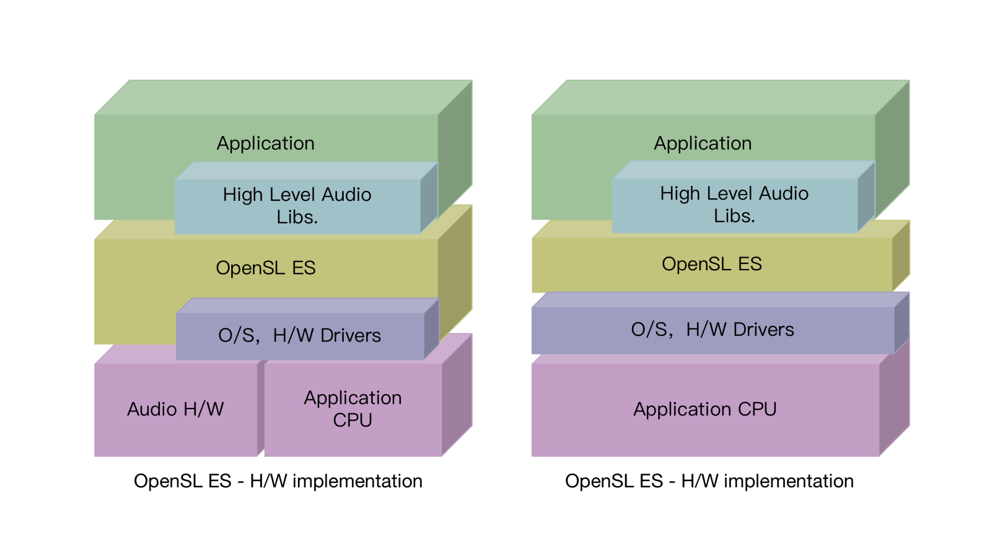
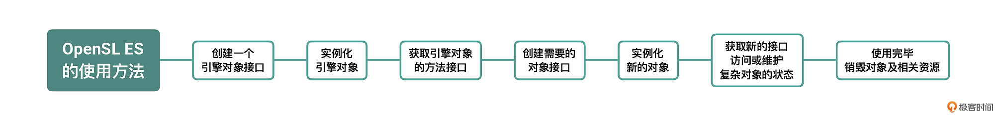
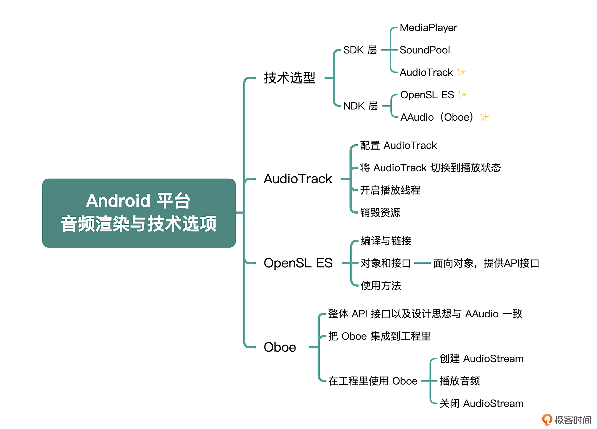

# 03 | Android平台音频渲染与技术选型

你好，我是展晓凯。

前两节课我们一起学习了 iOS 平台的音频渲染技术，深入地了解了 AudioQueue 和 AudioUnit两个底层的音频框架，了解这些音频框架便于我们做技术选型，可以给我们的应用融入更强大的功能。那除了 iOS 平台外，Android 平台的音视频开发也有着相当大的需求，所以这节课我们一起来学习 Android 平台的音频渲染技术。

由于 Android 平台的厂商与定制 Rom 众多，碎片化特别严重，所以系统地学习音频渲染是非常重要的。这节课我会先从音频渲染的技术选型入手，向你介绍 Android 系统上渲染音频方法的所有可能性，然后依次讲解常用技术选型的内部原理与使用方法。

## 技术选型及其优缺点

Android 系统为开发者在 SDK 以及 NDK 层提供了多种音频渲染的方法，每一种渲染方法其实也是为不同的场景而设计的，我们必须要了解每一种方法的最佳实践是什么，这样在开发工作中才能如鱼得水地使用它们。

### SDK 层的音频渲染

Android 系统在 SDK 层（Java 层提供的 API）为开发者提供了 3 套常用的音频渲染方法，分别是：MediaPlayer、SoundPool 和 AudioTrack。这三个 API 的推荐使用场景是不同的。

- MediaPlayer 适合在后台长时间播放本地音乐文件或者在线的流式媒体文件，相当于是一个端到端的播放器，可以播放音频也可以播放视频，它的封装层次比较高，使用方式也比较简单。

- SoundPool 也是一个端到端的音频播放器，优点是：延时较低，比较适合有交互反馈音的场景，适合播放比较短的音频片段，比如游戏声音、按键声、铃声片段等，它可以同时播放多个音频。

- AudioTrack 是直接面向 PCM 数据的音频渲染 API，所以也是一个更加底层的 API，提供了非常强大的控制能力，适合低延迟的播放、流媒体的音频渲染等场景，由于是直接面向PCM 的数据进行渲染，所以一般情况下需要结合解码器来使用。

### NDK 层的音频渲染

Android 系统在 NDK 层（Native 层提供的 API，即 C 或者 C++ 层可以调用的 API）提供了 2套常用的音频渲染方法，分别是 OpenSL ES 和 AAudio，它们都是为 Android 的低延时场景（实时耳返、RTC、实时反馈交互）而设计的，下面我们一起来看一下。

- OpenSL ES：是 Khronos Group 开发的 OpenSL ES™ API 规范的实现，专用于 Android低延迟高性能的音频场景，API 接口设计会有一些晦涩、复杂，目前 Google 已经不推荐开发者把 OpenSL ES 用于新应用的开发了。但是在 Android8.0 系统以下以及一些碎片化的Android 设备上它具有更好的兼容性，所以掌握这种音频渲染方法也是十分重要的。

- AAudio：专门为低延迟、高性能音频应用而设计的，API 设计精简，是 Google 推荐的新应用构建音频的应用接口。掌握这种音频渲染方法，为现有应用中增加这种音频的渲染能力是

- 十分有益的。但是它仅适合 Android 8.0 及以上版本，并且在一些品牌的特殊 Rom 版本中适配性不是特别好。

NDK 层的这两套音频渲染方法适用于不同的 Android 版本，可以应用在不同的场景中，因此了解这两种音频渲染的方法对我们的开发工作来说是非常必要的，一会儿我们会再就这两种方法深入展开讨论。

通过上述讲解，想必你已经了解了 Android 平台上所有的音频渲染的方法，而这里面最通用的渲染 PCM 的方法就是 AudioTrack，那么接下来我们首先从 AudioTrack 开始讲起。

## AudioTrack

由于 AudioTrack 是 Android SDK 层提供的最底层的音频播放 API，因此只允许输入 PCM 裸数据。与 MediaPlayer 相比，对于一个压缩的音频文件（比如 MP3、AAC 等文件），它需要开发者自己来实现解码操作和缓冲区控制。由于这节课我们重点关注的是音频渲染的知识，所以这个部分我们只介绍如何使用 AudioTrack 来渲染音频 PCM 数据，对于缓冲区的控制机制会在播放器实战部分详细讲一下。

首先让我们一起来看一下 AudioTrack 的工作流程：

1. 根据音频参数信息，配置出一个 AudioTrack 的实例。

2. 调用 play 方法，将 AudioTrack 切换到播放状态。

3. 启动播放线程，循环向 AudioTrack 的缓冲区中写入音频数据。

4. 当数据写完或者停止播放的时候，停止播放线程，并且释放所有资源。

根据上述 AudioTrack 的工作流程，我会给你详细地讲解流程中的每个步骤。

### 第一步：配置 AudioTrack

我们先来看一下 AudioTrack 的参数配置，要想构造出一个 AudioTrack 类型的实例，得先了解一下它的构造函数原型，如下所示：

```
public AudioTrack(int streamType, int sampleRateInHz, int channelConfig,
       int audioFormat, int bufferSizeInBytes, int mode);
```

其中构造函数中的参数说明如下：

- streamType，在 Android 手机上有多重音频管理策略，比如你按一下手机侧边的按键或者在系统设置中，可以看到有多个类型的音量管理，这其实就是不同音频策略的音量控制展示。当系统有多个进程需要播放音频的时候，管理策略会决定最终的呈现效果，该参数的可选值以常量的形式定义在类 AudioManager 中，主要包括：

```
STREAM_VOCIE_CALL：电话声音
STREAM_SYSTEM：系统声音
STREAM_RING：铃声
STREAM_MUSCI：音乐声
STREAM_ALARM：警告声
STREAM_NOTIFICATION：通知声
```

- sampleRateInHz，采样率，即播放的音频每秒钟会有多少次采样，可选用的采样频率列表为：8000、16000、22050、24000、32000、44100、48000 等。采样率越高声音的还原度就越高，普通的语音通话可能 16k 的采样频率就够了，但是如果高保真的场景，比如：K歌、音乐、短视频、ASMR 等，就需要 44.1k 以上的采样频率，你可以根据自己的应用场景进行合理的选择。

- channelConfig，声道数（通道数）的配置，可选值以常量的形式配置在类 AudioFormat中，常用的是 CHANNEL_IN_MONO（单声道）、CHANNEL_IN_STEREO（双声道）。因为现在大多数手机的麦克风都是伪立体声采集，考虑到性能，我建议你使用单声道进行采集，然后在声音处理阶段（比如混响、HRTF 等效果器）转变为立体声的效果。

- audioFormat，这个参数是用来配置“数据位宽”的，即采样格式，可选值以常量的形式定义在类 AudioFormat 中，分别为 ENCODING_PCM_16BIT（16bit）、ENCODING_PCM_8BIT（8bit）。注意，前者是可以保证兼容所有 Android 手机的，所以我建议你尽量选择前者。

- bufferSizeInBytes，它配置的是 AudioTrack 内部的音频缓冲区的大小，AudioTrack 类提供了一个帮助开发者确定这个 bufferSizeInBytes 的函数，原型如下：

```
int getMinBufferSize(int sampleRateInHz, int channelConfig, int audioFormat);
```

在实际开发中，我建议你使用该函数计算出需要传入的 bufferSizeInBytes，而不是自己手动计算。

- mode，AudioTrack 提供了两种播放模式，可选值以常量的形式定义在类 AudioTrack 中，一个是 MODE_STATIC，需要一次性将所有的数据都写入播放缓冲区，简单高效，通常用于播放铃声、系统提醒的音频片段；另一个是 MODE_STREAM，需要按照一定的时间间隔不间断地写入音频数据，理论上它可用于任何音频播放的场景。在实际开发中，我建议你采用 MODE_STREAM 这种播放模式。

讲到这里，我相信你可以根据自己的场景构造出一个 AudioTrack 实例来了，我们根据上面的工作流程继续进行下一步，接下来就是将 AudioTrack 切换到播放状态。

### 第二步：将 AudioTrack 切换到播放状态

其实切换到播放状态是非常简单的，需要先判断 AudioTrack 实例是否初始化成功，如果当前状态是初始化成功的话，那么就调用它的 play 方法，切换到播放状态，代码如下：

```
if (null != audioTrack && audioTrack.getState() != AudioTrack.STATE_UNINITIALIZED
{
   audioTrack.play();
}
```

但是在切换为播放状态之后，需要开发者自己启动一个线程，用于向 AudioTrack 里面送入PCM 数据，接下来我们一起来看如何开启播放线程。

### 第三步：开启播放线程

首先创建出一个播放线程，代码如下：

```
playerThread = new Thread(new PlayerThread(), "playerThread");
playerThread.start();
```

接着我们来看这个线程中执行的任务，代码如下：

```java
class PlayerThread implements Runnable {
   private short[] samples;
   public void run() {
       samples = new short[minBufferSize];
       while(!isStop) {
           int actualSize = decoder.readSamples(samples);
           audioTrack.write(samples, actualSize);
       }
   }
}
```

线程中的 minBufferSize 的计算方式如下：

1. 在初始化 AudioTrack 的时候获得的缓冲区大小为 bufferSizeInBytes；

2. 换算为 2 个字节表示一个采样的大小，也就是除以 2 得到这个 minBufferSize。

然后代码中的 decoder 是一个解码器实例，构建这个解码器实例比较简单，在这里我就不详细介绍了。现在我们假设已经构建成功，然后从解码器中拿到 PCM 采样数据，最后调用 write方法写入 AudioTrack 的缓冲区中。循环往复地不断送入 PCM 数据，音频就能够持续地播放了。

这里有一点是需要额外注意的，就是这个 write 方法是阻塞的，比如：一般写入 200ms 的音频数据需要执行接近 200ms 的时间，所以这要求在这个线程中不应该做更多额外耗时的操作，比如 IO、等锁。

### 第四步：销毁资源

当要停止播放（自动完成或者用户手动停止）的时候，就需要停止播放同时销毁资源，那么就需要首先停掉 AudioTrack，代码如下：

```
if (null != audioTrack && audioTrack.getState() != AudioTrack.STATE_UNINITIALIZED
{
   audioTrack.stop();
}
```

然后要停掉我们自己的播放线程：

```
isStop = true;
if (null != playerThread) {
   playerThread.join();
   playerThread = null;
}
```

只有当线程停掉之后，才不会再有 AudioTrack 的使用，最后一步就是释放 AudioTrack：

```
audioTrack.release();
```

看完了 SDK 层的音频渲染方法，接下来我们继续看 NDK 层音频渲染的两种方法，先来介绍OpenSL ES 吧！

## OpenSL ES

OpenSL ES 全称是 Open Sound Library for Embedded Systems，即嵌入式音频加速标准。OpenSL ES 是无授权费、跨平台、针对嵌入式系统精心优化的硬件音频加速的框架。它为嵌入式移动多媒体设备上的本地应用程序开发者提供了标准化、高性能、低响应时间的音频功能实现方法，并实现了软 / 硬件音频性能的直接跨平台部署，降低了执行难度，促进了高级音频市场的发展。



- 图1 OpenSL ES架构

图 1 描述了 OpenSL ES 的架构，在 Android 中，High Level Audio Libs 是音频 Java 层 API输入输出，属于高级 API。相对来说，OpenSL ES 则是比较低级别的 API，属于 C 语言API。在开发中，一般使用高级 API 就能完成，除非遇到性能瓶颈，比如低延迟耳返、低延迟声音交互反馈、语音实时聊天等场景，开发者可以直接通过 C/C++ 开发。

### 编译与链接

我们这个专栏里使用的是 OpenSL ES 1.0.1 版本，因为这个版本是目前比较成熟并且通用的，Android 系统 2.3 版本以上才支持这个版本，并且有一些高级功能，比如解码 AAC，是在Andorid 系统版本 4.0 以上才支持的。

在使用 OpenSL ES 的 API 之前，我们需要引入 OpenSL ES 的头文件，如下：

```
#include <SLES/OpenSLES.h>
#include <SLES/OpenSLES_Android.h>
```

由于是在 Native 层使用这个特性，所以要在编译脚本中引入对应的 so 库：

1. Android.mk 这个 Makefile 文件中增加链接选项，以便在链接阶段使用系统提供的 OpenSLES 的 so 库：

```
LOCAL_LDLIBS += -lOpenSLES
```

2. Cmake 的情况下，需要在 CMakeLists.txt 中增加链接选项，以便在链接阶段使用系统提供的 OpenSL ES 的 so 库：

```bash
target_link_libraries(audioengine
       OpenSLES
       )
```

### OpenSL ES 的对象和接口

我们前面也提到了 OpenSL ES 提供的是基于 C 语言的 API，设计者为了让开发更简单，所以以面向对象的方式为开发者提供接口，那基于 C 语言的 API 是如何设计面向对象的接口的呢？

OpenSL ES 提供的是基于对象和接口的方式，采用面向对象的方法提供 API 接口，所以，我们先来看一下 OpenSL ES 里面对象和接口的概念。

- 对象：对象是对一组资源及其状态的抽象，每个对象都有一个在其创建时指定的类型，类型决定了对象可以执行的任务集，它类似于 C++ 中类的概念。

- 接口：接口是对象提供的一组特征的抽象，这些抽象会暴露给开发者一组方法和每个接口的类型功能，在代码中，接口的类型由接口 ID 标识。

我们需要理解的重点是，一个对象在代码中其实是没有实际的表示形式的，可通过接口来改变对象的状态以及使用对象提供的功能。对象可以有一个或者多个接口的实例，但是对于接口实例，肯定只属于一个对象。理解了 OpenSL ES 中对象和接口的概念，我们继续来看代码实例中是如何使用它们的吧！

### OpenSL ES 的使用方法

刚刚我们提到，对象是没有实际的代码表示形式的，对象的创建也是通过接口来完成的。通过相应的方法来获取对象，进而可以访问对象的其他接口方法或者改变对象的状态，具体的执行步骤如下：



- 图2 OpenSL ES的执行步骤

1. 创建一个引擎对象接口。引擎对象是 OpenSL ES 提供 API 的唯一入口，开发者需要调用全局函数 slCreateEngine 来获取 SLObjectItf 类型的引擎对象接口。

```
SLObjectItf engineObject;
SLEngineOption engineOptions[] = { { (SLuint32) SL_ENGINEOPTION_THREADSAFE,  (SLu
slCreateEngine(&engineObject, ARRAY_LEN(engineOptions), engineOptions, 0, 0, 0);
```

2. 实例化引擎对象，需要通过在上一步得到的引擎对象接口来实例化引擎对象，否则无法使用这个对象，其实在 OpenSL ES 的使用中，任何对象都需要使用接口来进行实例化，所以我们也封装出一个实例化对象的方法，代码如下：

```
RealizeObject(engineObject);
SLresult RealizeObject(SLObjectItf object) {
   return (*object)->Realize(object, SL_BOOLEAN_FALSE);
};
```

3. 获取这个引擎对象的方法接口，通过 GetInterface 方法，使用上一步已经实例化好的对象，获取对应的 SLEngineItf 类型的对象接口，这个接口将会是开发者使用所有其他 API 的入口。

```
SLEngineItf engineEngine;
(*engineObject)->GetInterface(engineObject, SL_IID_ENGINE, &engineEngine);
```

4. 创建需要的对象接口，通过调用 SLEngineItf 类型的对象接口的 CreateXXX 方法，来返回新的对象的接口，比如调用 CreateOutputMix 这个方法来获取出一个 outputMixObject 接口，或者调用 CreateAudioPlayer 这个方法来获取出一个 audioPlayerObject 接口，这里我们仅列出创建 outputMixObject 的接口代码，播放器接口的获取可以参考代码仓库中的代码：

```
SLObjectItf outputMixObject;
(*engineEngine)->CreateOutputMix(engineEngine, &outputMixObject, 0, 0, 0);
```

5. 实例化新的对象，任何对象接口获取出来之后，都必须要实例化，其实是和第二步（实例化引擎对象）一样的操作。

```
realizeObject(outputMixObject);
realizeObject(audioPlayerObject);
```

6. 对于某一些比较复杂的对象，需要获取新的接口来访问对象的状态或者维护对象的状态，比如在播放器 audioPlayer 或录音器 audioRecorder 中注册一些回调方法等，代码如下：

```
SLPlayItf audioPlayerPlay;
(*audioPlayerObject)->GetInterface(audioPlayerObject, SL_IID_PLAY,
&audioPlayerPlay);
//设置播放状态
(*audioPlayerPlay)->SetPlayState(audioPlayerPlay, SL_PLAYSTATE_PLAYING);
//设置暂停状态
(*audioPlayerPlay)->SetPlayState(audioPlayerPlay, SL_PLAYSTATE_PAUSED);
```

7. 待使用完毕这个对象之后，要记得调用 Destroy 方法来销毁对象以及相关的资源。

```
destroyObject(audioPlayerObject);
destroyObject(outputMixObject);
void AudioOutput::destroyObject(SLObjectItf& object) {
   if (0 != object)
       (*object)->Destroy(object);
   object = 0;
}
```

相较于其他音频接口（AudioTrack、AAudio），OpenSL ES 的使用确实比较麻烦，但是如果你的面向对象思维比较好的话，按照它的套路写起来也会比较快。在后面课程中我们播放器实战的音频渲染部分也会使用 OpenSL ES 来构造，到时候你可以参考代码实例进行更深入的理解。

## Oboe

学到这里，你是否会有一个疑问呢？就是如果要在 NDK 层构建一套适配性好同时面向未来的音频渲染框架，势必要将上面介绍的两种方法结合起来，同时也要有一定的策略来选择使用哪一种实现，而从零搭建一套这样的框架会比较复杂，那有没有一些开源的实现来完成这件事情呢？

有，那就是 Oboe。

### Oboe 介绍

由于 AAudio 仅适用于 Android 8.0 系统以上，而 OpenSL ES 在某些设备上又没有 Google 给开发者提供的低延迟、高性能的能力，所以 Google 推出了自己的 Oboe 框架。Oboe 使用和AAudio 近乎一致的 API 接口为开发者封装了底层的实现，自动地根据当前 Android 系统来选择 OpenSL ES 还是 AAudio，当然也给开发者提供了接口，开发者可以自由地选择底层的实现。由于 Oboe 的整体 API 接口以及设计思想与 AAudio 一致，所以我们这节课直接以 Oboe为例来给你详细地讲解一下。

### 集成 Oboe 到工程里

1. 在 gradle 文件中增添对 Oboe 的依赖：

```
dependencies {
   implementation 'com.google.oboe:oboe:1.6.1'
}
```

2. 在 CMake 中增加头文件引用与库的链接：

```bash
# Find the Oboe package
find_package (oboe REQUIRED CONFIG)
# Specify the libraries which our native library is dependent on, including Oboe
target_link_libraries(native-lib log oboe::oboe)
```

3. 业务代码中引入必要的头文件：

```
#include <oboe/Oboe.h>
```

至此 Oboe 就已经集成到工程里了，那我们如何在工程中使用它呢？

### 在工程里使用 Oboe

1. 创建 AudioStream

- 首先，我们通过 AudioStreamBuilder 来创建 Stream，AudioStreamBuilder 是按照 Builder设计模式设计的类，可以接连地设置多个参数。在下面的代码块中，我对参数进行了解释：

```
oboe::AudioStreamBuilder builder;
builder.setPerformanceMode(oboe::PerformanceMode::LowLatency)
 ->setDirection(oboe::Direction::Output)//播放的设置
 ->setSharingMode(oboe::SharingMode::Exclusive)//独占设备，对应的是Shared
 ->setChannelCount(oboe::ChannelCount::Mono)//单声道
 ->setFormat(oboe::AudioFormat::Float);//格式采用Float，范围为[-1.0，1.0]，还有一种是
```

- 然后设置 Callback，定义一个 AudioStreamDataCallback 的子类，重写 onAudioReady 方法来实现自己填充数据的逻辑，但这个方法不可以太耗时，否则会出现卡顿，最后基于这个类构建对象设置给 Builder。

```python
class MyCallback : public oboe::AudioStreamDataCallback {
public:
   oboe::DataCallbackResult
   onAudioReady(oboe::AudioStream *audioStream, void *audioData, int32_t numFram
       auto *outputData = static_cast<float *>(audioData);
       const float amplitude = 0.2f;
       for (int i = 0; i < numFrames; ++i){
           outputData[i] = ((float)drand48() - 0.5f) * 2 * amplitude;
       }
       return oboe::DataCallbackResult::Continue;
   }
};
MyCallback myCallback;
builder.setDataCallback(&myCallback);
```

- 最终调用 openStream 来打开 Stream，根据返回值来判断是否创建成功，如果创建失败了，可以使用 convertToText 来查看错误码。

```
oboe::Result result = builder.openStream(mStream);
if (result != oboe::Result::OK) {
 LOGE("Failed to create stream. Error: %s", convertToText(result));
}
```

2. 播放音频

调用了 requestStart 方法之后，就要在回调函数中填充数据。

```
mStream->requestStart();
```

3. 关闭 AudioStream

```
mStream->close();
```

至此 Oboe 渲染音频的方法我们就学完了，其实 Oboe（AAudio）的接口设计是非常优雅的，开发者在使用的时候也都很得心应手，希望通过这节课的学习你可以在你的应用中加入 Oboe的能力，给你的应用赋予 Google 最新的低延迟、高性能的能力。

## 小结

最后，我们可以一起来回顾一下。



这节课我们重点学习了使用 Java 层的 AudioTrack 和 Native 层的 OpenSL ES 以及 Oboe 来渲染音频的方法。AudioTrack 是最通用的渲染 PCM 的方法，今天我们详细地介绍了它的工作流程；然后我们又聚焦了 Native 层的 OpenSL ES，它在高级音频市场占有非常重要的地位，今天通过代码实例，我们展示了 OpenSL ES 对象和接口的使用方法，希望你能通过今天的实战，掌握它的使用方法；最后我们学习了 Oboe 渲染音频的方法，Oboe 可以根据当前Android 系统选择合适的框架，在整个音频渲染体系中也是十分重要的存在。

其实在 Android 开发中除了这些底层的音频框架，还有其他的一些常用的上层框架，比如MediaPlayer、SoudPool，我们也做了简单的介绍。在系统地学习这些渲染音频的方法之后，相信你能够根据具体的开发场景，调用合适的音频框架去处理问题了。

## 思考题

如果你想要实现一个音频播放器功能，场景描述如下：

1. 自己构建解码器来解码本地的 MP3 或者 M4A 文件；

2. 使用 AudioTrack 或者 Oboe 来渲染音频；

3. 可以随时暂停、停止这个播放器的播放。

请你设计出这个案例的整体架构图，同时标记清楚你设计的各个类的职责。欢迎在评论区分享你的思考，也欢迎把这节课分享给更多对音视频感兴趣的朋友，我们一起交流、共同进步。下节课再见！
