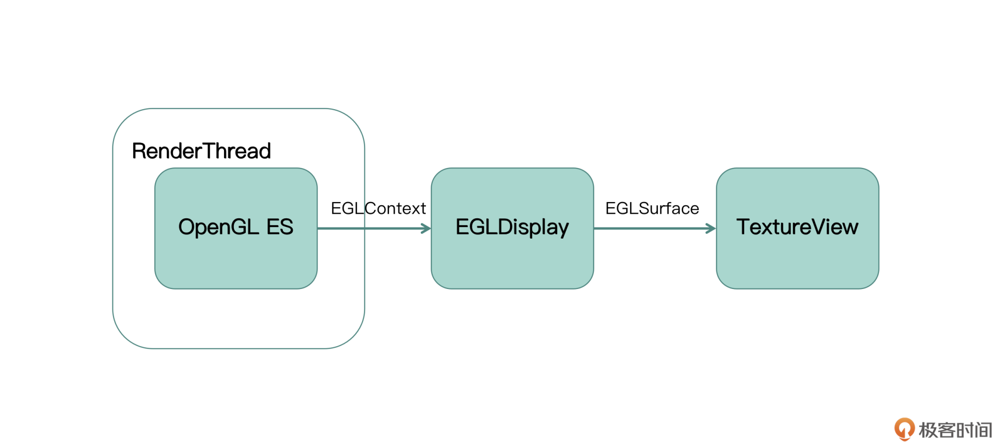
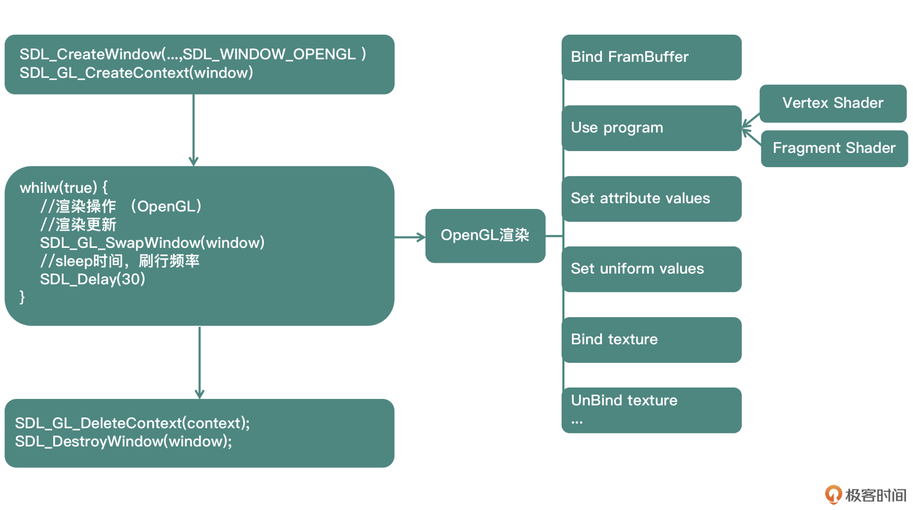
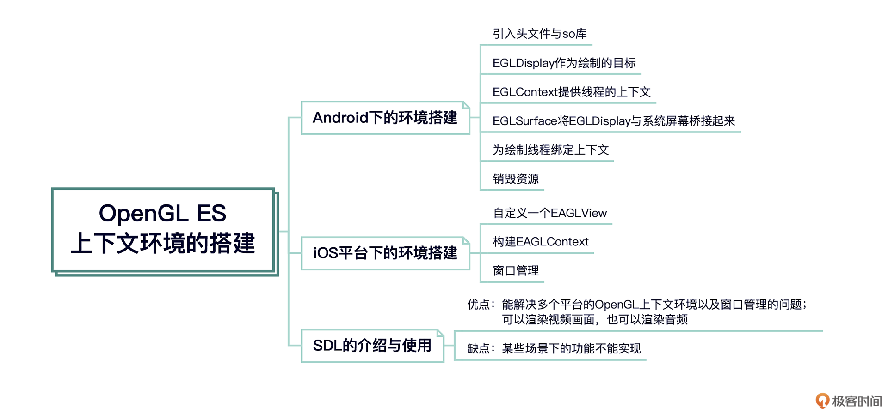

# 05 | 移动平台的视频渲染（二）：OpenGLES上下文环境搭建

你好，我是展晓凯。今天我们来继续学习移动平台的视频渲染。

上一节课，我们使用 OpenGL ES 提供给开发者的接口，创建出了一个 GLProgram，但是如果让这个 GLProgram 运行起来还需要有一个上下文环境来支撑。由于 OpenGL ES 一开始就是为跨平台设计的，所以它本身并不承担窗口管理以及上下文环境构建的职责，这个职责需要由各自的平台来承担。

Android 平台使用的是 EGL，EGL 是 Khronos 创建的一个框架，用来给 OpenGL 的输出与设备的屏幕搭建起一个桥梁。EGL 的工作机制是双缓冲模式，也就是有一个 Back Frame Buffer和一个 Front Frame Buffer，正常绘制操作的目标都是 Back Frame Buffer，渲染完毕之后，调用 eglSwapBuffer 这个 API，会将绘制完毕的 Back Frame Buffer 与当前的 Front FrameBuffer 进行交换，然后显示出来。EGL 承担了为 OpenGL 提供上下文环境以及窗口管理的职责。

iOS 平台使用的是 EAGL，与 EGL 的双缓冲机制比较类似，iOS 平台也不允许我们直接渲染到屏幕上，而是渲染到一个叫 renderBuffer 的对象上。这个对象你可以理解为一个特殊的FrameBuffer，最终再调用 EAGLContext 的 presentRenderBuffer 方法，就可以将渲染结果输出到屏幕上去了。

下面我会分别对这两个平台的环境搭建进行详细地介绍。

## Android 平台的环境搭建

要在 Android 平台上使用 OpenGL ES，最简单的方式是使用 GLSurfaceView，因为不需要开发者搭建 OpenGL ES 的上下文环境以及创建 OpenGL ES 的显示设备，只需要遵循GLSurfaceView 定义的接口，实现对应的逻辑即可。就像硬币有正反面一样，使用GLSurfaceView 的缺点也比较明显，就是不够灵活，OpenGL ES 很多核心用法，比如共享上下文，使用起来就会比较麻烦。

我们这个专栏的 OpenGL ES 上下文环境，会直接使用 EGL 提供的 API，在 Native 层基于C++ 环境进行搭建。原因是在 Java 层进行搭建的话，对于普通的应用也许可以，但是对于要进行解码或使用第三方库的场景，比如人脸识别，又需要到 Native 层来实施。考虑到效率和性能，我们这里就直接使用 Native 层的 EGL 来搭建一个 OpenGL ES 的开发环境。

### 引入头文件与 so 库

那么如何在 Native 层使用 EGL 呢？我们必须要在 CMake 构建脚本（CMakeLists.txt）中加入 EGL 这个库，并在使用这个库的 C++ 文件中引入 EGL 对应的头文件。

需要引用的头文件如下：

```
#include <EGL/egl.h>
#include <EGL/eglext.h>
```

需要引入的 so 库：

```bash
target_link_libraries(videoengine
       # 引入系统的动态库
       EGL
       )
```

这样我们就可以在 Android 的 Native 层中使用 EGL 了，不过要使用 OpenGL ES 给开发者提供的接口，还需要引入 OpenGL ES 对应的头文件与库。

需要包含的头文件：

```
#include <GLES2/gl2.h>
#include <GLES2/gl2ext.h>
```

需要引入的 so 库，注意这里使用的是 OpenGL ES 2.0 版本。

```bash
target_link_libraries(videoengine
       # 引入系统的动态库
       GLESv2
       )
```

至此，OpenGL ES 的开发需要用到的头文件以及库文件就引入完毕了，下面我们来看一下如何使用 EGL 搭建出 OpenGL 的上下文环境以及实现窗口的管理。

### EGLDisplay 作为绘制的目标

EGL 首先要解决的问题是，要告诉 OpenGL ES 绘制的目标在哪里，而 EGLDisplay 就是一个封装系统物理屏幕的数据类型，也就是绘制目标的一个抽象。开发者要调用 eglGetDisplay 这个方法来创建出 EGLDisplay 的对象，在调用这个方法的传参中，常量EGL_DEFAULT_DISPLAY 会被传进这个方法中，每个厂商在自己的实现中都会返回默认的显示设备，代码如下：

```
EGLDisplay display;
if ((display = eglGetDisplay(EGL_DEFAULT_DISPLAY)) == EGL_NO_DISPLAY) {
   LOGE("eglGetDisplay() returned error %d", eglGetError());
   return false;
}
```

在获得了 EGLDisplay 的对象之后，就需要对这个对象做初始化工作，开发者需要调用 EGL提供的 eglInitialize 方法来初始化这个对象，这个方法会返回一个 bool 值来代表函数运行结果。函数的第一个参数就是 EGLDisplay 对象，后面两个参数是这个函数为了返回 EGL 版本号而设计的，两个参数分别是 Major 和 Minor 的 Version，比如 EGL 的版本号是 1.0，那么Major 返回 1，Minor 则返回 0，如果我们不关心版本号，可以都传入 0 或者 NULL，代码如下：

```
if (!eglInitialize(display, 0, 0)) {
   LOGE("eglInitialize() returned error %d", eglGetError());
   return false;
}
```

一旦 EGLDisplay 初始化成功之后，它就可以将 OpenGL ES 的输出和设备的屏幕桥接起来，但是需要我们指定一些配置项，比如色彩格式、像素格式、OpenGL 版本以及 SurfaceType等，不同的系统以及平台使用的 EGL 标准是不同的，在 Android 平台下一般配置的代码如下所示：

```javascript
EGLConfig config;
const EGLint attribs[] = {EGL_BUFFER_SIZE, 32,
       EGL_ALPHA_SIZE, 8,
       EGL_BLUE_SIZE, 8,
       EGL_GREEN_SIZE, 8,
       EGL_RED_SIZE, 8,
       EGL_RENDERABLE_TYPE, EGL_OPENGL_ES2_BIT,
       EGL_SURFACE_TYPE, EGL_WINDOW_BIT,
       EGL_NONE };
if (!eglChooseConfig(display, attribs, &config, 1, &numConfigs)) {
   LOGE("eglChooseConfig() returned error %d", eglGetError());
   return false;
}
```

配置选项这个函数也是返回一个 bool 值来代表配置状态，如果配置成功，则代表 config 会被正确初始化。

EGLDisplay 这个对象是 EGL 给开发者提供的最重要的入口，接下来我们要基于这个EGLDisplay 对象还有 EGLConfig 配置来创建上下文了。

### EGLContext 提供线程的上下文

由于任何一条 OpenGL ES 指令（OpenGL ES 提供给开发者的接口）都必须运行在自己的OpenGL 上下文环境中，EGL 提供 EGLContext 来封装上下文，可以按照如下代码构建出OpenGL ES 的上下文环境。

```
EGLContext context;
EGLint attributes[] = { EGL_CONTEXT_CLIENT_VERSION, 2, EGL_NONE };
if (!(context = eglCreateContext(display, config, NULL,
       eglContextAttributes))) {
   LOGE("eglCreateContext() returned error %d", eglGetError());
   return false;
}
```

函数 eglCreateContext 的前两个参数就是我们刚刚创建的两个对象，第三个参数类型也是EGLContext 类型的，一般会有两种用法。

- 如果想和已经存在的某个上下文共享 OpenGL 资源（包括纹理 ID、frameBuffer 以及其他的 Buffer），则传入对应的那个上下文变量。

- 如果目标仅仅是创建一个独立的上下文，不需要和其他 OpenGL ES 的上下文共享任何资源，则设置为 NULL。

在一些场景下其实需要多个线程共同执行 OpenGL ES 的渲染操作，这种情况下就需要用到共享上下文，共享上下文的关键点就在这里，一定要记住。

成功创建出 OpenGL ES 的上下文，说明我们已经把 OpenGL ES 的绘制目标搞定了，但是这个绘制目标并没有渲染到我们某个 View 上，那如何将这个输出渲染到业务指定的 View 上呢？答案就在 EGLSurface。

### EGLSurface 将 EGLDisplay 与系统屏幕桥接起来

EGLSurface 实际上是一个 FrameBuffer，开发者可以调用 EGL 提供的eglCreateWindowSurface 创建一个可实际显示的 Surface，调用 eglCreatePbufferSuface 可以创建一个 OffScreen（离屏渲染，一般用户后台保存场景）的 Surface，创建可实际显示的Surface 代码如下：

```
EGLSurface surface = NULL;
EGLint format;
if (!eglGetConfigAttrib(display, config, EGL_NATIVE_VISUAL_ID,
       &format)) {
   LOGE("eglGetConfigAttrib() returned error %d", eglGetError());
   return surface;
}
ANativeWindow_setBuffersGeometry(_window, 0, 0, format);
if (!(surface = eglCreateWindowSurface(display, config, _window, 0))) {
   LOGE("eglCreateWindowSurface() returned error %d", eglGetError());
}
```

上述代码中不得不提的就是 _window 这个参数，这里我需要重点向你解释一下，这个_window 是 ANativeWindow 类型的对象，代表了本地业务层想要绘制到的目标 View。在Android 里面可以通过 Surface（通过 SurfaceView 或 TextureView 来得到或者构建出Surface 对象）去构建出 ANativeWindow。但构建之前需要我们在使用的时候引用头文件。

```
#include <android/native_window.h>
#include <android/native_window_jni.h>
```

调用 ANAtiveWindow 的 API 接口如下：

```
ANativeWindow* window = ANativeWindow_fromSurface(env, surface);
```

里面的 env 是 JNI 层的 JNIEnv 指针类型的变量，surface 就是 jobject 类型的变量，是由Java 层的 Surface 类型对象传递而来的。到这里我们就把 EGLSurface 和 Java 层的 View（即设备的屏幕）连接起来了。

这里我们再补充一点，如果想做离屏渲染，也就是在后台使用 OpenGL 处理一些图像，就需要用到处理图像的 Surface 了，创建离屏 Surface 如下：

```
EGLSurface surface;
EGLint PbufferAttributes[] = { EGL_WIDTH, width, EGL_HEIGHT, height, EGL_NONE,
       EGL_NONE };
if (!(surface = eglCreatePbufferSurface(display, config, PbufferAttributes))) {
   LOGE("eglCreatePbufferSurface() returned error %d", eglGetError());
}
```

可以看到这个 Surface 并不会和任何一个业务 View 进行关联，进行离屏渲染的时候，就可以把这个 Surface 当作目标进行绘制。



现在我们已经用 EGL 准备好了上下文环境与窗口管理，如上图所示，左侧我们为 OpenGL ES准备好上下文环境，并且用 EGLDisplay 用来接收绘制的内容，右边通过 EGLSurface 连接好了设备的屏幕（Java 层提供的 SurfaceView 或者 TextureView）。那么接下来我们就具体看一下如何使用创建好的 EGL 环境进行工作。

### 为绘制线程绑定上下文

OpenGL ES 需要开发者自己开辟一个新的线程，来执行 OpenGL ES 的渲染操作，还要求开发者在执行渲染操作前要为这个线程绑定上下文环境。EGL 为绑定上下文环境提供了eglMakeCurrent 这个接口。

```
eglMakeCurrent(display, eglSurface, eglSurface, context);
```

在绑定了上下文环境以及窗口之后就可以执行 RenderLoop 循环了，每一次循环都是去调用OpenGL ES 指令绘制图像。

还记得我们之前提到的 EGL 的双缓冲模式吗？EGL 内部有两个帧缓冲区（frameBuffer），我们执行的渲染目标都是后台的 frameBuffer。当渲染操作完成之后，要调用函数eglSwapBuffers 进行前台 frameBuffer 和后台 frameBuffer 的交换。

```
eglSwapBuffers(display, eglSurface)
```

执行上述函数之后，用户就可以在屏幕上看到刚刚渲染的图像了。

### 销毁资源

最后执行完所有的绘制操作之后，需要销毁资源。注意销毁资源也必须在这个独立的线程中，销毁显示设备（EGLSurface）的代码如下：

```
eglDestroySurface(display, eglSurface);
```

销毁上下文（Context）代码如下：

```
eglDestroyContext(display, context);
```

到这儿，在 Android 平台的 Native 层中，我们就使用 EGL 成功地把 OpenGL ES 的上下文环境搭建出来了，后面我们会用到这些知识。

## iOS 平台的环境搭建

iOS 平台不允许开发者使用 OpenGL ES 直接渲染输出到屏幕上，而是使用 Frame Buffer 与Render Buffer 相结合的方式来进行渲染。EAGL 提供的方式是必须创建一个 render Buffer，然后让 OpenGL ES 渲染到这个 Render Buffer 上面去。那这个 Renderbuffer 又是如何关联到业务层 View 上去的呢？

答案是 RenderBuffer 需要绑定一个 CAEAGLLayer，而这个 Layer 实际上就可以一对一地关联到我们自定义的一个 UIView。也就是开发者最后调用 EAGLContext 的presentRenderBuffer 方法，这样就可以将渲染结果输出到屏幕上去了。实际上，在这个方法的内部实现中，EAGL 也会执行类似于前面 EGL 中的 swapBuffer 的过程。具体使用步骤如下：

### 自定义一个 EAGLView

我们先自定义一个继承自 UIView 的 View，然后重写父类 UIView 的 layerClass 方法，并且一定要返回 CAEAGLLayer 这个类型。

```
+ (Class) layerClass
{
   return [CAEAGLLayer class];
}
```

接下来在这个 View 的初始化方法中，我们拿到 layer 并强制把类型转换为 CAEAGLLayer 类型的变量，然后给这个 layer 设置对应的参数。

```
- (id) initWithFrame:(CGRect)frame{
   if ((self = [super initWithFrame:frame])){
       CAEAGLLayer *eaglLayer = (CAEAGLLayer *)[self layer];
       NSDictionary *dict = [NSDictionary dictionaryWithObjectsAndKeys:
               [NSNumber numberWithBool:NO],
               kEAGLDrawablePropertyRetainedBacking,
               kEAGLColorFormatRGB565,
               kEAGLDrawablePropertyColorFormat,
               nil];
        [eaglLayer setOpaque:YES];
        [eaglLayer setDrawableProperties:dict];
   }
   return self;
}
```

### 构建 EAGLContext

像之前提到的，我们必须为每一个线程绑定 OpenGL ES 上下文，所以要开辟一个线程，开发者在 iOS 中开辟一个新线程的方法有很多，可以使用 GCD，也可以使用NSOperationQueue，甚至裸用 pthread 也可以，反正必须在一个线程中执行创建上下文的操作。创建 OpenGL ES 的上下文代码如下：

```
EAGLContext* _context;
_context = [[EAGLContext alloc]initWithAPI:kEAGLRenderingAPIOpenGLES2];
```

创建成功以后就来绑定上下文。

```
[EAGLContext setCurrentContext:_context];
```

执行成功之后就代表我们为这个线程绑定了刚刚创建好的上下文环境，也就是说我们已经建立好了 EAGL 与 OpenGL ES 的连接，接下来我们来建立另一端的连接。

### 窗口管理

这时，我们需要创建 RenderBuffer 并且把它绑定到前面自定义 EAGLView 的 Layer 上。首先是创建帧缓冲区。

```
glGenFramebuffers(1, &_framebuffer);
```

然后创建绘制缓冲区。

```
glGenRenderbuffers(1, &renderbuffer);
```

绑定帧缓冲区到渲染管线。

```
glBindFramebuffer(GL_FRAMEBUFFER, _framebuffer);
```

绑定绘制缓存区到渲染管线。

```
glBindRenderbuffer(GL_RENDERBUFFER, _renderbuffer);
```

为绘制缓冲区分配存储区，这里我们把 CAEAGLLayer 的绘制存储区作为绘制缓冲区的存储区。

```
[_context renderbufferStorage:GL_RENDERBUFFER fromDrawable:(CAEAGLLayer*)
       self.layer]
```

获取绘制缓冲区的像素宽度。

```
glGetRenderBufferParameteriv(GL_RENDER_BUFFER, GL_RENDER_BUFFER_WIDTH,
       &_backingWidth);
```

获取绘制缓冲区的像素高度。

```
glGetRenderBufferParameteriv(GL_RENDER_BUFFER, GL_RENDER_BUFFER_HEIGHT,
     &_backingHeight);
```

绑定绘制缓冲区到帧缓冲区。

```
glFramebufferRenderbuffer(GL_FRAMEBUFFER, GL_COLOR_ATTACHMENT0, GL_RENDERBUFFER,
     _renderbuffer);
```

检查 Framebuffer 的 status。

```
GLenum status = glCheckFramebufferStatus(GL_FRAMEBUFFER);
if(status != GL_FRAMEBUFFER_COMPLETE){
   //failed to make complete frame buffer object
}
```

完成以上操作，我们就把 EAGL 和我们的 Layer（设备的屏幕）连接起来了，当我们绘制了一帧之后（当然绘制过程也必须在这个线程中），调用以下代码就可以将绘制的结果显示到屏幕上了。

```
[_context presentRenderbuffer:GL_RENDERBUFFER];
```

这样我们就搭建好了 iOS 平台的 OpenGL ES 的上下文环境。这给我们之后要学的内容打好了基础。

这里 Open GL 上下文环境搭建的重点已经讲完了，但是学到这里你可能会有一些疑问，我们需要为每一个平台搭建自己的 OpenGL ES 上下文环境，感觉好复杂呀，并且整个搭建过程也都涉及平台相关的 API 接口，那有没有一个开源框架可以将上下文环境透明掉呢？这样开发者不就可以专注在自己的业务和重点算法攻坚上了吗？

答案是有的，就是我们接下来要学习的一个库——SDL。

## SDL 的介绍与使用

SDL 可以给开发者提供面向 libSDL 的 API 编程，它的内部能解决多个平台的 OpenGL 上下文环境和窗口管理的问题。开发者只需要交叉编译这个库到各自的平台上，就可以达到一份代码运行到多个平台的目的了。FFmpeg 中的 ffplay 工具就是基于 libSDL 开发的，SDL 不单单可以渲染视频画面，也可以渲染音频。

但是对于移动开发者来讲，它也有一些缺点，比如使用 SDL 会牺牲一些更加灵活的控制，甚至某些场景下的功能实现不了。所以到底用不用 SDL，你可以根据实际需求去考量，但了解这个库是十分有必要的。

我们这个部分的讲解是基于 Mac + CLion 的 C++ 工程，最后学习怎么去使用 sdl2 这个库来构建 OpenGL ES 的上下文环境。

首先是安装 sdl2 库，我们可以通过命令行来安装。

```
brew install sdl2
```

安装后，可以使用命令来查看安装列表和安装路径。

```
brew list 查看安装列表
brew list sdl2 查看sdl2安装路径
```

如果安装路径是：/usr/local/Cellar/sdl2/2.0.14_1，需要在工程的 CMakeLists.txt 文件里，加入配置。

```
include_directories(/usr/local/Cellar/sdl2/2.0.14_1/include/)
link_directories(/usr/local/Cellar/sdl2/2.0.14_1/lib )
```

在工程里加入 SDL 库和 OpenGL 库链接配置。

```bash
target_link_libraries(
 SDL_OpenGL
 SDL2
 "-framework OpenGL"
)
```

加入头文件。

```
//SDL API
#include "SDL2/SDL.h"
//OpenGL API
#include "OpenGL/gl3.h"
```

接下来就是整个使用 SDL 渲染的整体流程，在讲解过程中我们参考这个流程结构图。



结合上图，我们来详细地讲解一下其中的关键流程。首先，我们需要创建窗口和 OpenGL 上下文。

```
SDL_Window *window = SDL_CreateWindow("hello OpenGL", 0, 0, 300, 300, SDL_WINDOW_
SDL_GLContext context = SDL_GL_CreateContext(window);
```

进行循环渲染和更新窗口操作，然后退出。

```
while(true) {
 drawFromOpenGL(); //执行要做的渲染
 SDL_GL_SwapWindow(window); //相当于执行了eglSwapBuffers操作
 if (SDL_PollEvent(&event) && event.type == SDL_QUIT) {
   //在点击窗口close时退出循环
   break;
 }
 SDL_Delay(30); //单位ms,设置刷新频率
}
```

最后，释放资源。

```
SDL_GL_DeleteContext(context);
SDL_DestroyWindow(window);
SDL_Quit();
```

按照上述的整个流程，我们就使用 SDL 构建起 OpenGL ES 的上下文环境了，其实这也回答了刚才我们提出的问题。如果你选择使用 SDL 来构建，那么你写的代码就是跨平台的，实际上是 SDL 内部将平台的差异性屏蔽掉了，让我们可以更方便地去书写自己的业务，这也是面向对象思想的一个重要特征，你也可以思考一下，把它用到平时的系统与架构设计中。

## 总结

这节课我们分别为 Android 和 iOS 平台构建出了 OpenGL ES 的上下文环境，也给你讲解了使用 SDL 的方法以及优势。



还记得在上一节课我们创建出来的显卡执行程序吗？接下来就是见证奇迹的时刻：让我们创建的显卡执行程序运行在构建出来的上下文环境上，最终我们可以通过 OpenGL ES 将 YUV（或者 RGBA）数据绘制到系统屏幕上。那么如何将显卡执行程序运行到平台的上下文环境中呢？我们下节课接着聊。

## 思考题

在今天学习中，我们知道了 OpenGL ES 的渲染需要在一个绑定了上下文的独立线程中进行，但是在实际的一些场景中，OpenGL ES 的渲染需要分布在多个线程中，并且多个线程还需要共享这个上下文环境，那这个时候我们应该如何处理呢？欢迎在评论区留下你的思考，也欢迎你把这节课分享给需要的朋友，我们下节课再见！
