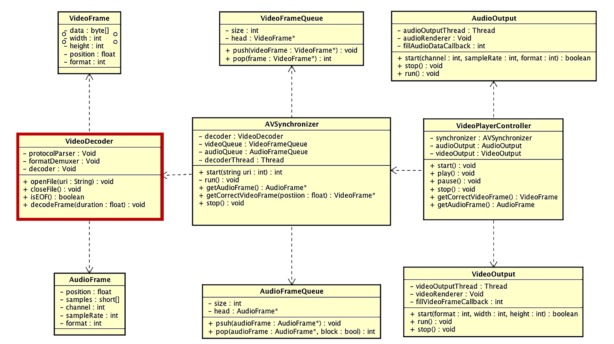
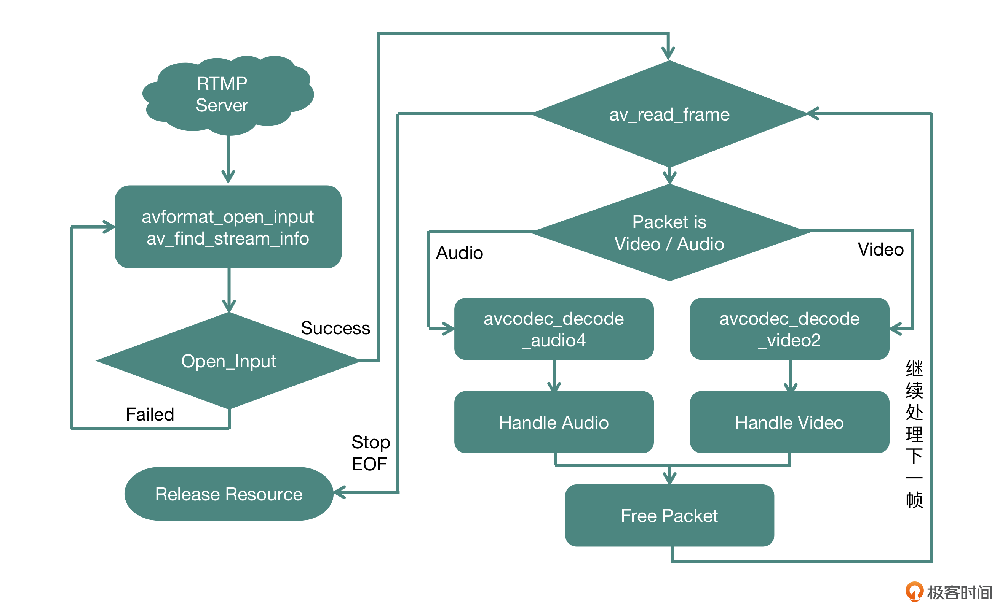
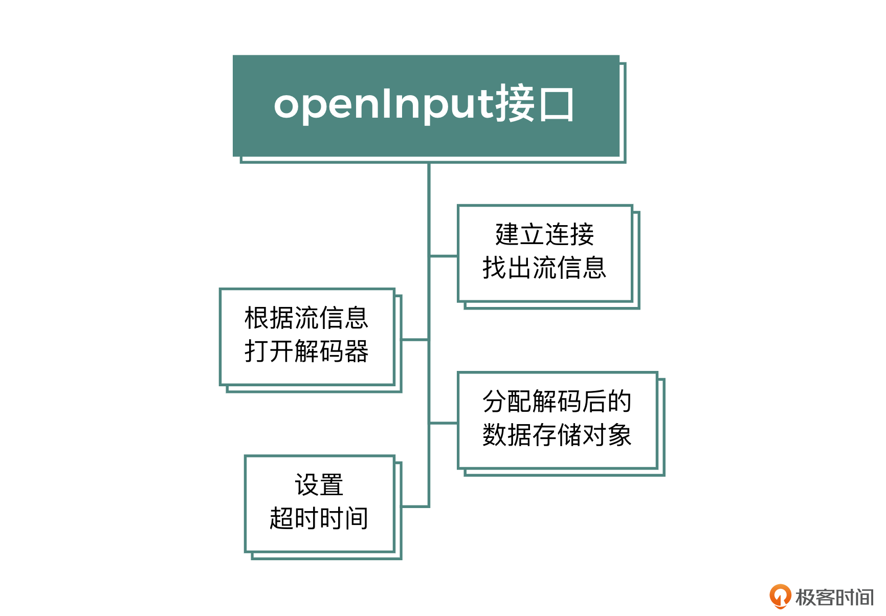
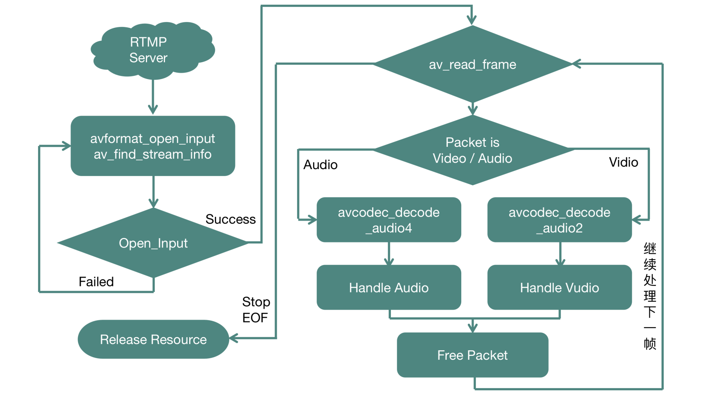
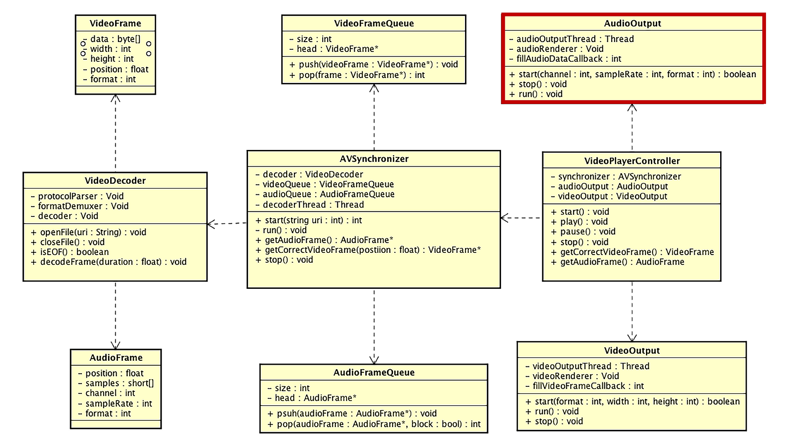
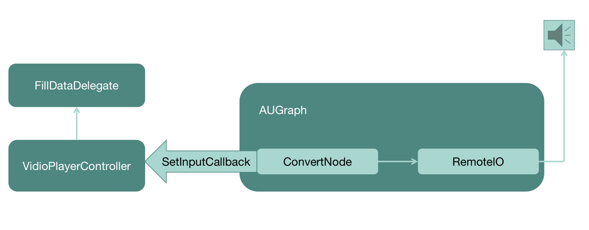
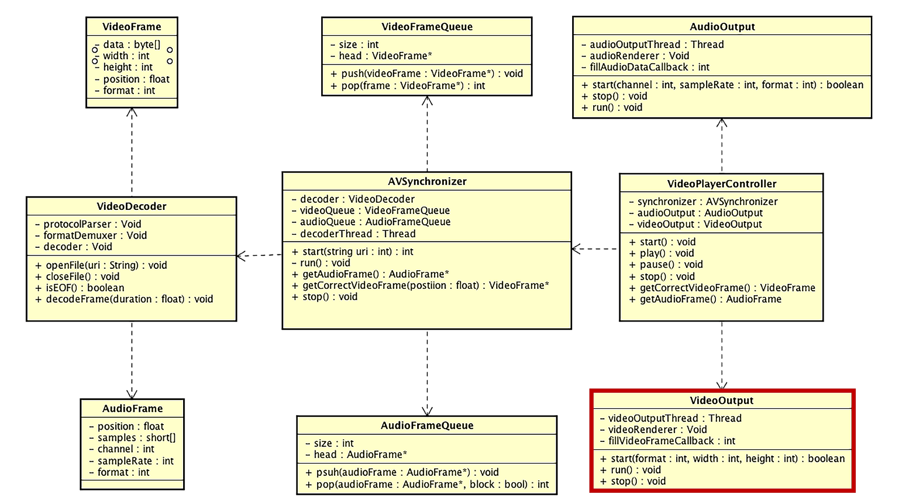
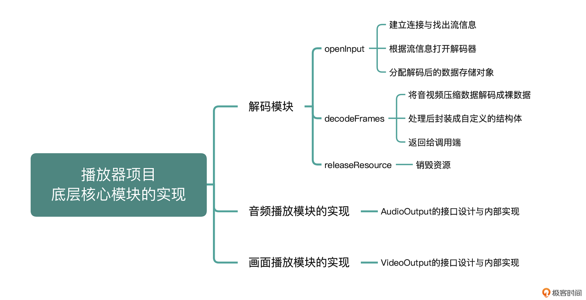

# 08 | 播放器项目实战（二）：底层核心模块的实现

你好，我是展晓凯。今天我们来学习实现播放器中的各个核心模块。

上一节课我们设计了播放器的架构，架构中包含各种模块，其中解码模块、音视频播放模块以及画面播放模块是架构中的核心模块。为了让我们设计的架构快速落地，这节课我会带你来分别实现这三个核心模块。我们先来看看解码模块是如何实现的吧。

## 解码模块的实现



我们一起来构建输入模块，也就是来做类图中的 VideoDecoder 类的实现。这里我们使用FFmpeg 这个开源库来完成输入模块的协议解析、封装格式拆分、解码操作等行为，你可以看一下 FFmpeg 在解码场景下的核心流程。



- FFmpeg在解码场景下的核心流程

整体的运行流程分为以下几个阶段：

- 建立连接、准备资源阶段：使用 openInput 方法向外提供接口。

- 读取数据进行拆封装、解码、处理数据阶段：使用 decodeFrames 方法向外提供接口。

- 释放资源阶段：使用 releaseResource 方法向外提供接口。

以上就是我们输入端的整体流程，其中第二个阶段是一个循环并且会放在单独的线程中来运行。接下来我们具体看一下这个类中最重要的几个接口是如何设计与实现的。

### openInput

这个方法的职责是建立与媒体资源的连接通道，并且分配一些全局需要用到的资源，最后将建立连接通道与分配资源的结果返回给调用端。这个方法的实现主要分为三个核心部分。



1. 建立连接与找出流信息

第一步就是与媒体资源建立连接，成功建立连接之后，就可以找出这个资源所包含的流的信息，比如声音轨的声道数、采样率、表示格式或者视频轨的宽、高、fps 等。如果是本地资源，这个过程会很快，如果是网络资源，可能就需要一段时间了。找出流信息失败的话可以重试，具体的重试逻辑可以根据不同的业务场景进行设置，在这里我们一般会进行重试 3 次的策略。

find_stream_info 这个函数的内部会发生实际的解码行为，所以解码的数据越多，花费的时间也会越长，对应得到的 MetaData 也会越准确。对此，我们一般通过设置 probesize 和max_analyze_duration 这两个参数来改善秒开的时间。

probesize 代表探测数据量，max_analyze_duration 代表最大的解析数据的长度。如果达到了设置的值，还没有解析出对应的视频流和音频流的 MetaData，那么 find_stream_info 这个函数就会返回失败，紧接着业务层可以提高这两个参数的数值，进入下一次重试，如果find_stream_info 解析成功，就会将对应的流信息填充到对应的结构体中。

2. 根据流信息打开解码器

找出对应的流信息之后，就要打开每个流的解码器了。如果声音有两路流，有的播放器允许切换，比如我们之前说的 ffplay 就支持带入参数进行选择，VLC 播放器可以实时切换。我们这个项目中只选择第一个音频流。

3. 分配解码后的数据存储对象

每个流都要分配一个 AVFrame 的结构体，用来存放解码之后的原始数据。对于音频流，可能还要额外分配一个重采样的上下文，将解码之后的音频格式进行重采样，把它变成业务层需要的 PCM 格式，这里我们只分配资源，具体的解码和转换行为下节课我们会讲到。

这三个步骤完成之后，整个初始化阶段就完成了。但如果是一个网络资源的话，一般我们需要设置一个超时时间，否则在弱网情况下会出现一些函数阻塞时间特别长的问题。在 FFmpeg的设计中，寻找流信息阶段，还有实际的 read_frame 等阶段，它们的内部会在另外一个线程调用开发者设置的超时判断的回调函数，询问是否达到超时的条件。返回 1 则代表超时，FFmpeg 会断开连接通道，阻塞的函数也会直接返回；返回 0 则代表不超时，会继续阻塞进行IO 操作。

这个机制要想生效，需要在建立连接通道之前，将自己定义的函数给 AVFormatContext 的interrupt_callback 赋值。一般在销毁资源的时候，直接让这个函数返回 0，或者为弱网也提供一个超时的读取时间，这个设置是非常有用的，它可以保证你的解码模块不会因为一些阻塞的IO 调用变得不可用。

### decodeFrames

我们再看 decodeFrames 这个方法的实现，这个接口主要负责将音视频压缩数据解码成裸数据，然后经过处理封装成自定义的结构体，最后返回给调用端。



如图所示，先调用 read_frame 读出一个压缩数据帧来，压缩数据在 FFmpeg 中使用AVPacket 这个结构体来表示。在视频流中，一个 AVPacket 里面只包含一个视频帧，在音频流中，一个 AVPacket 里面有可能包含多个音频帧，所以我们需要根据 AVPacket 的类型决定它所走的解码流程，这里我们可以根据 AVPacket 里面的 stream_index 来判定它是音频类型还是视频类型。

视频部分只需要解码一次，就可以得到 AVFrame 的视频裸数据（一般是 YUV 格式）。音频部分需要判定这个 AVPacket 里面的压缩数据是否被全部消耗干净了，并以此作为一次解码结束的条件。

解码成功之后，需要提取出对应的裸数据填充到我们自定义的结构体中，并返回给外界调用端。为什么需要填充到自定义的结构体中呢？

原因是我们不希望向外界暴露 Input 这个模块内部所使用的技术细节，也就是说，不希望向调用者暴露内部使用的是 FFmpeg 的解码器库还是硬件解码器或者其他的解码器库等细节，所以解码之后，需要封装成 AudioFrame 和 VideoFrame 的自定义结构体。但是在将 AVFrame中的数据封装成自定义数据结构的过程中，有可能会出现 AVFrame 中音频或者视频的表示方式和调用端预期的表示方式不一样的情况，那么就需要做个转换。

FFmpeg 对于音频和视频的格式转换，分别提供了不同的 API 供开发者使用。

音频的格式转换，FFmpeg 提供 libswresample 库让开发者使用，一般称为重采样。开发者需要用原始音频格式和目标音频格式，来调用 swr_alloc_set_opts 方法，初始化重采样的上下文，其中音频格式用声道、采样率、表示格式来表示。初始化成功之后，就可以调用swr_convert 方法，将解码器输出的 AVFrame 转换为目标音频格式类型的 AVFrame，重采样之后的数据就是开发者需要的音频格式的数据了。使用完毕之后调用 swr_free 方法来释放掉重采样的上下文。

视频帧的格式转换，FFmpeg 提供 libswscale 库让开发者使用。一般情况下如果原始视频的裸数据表示格式不是 YUV420P 的话，那么就需要使用这个库来把非 YUV420P 格式的视频数据转换为 YUV420P 格式。

转换过程也很简单，开发者需要先根据源格式（包括视频宽、高、表示格式）和目标格式（包括视频宽、高、表示格式）调用 sws_getCachedContext 方法，来构造出转换视频的上下文。构造成功之后，就可以调用 sws_scale 方法，将解码器输出的 AVFrame 转换为目标格式的AVPicture 类型的结构体。然后开发者就可以从 AVPicture 里取出对应的数据，封装到自定义的结构体中。最终使用完毕后调用 sws_freeContext 来释放掉这个转换上下文。

### releaseResource

最后是销毁资源这个方法的实现，它的过程正好与打开流阶段相反。第一步是销毁音频相关的资源，包括分配的 AVFrame 以及音频解码器，另外如果分配了重采样上下文以及重采样输出的音频缓冲 buffer，那么也要一并销毁掉。然后是销毁视频相关的资源，包括分配的AVFrame 与视频解码器，另外如果分配了格式转换上下文与转换后的 AVPicture，也要一并销毁掉。最后断开连接通道以及销毁掉上下文。

## 音频播放模块的实现



下面，我们来一起学习音频播放模块的实现，也就是类图中的 AudioOutput 类的实现，这一部分对于 Android 和 iOS 平台的实现是不同的。前面我们已经详细地学习了多种音频渲染的方法，基础概念与实现代码这里就不再赘述了，这个部分我们会将重点放在 AudioOutput 的接口设计与内部实现上。

### Android 平台的音频渲染

Android 平台我们选用 OpenSL ES 来渲染音频，建立 AudioOutput 这个类之后，按照之前的架构设计，第一步需要在这个类里面定义一个回调函数，来获取要播放的 PCM 数据 buffer，回调函数如下：

```
typedef int(*audioPlayerCallback)(byte* , size_t, void* ctx);
```

这个函数的第一个参数是需要外界填充 PCM 数据的缓冲区，第二个参数是这个缓冲区的大小，第三个参数是客户端代码自己填充的上下文对象，在 C++ 中的回调函数是静态的，所以要传递一个上下文对象，以便回调回来的时候可以将这个上下文对象强制转换成为目标对象，用于访问对象中的属性以及方法。

接下来，让我们具体实现 AudioOutput 这个类中的几个接口方法。面向对象的特性之一就是封装，也就是将类内部的具体实现细节封装起来，向外暴露出接口，用来完成调用端想要这个类完成的行为。所以这几个接口不能暴露 AudioOutput 内部到底是选用哪种技术框架来实现的。

尽管我们现在是使用 OpenSL ES 来实现的音频播放，如果以后有一些特殊需求，可以换成Oboe 或者其他的实现方式，但是暴露给外界的接口以及回调函数是不会变的。这对于整个系统的扩展性以及后期的维护是非常重要的，前面的解码模块不向客户端代码暴露 AVFrame，而是暴露自定义的 VideoFrame 或者 AudioFrame 结构体，也是一样的道理。那就让我们一起来实现第一个接口。

1. 初始化以及填充数据流程

传入参数就是声道数、采样率、表示格式、回调函数以及回调函数的上下文对象，返回值表示OpenSL ES 是否可以正常完成初始化。核心流程里有一步是给 audioPlayerBufferQueue 设置回调函数，也就是当 OpenSL ES 需要数据进行播放的时候，会回调这个函数，由开发者来填充 PCM 数据。我们需要在此处就调用上面定义的回调函数来填充 PCM 数据，最后调用audioPlayerBufferQueue 的 Enqueue 方法，把客户端代码填充过来的 PCM 数据放到OpenSL ES 中的 BufferQueue 中去。

2. 暂停和继续播放

在上面一步初始化 OpenSL ES 的时候，我们已经把 audioPlayerObject 中的 play 接口给拿出来了，对于暂停和继续播放，我们只需要设置 playState 就可以了。

```
int state = play ? SL_PLAYSTATE_PLAYING : SL_PLAYSTATE_PAUSED;
(*audioPlayerPlay)->SetPlayState(audioPlayerPlay, state);
```

3. 停止以及销毁资源

首先应该暂停现在的播放，接下来最重要的一步是设置一个全局的状态，保证如果再有audioPlayerBufferQueue 的回调函数要调用的时候，不需要再填充数据，最好再调用 usleep方法来暂停一段时间（比如 50ms），这样可以让 buffer 缓冲区里面的数据全部播放完毕，最终调用 OpenSL ES 的 API 销毁所有的资源，包括 audioPlayerObject 与 outputMixObject。

### iOS 平台的音频渲染

在 iOS 平台，我们选用 AudioUnit（AUGraph 实际上封装的就是 AudioUnit）来渲染音频，类似于 Android 平台的实现，我们也要设计一个回调函数用来获取要渲染的 PCM 数据。

在 OC 中回调函数的实现一般是定义一个协议（Protocol），由调用端去实现这个协议，重写协议里面定义的方法，下面来看这个协议的定义：

```
@protocol FillDataDelegate <NSObject>
 - (NSInteger) fillAudioData:(SInt16*) sampleBuffer numFrames:(NSInteger)frameNu
@end
```

第一个参数是要填充的 PCM 缓冲区，第二个参数是这个缓冲区包含的音频帧数目，第三个参数是声道数。调用端在实现中要按照帧的个数和声道数规则来填充这个缓冲区。比起 C++ 的回调函数，OC 语言的这种写法更加面向对象一些，调用端实现这个协议就意味着要承担这个协议所要求的职责，你可以自己体会一下。

接下来是这个类的初始化方法，传入声道数、采样率、采样的表示格式，以及实现上面填充数据协议的对象（idfillAudioDelegate）这几个参数。

在这个方法的实现中，首先要构造一个 AVAudioSession，然后给这个 Session 设置用途类型以及采样率等；接下来设置音频被中断的监听器，方便应用程序在特殊情况下可以给出相应的处理；最后就是核心流程构造 AUGraph，用来实现音频播放。

这里需要注意的是，在 AUGraph 中需要添加一个 ConvertNode，将调用端填充的 SInt16 格式音频数据转换为 Float32 格式的音频数据，Float32 格式是 RemoteIONode 可以播放出来的。最后需要给 ConvertNode 配置一个 InputCallback，在这个 InputCallback 的实现中调用Delegate 的 fillAudioData 方法，让调用端来填充数据。

配置好整个 AUGraph 之后，调用 AUGraphInitialize 方法来初始化整个 AUGraph。最终构造出来的 AUGraph 以及和客户端代码的调用关系如图所示。



- AUGraph和客户端代码的调用关系

接下来是 play 方法的实现，直接调用 AUGraphStart 方法启动这个 AUGraph 就可以了。一旦启动，RemoteIO 这个 AudioUnit 就会启动播放，需要音频数据的时候，就向前一级AudioUnit（ConvertNode）去拉取数据，而 ConvertNode 则会去找到自己的 InputCallback，在 InputCallback 的实现中，会去和 delagate（调用端）要数据，然后就在实现这个 Protocol的客户端代码中填充数据，最终就可以播放出来了。

至于 pause 方法，直接调用 AUGraphStop 方法就可以停掉 AUGraph 的运行，音频就会停止渲染。如果想恢复的话，重新调用 play 方法即可。

最后是销毁方法，在销毁方法中要先停掉 AUGraph，然后调用 AUGraphClose 方法关闭这个AUGraph，并移除掉 AUGraph 里面所有的 Node，最终调用 DisposeAUGraph，这样就可以彻底销毁整个 AUGraph 了。

## 视频（画面）播放模块的实现



接下来我们介绍视频（画面）播放模块的实现，也就是类图中的 VideoOutput 类的实现，这部分的实现也是依赖于平台的，虽然底层都是使用的 OpenGL ES，但是需要为不同平台构建自己的上下文环境以及窗口管理，具体细节我们第 5 节课已经学过了，所以这节课我们会把重点放在讲解 VideoOutput 的接口设计与内部实现上。

### Android 平台的视频渲染

根据我们之前的学习，无论在哪个平台使用 OpenGL ES 渲染视频画面，都需要单独开辟一个线程，并且为这个线程绑定一个 OpenGL ES 的上下文。

在 Android 平台上我们是在 Native 层进行 OpenGL ES 的开发工作的。第一件事就是选用线程模型，前面我们曾一起分析过各种线程模型的优缺点，这里就直接选用 POSIX 线程模型，即 PThread。

音视频同步模块中其实不会涉及任何平台相关的 API，不过考虑到它要维护解码线程，因此使用 PThread 来创建线程会是一个好的选择，原因是两个平台都支持这种线程模型。——第 7节课内容回顾

在 VideoOutput 中也是先定义一个回调函数，当 VideoOutput 这个模块需要渲染视频帧的时候，就调用这个回调函数拿到要渲染的视频帧进行真正的渲染，回调函数的代码原型如下：

```
typedef int (*getTextureCallback)(VideoFrame** texture, void* ctx);
```

第一个参数是要获取的视频帧，第二个是回调函数的上下文，返回值为 int 类型，当成功获取到一帧视频帧后返回大于零的值，否则返回负值。初始化函数的原型如下：

```
bool initOutput(ANativeWindow* window, int screenWidth, int screenHeight, ITextur
```

第一个参数是 ANativeWindow 类型的对象，这个 window 实际上是通过从 Java 层传递过来的一个 Surface 构造的，而 Surface 就是从 SurfaceView 的 SurfaceHolder 中获取出来的。第二个和第三个参数则是绘制的 View 的宽和高，后面的参数就是获取视频帧的回调函数以及回调函数的上下文对象。

初始化函数的实现也比较简单，首先创建一个线程作为 OpenGL ES 的渲染线程，线程执行的第一个步骤就是初始化 OpenGL ES 环境，它会利用 EGL 构建出 OpenGL ES 的上下文，并且利用 ANativeWindow 构造出 EGLDisplay 作为显示目标，然后利用 VertexShader 和FragmentShader 构造出一个 GLProgram。

VertexShader 代码如下：

```
static char* OUTPUT_VIEW_VERTEX_SHADER =
     "attribute vec4 vPosition;                  \n"
     "attribute vec4 vTexCords;                  \n"
     "varying vec2 yuvTexCoords;                 \n"
     "                                           \n"
     "void main() {                              \n"
     "    yuvTexCoords = vTexCords.xy;           \n"
     "    gl_Position = vPosition;               \n"
     "}                                          \n";
```

VertexShader 中直接将顶点赋值给 gl_Position，然后将纹理坐标传递给 FragmentShader，具体的 FragmentShader 代码如下：

```
static char* YUV_FRAME_FRAGMENT_SHADER =
     "varying highp vec2 yuvTexCoords;                                      \n"
     "uniform sampler2D s_texture_y;                                        \n"
     "uniform sampler2D s_texture_u;                                        \n"
     "uniform sampler2D s_texture_v;                                        \n"
     "void main(void)                                                        \n"
     "{                                                                       \n
     "    highp float y = texture2D(s_texture_y, yuvTexCoords).r;         \n"
     "    highp float u = texture2D(s_texture_u, yuvTexCoords).r - 0.5;   \n"
     "    highp float v = texture2D(s_texture_v, yuvTexCoords).r - 0.5;   \n"
     "                                                                        \n
     "    highp float r = y + 1.402 * v;                                    \n"
     "    highp float g = y - 0.344 * u - 0.714 * v;                       \n"
     "    highp float b = y + 1.772 * u;                                    \n"
     "    gl_FragColor = vec4(r,g,b,1.0);                                   \n"
     "}                                                                       \n
```

由于视频帧是 YUV420P 的数据格式表示的，所以在 FragmentShader 里面，需要把 YUV 的数据转换为 RGBA 格式的数据。先取出对应的 YUV 的数据，然后按照 YUV 到 RGBA 的计算公式将 YUV 格式转换为 RGBA 格式。由于 UV 的默认值是 127，所以我们这里要减去 0.5。在 OpenGL ES 的 Shader 中会把内存里 0～255 的整数数值换算为 0.0-1.0 的浮点数值。

接下来就是渲染方法，当客户端代码需要 VideoOutput 渲染视频帧的时候，VideoOutput 模块会先利用回调函数获得视频帧，然后利用构造的 GLProgram 执行渲染操作，最终调用eglSwapBuffers 方法将渲染的内容绘制到 EGLDisplay 上面去。

最后是销毁方法，这一步必须要在 GL 线程中进行，因为是在这个线程中创建的 OpenGL 上下文、EGLDisplay、GLProgram，渲染过程中还使用到了纹理对象、frameBuffer 对象，所以必须在这个线程中来销毁这一系列的对象。

### iOS 平台的视频渲染

第 6 节课我们已经学习过如何在 iOS 平台上使用 OpenGL ES 了，所以在接下来的实现中，我们书写一个继承自 UIView 的 VideoOutput 类，并重写父类的 layerClass 这个方法，返回 CAEAGLLayer 类型；然后在初始化方法中创建 OpenGL 线程。线程模型我们采用NSOperationQueue 来实现，这里我们会把所有 OpenGL ES 的操作都封装在NSOperationQueue 中完成。

为什么要使用这种线程模型呢？由于一些低端设备执行一次 OpenGL 的绘制耗费的时间可能比较长，如果使用 GCD 的线程模型的话，就有可能导致 DispatchQueue 里面的绘制操作累积得越来越多，并且不能清空。如果使用 NSOperationQueue 的话，可以在检测到这个Queue 里面的 Operation 的数量，当超过定义的阈值（Threshold）时，就会清空老的Operation，只保留最新的绘制操作。

iOS 平台规定：App 进入后台之后，就不可以再进行 OpenGL ES 的渲染操作。所以这里我们需要注册两个监听事件。

- WillResignActiveNotification，当 App 从活跃状态转到非活跃状态的时候，或者说即将进入后台的时候系统会发出这个事件。

- DidBecomeActiveNotification，当 App 从后台到前台时系统会发出这个事件。

我们分别为这两个事件注册回调方法，然后设置一个全局变量 enableOpenGLRendererFlag，在进入后台的监听事件中把它设置成 NO，再回到前台的监听事件中，把它设置成 YES。在OpenGL ES 绘制过程中，应该先判定这个变量是否为 YES，是 YES 就进行绘制，否则不进行绘制。

接下来我们看一下初始化方法的实现，首先给 layer 设置属性，然后初始化NSOperationQueue，并且直接将 OpenGL ES 的上下文以及 GLProgram 的构建作为一个Block（代码块）扔到这个 Queue 中。

这个 Block 中会先分配一个 EAGLContext，然后为这个 NSOperationQueue 线程绑定这个刚创建好的上下文，然后创建 frameBuffer 和 renderBuffer，并且把这个 UIView 的 layer 设置为renderBuffer 的 storage，再将 frameBuffer 和 renderBuffer 绑定起来，这样绘制过程中绘制到 frameBuffer 上的内容就相当于绘制到了 renderBuffer 上。最好使用前面提到的VertexShader 和 FragmentShader 构造出 GLProgram。

下面就到了关键的渲染方法，在发起绘制之前，我们需要判断当前 OperationQueue 里面的operation 的数目，如果大于规定的阈值（一般为 2 或者 3），就说明每一次绘制花费的时间较多，导致渲染队列积攒的数量越来越多了，我们应该删除最久的绘制操作，只保留与阈值个数对应的绘制操作数量，然后将本次绘制操作加入到绘制队列中。

由于在初始化的过程中已经给这个线程绑定了 OpenGL ES 的上下文，所以可以在这个线程中直接进行 OpenGL ES 的渲染操作。在绘制开始时，判定布尔型变量enableOpenGLRendererFlag 的值，如果是 YES，就绑定 frameBuffer，然后使用GLProgram 进行绘制，最后绑定 renderBuffer，并调用 EAGLContext 的PresentRenderBuffer，将刚刚绘制的内容显示到 layer 上去，最终用户就可以在 UIView 中看到我们刚刚绘制的内容了。

最后是销毁方法，由于所有涉及 OpenGL ES 的操作都要放到绑定了上下文环境的线程中去操作，所以这个方法中对 OpenGL ES 的操作也要保证放到 OperationQueue 中去执行。在具体实现中，首先要把 GLProgram 释放掉，然后把 frameBuffer 和 renderBuffer 释放掉，最后解除本线程与 OpenGL 上下文之间的绑定。

UIView 的 dealloc 方法主要负责回收所有的资源，首先移除所有的监听事件，然后清空OperationQueue 里面未执行的操作，最后释放所有的资源。到这里这个 VideoOutput 就实现完毕了。

## 小结

最后，我们来整体回顾一下这节课的内容吧！

视频播放器几个底层模块的实现中，解码模块内部使用 FFmpeg 实现，但是对外界会隐藏内部的实现，提供统一的封装接口。音频播放模块也会隐藏内部的实现，提供一个获取 PCM 数据的方法来拉取要播放的数据。画面播放模块直接获取出 YUV 数据使用 OpenGL ES 进行绘制，需要注意的是所有 OpenGL ES 的操作必须要在构建的 GL 线程中进行操作。



这三个模块是视频播放器最底层的三个模块，而如何把这三个模块有机地结合起来让视频播放器流畅地运转起来，还需要我们一起用音视频同步模块以及中控模块把他们串联起来的，下节课我们会继续学习这两个模块的实现。

## 思考题

在解码模块中，为了方便你理解和掌握视频播放器流程，我把 demux 和 decoder 放到了一个线程中，但是这两个部分其实消耗的资源是不同的，demux 是 IO 密集型的操作，decoder 是CPU 密集型的操作，所以如果让你去优化这部分的架构设计，应该如何做呢？

欢迎你把你的答案留在评论区，和我一起讨论，也欢迎你把这节课分享给需要的朋友，我们下节课再见！
