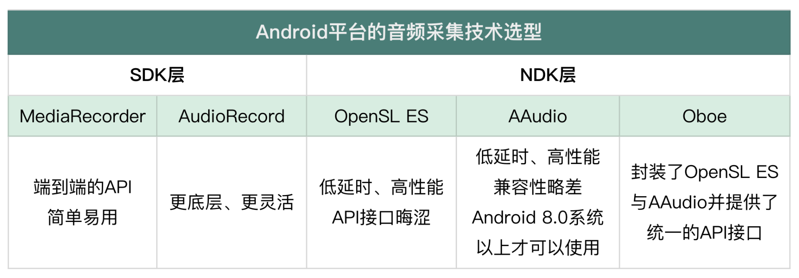
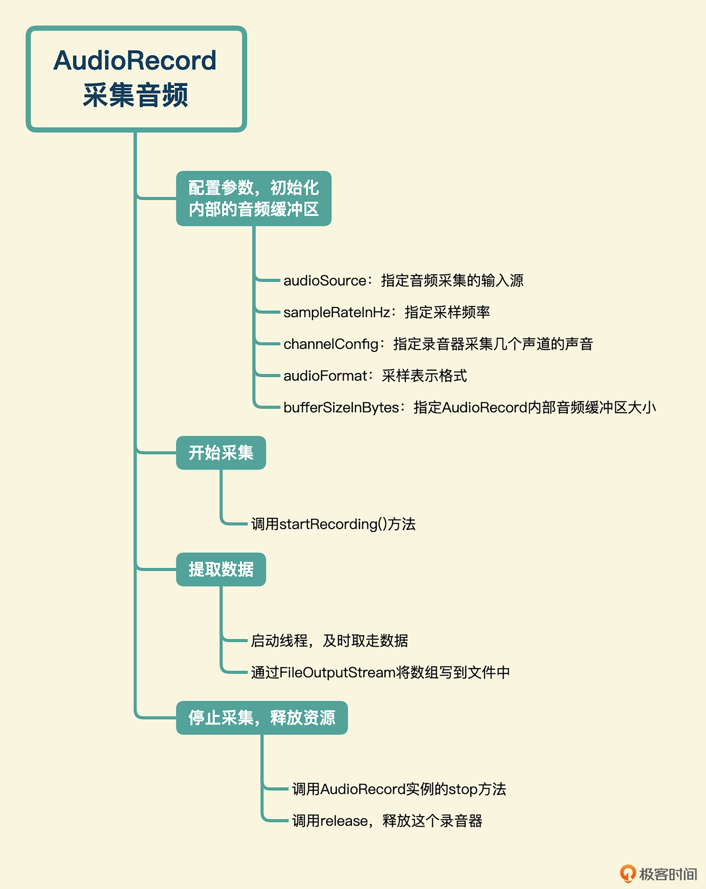
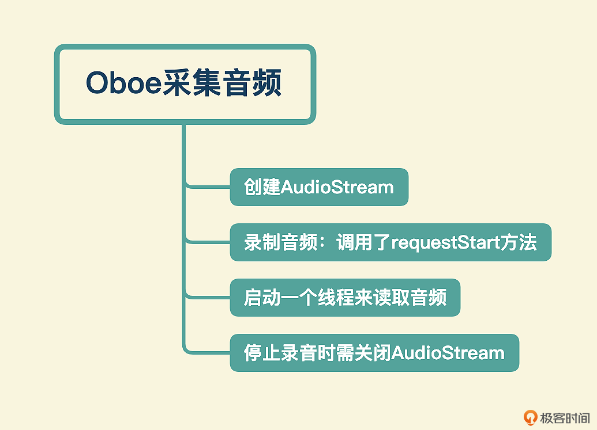
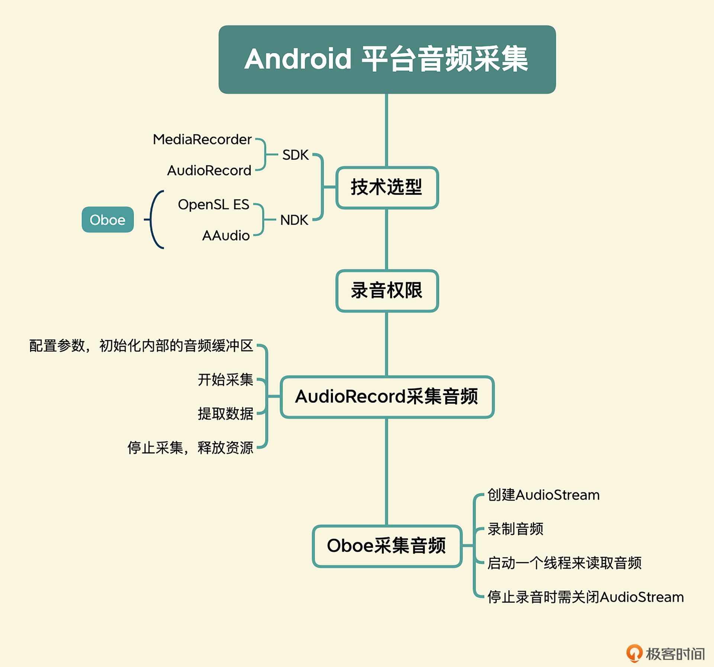

# 11 | Android平台音频采集：如何使用AudioRecord和Oboe采集音频？

你好，我是展晓凯。今天我们来一起学习 Android 平台的音频采集。

视频播放器是将一个视频文件通过解封装、解码、渲染等工作，让用户可以听到声音、看到画面，而视频录制器恰恰是一个逆向的过程，是将麦克风采集到的声音、摄像头采集到的画面通过编码、封装，最终得到一个视频文件。所以整个项目的前置知识包括音视频的采集、编码还有音视频同步等，上一节课我们一起学习了 iOS 平台的音频采集方法，这节课我们就一起来看 Android 平台给我们提供了哪些音频采集的方法吧。

## Android 平台的音频采集技术选型



### SDK 层提供的采集方法

Android SDK 提供了两套音频采集的 API 接口，分别是 MediaRecorder 和 AudioRecord。前者是一个端到端的 API，它可以直接把手机麦克风录入的音频数据进行编码压缩（如 AMR、MP3 等）并存储成文件；而后者则更底层一些，可以让开发者更加灵活地控制麦克风采集到的 PCM 数据。

如果想简单地做一个录音机，并且录制出一个音频文件，首选肯定是 MediaRecorder，而如果需要对音频做进一步的算法处理，或者需要采用第三方的编码库进行编码压缩，那么就需要使用 AudioRecord 了。我们的视频录制器场景显然更适合选用第二种方式，使用 AudioRecord来采集音频。

### NDK 层提供的采集方法

Android NDK 也提供了两套音频采集的 API 接口，就是 OpenSL ES 和 AAudio，其中 AAudio是在 Android 8.0 系统以上才可以使用的。这两个 API 接口也都属于底层接口，可以获取实时采集到的 PCM 数据。相比于 AudioRecord，Native 层提供的采集方法具有更低的延迟与更高的性能，但是由于 Android 设备与系统厂商碎片化的问题，兼容性比不上 AudioRecord，比如某些品牌的手机上会有声音采集音量过小，采集的音频有杂音等问题。

如果在一些需要低延迟音频采集的场景比较适合使用这两个音频采集的方法，比如实时耳返场景、更低延迟的 VOIP 场景等。如果想为自己的工程构建音频采集框架，是需要同时支持SDK 层 AudioRecord 采集和 Native 层采集的。而在 Native 层直接使用 Google 开源的 Oboe框架是一个比较好的选择，因为它屏蔽掉了 OpenSL ES 与 AAudio 的内部实现细节，提供了统一的 API 接口。所以在这节课的最后一部分，我会以 Oboe 为例给你讲解 Native 层录制音频的方法。

### 录音权限

其实无论是 SDK 层还是 NDK 层的音频采集，Android 平台都要求，在采集之前应用必须要向用户显示申请权限，所以这里我们还需要了解一下，应用如何在 Android 平台获取录音权限。

首先，需要在 AndroidManifest.xml 这个应用的配置文件中，增加权限的声明。

```xml
<uses-permission android:name="android.permission.RECORD_AUDIO" />
```

如果我们在获取到 PCM 数据之后，还要把数据写入 SDCard 中，就需要额外申请系统的文件权限。声明好了之后，就需要检查当前的授权状态。如果已经授权了，可以直接开启录音器采集音频。如果没有授权的话，就需要去申请授权。

```
if(ContextCompat.checkSelfPermission(this, android.Manifest.permission.RECORD_AUD
                       != PackageManager.PERMISSION_GRANTED){
 //未授权，则进行申请权限
 ActivityCompat.requestPermissions(this,new String[]{android.Manifest.permission
}else {
 //已经授权，可以开启录音器
}
```

申请授权的代码中，第一个参数传递的是一个 Activity 类型的对象，申请授权一般是用系统的弹窗来提示用户，应用索取录音权限，是否同意授权，用户的授权状态会回调给这个对象的方法 onRequestPermissionsResult。

```java
public static void requestPermission(@NonNull Activity activity, int requestCode,
   @Nullable PermissionGrantCallback callback) {
   //判断是否授权了
}
```

如果已获得授权一般 requestCode 是 1，permissions 里面包含了用户赋予应用的所有权限，可以在这里再判断一下用户是否给予了录音权限，如果确认授权了就可以执行录音操作，如果没有获得权限就可以给用户提示。

当我们取得内存中的 PCM 数据之后该如何处理呢？

其实在多媒体 App 中一般会进行声音特效处理，然后把它编码成一个 AAC 或者 MP3 文件。至于音频的处理部分这节课我们暂不涉及，音频的编码我们下节课会进行讲解，这里我们就简单地写到一个 PCM 文件中。在录制结束之后，可以从 SD 卡中拿出这个 PCM 文件，然后使用 ffplay 进行播放来试听效果。接下来我们就先看一下 SDK 层的 AudioRecord 采集音频吧。

## AudioRecord 采集音频

AudioRecord 是 Android 平台兼容性最好的音频采集方法，熟练地使用它可以为你的 App 带来最稳定的音频采集能力。使用方法分为四个步骤。



1. 配置参数，初始化内部的音频缓冲区

我们先来看一下 AudioRecord 的参数配置，AudioRecord 是通过构造函数来进行配置的，构造函数原型如下：

```
public AudioRecord(int audioSource, int sampleRateInHz, int channelConfig, int
       audioFormat, int bufferSizeInBytes).
```

我们来看下构造函数中参数代表的含义，以及在各种场景下应该传递的值具体说明。

audioSource 参数指定的是音频采集的输入源，可选值以常量的形式定义在类 AudioSource（MediaRecorder 的一个内部类）中，常用的可选值如下：

- DEFAULT，代表使用默认的麦克风采集。

- CAMCORDER，使用和摄像头同方向的麦克风采集。

- VOICE_RECOGNITION，一般用于语音识别场景。

- MIC，代表使用手机的主麦克风作为采集的输入源。

- VOICE_COMMUNICATION，在 VOIP 场景下如果使用硬件 AEC 的话，可以设置这个参数。

sampleRateInHz，用来指定采用多大的采样频率来采集音频，现在用得最多的就是 44100 或者 48000 的采样频率。因为根据奈奎斯特采样定律，只有这两个采样频率在做 AD/DA 转换的时候才能还原出 20K 以上的音频。如果使用这个采样率初始化录音器失败的话，则可以使用16000 的采样频率（就是我们经常说的 16k 的采样率）来兜一下底。

channelConfig，这个参数用来指定录音器采集几个声道的声音，可选值以常量的形式定义在AudioFormat 类中，常用的值包括：CHANNEL_IN_MONO 单声道采集和CHANNEL_IN_STEREO 立体声采集。

由于现在的移动设备都是伪立体声的采集，所以考虑到性能，一般按照单声道进行采集，然后在音频处理阶段转换为立体声效果。当然在某些需要立体声输入的场景（外接声卡输入 /USB麦克风），可以设置为立体声。

audioFormat，就是基础概念里我们介绍过的采样表示格式，可选值以常量的形式定义在AudioFormat 类中，常用的值包括：ENCODING_PCM_16BIT，使用 16 位或者 2 个字节来表示一个采样点，还有 ENCODING_PCM_8BIT，代表使用 8 位或者 1 个字节来表示一个采样点。前者可以保证兼容大部分的 Android 手机，一般都采用 16BIT。

bufferSizeInBytes，这是最难理解但又很重要的一个参数，用来指定 AudioRecord 内部音频缓冲区的大小。而具体的大小，不同厂商会有不同的实现，这个音频缓冲区越小，录音的延时就会越小。

AudioRecord 类提供了一个静态方法，帮助开发者来确定这个 bufferSizeInBytes 的函数，原型如下：

```
int getMinBufferSize(int sampleRateInHz, int channelConfig, int audioFormat);
```

在实际开发中，一定要通过这个函数计算需要传入的 bufferSizeInBytes。

配置好 AudioRecord 之后，要检查一下当前 AudioRecord 的状态，因为有可能会因为权限或者参数的问题，使构造的 AudioRecord 状态异常。那如何检查录音的状态呢？我们可以通过AudioRecord 的方法 getState 来获取当前状态，然后和 AudioRecord.STATE_INITAILIZED进行比较。如果相等，才可以开启采集，否则应该提示给用户。

2. 开始采集

走到这一阶段，说明已经创建好 AudioRecord 的实例了，并且状态也是正确的，接下来我们调用 startRecording() 方法来采集音频。

```
audioRecord.startRecording();
```

3. 提取数据

与 AudioTrack 的使用方法类似，读取音频录音器采集到的音频，需要开发者自己启动一个线程，不断地从 AudioRecord 的缓冲区将音频数据读出来。注意，这个过程一定要及时，否则控制台会打印“overrun”的错误，这个错误在音频开发中比较常见，意味着应用层没有及时地“取走”音频数据，导致内部的音频缓冲区溢出。读取录音器采集到的 PCM 数据的方法原型如下：

```
public int read(byte[] audioData, int offsetInBytes, int sizeInBytes)
```

当然，也可以读取 short 数组类型的数据，因为这更符合音频采样点的表示，毕竟我们设置的是每个 sample 都是由两个字节来表示，方法原型如下：

```
public int read(short[] audioData, int offsetInShorts, int sizeInShorts)
```

拿到数据之后，就可以通过 Java 层提供的 FileOutputStream 直接将数组写到文件中。

4. 停止采集，释放资源

当我们想停止音频采集的时候，需要调用 AudioRecord 实例的 stop 方法，并且最终要对这个AudioRecord 的实例调用 release，来释放这个录音器，以便设备的其他应用可以正常使用录音器。一般通用的写法是通过调用个布尔型变量控制读取数据的线程结束，然后再停止和释放AudioRecord 实例。最后还要关闭写入数据的文件，否则会有文件写出不完全的问题。

当拿到一个写出的 PCM 文件，我们应该如何播放呢？因为 PCM 文件就是一个二进制文件，如果不知道这个 PCM 文件的表示格式，是无法播放的。而我们这个 PCM 文件的表示格式是44100 的采样率、单声道、16 位表示一个采样点，那么使用 ffplay 来播放这个 PCM 文件的命令如下：

```
ffplay -f s16le  -sample_rate 44100  -channels 1 -i vocal.pcm
```

而我们常见的 WAV 文件就是将 PCM 文件的表示格式放到 WAV 协议定义的一个头里面，我们也可以利用 FFmpeg 将 PCM 文件转换为 WAV 文件，然后使用 PC 上的系统播放器进行播放，转换命令行如下：

```
ffmpeg -f s16le -sample_rate 44100 -channels 1 -i vocal.pcm -acodec pcm_s16le voc
```

## Oboe 采集音频

关于 Oboe 的介绍，以及如何集成 Oboe 到我们的工程中，我们第 3 节课使用 Oboe 来做音频渲染的时候已经讲过，你可以先回顾一下，这里我们就不再重复了。接下来，我们直接看如何使用 Oboe 采集音频。



1. 创建 AudioStream

和音频的渲染一样，我们通过 AudioStreamBuilder 来创建 Stream，不同点是 Direction 这里我们要设置成 Input，代表我们要创建录音器。

```
oboe::AudioStreamBuilder builder;
builder.setPerformanceMode(oboe::PerformanceMode::LowLatency)
 ->setDirection(oboe::Direction::Input)//录制的设置
 ->setSharingMode(oboe::SharingMode::Shared)
 ->setChannelCount(oboe::ChannelCount::Mono)//单声道采集
 ->setFormat(oboe::AudioFormat::I16);//格式采用I16，范围为[-32768, 32767]
```

最终调用 openStream 来打开 Stream，和音频渲染一样，也是根据返回值来判断是否创建成功，如果创建失败了，可以使用 convertToText 来查看错误码。

```
oboe::Result result = builder.openStream(mStream);
if (result != oboe::Result::OK) {
 LOGE("Failed to create stream. Error: %s", convertToText(result));
}
```

2. 录制音频

调用了 requestStart 方法，当采集到音频之后就会回调设置的 Callback 函数。

```
mStream->requestStart();
```

3. 启动一个线程来读取音频

```
oboe::ResultWithValue<int32_t> result = mInputStream->read(mInputBuffer.get(), nu
if (!result) {
   //结束
} else {
   int32_t framesRead = result.value();
   //TODO 写入文件
}
```

在这里读取出一部分数据就可以写入文件了。

4. 当停止录音的时候需要关闭 AudioStream

```
mStream->requestStop();
mStream->close();
```

到这里，Oboe 录制音频的方法我们也就讲完了，最终得到的 PCM 文件也可以使用 ffplay 进行播放，使用这个方法来检查一下你录音器是否录制成功了吧。

当然，在一些低性能手机上，写文件还是要在异步线程中去写，否则就会阻碍录制器的录制线程。

## 小结

最后，我们可以一起来回顾一下。



Android 平台音频采集的技术选型，在 SDK 层和 NDK 层各有两套音频采集方法，考虑到我们的视频录制器的场景，我们选取了 SDK 层的 AudioRecord 和 Native 层的 Oboe 采集音频的方法。

- AudioRecord 采集音频主要分为配置参数，初始化内部音频缓冲区、采集、提取数据，以及停止采集，释放资源四步。

- 使用 Oboe 录制音频也分为四步，分别是创建 Audio Stream、录制、启动线程读取音频、停止录音时关闭 Audio Stream。

每一步我都给出了相应的代码示例，相信你跟着我做，也能成功录制音频。通过音频的录制我们已经得到设备采集到的 PCM 声音了。但是 PCM 数据是非常大的，比如 CD 音质的 PCM数据一般表示格式为：44100 采样率、双声道、每个采样点用 16 位来表示，那 1 分钟 CD 音质的 PCM 数据大小就是 10.09MB。

## 44100 × 16 × 2 × 60 ÷ 8 ÷ 1024 = 10.09MB

这么大的数据要想进行存储及网络传输是不现实的，需要对音频进行压缩编码，下节课我会带着你学习音频编码方面的内容。

## 思考题

在一些 K 歌的 App，比如回森中有一个功能是实时耳返功能，它可以让带有线耳机的用户在演唱歌曲的同时，在耳机中听到自己的声音，要想实现这个功能肯定需要将采集到的音频立马播放出来。而这里面的难点就是低延迟，因为如果延迟高了用户跟着伴奏演唱是非常糟糕的体验。那如果让你来实现这个功能，应该怎么实现呢？欢迎在评论区分享你的思考，也欢迎你把这节课分享给更多对音视频感兴趣的朋友，我们一起交流、共同进步。下节课再见！
