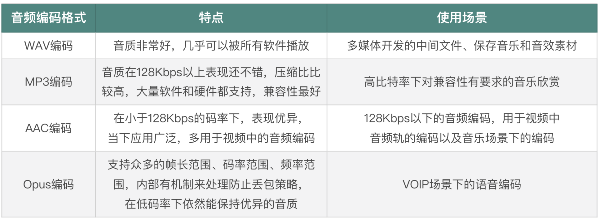
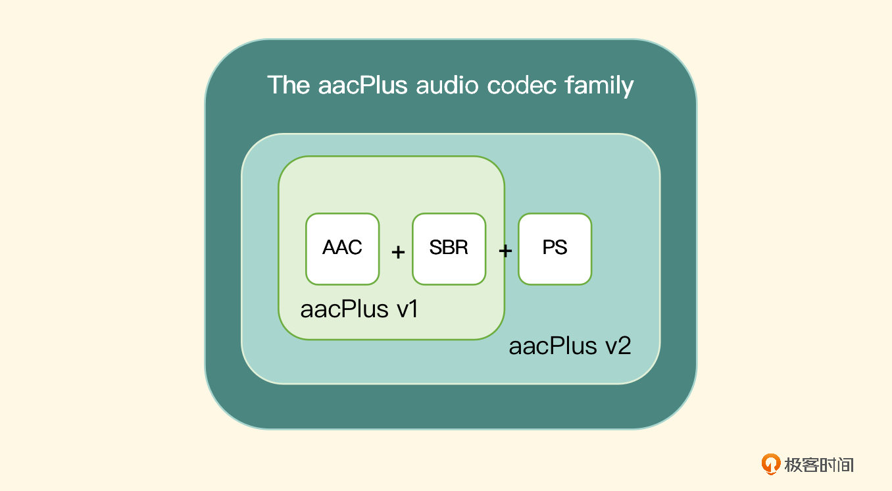
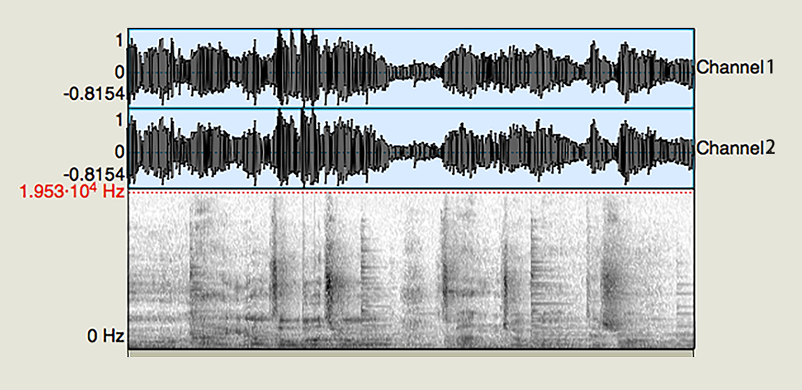
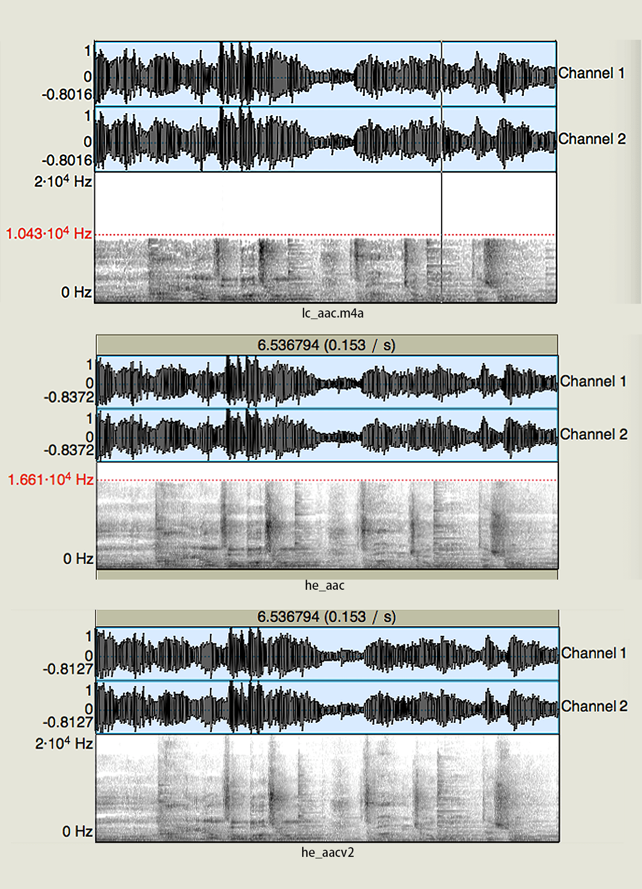
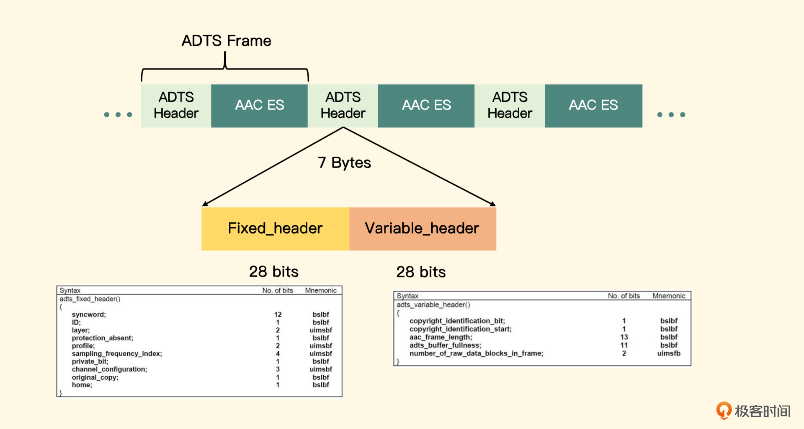
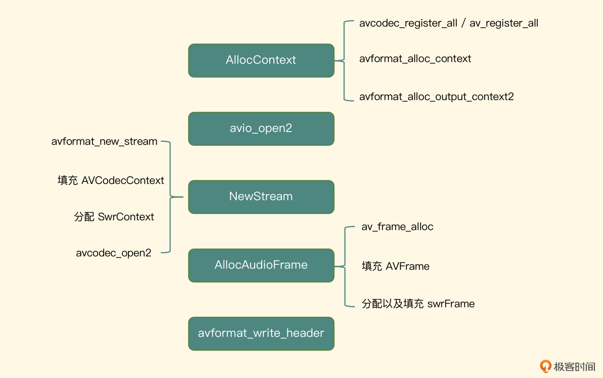
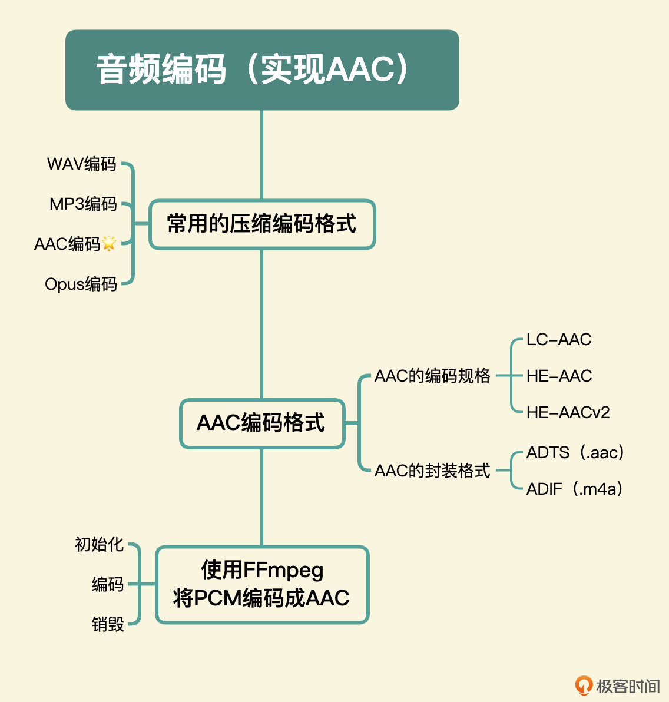

# 12 | 如何编码出一个AAC文件？

你好，我是展晓凯。今天我们来一起学习移动平台的音频编码。

上节课，我们提到过 CD 音质的数据每分钟需要的存储空间约为 10.1MB，如果仅仅是要放在存储设备（光盘、硬盘）中，可能是可以接受的，但是一旦在线传输的话，这个数据量就太大了，所以我们必须对其进行压缩编码。

压缩编码的基本指标之一就是压缩比，压缩比通常小于 1。压缩算法分为有损压缩和无损压缩。无损压缩就是解压后数据可以完全复原，比如我们常见的 Zip 压缩；在音视频领域我们用得比较多的是有损压缩，有损压缩指解压后的数据不能完全复原，会丢失一部分信息。压缩比越小，丢掉的信息越多，信号还原后失真越大。

根据不同的应用场景（从存储设备、传输网络环境、播放设备等角度综合考虑），我们可以选用不同的压缩编码算法，如 WAV、MP3、AAC、OPUS 等。压缩编码的原理实际上是压缩掉冗余信号。在音频中冗余信号指的是不容易被人耳感知到的信号，包含人耳听觉范围外的音频信号以及被掩蔽掉的音频信号等。

人耳听觉范围是 20～20kHz，被掩蔽掉的音频信号指的是由于人耳的掩蔽效应不被察觉的信号，主要表现为频域掩蔽效应与时域掩蔽效应，无论在时域还是频域上，被掩蔽掉的声音信号都被认为是冗余信息，也不进行编码处理。

## 常见的音频编码格式

了解了音频编码的原理，下面我们来详细看一下几种常用的压缩编码格式。

- WAV 编码

PCM 脉冲编码调制是 Pulse Code Modulation 的缩写。前面我们提到了 PCM 大致的工作流程，而 WAV 编码的一种实现（有多种实现，但是都不会进行压缩操作）就是在 PCM 数据格式的前面加上 44 个字节，分别用来描述 PCM 的采样率、声道数、数据格式等信息。

WAV 编码的特点是音质非常好，几乎可以被所有软件播放，适用于多媒体开发的中间文件、保存音乐和音效素材。

- MP3 编码

MP3 具有不错的压缩比，使用 LAME 编码（最常使用的一种 MP3 编码器）的中高码率（320Kbps 左右）的 MP3，听感上非常接近 WAV 源文件，当然在不同的应用场景下，我们自己应该调整合适的参数来达到最好的效果。

MP3 编码的特点是音质在 128Kbps 以上表现还不错，压缩比比较高，大量软件和硬件都支持，兼容性最好，适用于高比特率下对兼容性有要求的音乐欣赏。

- AAC 编码

AAC 是新一代的音频有损压缩技术，它通过一些附加的编码技术，如 SBR、PS 等，衍生出了 LC-AAC、HE-AAC、HE-AACv2 三种主要的编码规格（Profile）。LC-AAC 就是比较传统的

## ≥80Kbps

AAC，主要用在中高码率的场景编码（

- ）；HE-AAC，相当于 AAC+SBR，主要用

## ≤80Kbps

- ）；而 HE-AACv2，相当于 AAC+SBR+PS，主要用于双声

在中低码率场景编码（

## ≤48Kbps

道、低码率场景下的编码（

- ）。

事实上，大部分 AAC 编码器的实现中，将码率设成小于等于 48Kbps 会自动启用 PS 技术，而大于 48Kbps 就不加 PS，就相当于普通的 HE-AAC。

AAC 编码的特点是在小于 128Kbps 的码率下，表现优异，当下应用广泛，多用于 128Kbps以下的音频编码、视频中音频轨的编码以及音乐场景下的编码。

- Opus 编码

Opus 集成了以语音编码为导向的 SILK 和低延迟编码为导向的 CELT，所以它同时具有这两者的优点，可以无缝调节高低码率。在较低码率时，使用线性预测编码，在高码率时使用变换编码。

Opus 具有非常低的算法延迟，最低可以做到 5ms 的延迟，默认为 22.5 ms，非常适合用在低延迟语音通话场景。与 MP3、AAC 等常见格式相比，在低码率（64Kbps 及以下）场景下，Opus 具有更好的音质表现，同时也有更低的延迟表现。WebRTC 中采用的音频默认编码就是Opus 编码，并且在 Opus 编码的协议中，开发者也可以加入自己的增强信息（类似于 H264中的 SEI）用于一些场景功能的扩展。

Opus 编码的特点是支持众多的帧长范围、码率范围、频率范围，内部有机制，来处理防止丢包策略，在低码率下依然能保持优异的音质。它主要适用于 VOIP 场景下的语音编码。



在移动平台上，无论是单独的音频编码，还是视频编码中的音频流的编码，用得最广泛的就是AAC 这一编码格式。所以我们这节课来重点学习一下音频的 AAC 编码。

AAC 编码的方式有两种，一种是使用软件编码，另一种是使用 Android 与 iOS 平台的硬件编码。软件编码的实现方式我们会基于 FFmpeg 来讲解，后期无论你想用什么格式，都可以自己配置编码库来实现，编码部分的代码是可以复用的。这节课的输入是我们前两节课用录音器采集下来的 PCM 文件，最终编码成一个 AAC 编码格式的 M4A 文件。

在学习使用软件编码器编码 AAC 之前，让我们先来系统了解 AAC 这种编码格式，底层编码原理与算法我们就不介绍了，但是站在应用层角度我们要学习一下它的编码规格和封装格式，让我们一起来看一下吧。

## AAC 编码格式详解

对于音视频应用层的开发者来讲，还是要掌握编码器本身的一些高级特性的，在 AAC 这个编码中，我们需要重点掌握的就是它的编码规格和封装格式。

### AAC 的编码规格

AAC 编码器常用的编码规格有三种，分别是 LC-AAC、HE-AAC、HE-AACv2，这三种编码规格以及使用的消除冗余的技术手段如下图所示。



其中 LC-AAC 的 Profile 是最基础的 AAC 的编码规格，它的复杂度最低，兼容性也是最好的，双声道音乐在 128Kbps 的码率下可以达到全频带（44.1kHz）的覆盖。

在 LC-AAC 的基础上添加 SBR 技术，形成 HE-AAC 的编码规格，SBR 全称是 Spectral BandReplication，其实就是消除频域上的冗余信息，可以在降低码率的情况下保持音质。内部实现原理就是把频谱切割开，低频单独编码保存，来保留主要的频谱部分，高频单独放大编码保存以保留音质，这样就保证在降低码率的情况下，更大程度地保留了音质。

在 HE-AAC 的基础上添加 PS 技术，就形成了 HE-AACv2 的编码规格，PS 全称是Parametric Stereo，其实就是消除立体声中左右声道之间的冗余信息，所以使用这个编码规格编码的源文件必须是双声道的。内部实现原理就是存储了一个声道的全量信息，然后再花很少的字节用参数描述另一个声道和全量信息声道有差异的地方，这样就达到了在 HE-AAC 基础上进一步提高压缩比的效果。

我们使用 FFmpeg 命令行，用不同的编码规格，来把同一个输入文件编码成为三个文件，然后使用可视化的音频分析软件 Praat 看一下它们的质量，我们先来看一下原始文件source.wav（双声道、采样率为 44.1kHz）导入到 Praat 中的频谱分布。



可以看到图片中高频的部分到了 22050，根据奈奎斯特采样定律，编码之后频带分布到 22050就是全频带分布（原始格式 44.1kHz），使用下面命令来编码文件。

```
ffmpeg -i source.wav -acodec libfdk_aac -b:a 48K lc_aac.m4a
ffmpeg -i source.wav -acodec libfdk_aac -profile:a aac_he -b:a 48K he_aac.m4a
ffmpeg -i source.wav -acodec libfdk_aac -profile:a aac_he_v2 -b:a 48K he_v2_aac.m
```

这三行命令使用的都是 libfdk_aac 编码器，但是用了不同编码器规格，编码出了三个 M4A 文件。接下来我们把三个文件放到 Praat 中，如下图。



可以看到 lc_aac.m4a 的频带分布到了 10KHz 就被截断了，对高频部分影响比较大；而he_aac 这个文件的截止频率大约到 16KHz 以上，明显要比第一个好很多；再看第三个文件几乎达到了全频带覆盖，结合之前介绍的原理你就知道为什么这种编码规格可以达到全频带覆盖了。

AAC 编码器的这三种编码规格之间的差异我们了解清楚之后，就可以根据自己的应用场景选择不同的编码规格和码率。

### AAC 的封装格式

我们日常生活中常见的 AAC 编码的封装格式有两种，一种是 ADTS 封装格式，可以简单理解为以 AAC 为后缀名的文件，另外一种是 ADIF 封装格式，可以简单地理解为以 M4A 为后缀名的文件。

ADIF 全称是 Audio Data Interchange Format，是 AAC 定义在 MPEG4 里面的格式，字面意思是交换格式，是将整个流的 Meta 信息（包括 AAC 流的声道、采样率、规格、时长）写到头部，解码器只有解析了头部信息之后才可以解码具体的音频帧，像 M4A 封装格式、FLV 封装格式、MP4 封装格式都是这样的。

ADTS 全称是 Audio Data Transport Stream，是 AAC 定义在 MPEG2 里面的格式，含义就是传输流格式，特点就是从流中的任意帧位置都可以直接进行解码。这种格式实现的原理是在每一帧 AAC 原始数据块的前面都会加上一个头信息（ADTS+ES），形成一个音频帧，然后不断地写入文件中形成一个完整可播放的 AAC 文件。



如图所示，ADTS 头分为固定头和可变头两部分，各自需要 28 位来表示，要构造一个 ADTS头其实就是分配好这 7 个字节，下面我们来分配一下这七个字节。

```
int adtsLength = 7;
char *packet = malloc(sizeof(char) * adtsLength);
packet[0] = (char)0xFF;
packet[1] = (char)0xF9;
```

前 12 位表示同步字，固定为全 1，表示为[11111111], [1111]；接下来的 4 位表示的是 ID，我们这里是 ADTS 的封装格式 ID，也就是 1；Layer 一般固定是 00，protection_absent 代表是否进行误码校验，这里我们填 1，所以前 2 个字节就是 [11111111] [11111001]，也就是代码上的两个 Char 类型的数字了。

下面我们不再一一分析每一位是怎么构造的了，直接以字节来讲解。后边的字节是编码规格、采样率下标（注意是下标，而不是采样率）、声道配置（注意是声道配置，而不是声道数）、数据长度的组合（注意 packetLen 是原始数据长度加上 ADTS 头的长度），最后一个字节一般也是固定的代码，如下：

```
int profile = 2; // AAC LC
int freqIdx = 4; // 44.1KHz
int chanCfg = 2; // CPE
packet[2] = (byte) (((profile - 1) << 6) + (freqIdx << 2) + (chanCfg >> 2));
packet[3] = (byte) (((chanCfg & 3) << 6) + (packetLen >> 11));
packet[4] = (byte) ((packetLen & 0x7FF) >> 3);
packet[5] = (byte) (((packetLen & 7) << 5) + 0x1F);
packet[6] = (char) 0xFC;
```

这里具体的编码 Profile、采样率的下标以及声道数配置，可以点击链接查看相关的所有表示。一般编码器（Android 的 MediaCodec 或者 iOS 的 AudioToolbox）编码出来的 AAC 原始数据块我们称为 ES 流，需要在前面加上 ADTS 的头，才可以形成可播放的 AAC 文件，下节课我们就会用到。对于这种 ADTS 的压缩音频帧，也可以直接使用 FFmpeg 封装成 M4A 格式的文件。

在 FFmpeg 中，有一个类型的 Filter 叫做 bit stream filter，主要是应用在一些编码格式的转封装行为中。对于 AAC 编码上述的两种封装格式，FFmpeg 提供了 aac_adtstoasc 类型的 bitstream filter，用来把 ADTS 格式的压缩包（AVPacket）转换成 ADIF 格式的压缩包（Packet）。使用这个 Filter 可以很方便地完成 AAC 到 M4A 封装格式的转换，不用重新进行解码编码的操作，FFmpeg 帮助开发者隐藏掉了实现细节，并且提供了更好的代码可读性。

了解了 AAC 的封装格式之后，我们就来学习如何使用 FFmpeg 来将 PCM 编码成 AAC 格式。

## 使用软件编码器编码 AAC

我们用 FFmpeg 的 API 来编写的主要原因是，如果我们以后想使用别的编码格式，只需要调整相应的编码器 ID 或者编码器 Name 就可以了。原理就是 FFmpeg 帮我们透明掉了内部的细节，做了和各家编码器 API 对接的工作，给开发者暴露出了统一的面向 FFmpeg API 的接口。这里使用的编码器是 libfdk_aac，既然要使用第三方库 libfdk_aac，那么就必须在做交叉编译的时候，将 libfdk_aac 这个库编译到 FFmpeg 中去。

由于我们想书写一个同时运行在 Andorid 平台和 iOS 平台上编码器工具类，所以构造一个C++ 的类，叫做 audio_encoder，向外暴露三个接口，分别是初始化、编码以及销毁方法。下面我会向你详细讲解每一个接口定义、职责描述以及内部实现（实现会根据 FFmpeg 版本不同稍有不同，FFmpeg5.0 以上改动较大）。

### 初始化

初始化接口定义如下：

```javascript
int init(int bitRate, int channels, int sampleRate, int bitsPerSample,
     const char* aacFilePath, const char * codec_name);
```

第一个参数是比特率，也就是最终编码出来的文件的码率，码率越高音质也就越好，对于双声道的音频，一般我们设置 128Kb 就可以了；接下来的参数是声道数、采样率和位深度；然后是最终编码的文件路径；最后是编码器的名字。注意，最后两个参数是有关联的，比如 M4A文件要填入一个 AAC 的编码器（libfdk_aac）名称、MP3 文件要传入一个 MP3 编码器（lame）的名称。

这个接口内部会拿着这些信息把编码器初始化，如果编码器初始化成功，则返回 0，失败则返回小于 0 的值。接口内部的核心实现如下：



调用 avformat_alloc_context 方法分配出封装格式，然后调用avformat_alloc_output_context2 传入输出文件格式，分配出上下文，即分配出封装格。之后调用 avio_open2 方法将 AAC 的编码路径传入，相当于打开文件连接通道。这样就可以确定Muxer 与 Protocol 了。

有了容器之后，就应该向容器中添加音频轨了，调用 avformat_new_stream 传入刚才的FormatContext 构建出一个音频流（AVStream），接着要为这个 Stream 分配一个编码器，编码器是一个 AVCodecContext 类型的结构体，先调用 avcodec_find_encoder_by_name 函数，根据编码器名称找出对应的编码器，接着根据编码器分配出编码器上下文，然后给编码器上下文填充以下几个属性。

- 首先是 codec_type，赋值为 AVMEDIA_TYPE_AUDIO，代表音频类型；

- 其次是 bit_rate、sample_rate、channels 等基本属性；

- 然后是 channel_layout，可选值是两个常量 AV_CH_LAYOUT_MONO 代表单声道、AV_CH_LAYOUT_STEREO 代表立体声；

- 最后也是最重要的 sample_fmt，代表采样格式，使用的是 AV_SAMPLE_FMT_S16，即用2 个字节来表示一个采样点。

这样，我们就把 AVCodecContext 这个结构体构造完成了，然后还可以设置 profile，这里可以设置 FF_PROFILE_AAC_LOW。最后调用 avcodec_open2 来打开这个编码器上下文，接下来为编码器指定 frame_size 的大小，一般指定 1024 作为一帧的大小，现在我们就把音频轨以及这个音频轨里面编码器部分给打开了。

这里需要注意一下，某些编码器只允许特定格式的 PCM 作为输入源，比如对声道数、采样率、表示格式（比如 lame 编码器就不允许 SInt16 的表示格式）是有要求的。这时候就需要构造一个重采样器，来将 PCM 数据转换为可适配编码器输入的 PCM 数据，就是前面讲过的需要将输入的声道、采样率、表示格式和输出的声道、采样率、表示格式，传递给初始化方法，然后分配出重采样上下文 SwrContext。

接下来还要分配一个 AVFrame 类型的 inputFrame，作为客户端代码输入的 PCM 数据存放的地方，这里需要知道 inputFrame 分配的 buffer 的大小，默认一帧大小是 1024，所以对应的buffer（按照 uint8_t 类型作为一个元素来分配）大小就应该是：

```
bufferSize = frame_size * sizeof(SInt16) * channels;
```

也可以调用 FFmpeg 提供的方法 av_samples_get_buffer_size，来帮助开发者计算，其实这个方法内部的计算公式就是上面所列的公式。如果需要重采样的处理的话，也需要额外分配一个重采样之后的 AVFrame 类型的 swrFrame，作为最终得到结果的 AVFrame。

在初始化方法的最后，需要调用 FFmpeg 提供的方法 avformat_write_header 将这个音频文件的 Header 部分写进去，然后记录一个标志 isWriteHeaderSuccess，使其为 true，因为后续在销毁资源的阶段，需要根据这个标志来判断是否调用 write trailer 方法写入文件尾部。

### 编码方法

编码接口定义如下：

```
void encode(byte* buffer, int size);
```

传入的参数是 uint8_t 类型数组和它的长度，这个接口的职责就是将传递进来的 PCM 数据编码并写到文件中。接口内部实现就是将这个 buffer 填充入 inputFrame，因为前面我们已经知道每一帧 buffer 需要填充的大小是多少了，所以这里可以利用一个 while 循环来做数据的缓冲，一次性填充到 AVFrame 中去。

调用 avcodec_send_frame，当返回值大于 0 的时候，再调用 avcodec_receive_packet 来得到编码后的数据 AVPacket，然后调用 av_interleaved_write_frame 方法，就可以将这个packet 写到最终的文件中去。

### 销毁方法

接口定义如下：

```
void destroy();
```

这个方法需要销毁前面分配的资源以及打开的连接通道。如果初始化了重采样器，那么就销毁重采样的数据缓冲区以及重采样上下文；然后销毁为输入 PCM 数据分配的 AVFrame 类型的inputFrame，再判断标志 isWriteHeaderSuccess 变量，决定是否需要填充 duration 以及调用方法 av_write_trailer，然后关闭编码器和连接通道，最终释放 FormatContext。

这个类写完之后，就可以集成到 Android 和 iOS 平台了，外界控制层需要初始化这个类，然后负责读写文件调用 encode 方法，最终调用销毁资源方法。

这节课涉及的代码比较多，后续我会把代码实例上传到 GitHub 上，你可以对着代码再进行练习一下。

## 小结

最后，我们可以一起来回顾一下。



一般我们采集得到的原始数据都会比较大，需要我们后期进行压缩编码。目前常用的编码格式有 AAC、MP3、WAV、Opus 几种，其中 WAV 格式编码是最常见的，MP3 格式是兼容性最好的，而 AAC 在低码率（128Kb 以下）场景下，音质大大超过 MP3。目前在音视频开发领域，用得最广泛的就是 AAC 编码格式。

这节课，我们用 FFmpeg 实现了一个编码 AAC 文件的工具类，并且这个音频编码的工具类不单单可以用到编码 AAC 格式中，同时支持后续的其他编码，比如 WAV 编码和 MP3 编码等。在 Android 和 iOS 平台上都提供了各自的硬件编码器用于音频编码，下节课我会给你讲一讲怎么使用这两个平台的硬件编码器来给音频编码，一起期待一下吧！

## 思考题

这节课我们一起学习了 AAC 的编码格式，并且一起书写了一个用 FFmpeg 来编码 AAC 的工具类，上节课我们也掌握了音频采集的方法，那如何将它们结合起来，做一个系统录音机呢？思考一下，描述出你的架构设计。

欢迎在评论区分享你的思考，也欢迎你把这节课分享给更多对音视频感兴趣的朋友，我们一起交流、共同进步。下节课再见！
